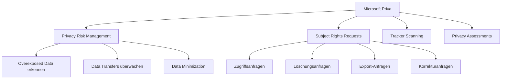
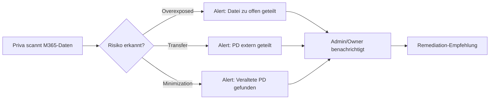
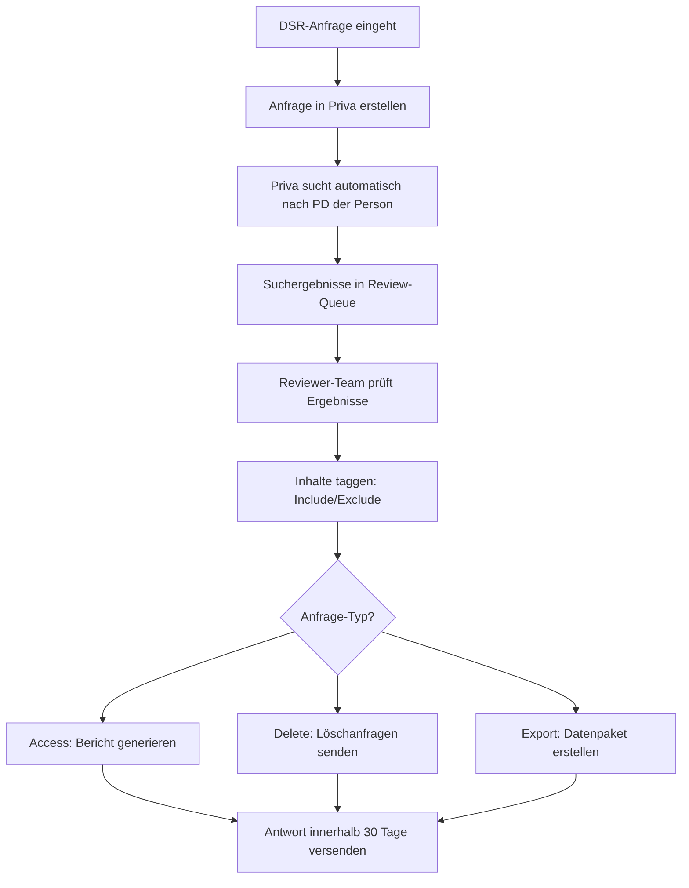
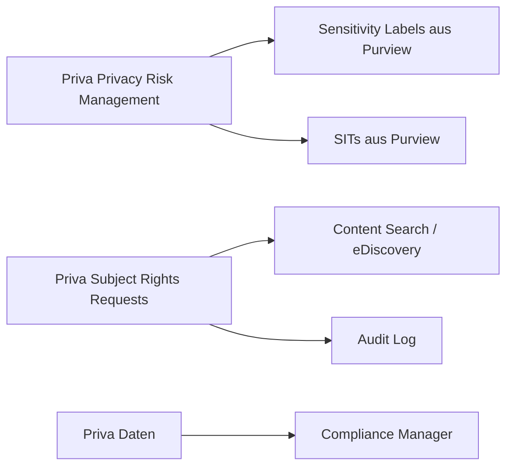

---
tags:
  - microsoft365
  - compliance
  - purview
  - datenschutz
  - dsgvo
  - priva
aliases:
  - Priva
  - Privacy Risk Management
  - Subject Rights Requests
---

# Microsoft Priva

> [!ABSTRACT] TL;DR
> Microsoft Priva ist Microsofts Privacy-Management-Lösung für Microsoft 365. Priva Privacy Risk Management erkennt Datenschutzrisiken in M365-Daten, Priva Subject Rights Requests automatisiert DSGVO-Betroffenenanfragen (DSR). Beide Produkte sind separat lizenziert und ergänzen die Compliance-Features in Purview.

---

## Was ist Microsoft Priva?

Microsoft Priva adressiert zwei zentrale Datenschutz-Herausforderungen:

1. **Proaktiv**: Datenschutzrisiken in M365-Daten erkennen und reduzieren (Privacy Risk Management)
2. **Reaktiv**: DSGVO-Betroffenenanfragen effizient bearbeiten (Subject Rights Requests)



---

## Priva Privacy Risk Management

### Was wird erkannt?

| Risikotyp | Beschreibung | Beispiel |
|-----------|-------------|---------|
| **Overexposed Data** | Persönliche Daten zu offen geteilt | Datei mit IBAN öffentlich in SharePoint |
| **Data Transfers** | PD an ungeeignete Empfänger | Mitarbeiterdaten an externe Domain |
| **Data Minimization** | Unnötig gespeicherte persönliche Daten | Alte Kundendaten ohne Retention Label |

### Wie Priva PD findet
Priva nutzt:
- **Sensitivity Labels** (bereits gelabelte Inhalte)
- **Sensitive Information Types** (automatische Erkennung)
- **ML-Klassifizierer** (kontextbasierte Erkennung)

Durchsucht wird:
- Exchange Online (E-Mails)
- SharePoint Online (Dokumente)
- OneDrive for Business (Dateien)
- Microsoft Teams (Dateien in Kanal-Bibliotheken)

### Richtlinien und Alerts



### Remediation-Aktionen
- **Sharing einschränken**: Externe Links entfernen
- **Label anwenden**: Sensitivity Label zuweisen
- **Besitzer benachrichtigen**: E-Mail an Dateibesitzer
- **Quarantäne**: Datei aus Sharing entfernen

### Dashboard und Reporting
Das Privacy Risk Management Dashboard zeigt:
- Anzahl gefundener persönlicher Daten-Items
- Risikotrends über Zeit
- Verteilung nach Risikotyp
- Empfohlene Maßnahmen

---

## Priva Subject Rights Requests

### DSGVO-Betroffenenrechte

Die DSGVO (Art. 15-22) gibt Betroffenen folgende Rechte:

| Recht | DSGVO-Artikel | Priva-Anfrage-Typ |
|-------|--------------|-----------------|
| **Auskunftsrecht** | Art. 15 | Access (Zugang) |
| **Recht auf Löschung** | Art. 17 | Delete (Löschung) |
| **Recht auf Datenübertragbarkeit** | Art. 20 | Export (Datenexport) |
| **Recht auf Berichtigung** | Art. 16 | Correct (Korrektur) |
| **Widerspruchsrecht** | Art. 21 | Objection |

### DSR-Workflow mit Priva



### Suchumfang einer SRR
Priva durchsucht automatisch:
- Exchange Online Postfach der betroffenen Person
- SharePoint-Dateien mit Bezug zur Person
- OneDrive-Dateien
- Teams-Chats und -Dateien

### Collaboration-Features
- Mehrere Reviewer können an einer Anfrage arbeiten
- Kommentare und Notizen
- Aufgabenzuweisung
- Deadline-Tracking (DSGVO: 30 Tage Frist, verlängerbar auf 90 Tage)

### Power Automate Integration
```
Workflow-Beispiel:
1. DSR-Anfrage in Priva erstellt
2. Power Automate sendet Eingangsbestätigung an Betroffenen
3. Nach Review: Automatische Antwort mit Datenpäckchen
4. Dokumentation für DSGVO-Nachweispflicht
```

---

## Priva Tracker Scanning (neu 2024)

Priva Tracker Scanning erkennt Web-Tracker auf unternehmenseigenen Websites:

- **Erkennt**: Cookies, Pixel, JavaScript-Tracker
- **Bewertet**: Compliance mit ePrivacy-Richtlinie / Cookie-Gesetzen
- **Kategorisiert**: Notwendig, Funktional, Analytisch, Marketing
- **Empfehlung**: Verbesserungen für Cookie-Banner und Consent Management

---

## Priva Privacy Assessments (neu 2024)

Automatisierte Unterstützung für Datenschutz-Folgenabschätzungen (DPIA):

- **Templates**: Vordefinierte DPIA-Fragebögen
- **Risikobewertung**: Automatische Risiko-Scoring
- **Collaboration**: Mehrere Stakeholder können mitwirken
- **Dokumentation**: DPIA-Berichte für Aufsichtsbehörden

---

## Integration mit Microsoft Purview



---

## Priva vs. Manuelle DSGVO-Compliance

| Aspekt | Manuell | Mit Priva |
|--------|---------|-----------|
| **PD-Entdeckung** | Aufwändige manuelle Suche | Automatisiert |
| **DSR-Bearbeitung** | Excel-Tracking, manuelle Suchen | Workflow-System |
| **Fristen einhalten** | Kalender-Erinnerungen | Integriertes Deadline-Tracking |
| **Dokumentation** | Manuelle Protokollierung | Automatische Audit-Trails |
| **Zeitaufwand** | Tage bis Wochen pro DSR | Stunden bis Tage |
| **Fehleranfälligkeit** | Hoch (menschliche Fehler) | Niedrig (automatisiert) |

---

## Via Microsoft Purview Compliance Portal (UI)

### Priva Privacy Risk Management einrichten

1. Öffne **Microsoft Purview Compliance Portal** unter [purview.microsoft.com](https://purview.microsoft.com)
2. Navigiere zu **Priva → Datenschutz-Risikomanagement**
3. Klicke auf **Einrichten** beim ersten Start
4. Wähle **Richtlinie erstellen** und konfiguriere:
   - **Richtlinientyp:** Datenübertragung, Daten-Thesaurus, Daten-Maximierung
   - **Name:** Aussagekräftiger Name
   - **Datenbereiche:** Speicherorte (Exchange, SharePoint, Teams, OneDrive) festlegen
   - **Schweregrad:** Niedrig, Mittel oder Hoch
   - **Benachrichtigungen:** Benutzertipps aktivieren
5. Klicke auf **Erstellen**

### Subject Rights Request erstellen

1. Navigiere zu **Priva → Anträge auf Rechte betroffener Personen**
2. Klicke auf **+ Anfrage erstellen**
3. Konfiguriere:
   - **Antragstyp:** Export, Löschung, Korrektur, Zugriffseinschränkung
   - **Betroffene Person:** Name und E-Mail-Adresse eingeben
   - **Inhaltssuchparameter:** Suchbereiche festlegen
4. Klicke auf **Erstellen** und überwache den Fortschritt im Dashboard

> [!NOTE]
> Die Bearbeitung eines Subject Rights Requests kann mehrere Tage dauern. Priva schätzt automatisch das Abschlussdatum basierend auf dem Datenvolumen.

---

## Konfiguration und Einrichtung

### Voraussetzungen
- Microsoft Purview-Lizenz für Priva (separat)
- Mindestens Security Administrator oder Compliance Administrator-Rolle
- Audit Log muss aktiviert sein

### Erste Schritte
```
1. purview.microsoft.com öffnen
2. Privacy Risk Management → Einrichten
3. Erste Scan-Policy erstellen
4. Subject Rights Requests → Konfigurieren
5. Reviewer-Rollen zuweisen
6. Test-DSR erstellen
```

### Rollen für Priva
| Rolle | Berechtigung |
|-------|-------------|
| **Privacy Manager** | Voller Zugriff auf Priva |
| **Privacy Manager Analyst** | DSR-Reviews durchführen |
| **Privacy Manager Investigator** | Daten untersuchen |
| **Privacy Manager Viewer** | Nur-Lesen |

---

## Lizenzierung

| Produkt | Lizenzierung |
|---------|-------------|
| **Priva Privacy Risk Management** | Add-on (pro Benutzer/Monat) |
| **Priva Subject Rights Requests** | Pro Anfrage oder Bundle (500/1000/3000 pro Monat) |

> [!NOTE]
> Priva ist **nicht** in Microsoft 365 E5 enthalten — es ist ein separates Add-on. Priva ist zusätzlich zu einer Microsoft 365-Lizenz erforderlich.

| Bundle | Enthält |
|--------|---------|
| **Priva Privacy Risk Management** | Overexposed Data, Transfers, Minimization |
| **Subject Rights Requests 500** | 500 DSR/Monat |
| **Subject Rights Requests 1000** | 1.000 DSR/Monat |

---

## Verwandte Notizen
- [[Microsoft Purview Grundlagen]]
- [[eDiscovery und Audit]]
- [[Sensitivity Labels]]
- [[Data Loss Prevention DLP]]
