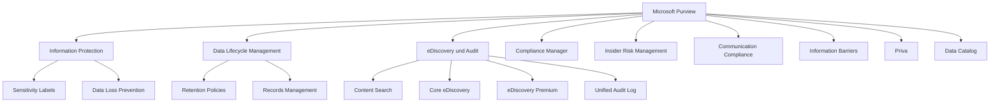
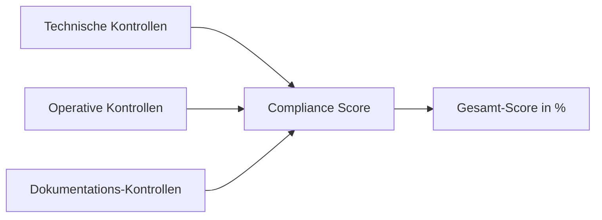
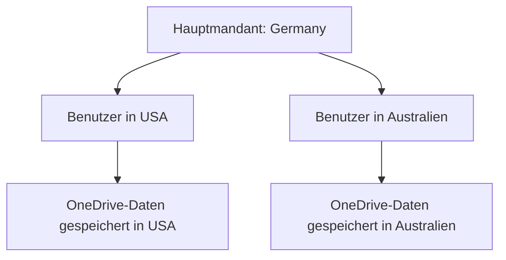

---
tags:
  - microsoft365
  - compliance
  - purview
  - datenschutz
  - governance
aliases:
  - Purview
  - Microsoft Compliance Center
  - Purview Grundlagen
---

# Microsoft Purview Grundlagen

> [!ABSTRACT] TL;DR
> Microsoft Purview ist Microsofts unified Data Governance und Compliance-Plattform. Sie kombiniert Information Protection, Data Lifecycle Management, eDiscovery, Audit, Compliance Manager und Data Catalog in einem Portal unter purview.microsoft.com — und deckt regulatorische Anforderungen wie DSGVO, ISO 27001 und SOC 2 ab.

---

## Was ist Microsoft Purview?

Microsoft Purview vereint zwei früher getrennte Produktbereiche:

1. **Microsoft 365 Compliance** (früher: Microsoft 365 Compliance Center) — Compliance-Features für M365-Daten
2. **Azure Purview** (früher: Azure Purview / Data Catalog) — Data Governance für Azure/Fabric-Daten

Das Ergebnis ist eine einheitliche Plattform für **Datenschutz, Compliance, Governance und Risk Management**.

---

## Purview-Komponenten

| Komponente | Beschreibung | Lizenz |
|------------|-------------|--------|
| **Information Protection** | Sensitivity Labels, DLP | E3/E5 |
| **Data Lifecycle Management** | Retention Policies, Records | E3/E5 |
| **eDiscovery** | Content Search, Core, Premium | E3/E5 |
| **Audit** | Standard (90 Tage), Premium (1 Jahr+) | E3/E5 |
| **Compliance Manager** | Regulatory Score, Assessments | E3/E5 |
| **Insider Risk Management** | Risiko-Richtlinien, Cases | E5 Compliance |
| **Communication Compliance** | Richtlinienüberwachung | E5 Compliance |
| **Information Barriers** | Kommunikationsbeschränkungen | E5 Compliance |
| **Priva** | Privacy Risk, DSR | Add-on |

---

## Compliance-Portal: purview.microsoft.com

Das Purview-Portal ist das zentrale Admin-Center für alle Compliance-Aktivitäten:

- **Compliance Manager**: Score und Verbesserungsmaßnahmen
- **Information Protection**: Labels und DLP konfigurieren
- **Data Lifecycle**: Retention Policies verwalten
- **eDiscovery**: Fälle und Suchen
- **Audit**: Aktivitätsprotokoll durchsuchen
- **Insider Risk**: Risikorichtlinien und Cases
- **Communication Compliance**: Richtlinien und Reviews
- **Reports**: Compliance-Berichte und Dashboards

---

## Compliance Manager

Der Compliance Manager berechnet einen **Compliance Score** (0–100%) und zeigt, wie gut das Unternehmen regulatorische Anforderungen erfüllt.

### Score-Berechnung

- **Technische Kontrollen**: Automatisch von Microsoft erkannt (z.B. MFA aktiviert)
- **Operative Kontrollen**: Prozesse, die manuell dokumentiert werden
- **Microsoft-Kontrollen**: Kontrollen, die Microsoft für den Kunden übernimmt

### Assessments und Templates
Assessments bewerten die Compliance gegen einen bestimmten Standard:

| Standard | Verfügbar | Beschreibung |
|---------|-----------|-------------|
| **DSGVO/GDPR** | ✅ | EU-Datenschutzgrundverordnung |
| **ISO 27001** | ✅ | Informationssicherheits-Management |
| **SOC 2 Type II** | ✅ | Service Organization Control |
| **HIPAA** | ✅ | US-Gesundheitsdatenschutz |
| **BSI C5** | ✅ | Deutschland — Cloud-Compliance |
| **NIS 2** | ✅ | EU-Netzwerksicherheitsrichtlinie |
| **PCI DSS** | ✅ | Zahlungskartenindustrie |
| **NIST CSF** | ✅ | US Cybersecurity Framework |
| **Microsoft Data Protection Baseline** | ✅ | Microsoft-eigener Standard |

### Improvement Actions
Jede Verbesserungsmaßnahme hat:
- **Punktwert**: Wie viele Punkte es zum Score beiträgt
- **Implementierungsanleitung**: Schritt-für-Schritt-Anweisungen
- **Status**: Not started, In progress, Implemented, Tested
- **Typ**: Technical (automatisch erkennbar), Operational, Documentation

> [!TIP]
> Microsoft erkennt technische Maßnahmen **automatisch**. Wenn du MFA aktivierst, steigt der Score automatisch — keine manuelle Eingabe nötig.

---

## Regulatory Compliance in Microsoft 365

### DSGVO/GDPR

Die DSGVO stellt folgende Anforderungen, die Purview adressiert:

| DSGVO-Anforderung | Purview-Feature |
|-------------------|----------------|
| Daten kennen und klassifizieren | Sensitivity Labels, DLP, Content Explorer |
| Verarbeitung dokumentieren | Compliance Manager |
| Einwilligung und Rechtsgrundlage | Priva |
| Betroffenenrechte (DSR) | Priva Subject Rights Requests, eDiscovery |
| Datensicherheit | Sensitivity Labels, Encryption, DLP |
| Meldung bei Datenpanne | Compliance Manager, Audit Logs |
| Auftragsverarbeitung | Compliance Manager Assessments |

### ISO 27001
- Technische Kontrollen: MFA, Encryption, DLP, Audit
- Operative Kontrollen: Access Management, Incident Response
- Compliance Manager bewertet und trackt alle Kontrollen

---

## Datenschutz in Microsoft 365

### Data Residency
Microsoft legt fest, **wo** M365-Kundendaten gespeichert werden:

| Dienst | Standard-Speicherort |
|--------|---------------------|
| Exchange Online | Tenant-Region |
| SharePoint Online | Tenant-Region |
| Teams Chats | Tenant-Region |
| OneDrive | Tenant-Region |
| Entra ID | Tenant-Region |

**Tenant-Region** wird beim ersten M365-Setup bestimmt (z.B. Europe → West Europe oder North Europe).

### EU Data Boundary
Microsoft hat 2023 die **EU Data Boundary** eingeführt: Alle Daten von EU/EEA-Tenants werden ausschließlich in der EU/EEA gespeichert und verarbeitet — inklusive Support-Daten.

### Multi-Geo
Multi-Geo ermöglicht es, Benutzerdaten in bestimmten geografischen Regionen zu speichern:

> [!NOTE]
> Multi-Geo erfordert eine spezielle Lizenzierung (Microsoft 365 Multi-Geo Add-on) und ist für große internationale Organisationen konzipiert.

---

## Purview Data Catalog (Data Governance)

Der Purview Data Catalog (früher Azure Purview) bietet Data Governance für:

- **Azure Data Sources**: Azure SQL, Synapse, ADLS, Blob Storage
- **Microsoft Fabric**: Lakehouse, Warehouse, Dataflows
- **Power BI**: Datasets, Berichte
- **AWS, GCP**: S3, BigQuery, etc.
- **On-Premises**: SQL Server, SAP, Oracle

**Kernfunktionen:**
- **Data Map**: Automatisches Scannen und Katalogisieren
- **Data Lineage**: Datenherkünfte verfolgen
- **Business Glossary**: Einheitliche Datendefinitionen
- **Sensitivity Labels**: Labels auf Datenquellen anwenden
- **Insights**: Übersicht über Datenzustand

---

## Via Microsoft Purview Compliance Portal (UI)

### Compliance Manager aufrufen und Verbesserungsmaßnahmen umsetzen

1. Öffne **Microsoft Purview Compliance Portal** unter [purview.microsoft.com](https://purview.microsoft.com)
2. Navigiere zu **Compliance Manager**
3. Überprüfe deinen **Compliance Score** auf der Übersichtsseite
4. Klicke auf **Verbesserungsmaßnahmen**, um die Liste der empfohlenen Aktionen zu sehen
5. Filtere nach:
   - **Kategorie:** Datenschutz, Informationsschutz, etc.
   - **Status:** Nicht gestartet, In Bearbeitung, Abgeschlossen
   - **Punktzahl:** Nach Punkte-Impact sortieren
6. Klicke auf eine Maßnahme und folge der **Implementierungsanleitung**
7. Setze den Status auf **Implementiert** nach Abschluss

### Assessment erstellen

1. Navigiere zu **Compliance Manager → Assessments**
2. Klicke auf **+ Assessment hinzufügen**
3. Wähle eine **Regulierungsvorlage** (z.B. DSGVO, ISO 27001, NIST)
4. Konfiguriere **Name**, **Gruppe** und **Dienste**
5. Klicke auf **Assessment erstellen**

> [!TIP]
> Nutze den **Compliance Manager**, um den aktuellen Compliance-Status gegenüber wichtigen Standards wie DSGVO oder ISO 27001 zu bewerten und priorisierte Maßnahmen umzusetzen.

---

## Lizenzierung: E3 vs. E5 Compliance

| Feature | M365 E3 | M365 E5 | E5 Compliance Add-on |
|---------|---------|---------|---------------------|
| Sensitivity Labels | ✅ | ✅ | ✅ |
| Basic DLP | ✅ | ✅ | ✅ |
| Advanced DLP (Endpoint, Teams) | ❌ | ✅ | ✅ |
| Retention Policies (Basic) | ✅ | ✅ | ✅ |
| Retention Labels + Auto-Apply | ❌ | ✅ | ✅ |
| Records Management | ❌ | ✅ | ✅ |
| Content Search / Core eDiscovery | ✅ | ✅ | ✅ |
| eDiscovery Premium | ❌ | ✅ | ✅ |
| Audit Standard (90 Tage) | ✅ | ✅ | ✅ |
| Audit Premium (1 Jahr) | ❌ | ✅ | ✅ |
| Compliance Manager | ✅ | ✅ | ✅ |
| Information Barriers | ❌ | ✅ | ✅ |
| Communication Compliance | ❌ | ✅ | ✅ |
| Insider Risk Management | ❌ | ✅ | ✅ |
| Adaptive Protection (DLP+IRM) | ❌ | ✅ | ✅ |

---

## Verwandte Notizen
- [[Sensitivity Labels]]
- [[Data Loss Prevention DLP]]
- [[Retention Policies und Labels]]
- [[eDiscovery und Audit]]
- [[Information Barriers]]
- [[Communication Compliance]]
- [[Insider Risk Management]]
- [[Microsoft Priva]]
- [[Microsoft Secure Score]]
