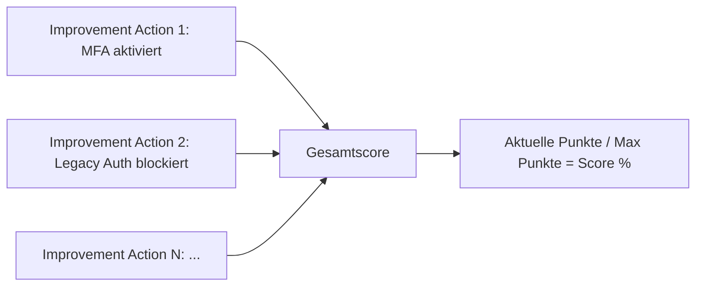
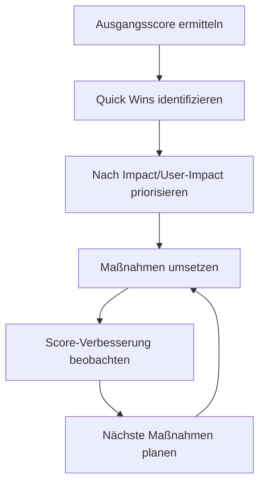

---
tags:
  - microsoft365
  - security
  - secure-score
  - sicherheitsbewertung
  - empfehlungen
aliases:
  - Secure Score
  - Microsoft Sicherheitsbewertung
  - M365 Secure Score
---

# Microsoft Secure Score

> [!ABSTRACT] TL;DR
> Microsoft Secure Score bewertet die Sicherheitskonfiguration eines Tenants auf einer Punkt-Skala und zeigt priorisierte Verbesserungsmaßnahmen. Er deckt Identity, Devices, Apps, Data und Infrastructure ab — und aktualisiert sich automatisch, wenn Konfigurationsänderungen erkannt werden.

---

## Was ist Microsoft Secure Score?

Microsoft Secure Score (MSS) ist ein kontinuierliches Security-Posture-Bewertungssystem. Es analysiert die Sicherheitskonfiguration des Microsoft 365-Tenants und gibt einen Score (Punkte und Prozent) zurück.

**Ziele des Secure Score:**
- Aktuellen Sicherheitsstatus verstehen
- Verbesserungspotenziale priorisieren
- Fortschritt über Zeit messen
- Mit ähnlichen Organisationen vergleichen

**Zugriff:** `security.microsoft.com` → Secure Score

---

## Score-Berechstellung



### Beispiel Score-Berechnung
```
Aktivierte Maßnahmen: 350 Punkte
Maximale Punkte:      600 Punkte
Secure Score:         350/600 = 58.3%
```

> [!NOTE]
> Der **maximale Score** ändert sich laufend, da Microsoft neue Maßnahmen hinzufügt. Ein Rückgang des Scores bedeutet nicht zwingend, dass die Konfiguration schlechter wurde — es können neue Maßnahmen hinzugekommen sein.

---

## Kategorien

| Kategorie | Abdeckung | Beispiel-Maßnahmen |
|-----------|----------|-------------------|
| **Identity** | Entra ID, MFA, Conditional Access, PIM | MFA erzwingen, Legacy Auth blockieren |
| **Devices** | MDE, Intune, Device Compliance | MDE onboarden, Compliance-Policies |
| **Apps** | MDO, Safe Links, Safe Attachments | Safe Links aktivieren, DMARC konfigurieren |
| **Data** | Purview, Sensitivity Labels, DLP | DLP-Richtlinien, Auto-Labeling |
| **Infrastructure** | Azure Defender, ASR Rules | Defender for Cloud aktivieren |

---

## Verbesserungsmaßnahmen (Improvement Actions)

### Status einer Maßnahme

| Status | Beschreibung |
|--------|-------------|
| **To Address** | Maßnahme noch nicht implementiert |
| **Planned** | Implementierung ist geplant (Punkte werden nicht gezählt) |
| **Risk Accepted** | Bewusste Entscheidung, Risiko zu akzeptieren |
| **Resolved Through Third Party** | Drittanbieter-Tool übernimmt diese Funktion |
| **Resolved Through Alternate Mitigation** | Alternative Maßnahme implementiert |
| **Completed** | Maßnahme vollständig implementiert |

### Maßnahmen-Details
Jede Maßnahme enthält:
- **Beschreibung**: Was wird empfohlen?
- **Punkte**: Wie viel trägt die Maßnahme zum Score bei?
- **User Impact**: Wie stark betrifft die Änderung Benutzer?
- **Implementation**: Schritt-für-Schritt-Anleitung
- **Lizenz-Anforderung**: Welche Lizenz wird benötigt?

---

## Top Quick Wins — Typische Maßnahmen

### Identity (höchste Priorität)

| Maßnahme | Punkte (ca.) | Schwierigkeit |
|---------|------------|--------------|
| MFA für alle Benutzer aktivieren | Hoch | Mittel |
| Legacy-Authentifizierung blockieren (Conditional Access) | Hoch | Einfach |
| Privileged Identity Management (PIM) für Admin-Rollen | Hoch | Mittel |
| Self-Service Password Reset (SSPR) aktivieren | Mittel | Einfach |
| Entra ID Password Protection aktivieren | Mittel | Einfach |
| Riskante Benutzer-Logins blockieren | Mittel | Einfach |
| Keine dauerhaften Global Admins | Hoch | Mittel |
| Dedizierte Admin-Konten verwenden | Mittel | Mittel |

### Devices

| Maßnahme | Punkte (ca.) | Schwierigkeit |
|---------|------------|--------------|
| MDE auf allen Geräten aktivieren | Hoch | Mittel |
| ASR-Rules im Block-Modus | Mittel | Mittel |
| Windows-Antivirus-Schutz aktivieren | Mittel | Einfach |
| BitLocker auf Windows-Geräten | Mittel | Mittel |
| Intune-Compliance-Policies | Mittel | Mittel |

### Apps (E-Mail)

| Maßnahme | Punkte (ca.) | Schwierigkeit |
|---------|------------|--------------|
| Safe Links für E-Mail aktivieren | Hoch | Einfach |
| Safe Attachments für E-Mail aktivieren | Hoch | Einfach |
| Anti-Phishing Policy (Impersonation) | Mittel | Einfach |
| DMARC-Richtlinie konfigurieren | Mittel | Mittel |
| Spam Confidence Level (SCL) konfigurieren | Niedrig | Einfach |

### Data

| Maßnahme | Punkte (ca.) | Schwierigkeit |
|---------|------------|--------------|
| Sensitivity Labels aktivieren | Mittel | Mittel |
| DLP-Richtlinien für Exchange | Mittel | Mittel |
| Azure Information Protection Scanner | Niedrig | Komplex |

---

## Score-Vergleich und Benchmarking

### Branchenvergleich
Secure Score zeigt, wie der eigene Score im Vergleich zu ähnlichen Organisationen steht:

```
Eigener Score:        58%
Branchendurchschnitt: 52%
Ähnliche Unternehmen: 54%
(Basierend auf anonymisierten Daten von Microsoft-Kunden)
```

### Zeitverlauf-Tracking
Das Score-Verlaufdiagramm zeigt:
- Wöchentlichen Score-Verlauf
- Score-Änderungen durch Konfigurationsänderungen
- Trend über Monate

---

## Regression Tracking

Wenn der Score **sinkt**, identifiziert Secure Score die Ursache:

| Ursache | Beispiel |
|---------|---------|
| **Konfiguration geändert** | Safe Links Policy deaktiviert |
| **Neue Maßnahme hinzugefügt** | Neuer Control im Score-Framework |
| **Tenant-Änderungen** | Neue Benutzer ohne MFA |

---

## Secure Score API (Microsoft Graph)

```powershell
# Graph API — Secure Score abrufen
$headers = @{
    "Authorization" = "Bearer $accessToken"
    "Content-Type" = "application/json"
}

# Aktueller Score
Invoke-RestMethod -Uri "https://graph.microsoft.com/v1.0/security/secureScores?`$top=1" `
    -Headers $headers

# Score Control Profiles (alle Maßnahmen)
Invoke-RestMethod -Uri "https://graph.microsoft.com/v1.0/security/secureScoreControlProfiles" `
    -Headers $headers
```

```json
// Beispiel-Antwort secureScores
{
  "currentScore": 350.0,
  "maxScore": 600.0,
  "averageComparativeScores": [
    {
      "basis": "AllTenants",
      "averageScore": 38.5
    },
    {
      "basis": "TotalSeats",
      "averageScore": 52.1
    }
  ],
  "controlScores": [
    {
      "controlName": "MFARegistrationV2",
      "score": 9.0,
      "controlCategory": "Identity"
    }
  ]
}
```

---

## Integration mit Compliance Manager

| Aspekt | Secure Score | Compliance Manager |
|--------|-------------|-------------------|
| **Fokus** | Technische Sicherheitskonfiguration | Regulatorische Compliance |
| **Score-Basis** | Microsoft-eigene Best Practices | Standards (GDPR, ISO 27001, etc.) |
| **Maßnahmen** | Technische Settings | Technisch + Operational + Dokumentation |
| **Zielgruppe** | Security Team | Compliance Team |
| **Verknüpfung** | Technische Maßnahmen fließen in Compliance Manager ein | — |

---

## Microsoft Secure Score for Devices

MDE hat einen **separaten** Secure Score for Devices (in security.microsoft.com → Endpoint Secure Score):

- Bewertet Endpoint-Konfiguration
- Empfehlungen: ASR-Rules, Antivirus-Konfiguration, BitLocker
- **Getrennt** vom Microsoft Secure Score (Identity/Apps/Data)

---

## Secure Score in der Praxis

### Strategischer Ansatz



### Monatliches Review
1. Aktuellen Score notieren
2. Neue Maßnahmen identifizieren
3. Regressions analysieren (Was ist gesunken?)
4. Top-3-Maßnahmen für den Monat definieren
5. Fortschritt im Management-Report darstellen

### Executive Reporting
```
Sicherheits-KPI für Q1 2025:
- Secure Score: 68% (+5% gegenüber Q4 2024)
- Neue Maßnahmen umgesetzt: MFA für alle Benutzer, Legacy Auth blockiert
- Offene kritische Maßnahmen: 3 (PIM, Device Compliance, DMARC)
```

> [!TIP]
> **Beginne mit Identity-Maßnahmen** — sie haben typischerweise den höchsten Score-Impact und sind oft einfach umzusetzen (z.B. MFA aktivieren). Ein Score unter 50% deutet auf grundlegende Sicherheitslücken hin.

---

## Verwandte Notizen
- [[Microsoft Defender XDR]]
- [[Microsoft Purview Grundlagen]]
- [[Microsoft Defender for Endpoint]]
- [[Microsoft Defender for Office 365]]
