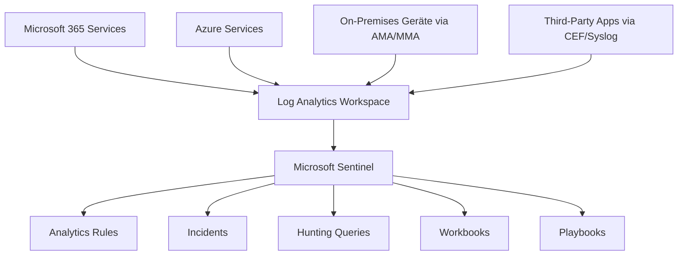
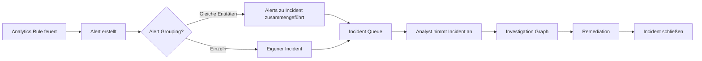
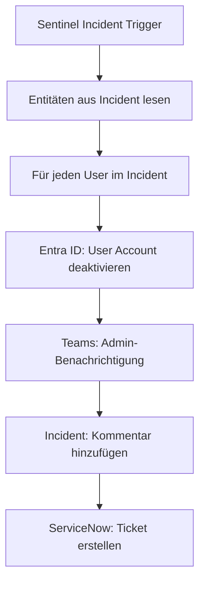

---
tags:
  - microsoft365
  - security
  - sentinel
  - siem
  - soar
  - azure
aliases:
  - Sentinel
  - Azure Sentinel
  - Microsoft Sentinel SIEM
---

# Microsoft Sentinel

> [!ABSTRACT] TL;DR
> Microsoft Sentinel ist Microsofts cloudnatives SIEM (Security Information and Event Management) und SOAR (Security Orchestration, Automation and Response), aufgebaut auf Azure Log Analytics. Es sammelt Logs aus allen Quellen, erkennt Bedrohungen über Analytics Rules, automatisiert Reaktionen via Playbooks und unterstützt proaktives Hunting.

---

## Was ist Microsoft Sentinel?

Microsoft Sentinel ist ein vollständig in der Azure-Cloud gehostetes SIEM/SOAR. Es löst das klassische SIEM-Problem (teure Hardware, schwieriges Scaling) durch Pay-as-you-go-Modell und Integration mit dem gesamten Microsoft Security-Stack.

**Kernfunktionen:**
- **Collect**: Logs aus allen Quellen (Microsoft, Third-Party, On-Premises)
- **Detect**: Analytics Rules (KQL, ML, Fusion) für Bedrohungserkennung
- **Investigate**: Unified Incident Investigation
- **Respond**: Playbooks (Logic Apps) für automatisierte Reaktion
- **Hunt**: Proaktive Bedrohungssuche mit KQL
- **Report**: Workbooks und Dashboards

---

## Workspace-Architektur

Sentinel basiert auf einem **Azure Log Analytics Workspace**:



### Workspace-Planung
| Parameter | Überlegung |
|-----------|-----------|
| **Region** | Nahe am Datenursprung, EU-Compliance (West Europe) |
| **Retention** | Standard 90 Tage, max. 2 Jahre Hot Storage, bis 7 Jahre Cold Archive |
| **Daily Cap** | Optional: Maximales Volumen begrenzen |
| **Commitment Tier** | Ab 100 GB/Tag günstiger als Pay-as-you-go |

---

## Datenquellen und Connectors

### Microsoft-Connectors (Native)
| Connector | Tabellen | Beschreibung |
|-----------|---------|-------------|
| Microsoft Defender XDR | `SecurityAlert`, `SecurityIncident` | Incidents und Alerts aus Defender XDR |
| Entra ID | `SigninLogs`, `AuditLogs`, `AADNonInteractiveUserSignInLogs` | Login und Audit-Ereignisse |
| Office 365 | `OfficeActivity` | SharePoint, Exchange, Teams-Aktivitäten |
| Azure Activity | `AzureActivity` | Azure-Ressourcenaktionen |
| Defender for Cloud | `SecurityAlert` | Azure Security-Alerts |
| Microsoft 365 Defender | Alle MDE/MDO/MDI Tabellen | Vollständige XDR-Daten |

### Third-Party und On-Premises Connectors
| Methode | Anwendungsfall |
|---------|---------------|
| **CEF (Common Event Format)** | Firewalls, IDS/IPS (Palo Alto, Fortinet, Cisco) |
| **Syslog** | Linux-Systeme, Network Devices |
| **REST API** | Custom Applications |
| **Azure Monitor Agent (AMA)** | Windows/Linux Server (On-Premises oder Azure) |
| **Logstash** | Flexible Log-Pipeline |
| **AWS S3** | AWS CloudTrail, VPC Flow Logs |

### Content Hub Solutions
Der Content Hub bietet vorgefertigte Lösungspakete mit Connectors + Analyseregeln + Workbooks:
- Microsoft 365 Defender Solution
- Sysmon Threat Detection
- Palo Alto Networks
- Fortinet FortiGate
- MITRE ATT&CK

---

## Analytics Rules

### Regeltypen im Vergleich

| Typ | Latenz | Anwendungsfall |
|-----|--------|---------------|
| **Scheduled** | 5 Min.–24h | Regelmäßige KQL-Abfragen gegen Log-Daten |
| **Near Real-Time (NRT)** | ~1 Minute | Zeitkritische Erkennungen (Login-Anomalien) |
| **Fusion** | Variabel | ML-basierte Multi-Stage-Angriffserkennung |
| **ML Behavior Analytics** | Stunden | UEBA-basierte Anomalien |
| **Threat Intelligence** | Echtzeit | IoC-Matching mit TI-Feeds |
| **Microsoft Security** | Echtzeit | Direkt aus Microsoft-Produkten |

### Scheduled Rule — Beispiel

```kusto
// Analytics Rule: Brute Force gegen Entra ID
SigninLogs
| where TimeGenerated > ago(1h)
| where ResultType != "0"  // Fehlgeschlagene Logins
| summarize 
    FailedAttempts = count(),
    FirstAttempt = min(TimeGenerated),
    LastAttempt = max(TimeGenerated),
    Locations = make_set(Location)
    by UserPrincipalName, IPAddress
| where FailedAttempts >= 10
| extend AlertSeverity = "High"
```

**Rule-Konfiguration:**
- **Query Frequency**: Wie oft wird die Abfrage ausgeführt? (z.B. alle 5 Min.)
- **Query Period**: Wie weit in die Vergangenheit schaut die Abfrage? (z.B. letzte 5 Min.)
- **Alert Threshold**: Ab wann wird ein Alert generiert? (Results > 0)
- **Entity Mapping**: Welche Felder entsprechen Entitäten (User, IP, Host)?
- **MITRE ATT&CK**: Mapping auf Taktiken und Techniken
- **Incident Creation**: Soll ein Incident aus dem Alert erstellt werden?

---

## Incidents und Alerts

### Incident-Verwaltung in Sentinel


### Alert Grouping
- Alerts werden zu einem Incident zusammengeführt, wenn sie gleiche Entitäten (User, IP, Host) haben
- Zeitfenster konfigurierbar (z.B. alle Alerts der letzten 5 Stunden)

---

## Automation Rules und Playbooks

### Automation Rules
Automation Rules werden automatisch auf Incidents angewendet:

```
Wenn: Incident erstellt
UND: Taktik = Credential Access
DANN: Schweregrad auf High setzen
       Analyst zuweisen: soc-team@contoso.com
       Tag hinzufügen: Credential-Theft
       Playbook ausführen: Disable-CompromisedUser
```

### Playbooks (Azure Logic Apps)
Playbooks sind Azure Logic Apps, die auf Incident-Trigger reagieren:

**Beispiel: Automatically Disable Compromised User**


**Weitere typische Playbook-Aktionen:**
- IP-Adresse in Firewall blockieren
- Gerät in MDE isolieren
- E-Mail an Benutzer senden (Awareness)
- Jira/ServiceNow-Ticket erstellen
- Teams/Slack-Benachrichtigung

---

## KQL für Sentinel — Wichtige Tabellen

### Authentifizierung
```kusto
// Fehlgeschlagene Logins nach Land
SigninLogs
| where TimeGenerated > ago(24h)
| where ResultType != "0"
| summarize FailedLogins = count() by Location, UserPrincipalName
| order by FailedLogins desc
```

### Windows Security Events
```kusto
// Lokale Admin-Gruppe verändert
SecurityEvent
| where TimeGenerated > ago(7d)
| where EventID == 4732 or EventID == 4728  // Mitglied zu privilegierter Gruppe hinzugefügt
| where TargetUserName in ("Administrators", "Domain Admins")
| project TimeGenerated, Computer, SubjectUserName, TargetUserName, MemberName
```

### Office 365 Aktivitäten
```kusto
// Externe Weiterleitungsregeln in Exchange
OfficeActivity
| where TimeGenerated > ago(7d)
| where Operation == "New-InboxRule"
| where Parameters has "ForwardTo" or Parameters has "RedirectTo"
| where not(Parameters has "@contoso.com")
| project TimeGenerated, UserId, Parameters
```

### Bedrohungsintelligenz-Matching
```kusto
// Logins von bekannten bösartigen IPs
let ThreatIPs = ThreatIntelligenceIndicator
    | where Active == true
    | where NetworkIP != ""
    | project NetworkIP;
SigninLogs
| where IPAddress in (ThreatIPs)
| project TimeGenerated, UserPrincipalName, IPAddress, Location, ResultType
```

---

## Hunting Queries

Proaktive Suche nach versteckten Bedrohungen ohne Alert-Trigger:

```kusto
// Hunting: Ungewöhnliche Service-Account-Logins
let ServiceAccounts = dynamic(["svc_sql", "svc_app", "svc_backup"]);
SigninLogs
| where UserPrincipalName has_any (ServiceAccounts)
| where ResultType == "0"
| where AppDisplayName != "Azure Portal"
| project TimeGenerated, UserPrincipalName, AppDisplayName, IPAddress, Location
| order by TimeGenerated desc
```

### MITRE ATT&CK Mapping
Hunting-Abfragen können MITRE ATT&CK-Techniken zugeordnet werden:
- **T1078**: Valid Accounts
- **T1110**: Brute Force
- **T1003**: OS Credential Dumping
- **T1566**: Phishing

---

## Workbooks (Dashboards)

Workbooks bieten visuelle Dashboards für Security-Monitoring:

| Built-in Workbook | Inhalt |
|-------------------|--------|
| **Azure AD Sign-in Logs** | Login-Analyse, Fehler, Geos |
| **Microsoft 365 Defender** | XDR-Übersicht |
| **Threat Intelligence** | IoC-Visualisierung |
| **Security Operations Efficiency** | SOC-KPIs |
| **MITRE ATT&CK** | Abdeckung der Techniken |

---

## Watchlists

Watchlists sind CSV-basierte Referenzlisten für Analytics Rules:

```
Anwendungsfall: Liste von VIP-Benutzern
Wenn VIP-Benutzer sich von unbekanntem Land einloggt → Priority Alert

Anwendungsfall: Liste von genehmigten externen IPs
Filter: Alerts von diesen IPs ausschließen
```

---

## Threat Intelligence (TAXII/STIX)

Sentinel kann Threat Intelligence aus externen Quellen importieren:

- **TAXII Server**: Standard-Format für TI-Sharing
- **Microsoft Threat Intelligence**: Automatisch integriert
- **MISP**: Open-Source TI-Platform Integration
- **Anomali, ThreatConnect**: Commercial TI-Plattformen

---

## UEBA (User and Entity Behavior Analytics)

UEBA erstellt Baseline-Profile für Benutzer und Entitäten:

- **Investigation Priority Score**: 0–10, höher = mehr verdächtig
- **Peer Analysis**: Vergleich mit ähnlichen Benutzern (gleiche Abteilung, Rolle)
- **Anomaly Detection**: Abweichungen von der persönlichen Baseline

---

## Sentinel vs. Defender XDR

| Aspekt | Defender XDR | Microsoft Sentinel |
|--------|-------------|-------------------|
| **Fokus** | Microsoft-Produkte | Alle Quellen |
| **Datenquellen** | Microsoft-only | Unbegrenzt (CEF, Syslog, etc.) |
| **Retention** | 30 Tage Hunting | Bis 7 Jahre |
| **KQL** | 30 Tage Daten | Alle ingested Daten |
| **SOAR** | Einfache AIR | Vollständige Logic Apps |
| **Kosten** | Im M365-Lizenz | Pay-per-GB |
| **Empfehlung** | Für M365-Fokus | Enterprise SIEM |

> [!NOTE]
> Defender XDR und Sentinel **ergänzen** sich: Defender XDR für schnelle Reaktion auf Microsoft-Bedrohungen, Sentinel für zentrale Log-Aggregation und komplexe SIEM-Szenarien. Die **Defender XDR-Integration** in Sentinel spiegelt alle Incidents beidseitig.

---

## Via Microsoft Sentinel (Azure Portal) (UI)

### Sentinel-Workspace einrichten und Analytics Rule erstellen

1. Öffne das **Azure Portal** unter [portal.azure.com](https://portal.azure.com)
2. Suche nach **Microsoft Sentinel** und wähle deinen Workspace
3. Navigiere zu **Konfiguration → Datenconnectors**:
   - Wähle einen Connector (z.B. **Microsoft 365 Defender**)
   - Klicke auf **Connectorseite öffnen** und folge den Anweisungen
4. Navigiere zu **Konfiguration → Analytics**
5. Klicke auf **+ Erstellen → Geplante Abfrageregel**
6. Konfiguriere:
   - **Name und Beschreibung:** Regelname vergeben
   - **Schweregrad:** Niedrig, Mittel, Hoch oder Kritisch
   - **MITRE ATT&CK:** Taktiken und Techniken zuordnen
   - **KQL-Abfrage:** Erkennungslogik eingeben und testen
   - **Abfragehäufigkeit:** z.B. alle 5 Minuten
   - **Lookback-Zeitraum:** Zeitfenster für die Abfrage
   - **Entitätszuordnungen:** Account, Host, IP-Adresse zuordnen
7. Klicke auf **Überprüfen und erstellen**

> [!TIP]
> Nutze den **Content Hub** unter **Inhaltsverwaltung → Content Hub**, um fertige Solutions mit vorgefertigten Analytics Rules, Workbooks und Playbooks für bekannte Produkte (z.B. Microsoft 365, AWS) zu installieren.

---

## Kostenmodell

| Modell | Beschreibung | Empfehlung |
|--------|-------------|-----------|
| **Pay-as-you-go** | Pro GB ingested (ca. 2–3 EUR/GB) | < 10 GB/Tag |
| **Commitment Tier 100 GB** | Fester Preis, günstiger | 100 GB/Tag |
| **Commitment Tier 200 GB** | Noch günstiger | 200 GB/Tag |
| **Commitment Tier 500 GB+** | Bestes Preis-Leistungs-Verhältnis | > 500 GB/Tag |

> [!TIP]
> **Kosten optimieren**: Nicht alle Logs sind gleich wertvoll. Nutze **Data Collection Rules (DCR)** um unnötige Events zu filtern, bevor sie Sentinel erreichen. Verwende **Basic Logs** für günstigere Langzeitspeicherung seltener abgefragter Daten.

---

## Verwandte Notizen
- [[Microsoft Defender XDR]]
- [[Microsoft Secure Score]]
