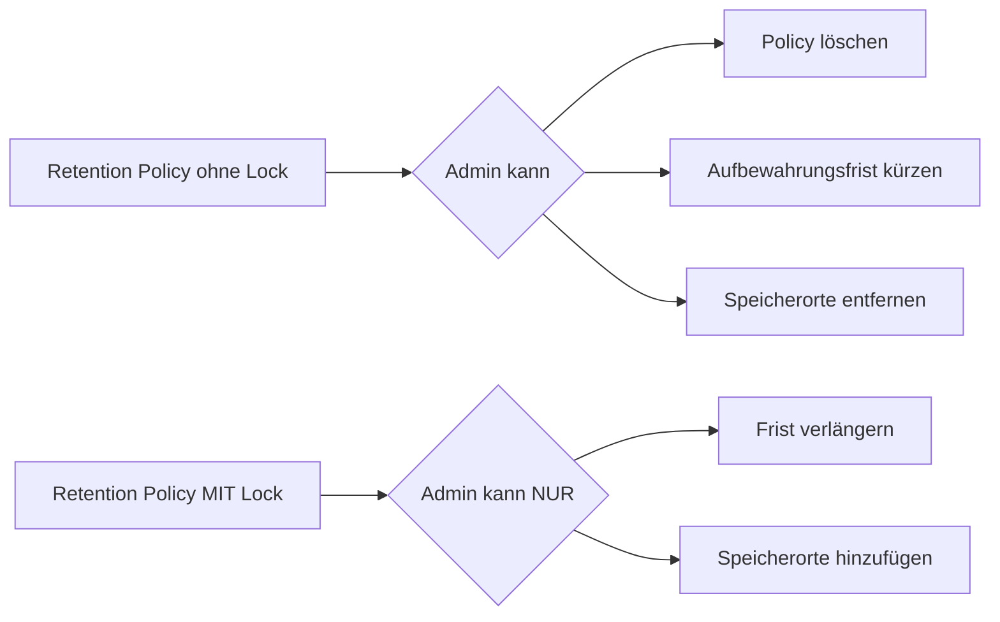
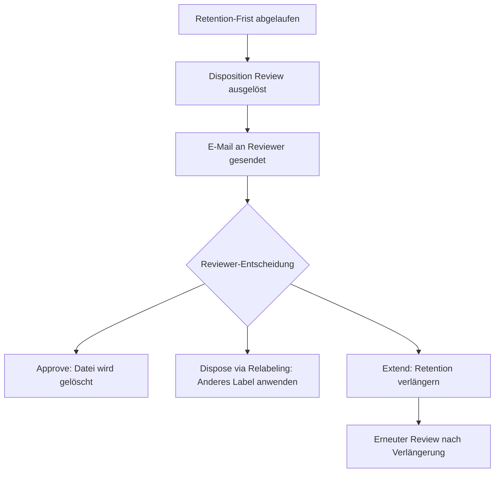

---
tags:
  - microsoft365
  - compliance
  - purview
  - retention
  - records-management
  - lifecycle
aliases:
  - Retention
  - Aufbewahrungsrichtlinien
  - Records Management
---

# Retention Policies und Labels

> [!ABSTRACT] TL;DR
> Retention Policies und Retention Labels in Microsoft Purview steuern, wie lange Daten aufbewahrt und wann sie gelöscht werden. Policies gelten breit für ganze Dienste, Labels ermöglichen granulare Kontrolle pro Element — inklusive Disposition Review, Regulatory Records und Event-basiertem Retention.

---

## Warum Retention?

Unternehmen benötigen Retention für drei Kernzwecke:

| Zweck | Beschreibung |
|-------|-------------|
| **Compliance** | Gesetzliche Aufbewahrungsfristen (z.B. 10 Jahre Buchhaltung nach HGB) |
| **Legal Hold** | Aufbewahrung für Rechtstreitigkeiten (eDiscovery) |
| **Storage Management** | Veraltete Daten automatisch löschen |

---

## Retention Policies vs. Retention Labels

| Aspekt | Retention Policy | Retention Label |
|--------|-----------------|----------------|
| **Granularität** | Gesamter Speicherort (z.B. alle Postfächer) | Einzelne Elemente (E-Mails, Dokumente) |
| **Anwendung** | Automatisch, breit | Manuell oder automatisch |
| **Priorität** | Niedrigere Priorität | Höhere Priorität (überschreibt Policy) |
| **Disposition Review** | ❌ | ✅ |
| **Records** | ❌ | ✅ |
| **Event-basiert** | ❌ | ✅ |
| **Anwendungsfall** | Mindest-Aufbewahrung für alle | Spezifische Aufbewahrung pro Inhaltstyp |

> [!NOTE]
> **Retention-Prioritätsregel**: Bei Konflikt gilt immer das Prinzip "längste Aufbewahrung gewinnt". Eine Policy mit 5 Jahren und ein Label mit 7 Jahren → 7 Jahre werden aufbewahrt. Löschen passiert erst nach der längsten Frist.

---

## Aufbewahrungsfristen konfigurieren

### Retention-Aktionen

| Aktion | Beschreibung |
|--------|-------------|
| **Retain only** | Nur aufbewahren, kein automatisches Löschen |
| **Delete only** | Nach Ablauf löschen (kein Schutz vor vorzeitigem Löschen) |
| **Retain then Delete** | Aufbewahren für X Jahre, dann automatisch löschen |

### Fristberechnung (Start des Retention-Zeitraums)

| Startpunkt | Beschreibung |
|-----------|-------------|
| **Erstellungsdatum** | Ab Erstellung der Datei/E-Mail |
| **Zuletzt geändert** | Ab letzter Änderung |
| **Label angewendet** | Ab Zeitpunkt der Label-Vergabe |
| **Event** | Trigger durch externes Ereignis (event-basiert) |

---

## Retention-Speicherorte

| Speicherort | Beschreibung | Technischer Mechanismus |
|-------------|-------------|------------------------|
| **Exchange Online** | Postfächer, freigegebene Postfächer, Gruppen-Postfächer | Recoverable Items → Holds |
| **SharePoint Online** | Sites und Dokumente | Preservation Hold Library |
| **OneDrive** | Benutzerdateien | Preservation Hold Library |
| **Teams Kanal-Nachrichten** | Nachrichten in Kanälen | SubstrateHolds |
| **Teams Chats** | 1:1 und Gruppen-Chats | SubstrateHolds |
| **Viva Engage (Yammer)** | Community-Nachrichten | SubstrateHolds |
| **Microsoft 365 Copilot** | Copilot-Interaktionen | SubstrateHolds |

### Wie Retention technisch funktioniert

**SharePoint/OneDrive:**
```
Datei gelöscht → In Papierkorb
Retention greift → Kopie in Preservation Hold Library (unsichtbar)
Retention-Frist abgelaufen → Echtes Löschen
```

**Exchange Online:**
```
E-Mail gelöscht → In Recoverable Items
Retention/Hold greift → Verbleibt in Recoverable Items
Retention-Frist abgelaufen → Purge (unwiederbringlich)
```

---

## Preservation Lock

**Preservation Lock** verhindert, dass eine Retention Policy gelockert oder gelöscht werden kann.



> [!WARNING]
> Preservation Lock ist **unwiderruflich**. Nach Aktivierung kann die Policy nicht mehr gelockert werden. Nur für echte regulatorische Anforderungen verwenden (z.B. SEC Rule 17a-4, FINRA).

---

## Retention Labels: Anwendung

### Manuelle Anwendung
- Benutzer wählt Label in SharePoint, OneDrive oder Outlook
- Label-Auswahl via Datei-Eigenschaften

### Auto-Apply Retention Labels

#### 1. SIT-basiertes Auto-Apply
```powershell
# Retention Label erstellen
New-RetentionCompliancePolicy -Name "Finanz-Aufbewahrung" `
    -SharePointLocation All `
    -OneDriveLocation All

New-RetentionComplianceRule -Name "Aufbewahrungsregel" `
    -Policy "Finanz-Aufbewahrung" `
    -RetentionDuration 3650 `  # 10 Jahre in Tagen
    -ContentMatchQuery "Document.ContentType:FinancialReport"
```

#### 2. KQL-basiertes Auto-Apply
Dateien werden basierend auf KQL-Abfragen automatisch gelabelt:
```
ContentType:Invoice AND DocumentDate < {now-1y}
```

#### 3. Trainable Classifiers
ML-basierte Erkennung von Inhaltstypen:
- Tax Forms (Steuerformulare)
- Invoices (Rechnungen)
- Legal Affairs (Rechtliche Dokumente)
- Source Code
- Project Documents

#### 4. Adaptive Policy Scopes
Dynamische Zielgruppen basierend auf Benutzer-/Site-Attributen:
```
Scope: Alle SharePoint-Sites mit Attribut "Department = Finance"
→ Automatisch neue Finance-Sites einschließen
```

---

## Disposition Review

Der Disposition Review-Prozess verhindert automatisches Löschen — ein Reviewer muss zuerst zustimmen.



### Multi-Stage Disposition
Mehrere Review-Stufen möglich:
1. **Stage 1**: Team Lead genehmigt
2. **Stage 2**: Legal/Compliance genehmigt
3. **Stage 3**: Final Deletion

### Disposition-Protokoll
Alle Disposition-Entscheidungen werden protokolliert (unveränderbar) für Compliance-Nachweise.

---

## Regulatory Records

Der stärkste Schutzstatus für Dokumente:

| Eigenschaft | Records | Regulatory Records |
|-------------|---------|-------------------|
| **Umbenennen** | ❌ | ❌ |
| **Bearbeiten** | ❌ | ❌ |
| **Label entfernen** | ✅ (Admin) | ❌ (niemand) |
| **Löschen** | ❌ | ❌ |
| **Preservation Lock nötig** | Optional | Empfohlen |

> [!DANGER]
> Einmal als **Regulatory Record** gelabelt, kann eine Datei von **niemandem** — auch nicht von globalen Admins — gelöscht oder verändert werden, bis die Retention-Frist abgelaufen ist.

---

## Records Management und File Plan

Der **File Plan** (Datei-Plan) bietet strukturierte Verwaltung von Retention Labels:

- **File Plan Descriptors**: Zusätzliche Metadaten für Labels
  - Function (Geschäftsfunktion)
  - Department (Abteilung)
  - Citation (Rechtliche Grundlage)
  - Authority (Behörde/Standard)
- **CSV Import**: Massenimport von Labels
- **Compliance-Nachweis**: Export für Audits

---

## Event-basiertes Retention

Retention-Fristen können durch **Ereignisse** (Events) ausgelöst werden — nicht durch feste Daten.

### Anwendungsbeispiel: Mitarbeiter verlässt das Unternehmen
1. Retention Label "HR-Akte" erstellt: Frist = 7 Jahre **ab Ereignis**
2. Ereignis-Typ "Anstellung beendet" definiert
3. Wenn Mitarbeiter austritt: Ereignis auslösen
4. Alle mit "HR-Akte" gelabelten Dokumente starten 7-Jahres-Countdown

```powershell
# Ereignis erstellen (triggert Retention)
New-ComplianceRetentionEvent -Name "Austritt_MaxMuster" `
    -EventType "Anstellung beendet" `
    -EventTags "MaxMuster_EmployeeID_12345" `
    -Comment "Max Muster hat das Unternehmen verlassen"
```

---

## MRM vs. Purview Retention

| Aspekt | MRM (Exchange Managed Folders) | Purview Retention |
|--------|-------------------------------|-------------------|
| **Empfohlen** | Legacy | ✅ Aktuell |
| **Plattformen** | Nur Exchange | Exchange + SharePoint + OneDrive + Teams |
| **Admin-Interface** | Exchange Admin Center | Purview Portal |
| **Funktionalität** | Eingeschränkt | Vollständig |
| **Migration** | Von MRM zu Purview empfohlen | — |

---

## PowerShell-Verwaltung

```powershell
# Verbinden
Connect-IPPSSession

# Retention Policy und Label anzeigen
Get-RetentionCompliancePolicy
Get-ComplianceTag  # Retention Labels

# Retention Label erstellen (7 Jahre, dann löschen)
New-ComplianceTag -Name "Finanzdokument 7J" `
    -RetentionEnabled $true `
    -RetentionDuration 2555 `
    -RetentionAction Delete `
    -RetentionType ModificationAgeInDays

# Status einer Retention Policy prüfen
Get-RetentionCompliancePolicy -Identity "Finanz-Policy" | 
    Select-Object Name, Mode, DistributionStatus
```

---

## Troubleshooting

| Problem | Ursache | Lösung |
|---------|---------|--------|
| Datei kann nicht gelöscht werden | Retention Hold aktiv | Retention Explorer prüfen, Hold-Status anzeigen |
| Label erscheint nicht in SharePoint | Policy nicht publiziert | Policy-Deployment abwarten (24h) |
| Auto-Apply Label greift nicht | Scan noch nicht abgeschlossen | Bis zu 7 Tage warten |
| Disposition Review kommt nicht | Reviewer nicht konfiguriert | Label-Einstellungen prüfen |

---

## Verwandte Notizen
- [[Microsoft Purview Grundlagen]]
- [[eDiscovery und Audit]]
- [[Sensitivity Labels]]
- [[Data Loss Prevention DLP]]
