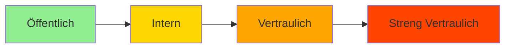
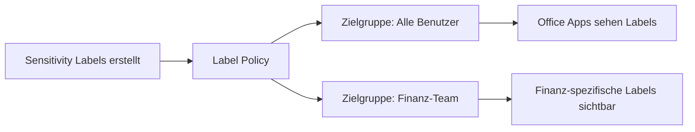
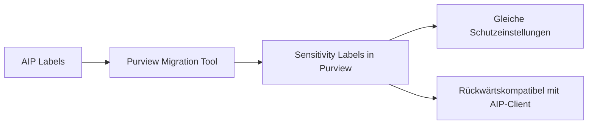

---
tags:
  - microsoft365
  - compliance
  - purview
  - sensitivity-labels
  - information-protection
  - dlp
aliases:
  - Labels
  - Sensitivity Labels M365
  - MIP Labels
---

# Sensitivity Labels

> [!ABSTRACT] TL;DR
> Sensitivity Labels sind das Herzstück von Microsoft Purview Information Protection. Sie klassifizieren und schützen Dokumente, E-Mails, SharePoint-Sites und Teams — durch Verschlüsselung, visuelle Markierungen und automatische Anwendung. Labels folgen dem Prinzip: Je sensitiver, desto restriktiver.

---

## Was sind Sensitivity Labels?

Sensitivity Labels sind persistente Metadaten, die an Dokumente, E-Mails und Container (Sites, Teams) angehängt werden. Sie:

- **Klassifizieren** Inhalte (Öffentlich, Intern, Vertraulich, etc.)
- **Schützen** durch Verschlüsselung und Zugriffsrechte
- **Markieren** visuell (Kopfzeilen, Fußzeilen, Wasserzeichen)
- **Reisen mit dem Dokument** — auch außerhalb von M365

---

## Label-Taxonomie

Eine typische Unternehmens-Klassifizierungshierarchie:



| Label | Beschreibung | Typische Einstellungen |
|-------|-------------|----------------------|
| **Öffentlich** | Für externe Veröffentlichung gedacht | Keine Verschlüsselung |
| **Intern** | Nur für Mitarbeiter | Keine Verschlüsselung, Wasserzeichen |
| **Vertraulich** | Sensible Geschäftsinformationen | Verschlüsselung (alle Mitarbeiter) |
| **Vertraulich / Extern** | Für externe Partner freigegeben | Verschlüsselung (Mitarbeiter + Partner) |
| **Streng Vertraulich** | Höchste Vertraulichkeit | Starke Verschlüsselung, eingeschränkte Weitergabe |

> [!NOTE]
> Labels werden durch eine **Zahl** (Priority) sortiert. Höhere Zahl = höheres Schutzniveau. Ein Label kann nicht durch ein Label niedrigerer Priorität ersetzt werden ohne Begründung (Justification).

---

## Label-Einstellungen

### 1. Encryption (Verschlüsselung)

| Einstellung | Beschreibung |
|-------------|-------------|
| **Assign permissions now** | Admin definiert Rechte vorab |
| **Let users assign permissions** | Benutzer entscheidet beim Anwenden |
| **None** | Keine Verschlüsselung |

**Berechtigungs-Optionen bei "Assign permissions now":**
- Spezifische Benutzer/Gruppen auswählen
- Alle authentifizierten Benutzer
- Spezifische Domänen (z.B. `@partner.com`)

### Rights Management — Berechtigungsstufen

| Berechtigung | View | Edit | Copy | Print | Forward | Full Control |
|-------------|------|------|------|-------|---------|-------------|
| **Viewer** | ✅ | ❌ | ❌ | ❌ | ❌ | ❌ |
| **Reviewer** | ✅ | ✅ | ❌ | ❌ | ✅ | ❌ |
| **Author** | ✅ | ✅ | ✅ | ✅ | ✅ | ❌ |
| **Co-Owner** | ✅ | ✅ | ✅ | ✅ | ✅ | ✅ |

### 2. Content Marking

```
Kopfzeile: "VERTRAULICH — Nur für internen Gebrauch"
Fußzeile:  "Klassifiziert durch: Contoso AG | © 2025"
Wasserzeichen: "STRENG VERTRAULICH"
```

> [!TIP]
> Verwende für Wasserzeichen dynamische Variablen: `${Item.Label}`, `${User.Name}`, `${Event.DateTime}`

### 3. Site and Group Protection

Labels können auf SharePoint-Sites, Teams und M365 Groups angewendet werden:

| Einstellung | Beschreibung |
|-------------|-------------|
| **Privacy** | Private oder Public (Site/Team) |
| **External User Access** | Gäste erlaubt oder blockiert |
| **Unmanaged Device Access** | Web-only oder vollständiger Zugriff |
| **SharePoint Site Sharing** | Sharing-Einschränkungen |

### 4. Auto-Labeling

Automatische Label-Anwendung auf Basis von Inhalten.

---

## Label-Publishing (Label Policies)

Labels werden über **Label Policies** an Benutzer verteilt:



### Policy-Einstellungen

| Einstellung | Beschreibung |
|-------------|-------------|
| **Default Label** | Standard-Label für neue Dokumente |
| **Mandatory Labeling** | Benutzer MUSS ein Label auswählen |
| **Justification for Downgrade** | Begründung erforderlich bei niedrigerem Label |
| **Label Help URL** | Link zu internen Richtlinien |
| **Outlook Default** | Separate Standard-Label für E-Mails |

> [!IMPORTANT]
> **Mandatory Labeling** bedeutet: Kein Dokument kann ohne Label gespeichert werden. Dies erhöht die Klassifizierungsrate erheblich, kann aber anfangs Widerstand bei Benutzern erzeugen.

---

## Auto-Labeling

### Client-side Auto-Labeling (Office Apps)
- Erkennt sensible Inhalte beim Tippen
- Zeigt eine **Empfehlung** an (Label vorschlagen)
- Oder wendet automatisch an (bei konfigurierter Auto-Labeling-Bedingung)
- Basiert auf: SITs, Keywords, Trainable Classifiers

### Service-side Auto-Labeling
Scannt bereits gespeicherte Dateien in SharePoint/OneDrive/Exchange **im Hintergrund**:

1. **Simulation Mode**: Zeigt an, was gelabelt werden würde (ohne Änderung)
2. **Active Mode**: Labelt Dateien automatisch

```powershell
# Auto-Labeling Policy erstellen
New-AutoSensitivityLabelPolicy -Name "GDPR Auto-Label" `
    -ApplySensitivityLabel "Vertraulich" `
    -SharePointLocation All `
    -OneDriveLocation All

# Regel zur Policy hinzufügen
New-AutoSensitivityLabelRule -Name "IBAN-Erkennung" `
    -Policy "GDPR Auto-Label" `
    -ContentContainsSensitiveInformation @{Name="IBAN"; minCount=1}
```

---

## Labels in verschiedenen Diensten

### Office Apps (Word, Excel, PowerPoint, Outlook)
- Sensitivity-Bar in der Menüleiste
- Label-Auswahl beim Erstellen neuer Dateien
- Automatische visuelle Markierungen
- Verschlüsselung wird beim Speichern angewendet

### SharePoint Sites, Teams, M365 Groups
```powershell
# Label auf SharePoint Site anwenden
Set-SPOSite -Identity "https://contoso.sharepoint.com/sites/Finanzen" `
            -SensitivityLabel "Vertraulich"
```

### Power BI
- Sensitivity Labels in Datasets, Berichten, Dashboards
- Beim Export (Excel, PDF) wird Label übertragen
- DLP-Richtlinien können Labels in Power BI erkennen

### Microsoft Teams Meetings
- Meeting-Labels (erfordert Teams Premium)
- Kontrolle: Wer kann aufzeichnen? Wer kann beitreten?
- Lobby-Einstellungen basierend auf Label

---

## Label-Migration von Azure Information Protection (AIP)

Alte AIP-Labels können auf Sensitivity Labels migriert werden:



> [!WARNING]
> Nach der Migration: AIP Unified Labeling Client wird ersetzt durch **Microsoft Purview Information Protection Client**. Der alte AIP-Add-in für Office ist deprecated (EOL September 2025).

---

## PowerShell-Verwaltung

```powershell
# Verbinden
Connect-IPPSSession

# Alle Labels anzeigen
Get-Label | Select-Object Name, Priority, IsActive

# Neues Label erstellen
New-Label -Name "Streng Vertraulich" `
          -DisplayName "Streng Vertraulich" `
          -Tooltip "Höchste Vertraulichkeit — nicht extern teilen" `
          -EncryptionEnabled $true `
          -EncryptionProtectionType Template `
          -EncryptionRightsDefinitions "contoso.com:VIEW,EDIT,PRINT"

# Label-Policy erstellen
New-LabelPolicy -Name "Standard-Policy" `
                -Labels "Öffentlich","Intern","Vertraulich" `
                -ExchangeLocation All `
                -SharePointLocation All `
                -OneDriveLocation All

# Mandatory Labeling aktivieren
Set-LabelPolicy -Identity "Standard-Policy" -MandatoryLabel $true
```

---

## Troubleshooting

### Häufige Probleme

| Problem | Ursache | Lösung |
|---------|---------|--------|
| Label nicht sichtbar in Office | Policy nicht publiziert oder synchroisiert | 24h warten, oder M365 Apps-Cache leeren |
| Verschlüsselung funktioniert nicht | Benutzer nicht in Berechtigung enthalten | Berechtigungs-Konfiguration prüfen |
| Auto-Labeling greift nicht | SIT-Schwellenwert nicht erreicht | Simulation Mode für Diagnose nutzen |
| Label wird nicht von Entra ID erkannt | Migration nicht abgeschlossen | AIP Scanner Logs prüfen |

### Diagnose-Tools
```powershell
# Purview Information Protection Client Diagnose
Start-MIPDiagnostics

# Label-Policy für Benutzer prüfen
(Get-LabelPolicy -Identity "Standard-Policy").Labels

# Welche Labels hat ein Benutzer?
Get-User -Identity "user@contoso.com" | 
    Get-LabelPolicy | 
    Select-Object Labels
```

---

## Verwandte Notizen
- [[Microsoft Purview Grundlagen]]
- [[Data Loss Prevention DLP]]
- [[Microsoft Defender for Cloud Apps]]
- [[Microsoft Secure Score]]
