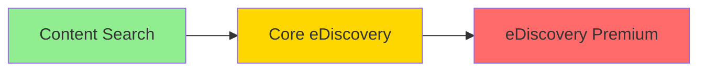
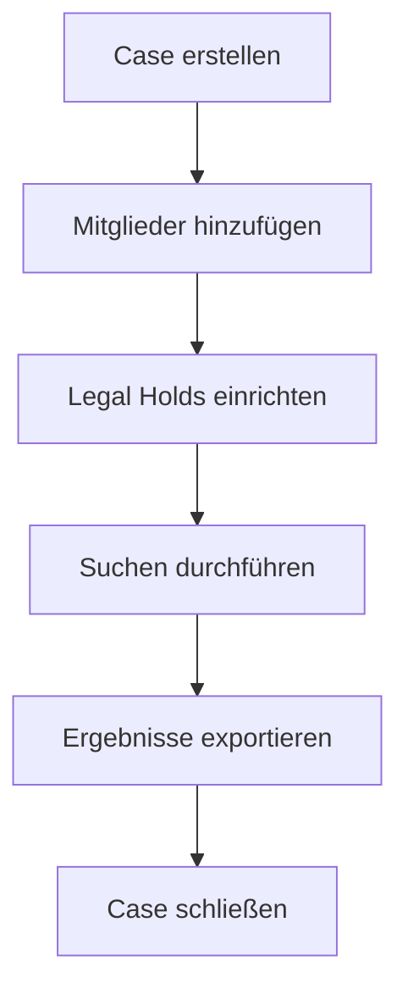
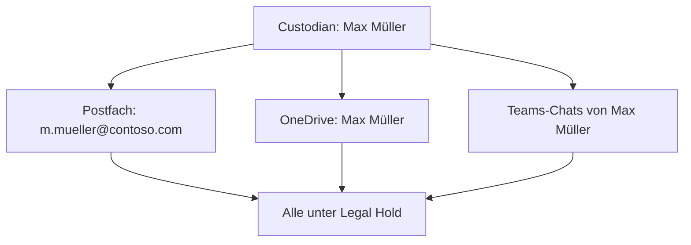
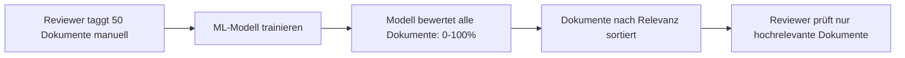
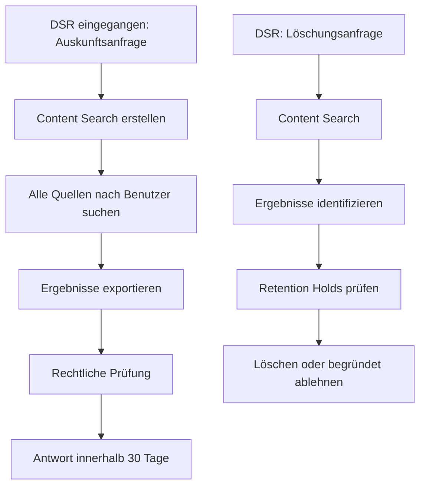

---
tags:
  - microsoft365
  - compliance
  - purview
  - ediscovery
  - audit
  - legal-hold
aliases:
  - eDiscovery
  - Audit Log
  - Legal Hold
  - Unified Audit Log
---

# eDiscovery und Audit

> [!ABSTRACT] TL;DR
> Microsoft Purview bietet drei eDiscovery-Stufen (Content Search, Core, Premium) für rechtliche Untersuchungen sowie ein Unified Audit Log für Aktivitätsnachweise. eDiscovery Premium unterstützt komplexe Rechtsfälle mit Custodians, Review Sets und ML-Analyse; Audit Premium liefert hochwertige Ereignisse mit bis zu 10 Jahren Aufbewahrung.

---

## eDiscovery-Übersicht



| Feature | Content Search | Core eDiscovery | eDiscovery Premium |
|---------|---------------|----------------|-------------------|
| **Cases** | ❌ | ✅ | ✅ |
| **Legal Hold** | ❌ | ✅ | ✅ |
| **KQL-Suche** | ✅ | ✅ | ✅ |
| **Export** | ✅ (eingeschränkt) | ✅ | ✅ |
| **Custodians** | ❌ | ❌ | ✅ |
| **Review Sets** | ❌ | ❌ | ✅ |
| **Analytics** | ❌ | ❌ | ✅ |
| **Predictive Coding** | ❌ | ❌ | ✅ |
| **Lizenz** | E3 | E3 | E5 |

---

## Content Search

Content Search ist die einfachste Suchmethode — kein Case nötig.

### Suchbare Speicherorte
- Exchange Online Postfächer
- SharePoint Online Sites
- OneDrive for Business
- Microsoft Teams Chats und Kanäle
- Microsoft 365 Groups

### KQL-Suchabfragen

```
# Grundlegende KQL-Syntax
subject:"Quartalsbericht 2024"                    # Betreff-Suche
from:ceo@contoso.com                              # Von bestimmtem Absender
to:legal@contoso.com                              # An bestimmten Empfänger
sent:01.01.2024..31.12.2024                       # Zeitraum
kind:email subject:"Projekt Phoenix"              # E-Mails mit Betreff
kind:document filetype:xlsx "Umsatzzahlen"        # Excel-Dateien
cc:partner@extern.com AND "vertraulich"           # CC + Keyword
```

### Export-Formate
| Format | Beschreibung |
|--------|-------------|
| **PST** | Outlook-Archiv für E-Mails |
| **Native Format** | Originaldateien (DOCX, XLSX, etc.) |
| **Single HTML** | Alle E-Mails in einer HTML-Datei |
| **MSG** | Einzelne E-Mail-Dateien |
| **EDRM XML** | Für eDiscovery-Tools (Nuix, Relativity) |

---

## Core eDiscovery

Core eDiscovery fügt Cases, Legal Hold und strukturierten Workflow hinzu.

### Case-Verwaltung


### Legal Hold
Legal Hold verhindert das Löschen von Daten für rechtliche Zwecke:

```powershell
# Verbinden
Connect-IPPSSession

# Core eDiscovery Case erstellen
New-ComplianceCase -Name "Rechtsstreit Müller 2025"

# Legal Hold auf Postfach einrichten
New-CaseHoldPolicy -Name "Hold Müller" `
    -Case "Rechtsstreit Müller 2025" `
    -ExchangeLocation "max.mueller@contoso.com"

# Hold-Regel ohne Zeitbeschränkung
New-CaseHoldRule -Name "Hold Regel Müller" `
    -Policy "Hold Müller"

# SharePoint auch unter Hold stellen
Set-CaseHoldPolicy -Identity "Hold Müller" `
    -AddSharePointLocation "https://contoso.sharepoint.com/sites/projekte"
```

---

## eDiscovery Premium

eDiscovery Premium (früher Advanced eDiscovery) bietet einen vollständigen rechtlichen Workflow für komplexe Fälle.

### Custodians (Verwalter)
Custodians sind Personen, die relevante Daten besitzen oder kontrollieren:

1. **Custodian hinzufügen**: Benutzer dem Case zuordnen
2. **Datenquellen zuordnen**: Postfach, OneDrive, Teams, SharePoint
3. **Hold Status**: Custodians automatisch unter Legal Hold
4. **Hold-Benachrichtigung**: Automatische E-Mail-Benachrichtigung an Custodian



### Review Sets
Review Sets sind Arbeitsbereiche für die Dokumentenprüfung:

| Funktion | Beschreibung |
|---------|-------------|
| **Dokumente anzeigen** | Native oder konvertierte Ansicht |
| **Tagging** | Relevanz, Privileg, Kategorie markieren |
| **Annotation** | Dokumente annotieren |
| **Redaction** | Inhalte schwärzen |
| **Conversation Reconstruction** | E-Mail-Threads und Teams-Nachrichten zusammenfassen |

### Analytics
| Analyse-Typ | Beschreibung |
|------------|-------------|
| **Near-Duplicate Detection** | Ähnliche Dokumente gruppieren |
| **Email Threading** | E-Mail-Konversationen als Thread darstellen |
| **Themes** | Hauptthemen aus Dokumenten extrahieren |
| **Predictive Coding** | ML-Relevanz-Bewertung (Prioritization) |

### Predictive Coding
ML-Modell lernt aus manuellen Tags und bewertet die Relevanz ungereviewter Dokumente:



---

## Legal Hold vs. Retention Hold

| Aspekt | Legal Hold | Retention Policy/Label |
|--------|------------|----------------------|
| **Zweck** | Rechtliche Anforderung | Compliance/Lifecycle |
| **Dauer** | Bis zum Ende des Falles | Feste Zeitspanne |
| **Löschung** | Blockiert | Kann nach Frist löschen |
| **Benachrichtigung** | Optional (eDiscovery Premium) | Keine |
| **Sichtbar für Benutzer** | Nein (transparent) | Nein |

---

## Audit Log

### Standard vs. Premium Audit

| Aspekt | Audit Standard | Audit Premium |
|--------|---------------|--------------|
| **Aufbewahrung** | 90 Tage | 1 Jahr (E5), erweiterbar auf 10 Jahre |
| **Aktivitäten** | Alle Standard-Aktivitäten | + High-Value Events |
| **Suche** | Purview Portal, PowerShell | Purview Portal, PowerShell |
| **Lizenz** | E3 | E5 oder Audit Premium Add-on |

### Audit-Suche im Purview-Portal
`purview.microsoft.com → Audit`

Filter:
- **Zeitraum**: Bis zu 90 Tage (Standard) / 1 Jahr (Premium)
- **Aktivitäten**: Aus Dropdown auswählen
- **Benutzer**: Bestimmte Benutzer filtern
- **Datei/Ordner**: Bestimmte Dateipfade
- **Dienst**: Exchange, SharePoint, Teams, etc.

### Wichtige auditierte Aktivitäten

| Dienst | Aktivität | Event |
|--------|----------|-------|
| **Exchange** | E-Mail gelesen | MailItemsAccessed (Premium) |
| **Exchange** | E-Mail gesendet | Send (Premium) |
| **Exchange** | Weiterleitung eingerichtet | Set-InboxRule |
| **SharePoint** | Datei heruntergeladen | FileDownloaded |
| **SharePoint** | Freigabe erstellt | SharingSet |
| **Teams** | Meeting aufgezeichnet | MeetingRecordingStarted |
| **Entra ID** | Anmeldung | UserLoggedIn |
| **Entra ID** | Passwort geändert | ChangeUserPassword |
| **Admin** | Admin-Rolle zugewiesen | Add member to role |
| **Purview** | DLP Policy match | DLPRuleMatch |

---

## Audit Premium — High-Value Events

Audit Premium protokolliert zusätzliche hochwertige Ereignisse:

| Event | Bedeutung |
|-------|-----------|
| **MailItemsAccessed** | Jedes Öffnen einer E-Mail (für Phishing-Forensik) |
| **Send** | Jede gesendete E-Mail |
| **SearchQueryInitiatedExchange** | Suchabfragen in Outlook/Exchange |
| **SearchQueryInitiatedSharePoint** | Suchabfragen in SharePoint |
| **FileAccessedExtended** | Erweiterte Dateizugriffsprotokollierung |

> [!IMPORTANT]
> **MailItemsAccessed** ist entscheidend für Incident Response: "Wann genau hat der Angreifer welche E-Mails gelesen?" — nur mit Audit Premium beantwortbar.

---

## Via Microsoft Purview Compliance Portal (UI)

### Audit Log durchsuchen

1. Öffne **Microsoft Purview Compliance Portal** unter [purview.microsoft.com](https://purview.microsoft.com)
2. Navigiere zu **Überwachung → Überwachungssuche**
3. Konfiguriere die Suche:
   - **Datumsbereich:** Start- und Enddatum festlegen
   - **Aktivitäten:** Spezifische Aktivitäten auswählen oder alle einschließen
   - **Benutzer:** Optional auf bestimmte Benutzer einschränken
   - **Datei/Ordner/Website:** Optional nach Ressource filtern
4. Klicke auf **Suche**
5. Warte auf die Ergebnisse und klicke auf einzelne Einträge für Details

### eDiscovery-Fall erstellen

1. Navigiere zu **eDiscovery → Premium**
2. Klicke auf **+ Fall erstellen**
3. Konfiguriere:
   - **Name:** Fallbezeichnung (z.B. Fallnummer oder Projekt)
   - **Beschreibung:** Kurzbeschreibung des Falles
   - **Mitglieder:** Berechtigte Personen hinzufügen
4. Klicke auf **Speichern** und öffne den neuen Fall
5. Füge unter **Quellen → Custodians** die relevanten Datenhüter hinzu
6. Erstelle unter **Haltebereich** einen Legal Hold für die Quellen

> [!NOTE]
> Für die Audit-Suche ist mindestens die Rolle **Überwachungsprotokolle anzeigen** erforderlich. Premium-Audit benötigt eine E5- oder Audit-Add-on-Lizenz.

---

## Audit Log über PowerShell

```powershell
# Verbinden
Connect-ExchangeOnline

# Audit Log durchsuchen
Search-UnifiedAuditLog -StartDate "2025-01-01" `
                       -EndDate "2025-01-31" `
                       -UserIds "suspect@contoso.com" `
                       -Operations "FileDownloaded","FileSyncDownloadedFull" |
    Select-Object CreationDate, UserIds, Operations, AuditData |
    Export-Csv -Path "audit_export.csv"

# Fehlgeschlagene Logins
Search-UnifiedAuditLog -StartDate "2025-01-01" `
                       -EndDate "2025-01-31" `
                       -Operations "UserLoginFailed" `
                       -ResultSize 1000

# Admin-Aktivitäten
Search-UnifiedAuditLog -StartDate "2025-01-01" `
                       -EndDate "2025-01-31" `
                       -RecordType AzureActiveDirectory `
                       -Operations "Add member to role"

# DLP-Treffer
Search-UnifiedAuditLog -StartDate "2025-01-01" `
                       -EndDate "2025-01-31" `
                       -RecordType ComplianceDLPExchange
```

---

## DSGVO Betroffenenanfragen (DSR)

Data Subject Requests (DSR) können mit eDiscovery bearbeitet werden:



> [!TIP]
> Nutze **Microsoft Priva Subject Rights Requests** für einen automatisierten DSR-Workflow — statt manuelle eDiscovery-Suchen.

---

## Lizenzierung

| Feature | E3 | E5 | Add-on |
|---------|----|----|--------|
| Content Search | ✅ | ✅ | — |
| Core eDiscovery | ✅ | ✅ | — |
| eDiscovery Premium | ❌ | ✅ | eDiscovery Premium |
| Audit Standard (90 Tage) | ✅ | ✅ | — |
| Audit Premium (1 Jahr) | ❌ | ✅ | Microsoft Purview Audit |
| Audit (10 Jahre) | ❌ | ❌ | 10-Year Audit Retention Add-on |

---

## Verwandte Notizen
- [[Microsoft Purview Grundlagen]]
- [[Retention Policies und Labels]]
- [[Microsoft Priva]]
- [[Communication Compliance]]
