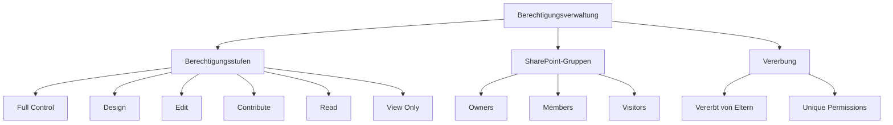
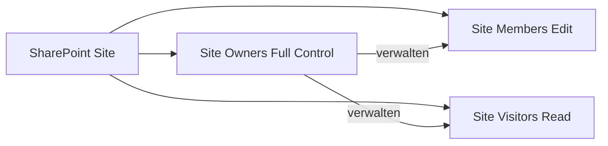
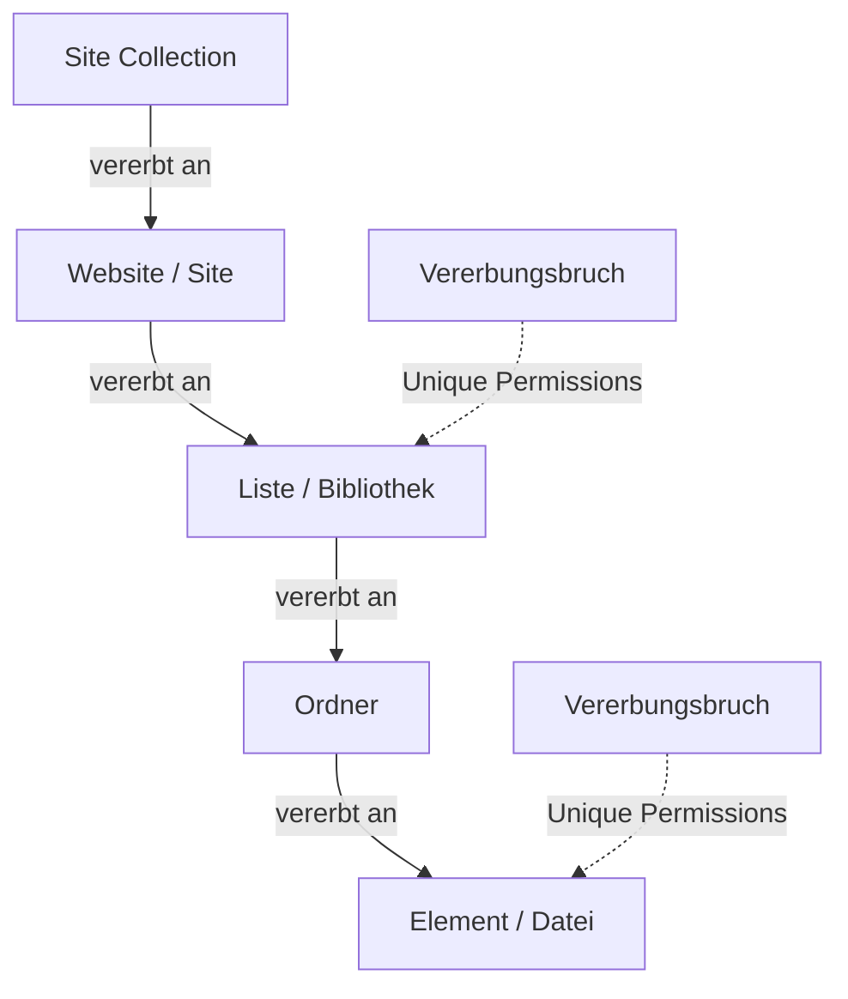
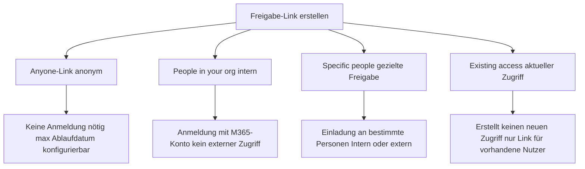
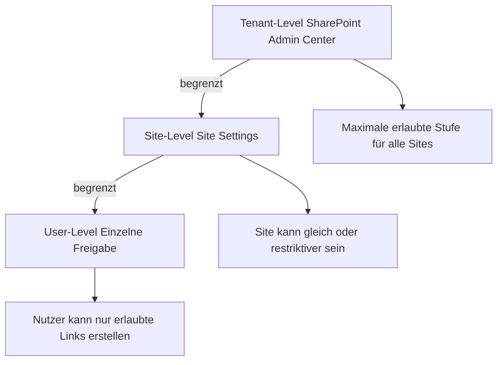
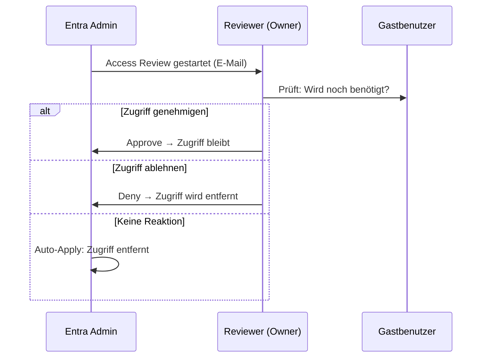
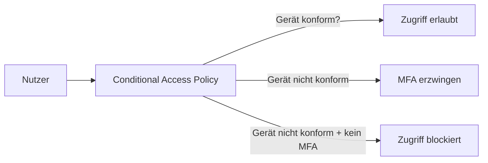
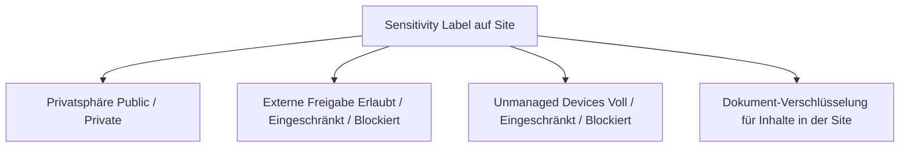
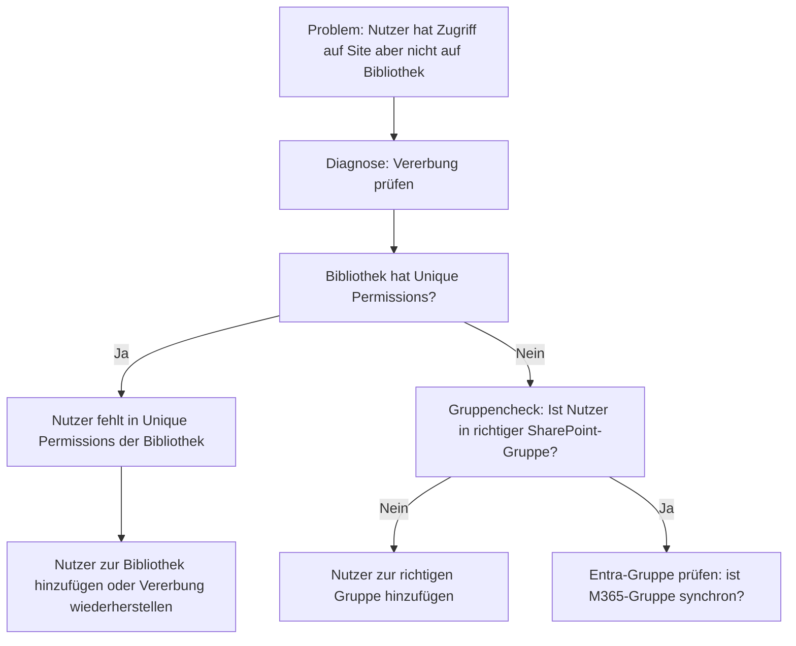

---
tags:
  - microsoft365
  - sharepoint
  - sharepoint-online
  - berechtigungen
  - sharing
  - sicherheit
  - governance
aliases:
  - SPO Berechtigungen
  - SharePoint Sharing
  - Freigaben SharePoint
---

# Berechtigungen und Sharing

> [!ABSTRACT] TL;DR
> SharePoint Online nutzt ein hierarchisches Berechtigungsmodell auf Basis von Berechtigungsstufen (Full Control, Edit, Read) und Standardgruppen (Owners, Members, Visitors). Freigabe-Links ermöglichen flexibles Teilen von Inhalten — von anonymen Anyone-Links bis zu internen Org-Links. Externe Freigabe wird auf Tenant- und Site-Ebene durch Richtlinien gesteuert, während Conditional Access, Sensitivity Labels und Access Reviews für Sicherheit und Compliance sorgen.

---

## Berechtigungsmodell

SharePoint Online verwendet ein rollenbasiertes Berechtigungsmodell mit drei Kernkomponenten: **Berechtigungsstufen**, **SharePoint-Gruppen** und **Berechtigungsvererbung**.



### Berechtigungsstufen (Permission Levels)

| Berechtigungsstufe | Typische Gruppe | Kernrechte |
|-------------------|----------------|-----------|
| **Full Control** | Owners | Alle Rechte inkl. Berechtigungsverwaltung |
| **Design** | (selten) | Bearbeiten + Seiten- und Formulardesign ändern |
| **Edit** | Members | Elemente lesen, hinzufügen, bearbeiten, löschen — keine Berechtigungsverwaltung |
| **Contribute** | (individuell) | Elemente hinzufügen, bearbeiten, löschen — keine Listen/Bibliotheken verwalten |
| **Read** | Visitors | Nur lesend, keine Änderungen |
| **View Only** | (individuell) | Anzeige ohne Download (Dokumentbibliotheken) |
| **Limited Access** | (automatisch) | Systemreserviert — minimaler Zugriff auf übergeordnete Site |

> [!NOTE] Limited Access
> Die Stufe **Limited Access** wird automatisch von SharePoint vergeben, wenn ein Nutzer Zugriff auf ein einzelnes Element unterhalb einer Site erhält. Sie kann nicht manuell zugewiesen werden und ermöglicht nur den Zugriff auf das spezifische Element, nicht auf die gesamte Site.

### Berechtigungen im Detail

Jede Berechtigungsstufe setzt sich aus granularen Einzelrechten zusammen:

| Einzelrecht | Full Control | Edit | Contribute | Read |
|------------|:---:|:---:|:---:|:---:|
| Elemente anzeigen | ✓ | ✓ | ✓ | ✓ |
| Elemente hinzufügen | ✓ | ✓ | ✓ | — |
| Elemente bearbeiten | ✓ | ✓ | ✓ | — |
| Elemente löschen | ✓ | ✓ | ✓ | — |
| Listen verwalten | ✓ | ✓ | — | — |
| Berechtigungen verwalten | ✓ | — | — | — |
| Web hinzufügen/löschen | ✓ | — | — | — |
| Design ändern | ✓ | — | — | — |

---

## Standard-Berechtigungsgruppen

Jede SharePoint-Site verfügt automatisch über drei Standard-Gruppen. Diese Gruppen sind site-spezifisch und werden nicht mandantenübergreifend geteilt.



### Owners (Site-Besitzer)

- **Berechtigungsstufe:** Full Control
- **Standardmitglieder:** Ersteller der Site + M365-Gruppenbesitzer (bei Team Sites)
- **Rechte:** Vollständige Kontrolle inklusive Berechtigungsverwaltung, Site-Einstellungen, Aussehen und Fremdkonfiguration
- **Empfehlung:** Mindestens 2, maximal 5 Owners pro Site

> [!IMPORTANT] Owners mit Bedacht vergeben
> Jeder Site Owner kann Berechtigungen für beliebige Nutzer — auch externe Gäste — vergeben. Beschränke die Anzahl der Owners und stelle sicher, dass sie die Freigabe-Richtlinien des Unternehmens kennen.

### Members (Mitglieder)

- **Berechtigungsstufe:** Edit
- **Standardmitglieder:** Mitglieder der verbundenen Microsoft 365-Gruppe (bei Team Sites)
- **Rechte:** Vollständige Inhaltsverwaltung ohne Berechtigungsänderungen — Lesen, Erstellen, Bearbeiten, Löschen
- **Typische Nutzer:** Alle aktiven Teammitglieder, die Inhalte beitragen

### Visitors (Besucher)

- **Berechtigungsstufe:** Read
- **Standardmitglieder:** Leer (muss manuell befüllt werden)
- **Rechte:** Ausschließlich lesender Zugriff — keine Änderungen möglich
- **Typische Nutzer:** Abteilungsfremde Mitarbeiter, externe Stakeholder, Reviewers

### Benutzerdefinierte Gruppen erstellen

Neben den Standard-Gruppen können eigene Gruppen mit individuellen Berechtigungsstufen erstellt werden:

```
Site Settings → People and Groups → Groups → New Group
```

**Sinnvolle benutzerdefinierte Gruppen:**
- `[Projektname] Approvers` mit *Approve*-Berechtigung für Genehmigungsworkflows
- `[Projektname] Designers` mit *Design*-Berechtigung für Seitenlayout-Änderungen
- `Externe Partner` mit *Contribute* nur auf spezifische Bibliotheken

---

## Berechtigungsvererbung

### Vererbungsprinzip

SharePoint verwaltet Berechtigungen hierarchisch:



Standardmäßig erben alle untergeordneten Elemente (Sites, Listen, Ordner, Dateien) die Berechtigungen ihrer übergeordneten Ebene. Ändert man die Berechtigungen auf Site-Ebene, wirkt sich das automatisch auf alle Unterelemente mit aktivierter Vererbung aus.

### Vererbungsbruch (Stop Inheriting Permissions)

Ein Vererbungsbruch entkoppelt ein Element von den Berechtigungen der übergeordneten Ebene und erlaubt **individuelle (Unique) Berechtigungen**:

```
Bibliothek / Ordner / Datei → ... (drei Punkte) → Manage Access
→ Advanced Settings → Stop Inheriting Permissions
```

**Typische Anwendungsfälle für Vererbungsbruch:**
- Vertrauliche HR-Bibliothek innerhalb einer allgemeinen Team-Site
- Einzelne Projektdatei nur für Projektleiter sichtbar
- Externe Partner-Ordner mit eingeschränkten Rechten

> [!WARNING] Vererbungsbrüche sparsam einsetzen
> Zu viele Vererbungsbrüche erhöhen die Komplexität der Berechtigungsverwaltung erheblich. Sie erschweren Berechtigungsberichte, machen Audits aufwändiger und führen häufig zu Berechtigungsfehlern. Nutze stattdessen eigene Sites für unterschiedliche Zugriffsanforderungen.

### Vererbung wiederherstellen

Um die Vererbung eines Elements wiederherzustellen:

```
Element → Manage Access → Advanced Settings → Delete Unique Permissions
→ Inherit Permissions
```

> [!DANGER] Achtung beim Wiederherstellen der Vererbung
> Beim Zurücksetzen auf Vererbung werden **alle einzigartigen Berechtigungen des Elements unwiderruflich gelöscht**. Vorher prüfen, ob Nutzer von dieser Änderung betroffen sein könnten!

---

## Via SharePoint Admin Center (UI)

### Berechtigungen über die Site-Einstellungen verwalten

#### Benutzer zu SharePoint-Gruppe hinzufügen

1. Öffne die gewünschte SharePoint-Site
2. Klicke auf das **Zahnrad-Symbol (Einstellungen) → Site-Berechtigungen**
3. Klicke auf **Mitglieder einladen** oder wähle eine Gruppe (Owners / Members / Visitors)
4. Klicke auf **⋮ → Mitglieder hinzufügen**, gib Namen oder E-Mail ein
5. Klicke auf **Hinzufügen**

> [!TIP]
> Direkt in einer Site: **Einstellungen (Zahnrad) → Site-Berechtigungen → Alle Berechtigungen anzeigen** öffnet die klassische Berechtigungsseite.

#### Vererbungsbruch für Bibliothek / Liste setzen

1. Öffne die gewünschte **Bibliothek oder Liste** → klicke auf **Einstellungen (Zahnrad) → Bibliothekseinstellungen**
2. Klicke auf **Berechtigungen für diese Bibliothek** (unter „Berechtigungen und Verwaltung")
3. Klicke auf **Berechtigungsvererbung unterbrechen → OK**
4. Passe Berechtigungen an: **Berechtigungen erteilen** oder Gruppen / Benutzer entfernen

#### Individuelle Berechtigung auf Listenelement setzen

1. Klicke auf das Element → **⋮ → Mehr → Zugriff verwalten**
2. Klicke auf **Erweitert** → **Berechtigungsvererbung unterbrechen**
3. Klicke auf **Berechtigungen erteilen** → Benutzer und Stufe auswählen → **Freigeben**

### Externe Freigabe-Richtlinien konfigurieren (Tenant-weit)

1. Öffne das **SharePoint Admin Center** unter [admin.microsoft.com/sharepoint](https://admin.microsoft.com/sharepoint)
2. Navigiere zu **Richtlinien → Freigabe**
3. Stelle den Schieberegler für **SharePoint** auf die gewünschte Stufe:
   - **Jeder** — Anonyme Links erlaubt
   - **Neue und vorhandene Gäste** — Authentifizierung erforderlich
   - **Nur vorhandene Gäste** — Keine neuen Gasteinladungen
   - **Nur Personen in Ihrer Organisation** — Keine externe Freigabe
4. Konfiguriere unter **Erweiterte Einstellungen für externe Freigabe**:
   - **Standardlinktyp** (intern / spezifische Personen / anonym)
   - **Ablaufdatum** für Jeder-Links (empfohlen: 30 Tage)
   - **Domaineinschränkungen** (Erlaubnisliste / Sperrliste)
5. Klicke auf **Speichern**

### Externe Freigabe pro Site konfigurieren

1. Navigiere im SPAC zu **Sites → Aktive Sites**
2. Klicke auf den **Site-Namen** → Detailpanel öffnet sich
3. Klicke im oberen Menü auf **Freigabe**
4. Wähle den Freigabe-Level für diese Site (maximal gleich dem Tenant-Level)
5. Aktiviere optional **Erweiterte Einstellungen**: Domaineinschränkungen, Linkablauf
6. Klicke auf **Speichern**

> [!NOTE]
> Berechtigungsberichte und der **„Check Permissions"**-Check für einzelne Benutzer sind nur über **Site-Einstellungen → Websiteberechtigungen → Berechtigungen prüfen** oder PowerShell verfügbar. Das Access Review Dashboard befindet sich im Microsoft Entra Admin Center.

---

## Individuelle Berechtigungen vergeben

### Benutzer oder Gruppe direkt hinzufügen

Im modernen SharePoint-Interface:

```
Site → Einstellungen (Zahnrad) → Site Permissions → Share site
→ Nutzer oder Gruppe eingeben → Berechtigungsstufe wählen
```

Alternativ über das klassische Interface:

```
Site Settings → Site Permissions → Grant Permissions
→ Nutzer/Gruppe angeben → Berechtigungsstufe wählen → OK
```

### Powershell: Berechtigungen setzen (PnP)

```powershell
# Verbindung herstellen
Connect-PnPOnline -Url "https://contoso.sharepoint.com/sites/Projekt" -Interactive

# Nutzer zur Site Members-Gruppe hinzufügen
Add-PnPGroupMember -LoginName "user@contoso.com" -Group "Projekt Members"

# Individuelle Berechtigung auf Bibliothek vergeben
Set-PnPListPermission -Identity "Dokumente" `
    -User "user@contoso.com" `
    -AddRole "Read"

# Berechtigung auf Element-Ebene (Unique Permission erforderlich)
$item = Get-PnPListItem -List "Dokumente" -Id 5
Set-PnPListItemPermission -List "Dokumente" `
    -Identity $item `
    -User "user@contoso.com" `
    -AddRole "Contribute"
```

### Benutzer aus Gruppe entfernen

```powershell
# Mitglied aus Gruppe entfernen
Remove-PnPGroupMember -LoginName "user@contoso.com" -Group "Projekt Members"

# Alle Mitglieder einer Gruppe anzeigen
Get-PnPGroupMember -Group "Projekt Members"
```

---

## Freigabe-Links (Sharing Links)

SharePoint und OneDrive bieten vier verschiedene Link-Typen für die Freigabe von Dateien und Ordnern:



### Anyone-Link (Anonym)

- **Zugriff:** Jeder mit dem Link — keine Anmeldung erforderlich
- **Risiko:** Höchstes Risiko — Link kann unbeabsichtigt weitergegeben werden
- **Konfigurierbar:** Ablaufdatum (max. Tenant-weit konfigurierbar), Passwort, Bearbeitung sperren
- **Kann deaktiviert werden:** Auf Tenant- oder Site-Ebene

> [!DANGER] Anyone-Links kontrollieren
> Anyone-Links ermöglichen den Zugriff für beliebige Personen ohne Authentifizierung. Sie sollten nur bei explizitem Bedarf erlaubt und mit **Ablaufdatum** sowie **Passwort** gesichert sein.

### People in your organization (Intern)

- **Zugriff:** Alle authentifizierten Nutzer im Tenant
- **Externe Nutzer:** Kein Zugriff, auch keine Gastbenutzer
- **Ideal für:** Unternehmensweite Ressourcen, die jeder Mitarbeiter sehen darf
- **Anmeldung:** Microsoft 365-Konto erforderlich

### Specific people (Gezielte Freigabe)

- **Zugriff:** Nur explizit eingeladene Personen (intern oder extern)
- **Externe Nutzer:** Erhalten eine Einladungs-E-Mail und müssen sich authentifizieren
- **Sicherste Option** für gezielte Zusammenarbeit mit benannten Personen
- **Link ist personalisiert:** Andere Nutzer können ihn nicht nutzen

### Existing access (Bestehender Zugriff)

- **Zugriff:** Erstellt **keinen** neuen Zugriff — nur ein Link für Nutzer, die bereits Zugriff haben
- **Ideal für:** Interne Kommunikation ("Hier ist der direkte Link zur Datei")
- **Sicher:** Kein unbeabsichtigter Zugriff durch Link-Weitergabe möglich

### Link-Berechtigungen

Für jeden Link-Typ kann die Berechtigung festgelegt werden:

| Berechtigung | Beschreibung |
|------------|-------------|
| **Can edit** | Lesen und Bearbeiten der Datei/des Ordners |
| **Can review** | Kommentare hinzufügen, keine Änderungen (nur für Dateien) |
| **Can view** | Nur Lesen, kein Download |
| **Can't download** | Anzeigen, aber kein Download (View Only) |

---

## Link-Sicherheitsoptionen

### Ablaufdatum (Expiration Date)

Freigabe-Links können mit einem automatischen Ablaufdatum versehen werden:

```
Datei teilen → Link-Einstellungen → Set expiration date → Datum wählen
```

**Tenant-weite Standardkonfiguration (SharePoint Admin Center):**

```
SharePoint Admin Center → Richtlinien → Freigabe
→ Choose expiration and permissions options for Anyone links
→ "Links müssen innerhalb von X Tagen ablaufen"
```

> [!TIP] Ablaufdatum als Standard erzwingen
> Konfiguriere im Admin Center einen **maximalen Ablaufzeitraum** für Anyone-Links (Empfehlung: 30 Tage). So läuft jeder anonyme Link automatisch ab und muss bei Bedarf neu erstellt werden.

### Passwortschutz

Anyone-Links können mit einem Passwort gesichert werden:

```
Datei teilen → Link-Einstellungen → Set password → Passwort eingeben
```

Das Passwort wird **nicht** in der Freigabe-E-Mail mitgesendet und muss separat kommuniziert werden.

> [!NOTE] Passwort-Erzwingung via PowerShell
> Passwort-Anforderungen für Anyone-Links können tenant-weit erzwungen werden:
> ```powershell
> Set-SPOTenant -RequireAnonymousLinksExpireInDays 30
> ```

### PowerShell: Sharing Links verwalten

```powershell
# Alle Sharing Links einer Site abrufen
Connect-PnPOnline -Url "https://contoso.sharepoint.com/sites/Projekt" -Interactive

# Freigaben eines spezifischen Elements prüfen
Get-PnPFileSharingLink -FileUrl "/sites/Projekt/Dokumente/Vertrag.docx"

# Anyone-Link erstellen (mit Ablaufdatum)
New-PnPFileSharingLink -FileUrl "/sites/Projekt/Dokumente/Bericht.pdf" `
    -Type AnonymousAccess `
    -Scope Anonymous `
    -ExpirationDateTime (Get-Date).AddDays(14)

# Freigabe-Link entfernen
Remove-PnPFileSharingLink -FileUrl "/sites/Projekt/Dokumente/Alt.docx" -Force
```

---

## Externe Freigabe-Richtlinien

### Richtlinien-Hierarchie

Die externe Freigabe wird auf zwei Ebenen gesteuert:



> [!IMPORTANT] Tenant-Limit gilt immer
> Eine Site kann **niemals** permissiver sein als der Tenant. Wenn der Tenant auf *Existing guests only* gesetzt ist, kann keine Site *Anyone*-Links anbieten.

### Freigabe-Stufen

| Stufe | Beschreibung | Risiko |
|-------|-------------|--------|
| **Anyone** | Anonym + beliebige externe Nutzer | Hoch |
| **New and existing guests** | Gasteinladungen + bestehende Gäste | Mittel |
| **Existing guests only** | Nur bereits im Verzeichnis vorhandene Gäste | Niedrig |
| **Only people in your organization** | Keine externe Freigabe | Minimal |

### Tenant-Level konfigurieren

```
SharePoint Admin Center → Richtlinien → Freigabe
```

```powershell
# Tenant-Freigabestufe setzen
Set-SPOTenant -SharingCapability ExternalUserAndGuestSharing  # Anyone
Set-SPOTenant -SharingCapability ExternalUserSharingOnly       # New+Existing
Set-SPOTenant -SharingCapability ExistingExternalUserSharingOnly # Existing only
Set-SPOTenant -SharingCapability Disabled                       # Keine externe Freigabe

# Aktuelle Einstellungen anzeigen
Get-SPOTenant | Select SharingCapability, DefaultSharingLinkType, RequireSignIn
```

### Site-Level konfigurieren

```powershell
# Externe Freigabe für eine einzelne Site konfigurieren
Set-SPOSite -Identity "https://contoso.sharepoint.com/sites/HR" `
    -SharingCapability ExistingExternalUserSharingOnly

# Site-spezifische Einstellungen anzeigen
Get-SPOSite -Identity "https://contoso.sharepoint.com/sites/Projekt" `
    | Select SharingCapability, DefaultSharingLinkType
```

### Domain-Beschränkungen

Externe Freigaben können auf bestimmte Domains eingeschränkt oder geblockt werden:

```powershell
# Nur Freigabe an bestimmte Domains erlauben
Set-SPOTenant -SharingDomainRestrictionMode AllowList `
    -SharingAllowedDomainList "partner.com contoso.de"

# Bestimmte Domains blockieren
Set-SPOTenant -SharingDomainRestrictionMode BlockList `
    -SharingBlockedDomainList "wettbewerber.com"
```

> [!TIP] Domain-Allowlist für Partner
> Nutze die Domain-Allowlist in B2B-Szenarien, um externe Freigaben ausschließlich auf Partnerdomains zu beschränken. Dies verhindert das versehentliche Teilen mit unbekannten externen Adressen.

---

## Access Reviews für Gastbenutzer

Microsoft Entra ID (Azure AD) ermöglicht regelmäßige **Access Reviews**, um Gastbenutzer-Zugriffe zu überprüfen und abgelaufene Berechtigungen zu entfernen.

### Access Review konfigurieren

```
Microsoft Entra Admin Center → Identity Governance → Access Reviews → New access review
```

**Empfohlene Konfiguration für Gastbenutzer:**
- **Überprüfungstyp:** Teams + Gruppen
- **Review-Scope:** Gäste (Guest users only)
- **Häufigkeit:** Quartalsweise
- **Reviewer:** Gruppenbesitzer
- **Automatische Aktion:** Zugriff entfernen bei fehlender Reaktion (Auto-apply)



> [!TIP] Regelmäßige Reviews planen
> Plane Access Reviews mindestens **quartalsweise** für alle externen Gastbenutzer. Unverhältnismäßig viele inaktive Gäste im Tenant erhöhen das Sicherheitsrisiko und verursachen Lizenzkosten (bei bestimmten Entra ID P2-Features).

---

## Berechtigungsberichte (Permission Reports)

### Eingebaute Berichte (SharePoint Admin Center)

```
SharePoint Admin Center → Berichte → Freigabeaktivität
```

Verfügbare Berichte:
- **Dateizugriffe**: Welche Dateien wurden von externen Nutzern aufgerufen?
- **Freigabe-Aktivität**: Wer hat was mit wem geteilt?
- **Gastbenutzer-Aktivität**: Aktive vs. inaktive Gastbenutzer

### Berechtigungsbericht per PowerShell generieren

```powershell
Connect-PnPOnline -Url "https://contoso.sharepoint.com/sites/Projekt" -Interactive

# Alle Nutzer und ihre Berechtigungen auf Site-Ebene
Get-PnPWeb -Includes RoleAssignments | ForEach-Object {
    $_.RoleAssignments | ForEach-Object {
        $ra = $_
        $ra.Member | Select-Object `
            @{N='LoginName'; E={$ra.Member.LoginName}},
            @{N='Title'; E={$ra.Member.Title}},
            @{N='Role'; E={($ra.RoleDefinitionBindings | Select-Object -ExpandProperty Name) -join ', '}}
    }
} | Format-Table -AutoSize

# Externe Nutzer in einer Site Collection anzeigen
Get-SPOExternalUser -SiteUrl "https://contoso.sharepoint.com/sites/Projekt"
```

### Site Permissions Report (Microsoft 365 Compliance Center)

```
Microsoft Purview Compliance Portal → Datenverwaltung → Inhaltsuche
→ Suchabfrage auf SharePoint-Aktivitäten
```

> [!NOTE] Audit-Log aktivieren
> Stelle sicher, dass das **Unified Audit Log** im Microsoft 365 Compliance Center aktiviert ist. Nur dann werden Freigabe-Aktivitäten für spätere Berichte protokolliert.

---

## Conditional Access für SharePoint

### Unmanaged Devices Policy

SharePoint kann den Zugriff von nicht verwalteten Geräten (Geräte ohne Entra Join oder Intune-Compliance) einschränken:

```
SharePoint Admin Center → Richtlinien → Zugriffssteuerung → Nicht verwaltete Geräte
```

| Richtlinienoptionen | Beschreibung |
|--------------------|-------------|
| **Vollzugriff erlauben** | Keine Einschränkung (Standard) |
| **Nur eingeschränkten Web-Zugriff** | Kein Download, kein Sync, kein mobiler App-Zugriff |
| **Zugriff blockieren** | Kein Zugriff von nicht verwalteten Geräten |

```powershell
# Nur eingeschränkten Web-Zugriff für nicht verwaltete Geräte
Set-SPOTenant -ConditionalAccessPolicy AllowLimitedAccess

# Zugriff vollständig blockieren
Set-SPOTenant -ConditionalAccessPolicy BlockAccess

# Einstellungen zurücksetzen
Set-SPOTenant -ConditionalAccessPolicy AllowFullAccess
```

### App-only Zugriff (Authentication Context)

Für feingranulare Kontrolle per **Authentication Context** in Entra ID:



```powershell
# Authentication Context für Site setzen (erfordert Entra ID P1)
Set-SPOSite -Identity "https://contoso.sharepoint.com/sites/Vertraulich" `
    -AuthenticationContextName "High Sensitivity"
```

> [!TIP] Conditional Access mit Intune kombinieren
> Kombiniere SharePoint Conditional Access mit **Microsoft Intune Device Compliance Policies**, um sicherzustellen, dass nur Geräte mit aktuellem Patch-Status und Festplattenverschlüsselung auf sensible SharePoint-Sites zugreifen können.

---

## Sensitivity Labels und Zugriffssteuerung

Microsoft Purview Sensitivity Labels können direkt auf SharePoint Sites, Teams und Microsoft 365-Gruppen angewendet werden und steuern Berechtigungen automatisch.

### Labels auf Sites anwenden

```
Site Settings → Site Information → Sensitivity → Label auswählen
```

Oder per PowerShell:

```powershell
# Alle verfügbaren Labels anzeigen
Get-Label | Select DisplayName, Guid, Priority

# Sensitivity Label auf Site anwenden
Set-SPOSite -Identity "https://contoso.sharepoint.com/sites/HR" `
    -SensitivityLabel "xxxxxxxx-xxxx-xxxx-xxxx-xxxxxxxxxxxx"
```

### Label-Einstellungen für Sites

| Einstellung | Beschreibung |
|------------|-------------|
| **Externe Freigabe** | Label kann externe Freigabe automatisch einschränken oder deaktivieren |
| **Zugriff von nicht verwalteten Geräten** | Label kann Geräteanforderungen erzwingen |
| **Datenschutz** | Public (Alle im Tenant sehen die Site) oder Private |
| **Encryption** | Dokumente in der Site werden automatisch verschlüsselt |



> [!IMPORTANT] Label-Hierarchie verstehen
> Ein restriktiveres Sensitivity Label auf einem Dokument überschreibt Site-Level-Einstellungen nicht vollständig — beide greifen unabhängig voneinander. Ein Dokument mit Label "Streng Vertraulich" bleibt verschlüsselt, auch wenn es in einer öffentlichen Site gespeichert ist.

---

## Troubleshooting Berechtigungsprobleme

### Häufige Fehler und Lösungen

| Fehler | Ursache | Lösung |
|--------|---------|--------|
| "Access Denied" bei Ordner-Zugriff | Vererbungsbruch mit fehlender Berechtigung | Unique Permissions des Ordners prüfen und Nutzer hinzufügen |
| Nutzer sieht Site nicht in Navigation | Fehlende Berechtigung auf Site-Ebene | Site Permissions prüfen, Limited Access vergeben |
| Externer Nutzer kann Link nicht öffnen | Site erlaubt keine externe Freigabe | Site-Freigabestufe erhöhen oder Specific People Link verwenden |
| Freigabe-Button fehlt | Nutzer hat keine Freigabe-Berechtigung | Mindestens "Contribute" + Freigabe-Erlaubnis erforderlich |
| Anyone-Link erstellen nicht möglich | Tenant oder Site hat Anyone-Links deaktiviert | Admin muss Freigabestufe erhöhen |
| Gastbenutzer verliert Zugriff nach Zeit | Access Review hat Zugriff entfernt | Access Review-Ergebnis prüfen, Zugriff neu vergeben |

### Berechtigungen eines Nutzers prüfen

```powershell
Connect-PnPOnline -Url "https://contoso.sharepoint.com/sites/Projekt" -Interactive

# Alle Gruppen eines Nutzers in der Site
$user = Get-PnPUser | Where-Object { $_.Email -eq "user@contoso.com" }
Get-PnPGroup | Where-Object { 
    (Get-PnPGroupMember -Group $_) | Where-Object { $_.Email -eq "user@contoso.com" }
} | Select Title

# Effektive Berechtigungen eines Nutzers prüfen (UI)
# Site Settings → Site Permissions → Check Permissions → E-Mail eingeben
```

### "Check Permissions" Tool (UI)

Das eingebaute Berechtigungsprüfungs-Tool ist der schnellste Weg, effektive Berechtigungen zu prüfen:

```
Site Settings → Site Permissions → Check Permissions
→ Name oder E-Mail des Nutzers eingeben → Check Now
```

Das Tool zeigt die effektive Berechtigungsstufe inklusive Gruppenmitgliedschaften und Vererbungsquelle an.

### Häufiger Fehler: Vererbungsbruch-Kaskade



> [!WARNING] M365-Gruppen-Sync beachten
> Wenn SharePoint-Gruppen mit Microsoft 365-Gruppen (Entra ID-Gruppen) verbunden sind, kann es bis zu **24 Stunden** dauern, bis Gruppenänderungen in SharePoint wirksam werden. Bei dringendem Zugriffsbedarf direkt in SharePoint-Gruppen hinzufügen.

### PowerShell-Diagnose: Alle Unique Permissions finden

```powershell
Connect-PnPOnline -Url "https://contoso.sharepoint.com/sites/Projekt" -Interactive

# Alle Elemente mit Unique Permissions in einer Bibliothek finden
$items = Get-PnPListItem -List "Dokumente" -Fields "FileLeafRef","HasUniqueRoleAssignments"
$items | Where-Object { $_["HasUniqueRoleAssignments"] -eq $true } | 
    Select-Object @{N='Datei'; E={$_["FileLeafRef"]}}, Id
```

---

## Best Practices

> [!TIP] Empfohlene Vorgehensweisen
>
> **Berechtigungsstruktur:**
> - Nutze **Microsoft 365-Gruppen** statt direkte Nutzerzuweisungen — einfachere Verwaltung
> - Vermeide Berechtigungen auf Datei-/Element-Ebene — nutze stattdessen eigene Sites oder Bibliotheken
> - Halte Vererbungsbrüche auf ein Minimum — max. 2 Ebenen tief
>
> **Externe Freigabe:**
> - Setze **Ablaufdaten** für alle Anyone-Links (max. 30 Tage)
> - Aktiviere **Passwortschutz** für sensible Anyone-Links
> - Nutze **Specific People Links** für externe Partner statt Anyone-Links
> - Definiere eine **Domain-Allowlist** für bekannte Partner-Domains
>
> **Governance:**
> - Führe quartalsweise **Access Reviews** für Gastbenutzer durch
> - Dokumentiere alle Vererbungsbrüche in einem zentralen Register
> - Aktiviere das **Unified Audit Log** für lückenlose Nachverfolgung
> - Setze **Sensitivity Labels** auf Sites mit vertraulichen Inhalten

---

## Verwandte Notizen

- [[SharePoint Online Grundlagen]]
- [[Websitesammlungen verwalten]]
- [[SharePoint Governance]]
- [[SharePoint PowerShell und PnP]]
- [[SharePoint Premium]]
