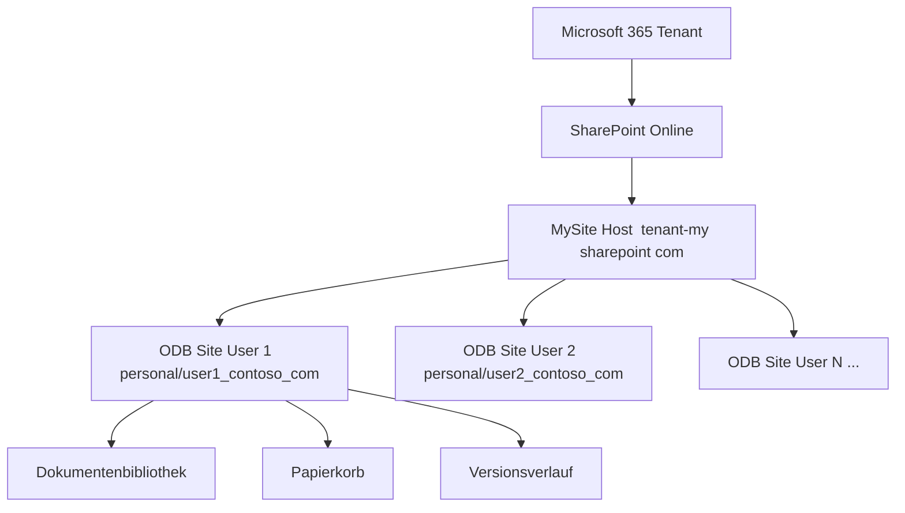
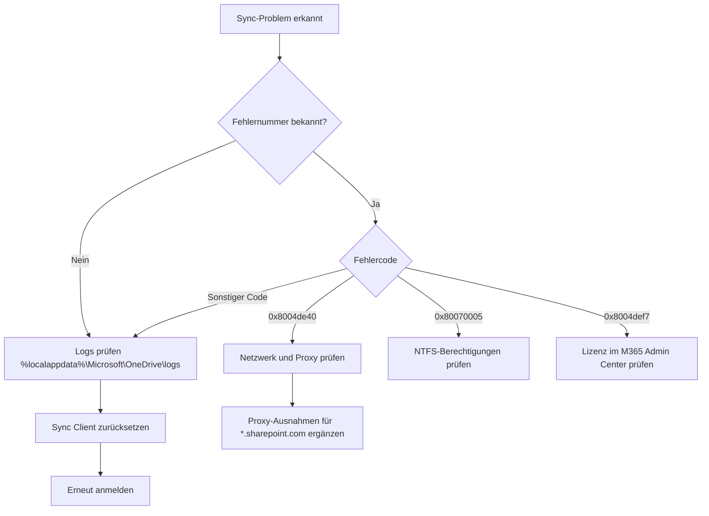
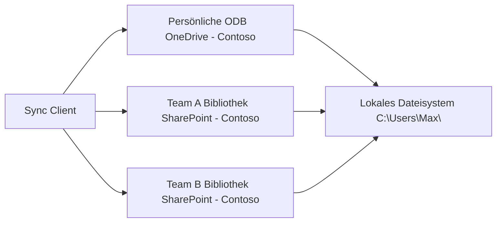
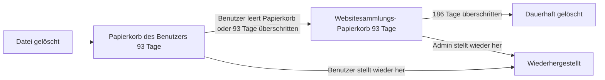
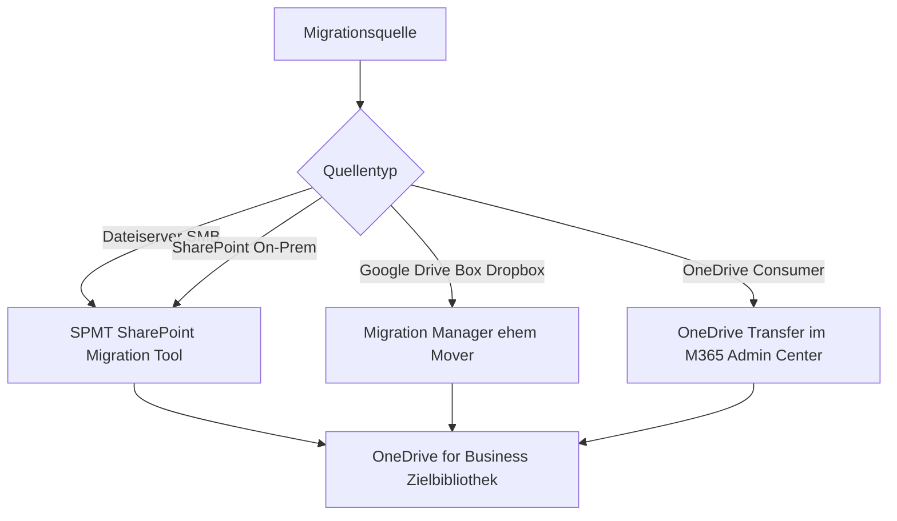

---
tags:
  - microsoft365
  - onedrive
  - sharepoint
  - sync
  - cloud-storage
  - intune
  - powershell
aliases:
  - OneDrive
  - ODB
  - OneDrive for Business
---

# OneDrive for Business

> [!ABSTRACT] TL;DR
> OneDrive for Business ist der persönliche Cloud-Speicher jedes Microsoft-365-Benutzers, technisch als eigene SharePoint-Site realisiert. Der Sync Client synchronisiert Dateien zwischen Cloud und lokalen Geräten, Known Folder Move (KFM) ersetzt klassische Ordnerumleitung per GPO oder Intune. Über das Admin Center lassen sich Kontingente, externe Freigaben und Aufbewahrungsrichtlinien zentral steuern.

---

## Architektur

OneDrive for Business ist keine eigenständige Infrastruktur, sondern eine dedizierte **SharePoint-Websitesammlung** pro Benutzer. Beim ersten Zugriff wird die persönliche Site automatisch provisioniert.

### URL-Struktur

```
https://<tenant>-my.sharepoint.com/personal/<UPN_normalisiert>/
```

Der UPN wird normalisiert: `@`-Zeichen und Punkte werden durch Unterstriche ersetzt.

| Benutzer-UPN | OneDrive-URL |
|---|---|
| `max.mustermann@contoso.com` | `.../personal/max_mustermann_contoso_com/` |
| `a.b.c@contoso.onmicrosoft.com` | `.../personal/a_b_c_contoso_onmicrosoft_com/` |

### Interne Struktur

```
personal/<UPN>/
├── Documents/           → Standardbibliothek (Sync Root)
├── _layouts/            → SharePoint-Systemordner
└── Shared with Everyone/
```



> [!NOTE] MySite Host
> Der MySite Host (`<tenant>-my.sharepoint.com`) ist eine spezielle SharePoint-Websitesammlung, die als Dachcontainer für alle persönlichen Sites fungiert. Er wird automatisch vom Tenant bereitgestellt und kann im Admin Center nicht gelöscht werden.

---

## Speicherkontingent

### Standardwerte (Stand 2024/2025)

| Plan | Standard-Kontingent | Maximales Kontingent |
|---|---|---|
| Microsoft 365 Business Basic/Standard/Premium | 1 TB | 5 TB (auf Anfrage) |
| Microsoft 365 E1 / E3 / E5 | 1 TB | Unbegrenzt* |
| Microsoft 365 F1 / F3 (Frontline) | 2 GB | 2 GB |
| SharePoint Standalone Plan 1 | 1 TB | 5 TB |

> [!IMPORTANT] Unbegrenzt ist relativ
> „Unbegrenzt" gilt für Tenants ab 5 Benutzern mit E-Plans. Microsoft stellt auf Anfrage bis zu 5 TB ein; darüber hinaus ist ein Support-Ticket erforderlich. Es handelt sich nicht um technisch echten unbegrenzten Speicher.

### Kontingent anpassen (Admin Center)

**Manuell über UI:** SharePoint Admin Center → Aktive Sites → Site auswählen → Speicher

**Per PowerShell (für eine Site):**

```powershell
# Kontingent auf 2 TB setzen
Set-SPOSite -Identity "https://contoso-my.sharepoint.com/personal/max_mustermann_contoso_com" `
            -StorageQuota 2097152 `
            -StorageQuotaWarningLevel 1900544
# StorageQuota in MB: 2097152 = 2 TB
```

**Standardkontingent für alle neuen ODB-Sites:**

```powershell
Set-SPOTenant -OneDriveStorageQuota 5242880  # 5 TB in MB
```

---

## OneDrive Sync Client

Der **OneDrive Sync Client** (früher „Groove") ist in Windows 10/11 nativ integriert und für macOS als separate App verfügbar.

### Installation

**Windows:** Bereits Teil des Betriebssystems ab Windows 10 1709.
Update auf aktuellste Version:

```powershell
# Aktuellsten Sync Client herunterladen (Enterprise-Ring)
winget install Microsoft.OneDrive
```

**macOS:**

```bash
# Über Homebrew
brew install --cask onedrive
```

### Registrierungsbasierte Konfiguration (Windows)

Alle zentralen Einstellungen liegen unter:
```
HKLM\SOFTWARE\Policies\Microsoft\OneDrive
HKCU\SOFTWARE\Microsoft\OneDrive
```

**Wichtige Registry-Keys:**

| Registry-Wert | Typ | Beschreibung |
|---|---|---|
| `SilentAccountConfig` | DWORD `1` | Stilles SSO-Anmelden |
| `KFMSilentOptIn` | String (Tenant-ID) | KFM automatisch aktivieren |
| `KFMSilentOptInWithNotification` | DWORD `1` | Benachrichtigung bei KFM |
| `FilesOnDemandEnabled` | DWORD `1` | Files On-Demand aktivieren |
| `DisablePersonalSync` | DWORD `1` | Privates OneDrive sperren |
| `AllowTenantList` | Multi-String | Erlaubte Tenants |

### Fehlerbehebung

> [!WARNING] Häufige Sync-Probleme
> - **0x8004de40** – Keine Internetverbindung oder Proxy blockiert
> - **0x80070005** – Zugriff verweigert (Berechtigungsproblem auf Dateisystem)
> - **0x8004def7** – Konto nicht lizenziert
> - **Grünes Häkchen fehlt** – Sync-Client neu starten: `taskkill /f /im OneDrive.exe && start OneDrive.exe`

```powershell
# Sync Client zurücksetzen (alle gecachten Daten löschen)
%localappdata%\Microsoft\OneDrive\onedrive.exe /reset

# Diagnose-Log exportieren
%localappdata%\Microsoft\OneDrive\onedrive.exe /client-console
```



---

## Known Folder Move (KFM)

Known Folder Move leitet die Windows-Standardordner **Desktop**, **Dokumente** und **Bilder** automatisch in die OneDrive-Cloud-Bibliothek um. Es ersetzt klassische GPO-Ordnerumleitung und funktioniert ohne Domänenmitgliedschaft.

> [!TIP] KFM vs klassische Ordnerumleitung
> KFM benötigt keine Netzlaufwerke, funktioniert auch für Heimarbeitsplätze und Hybrid-Join-Geräte und hat keine Abhängigkeit von einem Domain Controller. Die Dateien sind über alle Geräte des Benutzers sofort verfügbar.

### KFM per GPO konfigurieren

**Erforderliche ADMX-Templates:** `OneDrive.admx` / `OneDrive.adml`
Download: [https://aka.ms/OneDriveADMX](https://aka.ms/OneDriveADMX)

GPO-Pfad: `Computerkonfiguration → Administrative Vorlagen → OneDrive`

| GPO-Einstellung | Empfohlener Wert | Beschreibung |
|---|---|---|
| Stilles Anmelden mit Windows-Anmeldedaten | Aktiviert | SSO ohne Benutzerinteraktion |
| Bekannte Ordner automatisch nach OneDrive verschieben | Aktiviert + Tenant-ID | KFM ohne Benutzeranfrage |
| Benutzer daran hindern, bekannte Ordner zu verschieben | Aktiviert | KFM-Rollback sperren |
| Files On-Demand verwenden | Aktiviert | Cloud-only-Dateien erlauben |

**Tenant-ID ermitteln:**

```powershell
# Per Azure AD / Entra ID Modul
(Get-AzureADTenantDetail).ObjectId

# Alternativ per REST
Invoke-RestMethod "https://login.microsoftonline.com/contoso.com/.well-known/openid-configuration" |
    Select-Object -ExpandProperty issuer
```

### KFM per Intune konfigurieren

**Methode 1: Einstellungskatalog (empfohlen)**

1. Intune Admin Center → Geräte → Konfigurationsprofile → Erstellen
2. Plattform: **Windows 10 und höher**, Profiltyp: **Einstellungskatalog**
3. Suchbegriff: `OneDrive`
4. Einstellungen setzen:

| Einstellung | Wert |
|---|---|
| Silently sign in users to the OneDrive sync app | Enabled |
| Silently move Windows known folders to OneDrive | `<TenantID>` |
| Prevent users from redirecting their Windows known folders to their PC | Enabled |
| Use OneDrive Files On-Demand | Enabled |

**Methode 2: Custom OMA-URI**

```
OMA-URI: ./Device/Vendor/MSFT/Policy/Config/OneDriveNGSC~Policy~OneDriveNGSC/KFMSilentOptIn
Datentyp: String
Wert: <enabled/><data id="KFMSilentOptInWithNotification" value="1"/><data id="KFMSilentOptIn" value="<TENANT-ID>"/>
```

> [!IMPORTANT] Reihenfolge beachten
> KFM greift nur, wenn der Sync Client bereits angemeldet ist. `SilentAccountConfig` (stilles Anmelden) muss deshalb **vor** KFM aktiv sein – beide Richtlinien im selben Profil konfigurieren.

---

## Files On-Demand

Files On-Demand ermöglicht es, alle Dateien im Explorer anzuzeigen, ohne sie lokal gespeichert zu haben. Dateien werden erst beim Öffnen heruntergeladen.

### Dateistatus

| Symbol | Status | Bedeutung |
|---|---|---|
| ☁️ (blau) | **Nur in Cloud** | Platzhalterdatei, kein lokaler Inhalt |
| ✅ (grün, leer) | **Verfügbar** | Lokal gecacht, kann offline geöffnet werden |
| ✅ (grün, ausgefüllt) | **Immer verfügbar** | Dauerhaft lokal gespeichert, nie automatisch freigegeben |

### Dateistatus per PowerShell steuern

```powershell
# Datei als "Immer verfügbar" markieren (pinnen)
attrib +p "C:\Users\Max\OneDrive - Contoso\Wichtige Datei.docx"

# Datei zurück in Cloud verschieben (freigeben)
attrib -p "C:\Users\Max\OneDrive - Contoso\Wichtige Datei.docx"

# Ordner rekursiv pinnen
attrib +p /s /d "C:\Users\Max\OneDrive - Contoso\Projektordner"
```

> [!NOTE] Offline-Verfügbarkeit
> Dateien mit Status „Immer verfügbar" werden **nie** automatisch freigegeben. Sie verbrauchen lokalen Speicherplatz, sind aber auch ohne Internetverbindung vollständig nutzbar.

---

## Selective Sync

Mit Selective Sync (Selektive Synchronisierung) können Benutzer auswählen, welche Ordner der OneDrive-Bibliothek lokal synchronisiert werden.

**Konfiguration (Benutzer):** Sync-Client-Symbol → Einstellungen → Konto → Ordner auswählen

**Per GPO erzwingen (Ordner vom Sync ausschließen):**

```
GPO: Exclude specific kinds of files from being uploaded
Pfad: Computer\Administrative Vorlagen\OneDrive\
```

> [!WARNING] Selective Sync und KFM
> Wenn KFM aktiviert ist und ein Benutzer einen der bekannten Ordner (Desktop/Dokumente/Bilder) aus dem Sync ausschließt, werden neue Dateien trotzdem in die Cloud hochgeladen. Der Ausschluss gilt nur für den Download, nicht für den Upload von KFM-Ordnern.

---

## Shared Libraries synchronisieren

Neben der persönlichen ODB-Bibliothek können Benutzer auch **SharePoint-Teambibliotheken** mit dem Sync Client synchronisieren.



**Bibliothek synchronisieren:**
1. SharePoint-Bibliothek im Browser öffnen
2. **Synchronisieren**-Button in der Befehlsleiste klicken
3. Browser-Dialog bestätigen → Sync Client startet

**Per PowerShell (für alle Benutzer einer Site vorkonfigurieren):**

```powershell
# ODOpen-URL für automatischen Sync generieren
# Format: odopen://sync?siteId=<SiteId>&webId=<WebId>&listId=<ListId>&...
# URL aus SharePoint extrahieren:
$site = Get-SPOSite "https://contoso.sharepoint.com/sites/TeamA"
Write-Host "SiteId: $($site.Id)"
```

> [!TIP] Maximale Bibliotheken
> Pro Gerät können bis zu **30 SharePoint-Bibliotheken** gleichzeitig synchronisiert werden (OneDrive Sync Client ab Version 22.x). Die persönliche ODB-Bibliothek zählt dabei nicht mit.

---

## Externe Freigabe und Zusammenarbeit

### Freigabestufen (Tenant-weit)

| Stufe | Beschreibung |
|---|---|
| Jeder | Anonyme Links ohne Anmeldung (Anyone Links) |
| Neue und vorhandene Gäste | Externe Benutzer müssen sich authentifizieren |
| Nur vorhandene Gäste | Nur bereits im Verzeichnis bekannte Gäste |
| Nur Personen in der Organisation | Keine externe Freigabe |

```powershell
# Externe Freigabe für ODB einschränken
Set-SPOTenant -SharingCapability ExternalUserSharingOnly

# Ablaufdatum für "Jeder"-Links setzen (in Tagen)
Set-SPOTenant -RequireAnonymousLinksExpireInDays 30

# Standardlink-Typ für ODB
Set-SPOTenant -DefaultSharingLinkType Direct  # Direct | Internal | AnonymousAccess
```

### Anyone Links (anonyme Links)

> [!DANGER] Anyone Links im Unternehmensumfeld
> Anyone Links erlauben den Zugriff ohne Authentifizierung. Einmal geteilt, können sie beliebig weitergegeben werden. Für interne Dokumente mit vertraulichem Inhalt sollten sie deaktiviert oder mit Ablaufdatum und Passwort gesichert werden.

```powershell
# Anyone Links für ODB vollständig deaktivieren
Set-SPOTenant -OneDriveSharingCapability ExternalUserSharingOnly
```

---

## Versionsverlauf und Papierkorb

### Versionsverlauf

OneDrive for Business speichert automatisch **bis zu 500 Versionen** pro Datei. Der Aufbewahrungszeitraum hängt vom Speicherkontingent ab.

```powershell
# Maximale Versionsanzahl für alle ODB-Sites setzen
Set-SPOTenant -OneDriveDefaultShareLinkScope Organization

# Versionslimit für eine spezifische Bibliothek (über PnP PowerShell)
Set-PnPList -Identity "Dokumente" -MajorVersions 100
```

### Papierkorb

Gelöschte Dateien landen im **Erster-Stufen-Papierkorb** des Benutzers (93 Tage). Danach wandern sie in den **Zweiter-Stufen-Papierkorb** (Websitesammlungs-Papierkorb), wo sie nochmals 93 Tage aufbewahrt werden – insgesamt bis zu **186 Tage**.



> [!TIP] Aufbewahrung nach Kontolöschung
> Wenn ein Benutzerkonto gelöscht wird, bleibt die OneDrive-Site standardmäßig **30 Tage** erhalten (konfigurierbar bis 93 Tage). In dieser Zeit kann ein Admin Dateien wiederherstellen oder an einen anderen Benutzer übertragen.

```powershell
# Aufbewahrungsdauer nach Account-Löschung (in Tagen, max 93)
Set-SPOTenant -OrphanedPersonalSitesRetentionPeriod 90
```

---

## OneDrive Admin Center

Erreichbar unter: **SharePoint Admin Center → Aktive Sites** (ODB-Sites erscheinen hier) oder direkt über das klassische OneDrive Admin Center.

### Wichtige Berichte und Übersichten

| Bericht | Speicherort | Beschreibung |
|---|---|---|
| OneDrive-Nutzung | M365 Admin Center → Berichte → Nutzung → OneDrive | Aktive Dateien, Speicherverbrauch pro Benutzer |
| Freigabeaktivitäten | Purview Compliance Portal | Externe Freigaben auditieren |
| Synchronisierungsfehler | M365 Admin Center → Integrität → App-Integrität | Sync-Client-Fehler geräteübergreifend |

### ODB-Sites per PowerShell auflisten

```powershell
# Alle OneDrive-Sites im Tenant abrufen
$odbSites = Get-SPOSite -IncludePersonalSite $true -Limit All -Filter "Url -like '-my.sharepoint.com/personal/'"

# Mit Speicherverbrauch ausgeben
$odbSites | Select-Object Url, StorageUsageCurrent, StorageQuota, Owner |
    Sort-Object StorageUsageCurrent -Descending |
    Format-Table -AutoSize

# Sites mit > 80% Auslastung finden
$odbSites | Where-Object { $_.StorageUsageCurrent -gt ($_.StorageQuota * 0.8) }
```

---

## B2B-Sync (Gäste synchronisieren Shared Libraries)

B2B-Sync ermöglicht es **Gastbenutzern (externe Benutzer)**, SharePoint-Bibliotheken des Hosttenants mit ihrem eigenen OneDrive Sync Client zu synchronisieren – ohne ein lokales Gastkonto zu benötigen.

> [!NOTE] Voraussetzungen B2B-Sync
> - Sync Client Version **19.086.0502.0006** oder neuer
> - Gastkonto im Entra ID des Hosttenants (Azure AD B2B)
> - Im Hosttenant muss B2B-Sync aktiviert sein

```powershell
# B2B-Sync aktivieren
Set-SPOTenant -EnableAzureADB2BIntegration $true

# Für spezifische Domains erlauben/blockieren
Set-SPOTenant -SharingAllowedDomainList "partnercompany.com"
Set-SPOTenant -SharingDomainRestrictionMode AllowList
```

> [!WARNING] B2B-Sync und Conditional Access
> Wenn im Hosttenant Conditional-Access-Richtlinien für externe Benutzer konfiguriert sind (z. B. MFA-Pflicht, compliant device), müssen Gastbenutzer diese Anforderungen erfüllen, bevor der Sync startet.

---

## Via SharePoint Admin Center (UI)

### Standard-OneDrive-Speicher für alle Nutzer festlegen

1. Öffne das **SharePoint Admin Center** unter [admin.microsoft.com/sharepoint](https://admin.microsoft.com/sharepoint)
2. Navigiere zu **Einstellungen → OneDrive**
3. Setze unter **Standardspeicher pro Benutzer** den gewünschten Wert in GB
4. Klicke auf **Speichern**

> [!TIP]
> Alternativ: **Microsoft 365 Admin Center → Einstellungen → Organisationseinstellungen → OneDrive** für Freigabe- und Sync-Standardeinstellungen.

### Speicher für einzelnen Benutzer anpassen

1. Navigiere im SPAC zu **Sites → Aktive Sites**
2. Filtere oder suche nach `my.sharepoint.com` um OneDrive-Sites zu finden
3. Klicke auf die ODB-Site des Nutzers (`/personal/vorname_nachname_domain_com`)
4. Klicke auf **⋮ → Kontingent bearbeiten**
5. Gib den neuen Wert in GB ein → **Speichern**

> [!TIP]
> Direkter Weg: **Microsoft 365 Admin Center → Benutzer → Aktive Benutzer → Benutzer auswählen → OneDrive → Speicher verwalten**

### Known Folder Move (KFM) per Intune aktivieren

> [!NOTE]
> KFM kann nicht direkt im OneDrive Admin Center per Klick aktiviert werden. Der empfohlene Weg für verwaltete Geräte ist **Microsoft Intune**:

1. Öffne das **Microsoft Intune Admin Center** unter [intune.microsoft.com](https://intune.microsoft.com)
2. Navigiere zu **Geräte → Konfiguration → + Erstellen → Einstellungskatalog**
3. Plattform: **Windows 10 und höher**
4. Suche im Einstellungskatalog nach **OneDrive**
5. Aktiviere **Bekannte Ordner von Windows in OneDrive verschieben (Silent)**
6. Trage die **Tenant-ID** (Azure AD-Verzeichnis-ID) ein
7. Weise das Profil einer Gerätegruppe zu → **Speichern**

### Externe Freigabe für OneDrive konfigurieren

1. Navigiere im SPAC zu **Richtlinien → Freigabe**
2. Stelle den **OneDrive**-Schieberegler auf den gewünschten Level
3. Konfiguriere unter **Erweiterte Einstellungen**:
   - **Ablaufzeit für Gastlinks** (empfohlen: 30–180 Tage)
   - **Erlaubte oder gesperrte Domains**
4. Klicke auf **Speichern**

### OneDrive-Aufbewahrung nach Benutzerlöschung konfigurieren

1. Navigiere im SPAC zu **Einstellungen → OneDrive**
2. Setze unter **Aufbewahrung** den Zeitraum nach Benutzerlöschung (30–3650 Tage)
3. Lege optional einen **sekundären Besitzer** fest, der Zugriff erhält
4. Klicke auf **Speichern**

### OneDrive-Nutzungsberichte aufrufen

1. Öffne das **Microsoft 365 Admin Center → Berichte → Nutzung**
2. Wähle **OneDrive → Dateiaktivität** oder **OneDrive → Konten**
3. Wähle den Zeitraum (7, 30, 90 oder 180 Tage)
4. Klicke auf **Herunterladen** für CSV-Export

---

## PowerShell-Verwaltung

### Verbindung herstellen

```powershell
# SharePoint Online Management Shell
Install-Module -Name Microsoft.Online.SharePoint.PowerShell -Force
Connect-SPOService -Url "https://contoso-admin.sharepoint.com"

# PnP PowerShell (empfohlen für erweiterte Szenarien)
Install-Module -Name PnP.PowerShell -Force
Connect-PnPOnline -Url "https://contoso-admin.sharepoint.com" -Interactive
```

### Häufige Verwaltungsaufgaben

```powershell
# Alle ODB-Sites auflisten
Get-SPOSite -IncludePersonalSite $true -Limit All `
    -Filter "Url -like '-my.sharepoint.com/personal/'"

# Spezifische ODB-Site anzeigen
Get-SPOSite -Identity "https://contoso-my.sharepoint.com/personal/max_mustermann_contoso_com"

# Kontingent einer Site erhöhen (in MB)
Set-SPOSite -Identity "https://contoso-my.sharepoint.com/personal/max_mustermann_contoso_com" `
            -StorageQuota 5242880

# Admin-Zugriff auf eine ODB-Site gewähren
Set-SPOUser -Site "https://contoso-my.sharepoint.com/personal/max_mustermann_contoso_com" `
            -LoginName "admin@contoso.com" `
            -IsSiteCollectionAdmin $true

# ODB-Site eines ausgeschiedenen Mitarbeiters sperren
Set-SPOSite -Identity "https://contoso-my.sharepoint.com/personal/ex_mitarbeiter_contoso_com" `
            -LockState NoAccess

# Externe Freigabe für einzelne ODB-Site deaktivieren
Set-SPOSite -Identity "https://contoso-my.sharepoint.com/personal/max_mustermann_contoso_com" `
            -SharingCapability Disabled

# Tenant-weite ODB-Einstellungen anzeigen
Get-SPOTenant | Select-Object OneDrive*, Sharing*, DefaultSharingLinkType
```

### Bulk-Kontingent-Anpassung

```powershell
# Alle ODB-Sites auf 2 TB erhöhen
$sites = Get-SPOSite -IncludePersonalSite $true -Limit All `
    -Filter "Url -like '-my.sharepoint.com/personal/'"

foreach ($site in $sites) {
    Set-SPOSite -Identity $site.Url `
                -StorageQuota 2097152 `
                -StorageQuotaWarningLevel 1900544
    Write-Host "Aktualisiert: $($site.Url)"
}
```

---

## Migration zu OneDrive for Business

### SharePoint Migration Tool (SPMT)

SPMT ist das offizielle Microsoft-Tool für Migrationen aus:
- **Dateiserver** (SMB-Freigaben)
- **SharePoint 2010/2013/2016/2019** (On-Premises)
- **Box, Dropbox** (über SPMT-Konnektoren)

```powershell
# SPMT Installation
Install-Module -Name Microsoft.SharePoint.MigrationTool

# Migration starten (Bulk per JSON)
$migrationTask = @{
    SourcePath      = "\\fileserver\users\max.mustermann"
    TargetWebUrl    = "https://contoso-my.sharepoint.com/personal/max_mustermann_contoso_com"
    TargetList      = "Dokumente"
}
$migrationTask | ConvertTo-Json | Out-File "migration-task.json"
```

### Migration Assessment per PowerShell

```powershell
# Dateipfadlänge prüfen (SharePoint-Limit: 400 Zeichen)
Get-ChildItem -Path "\\fileserver\users" -Recurse |
    Where-Object { $_.FullName.Length -gt 250 } |
    Select-Object FullName, @{N="Länge";E={$_.FullName.Length}} |
    Export-Csv "lange-pfade.csv" -NoTypeInformation

# Ungültige Zeichen prüfen (SharePoint erlaubt kein: " * : < > ? / \ |)
Get-ChildItem -Path "\\fileserver\users" -Recurse |
    Where-Object { $_.Name -match '["\*:<>?/\\|]' } |
    Select-Object FullName |
    Export-Csv "ungueltige-zeichen.csv" -NoTypeInformation
```

### Mover (Microsoft 365 Migration Manager)

Für **Google Drive**, **Box**, **Dropbox** und andere Cloud-zu-Cloud-Migrationen steht der **Migration Manager** im SharePoint Admin Center zur Verfügung (ehemals Mover.io).



> [!TIP] Migration Assessment zuerst
> Führe vor jeder Migration einen Assessment-Scan durch (SPMT bietet diesen als Option). Typische Problembereiche: Pfade über 400 Zeichen, Sonderzeichen in Dateinamen, Dateigröße über 250 GB (SharePoint-Limit) und OneNote-Pakete.

---

## Bekannte Einschränkungen

| Einschränkung | Limit |
|---|---|
| Maximale Dateigröße | 250 GB |
| Maximaler Pfad (relativ zur Sync-Root) | 400 Zeichen |
| Maximale Anzahl Elemente (empfohlen) | 300.000 pro Bibliothek |
| Gleichzeitige Bibliotheken (Sync) | 30 |
| Ungültige Zeichen in Dateinamen | `" * : < > ? / \ \|` sowie führende/abschließende Leerzeichen und Punkte |
| Nicht synchronisierbare Dateitypen | `.tmp`, `.lnk`, `.ds_store`, Thumbs.db |

> [!WARNING] OneNote-Notebooks
> OneNote-Notebooks werden vom Sync Client **separat behandelt** und dürfen nicht manuell in den OneDrive-Ordner kopiert werden. Sie sollten ausschließlich über die OneNote-App oder den Browser verschoben werden, um Datenverlust zu vermeiden.

---

## Verwandte Notizen

- [[SharePoint Online Grundlagen]]
- [[Berechtigungen und Sharing]]
- [[SharePoint Governance]]
- [[SharePoint PowerShell und PnP]]
