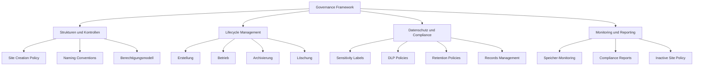
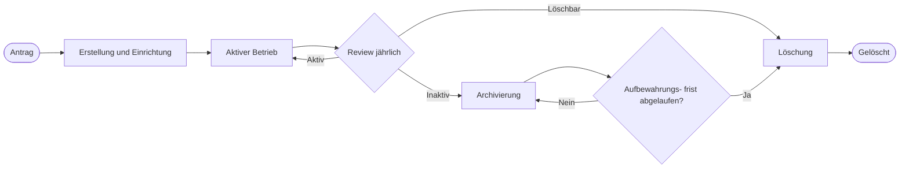
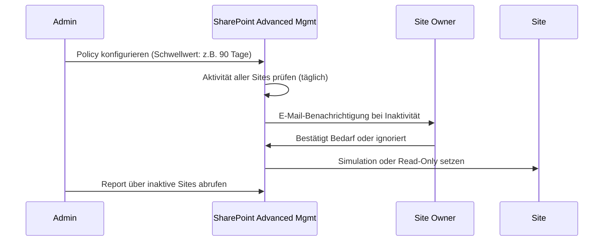
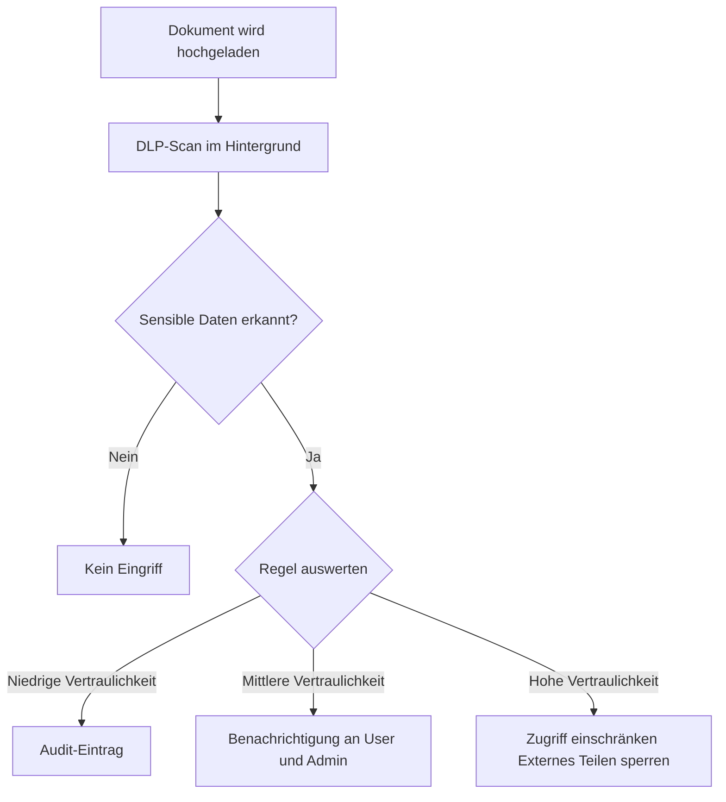

---
tags:
  - microsoft365
  - sharepoint
  - governance
  - compliance
  - purview
  - dlp
  - retention
  - sensitivity-labels
  - records-management
aliases:
  - SPO Governance
  - SharePoint Governance Framework
---

# SharePoint Governance

> [!ABSTRACT] TL;DR
> SharePoint Governance umfasst alle Richtlinien, Prozesse und technischen Kontrollen, die den geordneten Betrieb, die Sicherheit und die Compliance einer SharePoint Online-Umgebung sicherstellen. Ein durchdachtes Governance-Framework regelt, wer Sites erstellt, wie Inhalte klassifiziert werden, wann Inhalte archiviert oder gelöscht werden – und hält dabei Kosten, Risiken und Produktivität im Gleichgewicht.

---

## Was ist SharePoint Governance?

SharePoint Governance ist der Oberbegriff für alle Maßnahmen, mit denen eine Organisation steuert, wie ihr SharePoint Online-Tenant genutzt, verwaltet und kontrolliert wird. Es geht nicht nur um technische Einstellungen, sondern um ein ganzheitliches Rahmenwerk aus Richtlinien, Verantwortlichkeiten und Prozessen.

**Kernziele:**

| Ziel | Beschreibung |
|------|-------------|
| **Ordnung** | Unkontrolliertes Wachstum von Sites, Gruppen und Inhalten verhindern |
| **Sicherheit** | Daten vor unbefugtem Zugriff und unbeabsichtigtem Teilen schützen |
| **Compliance** | Gesetzliche und regulatorische Anforderungen erfüllen (DSGVO, GoBD, …) |
| **Effizienz** | Auffindbarkeit von Inhalten sicherstellen, Speicherkosten kontrollieren |
| **Kontinuität** | Klare Prozesse für Übergaben, Änderungen und Löschungen |

**Typische Governance-Rollen:**

- **Global Admin / SharePoint Admin** — Technische Konfiguration, Tenant-weite Richtlinien
- **Site Owner** — Verantwortlich für Berechtigungen, Inhalte und Lifecycle einer Site
- **Information Architect** — Definiert Metadaten-Strukturen, Taxonomien, Hub-Konzepte
- **Compliance Manager** — Retention Policies, DLP, eDiscovery, Purview-Konfiguration
- **Governance-Steuerkreis** — Entscheidet über Ausnahmen, prüft Einhaltung

---

## Governance-Framework aufbauen

Ein praxistaugliches Governance-Framework besteht aus vier Handlungsfeldern:



> [!TIP] Pragmatischer Einstieg
> Kein Governance-Framework muss von Beginn an vollständig sein. Starte mit den drei wirkungsstärksten Maßnahmen: **Site-Erstellung einschränken**, **Naming Conventions** einführen und **Expiration Policies** aktivieren. Alles Weitere kann schrittweise ergänzt werden.

---

## Via SharePoint Admin Center (UI)

### Site-Erstellung durch Benutzer steuern

1. Öffne das **SharePoint Admin Center** unter [admin.microsoft.com/sharepoint](https://admin.microsoft.com/sharepoint)
2. Navigiere zu **Einstellungen → Startseite der Website** (Site Creation)
3. Wähle unter **Site-Erstellung durch Benutzer**:
   - ✅ **Benutzer können Sites in SharePoint erstellen** (Standard)
   - Oder: Kontrollkästchen deaktivieren, um Self-Service zu deaktivieren
4. Klicke auf **Speichern**

> [!NOTE]
> Die Einschränkung, *welche Benutzergruppe* Microsoft 365 Groups (und damit Team-Sites) erstellen darf, ist nur über **Microsoft Entra Admin Center → Gruppen → Allgemein → Gruppenerstellung einschränken** möglich — nicht über das SPAC.

### Ablaufrichtlinie für M365 Groups konfigurieren

1. Öffne das **Microsoft Entra Admin Center** unter [entra.microsoft.com](https://entra.microsoft.com)
2. Navigiere zu **Identität → Gruppen → Ablaufrichtlinie**
3. Konfiguriere:
   - **Gruppenlebensdauer:** 90, 180, 365 Tage oder benutzerdefiniert
   - **Benachrichtigungs-E-Mail** für Gruppen ohne Besitzer
   - **Gilt für:** Alle Gruppen oder ausgewählte Gruppen
4. Klicke auf **Speichern**

### Sensitivity Labels für Sites und Gruppen konfigurieren

1. Öffne das **Microsoft Purview Compliance Portal** unter [compliance.microsoft.com](https://compliance.microsoft.com)
2. Navigiere zu **Informationsschutz → Vertraulichkeitsbezeichnungen**
3. Wähle ein Label oder klicke auf **+ Label erstellen**
4. Aktiviere unter **Bereich** die Option **Gruppen und Sites**
5. Konfiguriere **Gruppen- und Site-Einstellungen**:
   - **Datenschutz:** Öffentlich / Privat
   - **Externer Benutzerzugriff:** Erlauben / Blockieren
   - **Externe Freigabe:** Gesonderter Level für diese Bezeichnung
   - **Zugriff von nicht verwalteten Geräten:** Zulassen / Einschränken / Blockieren
6. Veröffentliche das Label über eine **Bezeichnungsrichtlinie** → **Speichern**

### DLP-Richtlinie für SharePoint erstellen

1. Im **Purview Compliance Portal** → **Lösungen → Verhinderung von Datenverlust → Richtlinien → + Richtlinie erstellen**
2. Wähle eine Vorlage (z. B. **Datenschutz → DSGVO**) oder **Benutzerdefinierte Richtlinie**
3. Wähle Speicherorte: **SharePoint-Sites** und/oder **OneDrive-Konten**
4. Konfiguriere Regeln: Erkennungsbedingungen (sensible Inhaltstypen) → Aktionen (Zugriff blockieren, Benachrichtigung senden, Audit)
5. Starte im **Testmodus** → Analysiere Treffer → Dann produktiv aktivieren → **Absenden**

### Aufbewahrungsrichtlinie für SharePoint erstellen

1. Im **Purview Compliance Portal** → **Lösungen → Datenverwaltung → Aufbewahrungsrichtlinien → + Neue Richtlinie**
2. Benenne die Richtlinie
3. Wähle **Statische Bereiche** → Speicherort **SharePoint-Sites** → gewünschte Sites auswählen
4. Konfiguriere:
   - **Aufbewahren für:** X Jahre / Tage (ab Erstellungsdatum, Änderungsdatum oder Ereignis)
   - **Nach Ablauf:** Inhalt löschen oder zur Dispositionsüberprüfung weiterleiten
5. Überprüfe und **Absenden**

---

## Site Creation Policies

Ohne Einschränkungen kann jeder Benutzer im Tenant Microsoft 365 Groups und damit automatisch SharePoint-Sites erstellen – das führt schnell zu unkontrollierbarem Wildwuchs.

### M365 Groups-Erstellung einschränken

Die Erstellung von Microsoft 365 Groups (und damit SharePoint Team-Sites) lässt sich auf eine bestimmte Azure AD-Sicherheitsgruppe beschränken:

```powershell
# Modul: AzureAD oder Microsoft.Graph
# Nur Mitglieder der Gruppe "SPO-Site-Creators" dürfen Groups erstellen

Import-Module Microsoft.Graph.Groups

# Gruppe ermitteln
$group = Get-MgGroup -Filter "displayName eq 'SPO-Site-Creators'"

# Directory-Setting auslesen oder neu erstellen
$template = Get-MgDirectorySettingTemplate | Where-Object { $_.DisplayName -eq "Group.Unified" }
$setting  = Get-MgDirectorySetting | Where-Object { $_.TemplateId -eq $template.Id }

if (-not $setting) {
    $params = @{ TemplateId = $template.Id; Values = $template.Values }
    $setting = New-MgDirectorySetting -BodyParameter $params
}

# Einschränkung setzen
$values = $setting.Values
($values | Where-Object { $_.Name -eq "EnableGroupCreation" }).Value          = "false"
($values | Where-Object { $_.Name -eq "GroupCreationAllowedGroupId" }).Value  = $group.Id

Update-MgDirectorySetting -DirectorySettingId $setting.Id -Values $values
```

> [!IMPORTANT] Wirkungsbereich
> Diese Einschränkung gilt für Teams, Planner, Viva Engage-Communities und SharePoint Team-Sites. Klassische SharePoint-Sites über das Admin Center sind davon nicht betroffen und müssen separat über SharePoint Admin Center → **Einstellungen → Site-Erstellung** gesteuert werden.

### Self-Service vs. Beantragungsprozess

| Modell | Vorteile | Nachteile |
|--------|----------|-----------|
| **Self-Service (offen)** | Produktivität, keine Wartezeiten | Wildwuchs, schwer kontrollierbar |
| **Eingeschränkte Gruppe** | Kontrolle, kein Prozess-Overhead | Flaschenhals bei Engpässen |
| **Formaler Antragsprozess** | Volle Kontrolle, Metadaten erzwingbar | Aufwand, Akzeptanzprobleme |
| **Power Apps / Forms Flow** | Automatisierung + Kontrolle | Implementierungsaufwand |

---

## Naming Conventions und URL-Konventionen

Einheitliche Namen erleichtern Suche, Governance und Reporting erheblich.

### Empfohlenes Schema

```
[Kürzel-Abteilung]-[Projektkürzel]-[Typ]
Beispiele:
  IT-M365-PROJ       → IT-Abteilung, Projekt M365, Typ: Projekt
  HR-ONBOARDING-TEAM → HR, Onboarding, Typ: Team
  MKT-KAMPAGNE-HUB   → Marketing, Kampagne, Typ: Hub
```

**URL-Regeln (wichtig, da nachträglich schwer änderbar):**

- Nur Kleinbuchstaben, keine Sonderzeichen, Leerzeichen werden zu `-`
- Kürzel am Anfang erleichtern Massen-Auswertungen
- Tenant-URL-Änderungen (Umbenennung) sind möglich, aber aufwändig

```powershell
# Site-URL nachträglich umbenennen (SPO Admin-Modul)
Rename-SPOSite -Identity "https://contoso.sharepoint.com/sites/altername" `
               -NewSiteUrl "https://contoso.sharepoint.com/sites/neuername"
```

> [!WARNING] URL-Umbenennung
> Eine Site-URL-Änderung bricht alle hart codierten Links in E-Mails, Teams-Registerkarten und externen Systemen. Plane ausreichend Kommunikation und teste Redirects vorab.

---

## Site-Lifecycle-Management

Jede Site durchläuft einen definierten Lebenszyklus. Governance bedeutet, jeden dieser Phasen aktiv zu steuern.



### Phasen im Detail

**Erstellung:** Site-Owner wird benannt, Metadaten werden gesetzt (Abteilung, Zweck, Klassifizierung), Sensitivity Label wird zugewiesen.

**Betrieb:** Regelmäßige Überprüfung der Mitglieder und Berechtigungen, Speichernutzung überwachen, Inhalte aktuell halten.

**Archivierung:** Site wird Read-Only gesetzt, aus der Navigation entfernt, aber Inhalte bleiben für Compliance erhalten.

**Löschung:** Nach Ablauf der Aufbewahrungsfristen wird die Site in den Papierkorb verschoben (93 Tage Wiederherstellungszeitraum).

```powershell
# Site als Read-Only (archiviert) setzen
Set-SPOSite -Identity "https://contoso.sharepoint.com/sites/altprojekt" -LockState ReadOnly

# Site löschen
Remove-SPOSite -Identity "https://contoso.sharepoint.com/sites/altprojekt"

# Aus dem Papierkorb endgültig entfernen
Remove-SPODeletedSite -Identity "https://contoso.sharepoint.com/sites/altprojekt"
```

---

## Microsoft 365 Groups Expiration Policy

Die Expiration Policy löscht inaktive M365 Groups (und deren SharePoint-Sites) automatisch nach einem definierten Zeitraum, sofern der Owner nicht verlängert.

### Konfiguration

1. **Azure AD → Gruppen → Ablaufrichtlinie**
2. Ablaufzeitraum: 90, 180, 365 Tage oder benutzerdefiniert
3. E-Mail-Adresse für Groups ohne Owner hinterlegen
4. Gilt für: Alle Gruppen oder ausgewählte Gruppen

```powershell
# Via Microsoft Graph PowerShell
$params = @{
    GroupLifetimeInDays    = 365
    ManagedGroupTypes      = "All"          # "All" oder "Selected"
    AlternateNotificationEmails = "admin@contoso.com"
}
New-MgGroupLifecyclePolicy -BodyParameter $params
```

**Ablauf der Verlängerungsbenachrichtigungen:**

| Zeitpunkt | Aktion |
|-----------|--------|
| 30 Tage vor Ablauf | Erste E-Mail an Owner |
| 15 Tage vor Ablauf | Zweite E-Mail an Owner |
| 1 Tag vor Ablauf | Letzte E-Mail an Owner |
| Ablauf | Group/Site in Papierkorb (30 Tage wiederherstellbar) |

> [!NOTE] Aktivitätserkennung
> Microsoft prüft automatisch, ob eine Group in den letzten 28 Tagen aktiv genutzt wurde (Teams-Nachrichten, SharePoint-Aufrufe, Exchange-E-Mails). Aktive Groups werden automatisch verlängert, ohne dass der Owner eingreifen muss.

---

## Inactive Site Policy (SharePoint Premium / SAM)

Seit 2024 bietet SharePoint Advanced Management (SAM) eine native **Inactive Site Policy**, die inaktive Sites automatisch erkennt und adressiert – ohne Group Expiration.

### Funktionsweise



**Anforderungen:** SharePoint Advanced Management Add-on (Teil von Microsoft 365 E5 oder separater Kauf) oder Microsoft Syntex.

**Konfiguration:** SharePoint Admin Center → **Richtlinien → Lebenszyklusverwaltung → Inaktive Websiterichtlinie**

> [!TIP] Simulation zuerst
> Aktiviere die Policy zunächst im **Simulationsmodus**. So erhältst du einen vollständigen Report aller betroffenen Sites, ohne Änderungen vorzunehmen – ideal für die Kommunikation mit Fachbereichen.

---

## Speicher-Governance

### Tenant-Speicher überwachen

```powershell
# Gesamtübersicht Tenant-Speicher
Get-SPOTenant | Select-Object StorageQuota, StorageQuotaAllocated

# Alle Sites mit Speichernutzung
Get-SPOSite -Limit All | Select-Object Url, StorageUsageCurrent, StorageQuota |
    Sort-Object StorageUsageCurrent -Descending |
    Format-Table -AutoSize

# Sites, die mehr als 50 GB nutzen
Get-SPOSite -Limit All |
    Where-Object { $_.StorageUsageCurrent -gt 51200 } |
    Select-Object Url, StorageUsageCurrent
```

### Speicher-Einstellungen

| Einstellung | Empfehlung |
|-------------|------------|
| **Tenant-Pooled Storage** | Aktiviert lassen (automatische Verteilung) |
| **Site-Speicherkontingent** | Für unkritische Sites begrenzen (z.B. 50 GB) |
| **Versionsverlauf-Grenze** | Auf 50–100 Versionen begrenzen (seit 2024 konfigurierbar) |
| **Microsoft 365 Archive** | Für inaktive Sites ≥ 6 Monate nutzen (0,10 $/GB/Monat) |

> [!NOTE] Versionsverlauf-Limits (2024)
> Seit Anfang 2024 können Admins Tenant-weite und site-spezifische Versionsverlauf-Limits setzen: entweder eine feste Anzahl oder eine zeitbasierte Grenze (z.B. max. 6 Monate). Das spart erheblich Speicher bei dokumentintensiven Sites.

---

## Sensitivity Labels (Microsoft Information Protection)

Sensitivity Labels klassifizieren Sites und Dokumente und erzwingen automatisch Schutzmaßnahmen.

### Labels für Sites (Container-Labels)

Ein Container-Label, das auf eine M365 Group / SharePoint-Site angewendet wird, steuert:

- **Datenschutz:** Öffentlich / Privat / Org-intern
- **Externer Zugriff:** Gastbenutzer erlaubt / verboten
- **Nicht verwaltete Geräte:** Zugriff einschränken oder blockieren
- **Private Channel-Zugriff** in Teams

```powershell
# Sensitivity Labels via Microsoft Graph abrufen
Get-MgSecurityInformationProtectionSensitivityLabel -All |
    Select-Object DisplayName, Id, IsActive

# Label auf Site setzen (PnP PowerShell)
Set-PnPSite -Identity "https://contoso.sharepoint.com/sites/projekt" `
            -SensitivityLabel "c4b7b8e1-xxxx-xxxx-xxxx-xxxxxxxxxxxx"
```

### Label-Hierarchie (Beispiel)

| Label | Farbe | Externe Nutzer | Nicht verw. Geräte |
|-------|-------|---------------|---------------------|
| **Öffentlich** | Grün | Erlaubt | Vollzugriff |
| **Intern** | Blau | Verboten | Vollzugriff |
| **Vertraulich** | Gelb | Verboten | Nur Web |
| **Streng Vertraulich** | Rot | Verboten | Blockiert |

> [!IMPORTANT] Label-Pflicht erzwingen
> Im Microsoft Purview Compliance Portal kann unter **Labels → Richtlinien → Labelpflicht** eingestellt werden, dass Benutzer vor dem Speichern ein Label wählen müssen. Kombiniere dies mit automatischer Klassifizierung für maximale Abdeckung.

---

## Information Barriers

Information Barriers (IB) verhindern, dass bestimmte Benutzergruppen miteinander kommunizieren oder Inhalte teilen – relevant für Finanzdienstleister (Chinese Walls) oder andere regulierte Branchen.

**Funktionsweise in SharePoint:**
- Benutzer außerhalb der erlaubten Segmente können nicht zu einer Site hinzugefügt werden
- Suche zeigt keine Inhalte aus gesperrten Segmenten
- OneDrive-Freigaben zwischen gesperrten Segmenten werden blockiert

**Voraussetzung:** Microsoft 365 E5 Compliance oder Information Protection & Governance Add-on.

```powershell
# Compliance PowerShell – Information Barrier Policy prüfen
Get-InformationBarrierPolicy | Select-Object Name, State, AssignedSegment, SegmentsBlocked
```

> [!WARNING] IB-Kompatibilitätsmodus
> SharePoint unterstützt IB im sogenannten **IB-Kompatibilitätsmodus** (Standard) oder im neueren **IB-Modus mit impliziten Beschränkungen**. Der neuere Modus ist restriktiver und muss explizit aktiviert werden. Teste vor der Produktivschaltung ausgiebig.

---

## Data Loss Prevention (DLP) in SharePoint

DLP-Richtlinien erkennen sensible Informationen (Kreditkartennummern, Personalausweis-Nummern, IBAN usw.) in SharePoint-Dokumenten und verhindern ungewolltes Teilen.

### DLP-Richtlinie konfigurieren

**Weg:** Microsoft Purview Compliance Portal → **Data Loss Prevention → Richtlinien → Erstellen**



**Häufig genutzte sensible Informationstypen:**

- `Credit Card Number` — Kreditkartennummern
- `EU National Identification Number` — Personalausweisnummern
- `IBAN` — Bankverbindungen
- `EU Social Security Number` — Sozialversicherungsnummern
- `Germany Driver's License Number` — Führerscheinnummern

> [!TIP] DLP im Simulation Mode
> Aktiviere neue DLP-Richtlinien zunächst im **Simulationsmodus** (Policy-Modus: Test). Alle Treffer werden geloggt, aber keine Aktionen ausgeführt. Werte den Report 2–4 Wochen aus, bevor du die Richtlinie scharf schaltest.

---

## Retention Policies und Retention Labels (Microsoft Purview)

Retention-Konfigurationen stellen sicher, dass Inhalte so lange aufbewahrt werden, wie gesetzlich oder regulatorisch erforderlich – und danach automatisch gelöscht werden.

### Retention Policies vs. Retention Labels

| Merkmal | Retention Policy | Retention Label |
|---------|-----------------|----------------|
| **Anwendung** | Automatisch auf gesamte Site / Speicherort | Manuell oder automatisch pro Dokument |
| **Granularität** | Grob (ganze Site) | Fein (einzelnes Dokument) |
| **Records** | Nein | Ja (Declare as Record möglich) |
| **Disposition Review** | Nein | Ja |
| **Priorität** | Niedrig | Hoch (Label gewinnt bei Konflikt) |

### Retention Policy erstellen

**Weg:** Purview Compliance Portal → **Datenverwaltung → Aufbewahrungsrichtlinien → Neu**

```powershell
# Via Security & Compliance PowerShell
New-RetentionCompliancePolicy -Name "SPO-5-Jahre-Aufbewahrung" `
    -SharePointLocation "https://contoso.sharepoint.com/sites/finanzen" `
    -RetentionDuration 1825 `   # 5 Jahre in Tagen
    -RetentionAction KeepAndDelete
```

> [!WARNING] Aufbewahrung vs. gesetzliche Pflicht
> Eine Retention Policy, die Inhalte nach 5 Jahren löscht, darf nicht eingerichtet werden, wenn ein Legal Hold aktiv ist. Preservation Locks und Compliance-Holds haben immer Vorrang vor Lösch-Aktionen.

---

## Records Management

Records Management geht über einfache Retention hinaus: Dokumente werden als offizielle **Records** deklariert und sind damit unveränderbar und nicht löschbar.

### Declare Record via Retention Label

1. Retention Label erstellen: **Purview → Records Management → Dateiplan → Neues Label**
2. Option „Elemente als Datensatz kennzeichnen" aktivieren
3. Label auf Bibliothek oder Ordner anwenden (automatisch oder manuell)

**Record-Zustände:**

| Zustand | Beschreibung | Änderbar | Löschbar |
|---------|-------------|----------|---------|
| **Kein Label** | Normales Dokument | Ja | Ja |
| **Aufbewahrungslabel** | Aufbewahrungsfrist aktiv | Ja | Nein (während Frist) |
| **Record** | Als Datensatz deklariert | Nein | Nein |
| **Regulatory Record** | Höchste Stufe | Nein | Nein (auch nicht durch Admins) |

> [!DANGER] Regulatory Records
> Ein Regulatory Record kann selbst von Global Admins nicht mehr gelöscht werden, bis die Aufbewahrungsfrist abläuft. Wende diese Stufe nur für tatsächlich regulatorisch relevante Inhalte an – eine falsch gesetzte Klassifizierung lässt sich nicht rückgängig machen.

### Disposition Review

Am Ende einer Aufbewahrungsfrist kann eine **Disposition Review** ausgelöst werden: Zuständige Reviewer prüfen, ob ein Dokument wirklich gelöscht oder weiter aufbewahrt werden soll.

**Konfiguration:** Purview → Records Management → Disposition → Reviewer zuweisen

---

## eDiscovery und Legal Hold

eDiscovery ermöglicht es, Inhalte für rechtliche Verfahren zu durchsuchen, zu sichern und zu exportieren.

### eDiscovery-Varianten

| Tool | Lizenz | Anwendungsfall |
|------|--------|----------------|
| **Content Search** | E3 | Einfache Suche und Export |
| **eDiscovery Standard** | E3 | Cases, Holds, Export |
| **eDiscovery Premium** | E5 | Review-Sets, Analyse, Redaktion |

### Legal Hold aktivieren

```powershell
# Security & Compliance PowerShell
# Neuen eDiscovery Case erstellen
New-ComplianceCase -Name "Verfahren-2025-001"

# Site unter Legal Hold stellen
New-CaseHoldPolicy -Name "Hold-Finanzdaten" `
    -Case "Verfahren-2025-001" `
    -SharePointLocation "https://contoso.sharepoint.com/sites/finanzen"

New-CaseHoldRule -Name "Hold-Finanzdaten-Regel" `
    -Policy "Hold-Finanzdaten" `
    -ContentMatchQuery ""    # Leer = gesamte Site
```

> [!IMPORTANT] Hold-Vorrang
> Ein Legal Hold überschreibt alle Retention Policies und verhindert jede Löschung – auch automatische. Das Preservation Hold Library (versteckte Bibliothek) bewahrt auch Dokumente auf, die Benutzer manuell löschen.

---

## Compliance-Berichte im Microsoft Purview Compliance Portal

### Wichtige Reports

| Report | Weg | Inhalt |
|--------|-----|--------|
| **Aktivitäts-Explorer** | Purview → Datenklass. → Aktivitäts-Explorer | Alle Label-, DLP- und Policy-Aktionen |
| **Inhalts-Explorer** | Purview → Datenklass. → Inhalts-Explorer | Alle klassifizierten Elemente durchsuchen |
| **DLP-Reports** | Purview → DLP → Reports | Regel-Treffer, False Positives |
| **Audit-Log** | Purview → Audit | Benutzer- und Admin-Aktivitäten |
| **Compliance-Score** | Purview → Compliance Manager | Gesamtbewertung der Compliance-Reife |

### Audit-Log abfragen

```powershell
# Security & Compliance PowerShell
Search-UnifiedAuditLog -StartDate "2025-01-01" -EndDate "2025-12-31" `
    -RecordType SharePointFileOperation `
    -Operations FileDeleted, FileDownloaded `
    -ResultSize 1000 |
    Select-Object CreationDate, UserIds, Operations, AuditData |
    Export-Csv "audit-report.csv" -NoTypeInformation -Encoding UTF8
```

> [!NOTE] Audit-Log-Aufbewahrung
> Das Standard-Audit-Log wird 90 Tage aufbewahrt (E3). Mit Microsoft 365 E5 oder dem Audit Premium Add-on verlängert sich die Aufbewahrung auf **1 Jahr**, optional erweiterbar auf **10 Jahre** mit separater Lizenz.

---

## Governance-Checkliste

> [!TODO] Governance-Framework einrichten
> - [ ] Site-Erstellung auf Genehmigungsgruppe einschränken
> - [ ] Naming Convention dokumentieren und kommunizieren
> - [ ] M365 Groups Expiration Policy aktivieren (365 Tage)
> - [ ] Sensitivity Labels definieren und publizieren
> - [ ] DLP-Richtlinien für sensible Datentypen einrichten (Simulationsmodus)
> - [ ] Retention Policies für alle SharePoint-Speicherorte konfigurieren
> - [ ] Retention Labels für Records-Management einrichten
> - [ ] Audit-Log-Aufbewahrung prüfen und ggf. verlängern
> - [ ] Compliance Score im Purview Compliance Manager reviewen
> - [ ] Inactive Site Policy (SAM) aktivieren und testen
> - [ ] Governance-Steuerkreis einberufen und Review-Rhythmus festlegen

---

## Verwandte Notizen

- [[SharePoint Online Grundlagen]]
- [[Websitesammlungen verwalten]]
- [[Berechtigungen und Sharing]]
- [[SharePoint Premium]]
- [[SharePoint PowerShell und PnP]]
