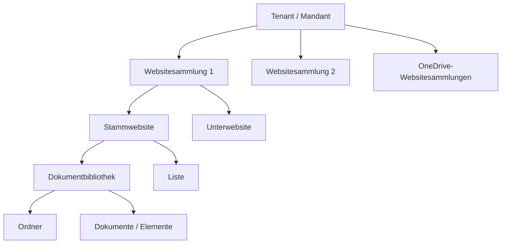
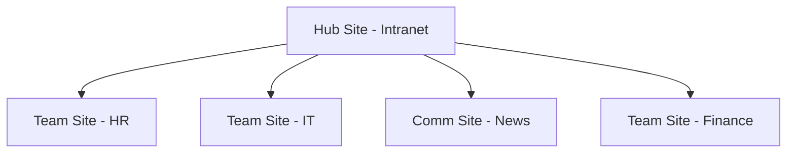
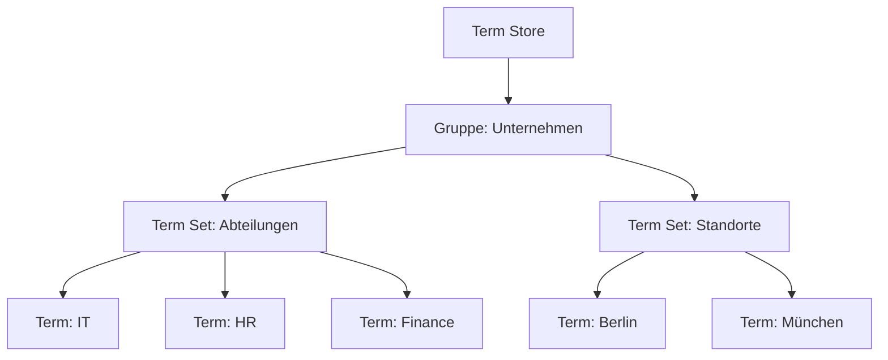

---
tags:
  - microsoft365
  - sharepoint
  - sharepoint-online
  - grundlagen
aliases:
  - SPO Grundlagen
  - SharePoint Einführung
---

# SharePoint Online Grundlagen

> [!ABSTRACT] TL;DR
> SharePoint Online ist die cloudbasierte Kollaborations- und Dokumentenmanagement-Plattform von Microsoft 365. Sie bildet das Fundament für Teams-Dateien, OneDrive-Synchronisation und Unternehmens-Intranets — strukturiert in Mandanten, Websitesammlungen, Websites, Listen/Bibliotheken und Elementen.

---

## Was ist SharePoint Online?

SharePoint Online (SPO) ist ein cloudbasierter Dienst innerhalb von Microsoft 365, der Unternehmen ermöglicht, Inhalte zu erstellen, zu teilen, zu organisieren und gemeinsam daran zu arbeiten. Im Gegensatz zum On-Premises SharePoint Server wird SPO vollständig von Microsoft in der Azure-Cloud betrieben und mit jedem Microsoft 365 Business- oder Enterprise-Abonnement bereitgestellt.

SharePoint Online dient als Fundament für mehrere Microsoft 365-Dienste:
- **Microsoft Teams** speichert Kanal-Dateien in SharePoint-Bibliotheken
- **OneDrive for Business** nutzt SharePoint-Infrastruktur im Hintergrund
- **Microsoft Viva** und **Viva Connections** basieren auf SharePoint-Intranets

---

## Architektur

Die SharePoint Online-Hierarchie ist klar strukturiert und bestimmt Berechtigungen, Navigation und Speicherverwaltung.

### Tenant (Mandant)
Der Tenant ist die oberste Ebene und entspricht dem Microsoft 365-Abonnement einer Organisation. Jeder Tenant besitzt eine eigene Admin-URL (`https://[Tenant]-admin.sharepoint.com`) und eine Root-Site (`https://[Tenant].sharepoint.com`).

### Websitesammlungen (Site Collections)
Eine Websitesammlung ist ein Container mit einer Stammwebsite und optional Unterwebsites. Jede Websitesammlung hat:
- Eigene Inhaltstypen und Websitespalten
- Eigene Berechtigungsverwaltung (Site Collection Administrators)
- Eigenes Speicherkontingent (bis zu 25 TB pro Websitesammlung)
- Eigenen Papierkorb

### Websites (Sites)
Unterhalb der Stammwebsite können Unterwebsites erstellt werden (in modernen SPO-Deployments jedoch nicht empfohlen — stattdessen separate Site Collections bevorzugen).

### Listen und Bibliotheken
- **Dokumentbibliothek**: Speichert Dateien mit Metadaten, Versionsverlauf, Check-In/Check-Out
- **Liste**: Strukturierte Datenhaltung (wie eine Tabelle / Mini-Datenbank)
- **Bilderbibliothek**: Spezialbibliothek für Medien

### Elemente (Items)
Das unterste Element der Hierarchie — ein einzelnes Dokument, ein Listeneintrag oder ein Ordner.

---

## Websitetypen

### Team Site (Teamwebsite)
- Verbunden mit einer Microsoft 365-Gruppe
- Privat, für Zusammenarbeit in einer geschlossenen Gruppe
- Besitzt automatisch ein SharePoint-Postfach, Planner, OneNote
- URL-Muster: `https://[Tenant].sharepoint.com/sites/[Name]`
- Empfohlen für: Projektteams, Abteilungen, Arbeitsgruppen

### Communication Site (Kommunikationswebsite)
- Kein Microsoft 365-Gruppen-Backing
- Öffentlich innerhalb der Organisation (Breitband-Kommunikation)
- Ideal für Intranets, Nachrichtenportale, HR-Seiten
- Professionelles Design mit Hero-Webpart und News-Funktionen
- Empfohlen für: Intranet, Unternehmenskommunikation, Policy-Seiten

### Hub Site (Hub-Website)
- Kein eigenständiger Websitetyp, sondern eine Rolle
- Verknüpft mehrere Sites zu einer logischen Einheit
- Gemeinsame Navigation und Suche über alle verbundenen Sites
- Erlaubt News-Rollup und Hervorgehobene Inhalte aus allen verknüpften Sites

> [!TIP] Hub Sites planen
> Plane Hub Sites nach Organisationsstruktur. Eine Navigations-Hub-Site pro Abteilung ist besser als eine riesige monolithische Site Collection.

---

## Hub Sites und Navigation

Hub Sites bieten:
- **Gemeinsame Navigationsleiste** für alle assoziierten Sites
- **News-Rollup**: News-Posts aus verbundenen Sites werden auf der Hub Site angezeigt
- **Suchbereich**: Suche kann auf Hub-Site-Ebene eingeschränkt werden
- **Site-Design-Anwendung** beim Assoziieren einer neuen Site

> [!NOTE] Hub Site Limits
> Pro Tenant sind standardmäßig bis zu **2.000 Hub Sites** möglich. Eine Site kann nur mit einer Hub Site verbunden sein, aber Hub Sites können selbst einem übergeordneten Hub verbunden werden (vertikale Hub-Hierarchie).

---

## Inhaltstypen (Content Types)

Inhaltstypen definieren eine wiederverwendbare Sammlung von Metadaten-Spalten, Workflows und Verhaltensweisen für Listenelemente oder Dokumente.

| Eigenschaft | Beschreibung |
|------------|-------------|
| Name | Eindeutiger Bezeichner des Inhaltstyps |
| Übergeordneter Typ | Vererbungshierarchie (z.B. von "Dokument") |
| Spalten | Benutzerdefinierte Metadaten-Felder |
| Dokumentvorlage | Standardvorlage für neue Dokumente |
| Workflow | Verknüpfte Automatisierungen |

Inhaltstypen werden im **Content Type Hub** (`/sites/contenttypehub`) zentral verwaltet und per Syndizierung auf alle Site Collections verteilt.

---

## Managed Metadata Service (Term Store)

Der Term Store ist der zentrale Metadaten-Dienst von SharePoint Online. Er ermöglicht die Verwaltung von kontrollierten Vokabularien (Taxonomien) für konsistente Metadaten-Vergabe.

**Komponenten:**
- **Term Store** → Oberster Container
  - **Gruppe** → Thematische Gruppierung
    - **Term Set** → Vokabular (z.B. "Abteilungen")
      - **Term** → Einzelner Begriff (z.B. "IT", "HR", "Finance")

> [!TIP] Term Store für konsistente Metadaten
> Nutze Managed Metadata-Spalten statt einfacher Textspalten, um Tippfehler und inkonsistente Kategorisierung zu vermeiden. Terms können mehrsprachig angelegt werden.

---

## Limits und Einschränkungen

| Ressource | Limit |
|-----------|-------|
| Speicher pro Websitesammlung | 25 TB |
| Maximale Listengröße | 30 Millionen Elemente |
| Listenansicht-Schwellenwert | **5.000 Elemente** (Indexierung empfohlen) |
| Maximale Dateigröße (Upload) | 250 GB |
| Maximale Anzahl Spalten pro Liste | 192 benutzerdefinierte Spalten |
| Hub Sites pro Tenant | 2.000 |
| Websitesammlungen pro Tenant | 2 Millionen |
| Dateipfadlänge (URL) | 400 Zeichen |
| Synchronisation (OneDrive) | 300.000 Dateien pro Bibliothek |

> [!WARNING] Listenansicht-Schwellenwert
> Bei mehr als **5.000 Elementen** in einer Listenansicht ohne Index werden Abfragen blockiert. Indiziere häufig gefilterte Spalten frühzeitig und nutze Ordnerstrukturen oder Metadaten-Navigierung zur Umgehung.

> [!IMPORTANT] Speicherkontingent
> Der Gesamt-Tenant-Speicher berechnet sich aus: **1 TB + 10 GB × Anzahl der lizenzierten Nutzer**. Zusätzlicher Speicher kann zugekauft werden.

---

## SharePoint vs. OneDrive vs. Teams

| Kriterium | SharePoint | OneDrive | Microsoft Teams |
|-----------|-----------|----------|-----------------|
| Zweck | Team-Kollaboration, Intranet | Persönliche Dateien | Kommunikation + Kollaboration |
| Eigentümer | Organisation / Team | Einzelperson | Team / Gruppe |
| Zugriffsmodell | Gruppen- oder individuell | Primär individuell | Kanalbasiert |
| Beste Nutzung | Abteilungsdaten, Projekte | Arbeitsordner, persönliche Docs | Meetings, Chats, Kanal-Dateien |
| Hintergrund-Speicher | SharePoint-Site | SharePoint (persönl. Site) | SharePoint Team Site |
| Externe Freigabe | Konfigurierbar | Konfigurierbar | Via SharePoint-Link |

> [!TIP] Faustregel
> - **OneDrive**: "Meine Dateien" — noch nicht geteilt oder nur mit wenigen Personen
> - **SharePoint**: Abteilungs- oder Projektdaten — dauerhaft geteilt mit einem Team
> - **Teams**: Kommunikation steht im Vordergrund, Dateien sind sekundär

---

## Via SharePoint Admin Center (UI)

### SharePoint Admin Center aufrufen

1. Melde dich bei [admin.microsoft.com](https://admin.microsoft.com) mit einem **SharePoint-Administrator**- oder **Global-Administrator**-Konto an
2. Klicke im linken Navigationsbereich auf **Alle anzeigen → Admin Center → SharePoint**
3. Alternativ: Direkt unter `https://[Tenant]-admin.sharepoint.com` aufrufen

### Neue Site erstellen

1. Navigiere zu **Sites → Aktive Sites → + Erstellen**
2. Wähle den Sitetyp:
   - **Teamwebsite** — mit M365-Gruppe, für Projektzusammenarbeit
   - **Kommunikationswebsite** — ohne Gruppe, für Intranets
3. Fülle Name, URL, Sprache und primären Administrator aus
4. Klicke auf **Fertig stellen**

### Websitesammlung verwalten

| Aufgabe | Pfad im SPAC |
|---------|-------------|
| Alle Sites anzeigen | **Sites → Aktive Sites** |
| Gelöschte Sites wiederherstellen | **Sites → Gelöschte Sites** |
| Speicher einer Site anpassen | **Aktive Sites → Site → Details → Speicher bearbeiten** |
| Site-Admin hinzufügen | **Aktive Sites → Site → Mitgliedschaft → Admins bearbeiten** |
| Site löschen | **Aktive Sites → Site auswählen → Löschen** |

### Term Store (Managed Metadata) verwalten

1. Navigiere zu **Inhaltsdienste → Terminologiespeicher**
2. Klicke auf **+ Begriffsgruppe hinzufügen** für neue Gruppen
3. Innerhalb einer Gruppe: **+ Begriffssatz hinzufügen**
4. Klicke auf einen Begriffssatz → **+ Begriff hinzufügen**
5. Vergib mehrsprachige Beschriftungen und Synonyme → **Speichern**

### Speicher- und Nutzungsstatistiken abrufen

1. Im SPAC: **Startseite** → Kacheln zeigen Tenant-Speichernutzung und aktive Sites
2. Pro Site: **Aktive Sites** → Spalten **Speicher (genutzt)** und **Speicher (Kontingent)** direkt sichtbar
3. Detaillierte Berichte: **Microsoft 365 Admin Center → Berichte → Nutzung → SharePoint**

> [!TIP]
> Über **Aktive Sites → Spalten anpassen** können weitere Spalten (z. B. Letzte Aktivität, Vorlagenname, Hub-Zuordnung) zur Übersichtsansicht hinzugefügt werden.

---

## SharePoint Admin Center

Das Admin Center (`https://[Tenant]-admin.sharepoint.com`) bietet folgende Bereiche:

| Bereich | Inhalt |
|---------|--------|
| **Startseite** | Dashboard mit Nutzungsstatistiken |
| **Sites → Aktive Sites** | Alle Site Collections verwalten |
| **Sites → Gelöschte Sites** | Wiederherstellung gelöschter Sites |
| **Richtlinien → Freigabe** | Externe Freigabe-Einstellungen |
| **Richtlinien → Zugriffssteuerung** | Bedingter Zugriff, unkonforme Geräte |
| **Einstellungen** | OneDrive-Speicher, Standardeinstellungen |
| **Inhaltsdienste** | Term Store, Content Type Hub |
| **Klassische Features** | Crawler, Sucheigenschaften (Legacy) |
| **Berichte** | Nutzung, SharePoint-Aktivität |

---

## Verwandte Notizen

- [[Websitesammlungen verwalten]]
- [[Berechtigungen und Sharing]]
- [[SharePoint Seiten und Webparts]]
- [[OneDrive for Business]]
- [[SharePoint Governance]]
- [[SharePoint Suche]]
- [[SharePoint PowerShell und PnP]]
