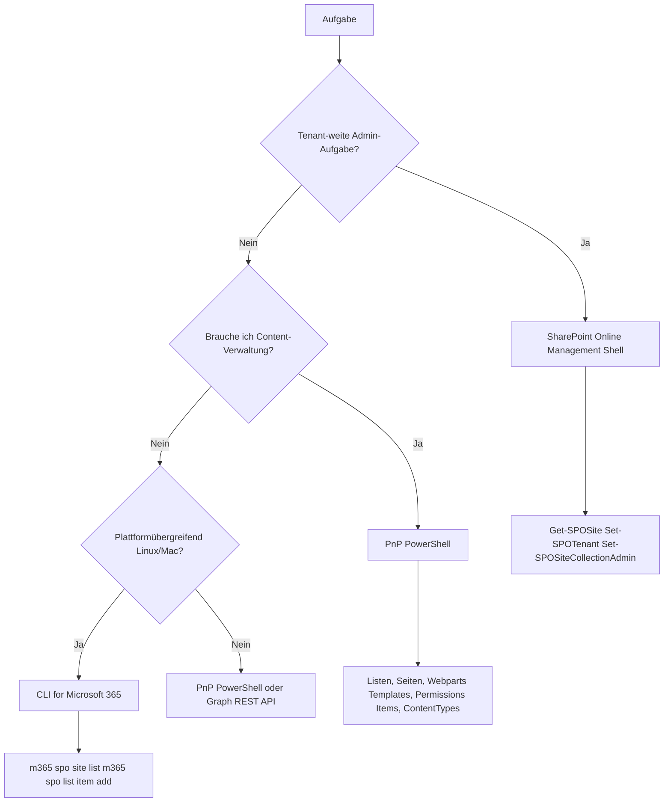

---
tags:
  - microsoft365
  - sharepoint
  - powershell
  - pnp
  - automation
  - scripting
  - graph-api
  - sharepoint-online
aliases:
  - PnP PowerShell
  - SPO PowerShell
  - SharePoint Management Shell
  - PnP.PowerShell
---

# SharePoint PowerShell und PnP

> [!ABSTRACT] TL;DR
> SharePoint Online kann über zwei PowerShell-Module verwaltet werden: die **SharePoint Online Management Shell** (Microsoft-offiziell, für Tenant-Administration) und **PnP PowerShell** (Community-getrieben, deutlich mächtiger für Site-Verwaltung, Content und Templates). Ergänzend existieren die **CLI for Microsoft 365** als plattformübergreifende Alternative sowie die **Microsoft Graph REST API** für maximale Flexibilität in der Automatisierung.

---

## Via SharePoint Admin Center (UI)

> [!NOTE]
> Für Administratoren, die selten oder einmalig Änderungen vornehmen, bietet das **SharePoint Admin Center** eine grafische Alternative zu PowerShell. Die meisten Tenant-weiten Konfigurationen sowie Site-Verwaltung sind ohne Skript-Kenntnisse durchführbar.

### Häufige Admin-Aufgaben im SPAC — ohne PowerShell

| Aufgabe | UI-Pfad im SPAC |
|---------|----------------|
| Alle Sites anzeigen | **Sites → Aktive Sites** |
| Site erstellen | **Sites → Aktive Sites → + Erstellen** |
| Site löschen / wiederherstellen | **Aktive Sites → Löschen** / **Gelöschte Sites → Wiederherstellen** |
| Speicher anpassen | **Aktive Sites → Site → Details → Speicher bearbeiten** |
| Site-Admin hinzufügen | **Aktive Sites → Site → Mitgliedschaft → Admins bearbeiten** |
| Externe Freigabe (tenant-weit) | **Richtlinien → Freigabe** |
| Externe Freigabe pro Site | **Aktive Sites → Site → Freigabe** |
| Conditional Access | **Richtlinien → Zugriffssteuerung** |
| Hub-Site konfigurieren | **Aktive Sites → Site → ⋮ → Als Hub-Site registrieren** |
| OneDrive-Speicher-Standard | **Einstellungen → OneDrive** |
| SPFx-Lösung deployen | **Weitere Features → Apps → App-Catalog** |

### App-Catalog und SPFx-Lösungen per UI deployen

1. Navigiere im SPAC zu **Weitere Features → Apps → Öffnen**
2. Klicke im App-Catalog auf **Neue App hinzufügen** (oder direkt in die Bibliothek hochladen)
3. Lade die `.sppkg`-Datei hoch
4. Aktiviere **Diese Lösung mandantenweit bereitstellen** (für Tenant-weites Deployment)
5. Klicke auf **Bereitstellen**

### Term Store per UI verwalten

1. Navigiere zu **Inhaltsdienste → Terminologiespeicher**
2. Erstelle Gruppen, Begriffssätze und Begriffe über die grafische Oberfläche
3. Vergib mehrsprachige Labels und Synonyme direkt im Browser

> [!TIP]
> Für einmalige, nicht-automatisierbare Aufgaben (Site-Erstellung, Freigabe-Einstellungen, Admin hinzufügen) ist die UI schneller als PowerShell. Für **Massenoperationen, Reporting und Automatisierung** ist PowerShell/PnP die richtige Wahl.

---

## Überblick: Welches Tool für welchen Zweck?



| Modul | Einsatz | Auth-Methoden | Plattform |
|---|---|---|---|
| **SPO Management Shell** | Tenant-Admin, Site-Policies | User + MFA, CBA | Windows |
| **PnP PowerShell** | Alles unterhalb Tenant-Ebene | User, MFA, App-Only, CBA | Windows, Linux, macOS |
| **CLI for Microsoft 365** | Scripting, CI/CD | User, App-Only | Alle (Node.js) |
| **Graph REST API** | Custom-Apps, maximale Kontrolle | OAuth 2.0 | Alle |

---

## SharePoint Online Management Shell

### Installation

```powershell
# Aktuellste Version aus dem PowerShell Gallery
Install-Module -Name Microsoft.Online.SharePoint.PowerShell -Scope CurrentUser -Force

# Version prüfen
Get-Module Microsoft.Online.SharePoint.PowerShell -ListAvailable | Select-Object Name, Version

# Update
Update-Module -Name Microsoft.Online.SharePoint.PowerShell
```

> [!NOTE] Voraussetzungen
> - PowerShell 5.1 oder PowerShell 7.x
> - .NET Framework 4.7.2+ (für Windows PowerShell 5.1)
> - Globaler Admin oder SharePoint Admin-Rolle erforderlich

### Verbindung herstellen

```powershell
# Interaktiv (MFA-kompatibel) — empfohlen für manuelle Arbeit
Connect-SPOService -Url "https://contoso-admin.sharepoint.com"

# Mit explizitem Credential (ohne MFA — nur für Service Accounts ohne MFA)
$cred = Get-Credential
Connect-SPOService -Url "https://contoso-admin.sharepoint.com" -Credential $cred

# Certificate-Based Authentication (App-Only, für Automatisierung)
Connect-SPOService `
    -Url "https://contoso-admin.sharepoint.com" `
    -ClientId "xxxxxxxx-xxxx-xxxx-xxxx-xxxxxxxxxxxx" `
    -Thumbprint "ABCDEF1234567890ABCDEF1234567890ABCDEF12" `
    -Tenant "contoso.onmicrosoft.com"

# Verbindung trennen
Disconnect-SPOService
```

> [!IMPORTANT] Admin-URL verwenden
> `Connect-SPOService` erfordert zwingend die **Admin-URL** (`-admin.sharepoint.com`), nicht die normale SharePoint-URL.

### Sites verwalten

```powershell
# Alle Sites auflisten
Get-SPOSite -Limit All

# Sites mit Details (Speicher, Owner, Template)
Get-SPOSite -Limit All | Select-Object Url, Title, StorageUsageCurrent, Owner, Template

# Einzelne Site abfragen
Get-SPOSite -Identity "https://contoso.sharepoint.com/sites/projekt-alpha"

# Nach Template filtern (z.B. nur Kommunikations-Sites)
Get-SPOSite -Limit All -Template "SITEPAGEPUBLISHING#0"

# Neue Team-Site erstellen
New-SPOSite `
    -Url "https://contoso.sharepoint.com/sites/neues-team" `
    -Title "Neues Team" `
    -Owner "user@contoso.com" `
    -StorageQuota 1024 `
    -Template "STS#3"

# Site-Eigenschaften ändern
Set-SPOSite `
    -Identity "https://contoso.sharepoint.com/sites/projekt-alpha" `
    -StorageQuota 5120 `
    -Title "Projekt Alpha (Archiv)"

# Speicherlimit auf 5 GB mit 80%-Warnung
Set-SPOSite `
    -Identity "https://contoso.sharepoint.com/sites/projekt-alpha" `
    -StorageQuota 5120 `
    -StorageQuotaWarningLevel 4096

# Site löschen (in den Papierkorb)
Remove-SPOSite -Identity "https://contoso.sharepoint.com/sites/altes-projekt" -Confirm:$false

# Site aus Papierkorb wiederherstellen
Restore-SPODeletedSite -Identity "https://contoso.sharepoint.com/sites/altes-projekt"

# Site permanent löschen
Remove-SPODeletedSite -Identity "https://contoso.sharepoint.com/sites/altes-projekt"
```

### Benutzer und Admins

```powershell
# Alle Benutzer einer Site anzeigen
Get-SPOUser -Site "https://contoso.sharepoint.com/sites/projekt-alpha"

# Externe Benutzer einer Site
Get-SPOUser -Site "https://contoso.sharepoint.com/sites/projekt-alpha" | Where-Object { $_.IsEmailAuthenticationOnly }

# Benutzer als Site Collection Admin hinzufügen
Set-SPOUser `
    -Site "https://contoso.sharepoint.com/sites/projekt-alpha" `
    -LoginName "user@contoso.com" `
    -IsSiteCollectionAdmin $true

# Mehrere Admins auf einmal setzen
$admins = @("admin1@contoso.com", "admin2@contoso.com")
foreach ($admin in $admins) {
    Set-SPOSiteCollectionAdmin `
        -Site "https://contoso.sharepoint.com/sites/projekt-alpha" `
        -LoginName $admin `
        -IsSiteCollectionAdmin $true
}

# Benutzer aus Site entfernen
Remove-SPOUser `
    -Site "https://contoso.sharepoint.com/sites/projekt-alpha" `
    -LoginName "user@contoso.com"
```

### Freigabe und Sharing-Einstellungen

```powershell
# Tenant-weite Sharing-Richtlinie
Set-SPOTenant -SharingCapability ExistingExternalUserSharingOnly

# Sharing für einzelne Site einschränken
Set-SPOSite `
    -Identity "https://contoso.sharepoint.com/sites/hr-intern" `
    -SharingCapability Disabled

# Ablaufdatum für Gast-Zugänge (in Tagen)
Set-SPOTenant -ExternalUserExpireInDays 180 -ExternalUserExpirationRequired $true

# Externe Freigabe für spezifische Domains einschränken
Set-SPOTenant `
    -SharingDomainRestrictionMode AllowList `
    -SharingAllowedDomainList "partner.com contoso.de"

# Sharing-Links standardmäßig auf "Spezifische Personen" setzen
Set-SPOTenant -DefaultSharingLinkType Direct

# Ablaufdatum für "Anyone"-Links (anonyme Links)
Set-SPOTenant -RequireAnonymousLinksExpireInDays 30
```

---

## PnP PowerShell

### Installation

```powershell
# PnP PowerShell aus PowerShell Gallery installieren
Install-Module -Name PnP.PowerShell -Scope CurrentUser -Force

# Für PowerShell 7 (empfohlen)
Install-Module -Name PnP.PowerShell -Scope CurrentUser -Force

# Version prüfen
Get-Module PnP.PowerShell -ListAvailable | Select-Object Name, Version

# Update
Update-Module -Name PnP.PowerShell

# Alle verfügbaren Cmdlets anzeigen
Get-Command -Module PnP.PowerShell | Measure-Object
```

> [!TIP] PnP PowerShell vs PnPPowerShell (veraltet)
> Das aktuelle Modul heißt **`PnP.PowerShell`** (mit Punkt). Das ältere `SharePointPnPPowerShellOnline` wird nicht mehr gepflegt — immer das neue Modul nutzen.

### Verbindung herstellen

```powershell
# Interaktiv mit Browser-Login (MFA-kompatibel)
Connect-PnPOnline -Url "https://contoso.sharepoint.com/sites/meine-site" -Interactive

# Mit PnP Management Shell App (empfohlen für interaktive Nutzung)
# Erfordert einmaligen Admin-Consent:
Register-PnPManagementShellAccess

Connect-PnPOnline -Url "https://contoso.sharepoint.com/sites/meine-site" -Interactive

# App-Only mit Client Secret (für Automatisierung)
Connect-PnPOnline `
    -Url "https://contoso.sharepoint.com/sites/meine-site" `
    -ClientId "xxxxxxxx-xxxx-xxxx-xxxx-xxxxxxxxxxxx" `
    -ClientSecret "dein-client-secret-hier"

# App-Only mit Zertifikat (empfohlen für Produktion)
Connect-PnPOnline `
    -Url "https://contoso.sharepoint.com/sites/meine-site" `
    -ClientId "xxxxxxxx-xxxx-xxxx-xxxx-xxxxxxxxxxxx" `
    -Thumbprint "ABCDEF1234567890ABCDEF1234567890ABCDEF12" `
    -Tenant "contoso.onmicrosoft.com"

# Mit PFX-Datei (für CI/CD Pipelines)
Connect-PnPOnline `
    -Url "https://contoso.sharepoint.com" `
    -ClientId "xxxxxxxx-xxxx-xxxx-xxxx-xxxxxxxxxxxx" `
    -CertificatePath "C:\certs\pnp-app.pfx" `
    -CertificatePassword (ConvertTo-SecureString "passwort" -AsPlainText -Force) `
    -Tenant "contoso.onmicrosoft.com"

# Verbindung trennen
Disconnect-PnPOnline
```

> [!WARNING] Client Secret in Skripten vermeiden
> Client Secrets niemals im Klartext in Skripten speichern. Stattdessen **Key Vault**, **Environment Variables** oder **Zertifikate** verwenden.

### Sites und Webs

```powershell
# Aktuelle Site-Infos
Get-PnPSite | Select-Object Url, Title, ServerRelativeUrl

# Web-Informationen (Untersite)
Get-PnPWeb | Select-Object Title, Url, WebTemplate

# Alle Subsites auflisten
Get-PnPSubWeb -Recurse | Select-Object Title, Url

# Neue Kommunikations-Site erstellen
New-PnPSite `
    -Type CommunicationSite `
    -Title "Intranet News" `
    -Url "https://contoso.sharepoint.com/sites/intranet-news" `
    -Owner "admin@contoso.com"

# Neue Team-Site (Microsoft 365 Group)
New-PnPSite `
    -Type TeamSite `
    -Title "Projektteam Alpha" `
    -Alias "projektteam-alpha" `
    -IsPublic $false

# Site-Eigenschaften ändern
Set-PnPSite -Title "Neuer Titel" -Description "Neue Beschreibung"

# Site-Logo setzen
Set-PnPSite -LogoFilePath "C:\logos\site-logo.png"
```

### Listen und Bibliotheken

```powershell
# Alle Listen einer Site
Get-PnPList | Select-Object Title, ItemCount, BaseType

# Nur Dokumentbibliotheken
Get-PnPList | Where-Object { $_.BaseType -eq "DocumentLibrary" }

# Einzelne Liste
$liste = Get-PnPList -Identity "Dokumente"

# Neue Liste erstellen
New-PnPList `
    -Title "Projektaufgaben" `
    -Template GenericList `
    -OnQuickLaunch

# Neues Spaltenfeld hinzufügen
Add-PnPField `
    -List "Projektaufgaben" `
    -DisplayName "Priorität" `
    -InternalName "Prioritaet" `
    -Type Choice `
    -Choices @("Hoch", "Mittel", "Niedrig") `
    -AddToDefaultView

# Listenelemente abfragen
Get-PnPListItem -List "Projektaufgaben"

# Mit CAML-Filter (effizient für große Listen)
$caml = "<View><Query><Where><Eq><FieldRef Name='Status'/><Value Type='Choice'>Aktiv</Value></Eq></Where></Query></View>"
Get-PnPListItem -List "Projektaufgaben" -Query $caml

# Neues Element erstellen
Add-PnPListItem -List "Projektaufgaben" -Values @{
    "Title"     = "Website-Redesign"
    "Prioritaet" = "Hoch"
    "Status"    = "In Bearbeitung"
}

# Element aktualisieren
Set-PnPListItem -List "Projektaufgaben" -Identity 42 -Values @{
    "Status" = "Abgeschlossen"
}

# Element löschen
Remove-PnPListItem -List "Projektaufgaben" -Identity 42 -Force

# Alle Elemente (auch über 5000) abrufen (paginiert)
$alle = Get-PnPListItem -List "GroßeListe" -PageSize 500
```

> [!TIP] Schwellenwert für Listenansichten
> SharePoint blockiert Abfragen über **5.000 Elemente** ohne Indizes. `Get-PnPListItem` mit `-PageSize` umgeht das Problem serverseitig. Für Listen mit >5.000 Elementen immer `-PageSize 500` setzen.

### Seiten und Webparts

```powershell
# Alle Modern Pages einer Site
Get-PnPPage | Select-Object Name, Title, PageLayoutType

# Einzelne Seite laden
$page = Get-PnPPage -Identity "Startseite"

# Neue Seite erstellen
$newPage = Add-PnPPage -Name "Neuigkeiten" -Title "Aktuelle Neuigkeiten" -LayoutType Article

# Text-Webpart hinzufügen
Add-PnPPageTextPart -Page $newPage -Text "<h2>Willkommen</h2><p>Inhalt hier.</p>"

# Hero-Webpart hinzufügen
Add-PnPPageWebPart -Page $newPage -DefaultWebPartType Hero -Section 1 -Column 1

# Seite veröffentlichen
Set-PnPPage -Identity "Neuigkeiten" -Publish

# Seite als Homepage setzen
Set-PnPHomePage -RootFolderRelativeUrl "SitePages/Startseite.aspx"
```

### Berechtigungen und Gruppen

```powershell
# Alle SharePoint-Gruppen einer Site
Get-PnPGroup | Select-Object Title, LoginName

# Mitglieder einer Gruppe
Get-PnPGroupMember -Group "Projekt Alpha Mitglieder"

# Benutzer zu Gruppe hinzufügen
Add-PnPGroupMember -Group "Projekt Alpha Mitglieder" -LoginName "user@contoso.com"

# Benutzer aus Gruppe entfernen
Remove-PnPGroupMember -Group "Projekt Alpha Mitglieder" -LoginName "user@contoso.com"

# Berechtigungen einer Liste prüfen
Get-PnPListPermissions -Identity "Dokumente"

# Unique Permissions für eine Liste aktivieren
Set-PnPList -Identity "Vertraulich" -BreakRoleInheritance

# Gruppe Berechtigung auf Liste geben
Set-PnPListPermission `
    -Identity "Vertraulich" `
    -Group "Extern-Lesend" `
    -AddRole "Lesen"

# Berechtigungen von Parent erben (Reset)
Set-PnPList -Identity "Vertraulich" -ResetRoleInheritance
```

### Inhaltstypen

```powershell
# Alle Inhaltstypen der Site
Get-PnPContentType | Select-Object Name, Id

# Inhaltstyp zu Liste hinzufügen
Add-PnPContentTypeToList -List "Dokumente" -ContentType "Vertrag"

# Neuen Inhaltstyp erstellen
Add-PnPContentType `
    -Name "Projektdokument" `
    -Description "Dokument für Projekte" `
    -Group "Contoso Inhaltstypen" `
    -ParentContentType (Get-PnPContentType -Identity "0x0101")
```

### PnP Site Templates

```powershell
# Template einer bestehenden Site exportieren
Get-PnPSiteTemplate -Out "C:\templates\mein-template.xml" -PersistBrandingFiles

# Template mit Liste exportieren
Get-PnPSiteTemplate `
    -Out "C:\templates\site-mit-listen.xml" `
    -Handlers Lists, Fields, ContentTypes, Pages

# Template auf neue Site anwenden
Connect-PnPOnline -Url "https://contoso.sharepoint.com/sites/neue-site" -Interactive
Invoke-PnPSiteTemplate -Path "C:\templates\mein-template.xml"

# Template mit Parametern anwenden
Invoke-PnPSiteTemplate `
    -Path "C:\templates\mein-template.xml" `
    -Parameters @{
        "SiteTitle" = "Neues Projekt"
        "TeamEmail"  = "team@contoso.com"
    }
```

---

## App-Registrierung für Automatisierung

### Azure AD App mit Zertifikat einrichten

```powershell
# Schritt 1: Selbstsigniertes Zertifikat erstellen
$cert = New-PnPAzureCertificate `
    -CommonName "PnP-Automation" `
    -OutPfx "C:\certs\pnp-app.pfx" `
    -OutCert "C:\certs\pnp-app.cer" `
    -CertificatePassword (ConvertTo-SecureString "sicheres-passwort" -AsPlainText -Force)

# Schritt 2: App-Registrierung im Azure AD erstellen
# (Entra ID → App-Registrierungen → Neu → API-Berechtigungen setzen)
# Benötigte Permissions:
#   - Sites.FullControl.All (SharePoint)
#   - User.Read.All (Microsoft Graph) — optional

# Schritt 3: Zertifikat hochladen
# Entra ID → App-Registrierung → Zertifikate & Geheimnisse → Zertifikat hochladen

# Schritt 4: Verbindung testen
Connect-PnPOnline `
    -Url "https://contoso.sharepoint.com/sites/test" `
    -ClientId "xxxxxxxx-xxxx-xxxx-xxxx-xxxxxxxxxxxx" `
    -CertificatePath "C:\certs\pnp-app.pfx" `
    -CertificatePassword (ConvertTo-SecureString "sicheres-passwort" -AsPlainText -Force) `
    -Tenant "contoso.onmicrosoft.com"

Get-PnPSite
```

> [!IMPORTANT] Admin-Consent nicht vergessen
> Nach dem Erstellen der App-Registrierung muss ein **Global Admin** den Admin-Consent für die API-Berechtigungen erteilen (Entra ID → App → API-Berechtigungen → Administratorzustimmung erteilen).

---

## CLI for Microsoft 365

### Installation und Setup

```bash
# Installation via npm (Node.js erforderlich)
npm install -g @pnp/cli-microsoft365

# Version prüfen
m365 --version

# Login (interaktiv im Browser)
m365 login

# Login-Status prüfen
m365 status

# Logout
m365 logout
```

### Wichtige m365-Befehle für SharePoint

```bash
# Alle Sites auflisten
m365 spo site list --output json

# Site erstellen
m365 spo site add \
  --type CommunicationSite \
  --url "https://contoso.sharepoint.com/sites/news" \
  --title "Company News" \
  --owner "admin@contoso.com"

# Listen einer Site
m365 spo list list --webUrl "https://contoso.sharepoint.com/sites/projekt"

# Listenelement hinzufügen
m365 spo listitem add \
  --webUrl "https://contoso.sharepoint.com/sites/projekt" \
  --listTitle "Aufgaben" \
  --Title "Neue Aufgabe" \
  --Status "Offen"

# Dateien in Bibliothek auflisten
m365 spo file list \
  --webUrl "https://contoso.sharepoint.com/sites/projekt" \
  --folderUrl "/sites/projekt/Shared%20Documents"

# Datei hochladen
m365 spo file add \
  --webUrl "https://contoso.sharepoint.com/sites/projekt" \
  --folder "/sites/projekt/Shared%20Documents" \
  --path "C:\lokal\dokument.pdf"
```

---

## Microsoft Graph REST API für SharePoint

> [!INFO] Wann Graph API nutzen?
> Die Graph API ist sinnvoll, wenn Skripte plattformübergreifend (z.B. in Python, bash, GitHub Actions) laufen oder wenn sehr spezifische Endpunkte gebraucht werden, die kein PowerShell-Cmdlet abdeckt.

### Authentifizierung und Beispiel-Requests

```powershell
# Access Token mit Client Credentials holen
$body = @{
    grant_type    = "client_credentials"
    client_id     = "xxxxxxxx-xxxx-xxxx-xxxx-xxxxxxxxxxxx"
    client_secret = $env:CLIENT_SECRET
    scope         = "https://graph.microsoft.com/.default"
}
$token = Invoke-RestMethod `
    -Uri "https://login.microsoftonline.com/contoso.onmicrosoft.com/oauth2/v2.0/token" `
    -Method POST -Body $body

$headers = @{ Authorization = "Bearer $($token.access_token)" }

# Alle SharePoint-Sites via Graph abrufen
$sites = Invoke-RestMethod `
    -Uri "https://graph.microsoft.com/v1.0/sites?search=*" `
    -Headers $headers

# Listen einer Site
$siteId = "contoso.sharepoint.com,abc123,def456"
$lists = Invoke-RestMethod `
    -Uri "https://graph.microsoft.com/v1.0/sites/$siteId/lists" `
    -Headers $headers

# Listenelemente abfragen
$items = Invoke-RestMethod `
    -Uri "https://graph.microsoft.com/v1.0/sites/$siteId/lists/Aufgaben/items?expand=fields" `
    -Headers $headers
```

```bash
# Mit curl (Linux/macOS/CI)
TOKEN=$(curl -s -X POST \
  "https://login.microsoftonline.com/${TENANT_ID}/oauth2/v2.0/token" \
  -d "grant_type=client_credentials&client_id=${CLIENT_ID}&client_secret=${CLIENT_SECRET}&scope=https://graph.microsoft.com/.default" \
  | jq -r '.access_token')

# Sites durchsuchen
curl -s -H "Authorization: Bearer $TOKEN" \
  "https://graph.microsoft.com/v1.0/sites?search=*" | jq '.value[].displayName'
```

---

## Praxis-Skripte

### Site-Report: Alle Sites mit Speicherverbrauch

```powershell
# SPO Management Shell: Vollständiger Site-Report als CSV
Connect-SPOService -Url "https://contoso-admin.sharepoint.com"

$report = Get-SPOSite -Limit All -IncludePersonalSite $false |
    Select-Object `
        Title,
        Url,
        Template,
        @{N="SpeicherMB"; E={$_.StorageUsageCurrent}},
        @{N="SpeicherQuotaMB"; E={$_.StorageQuota}},
        @{N="AuslastungProzent"; E={
            if ($_.StorageQuota -gt 0) {
                [math]::Round(($_.StorageUsageCurrent / $_.StorageQuota) * 100, 1)
            } else { 0 }
        }},
        Owner,
        LastContentModifiedDate

$report | Export-Csv -Path "C:\reports\site-report-$(Get-Date -Format 'yyyyMMdd').csv" `
    -NoTypeInformation -Encoding UTF8

Write-Host "Report erstellt: $($report.Count) Sites" -ForegroundColor Green
```

### Berechtigungs-Audit: Externe Benutzer pro Site

```powershell
# Alle Sites auf externe Benutzer prüfen
Connect-SPOService -Url "https://contoso-admin.sharepoint.com"

$externeBenutzer = @()
$sites = Get-SPOSite -Limit All -IncludePersonalSite $false

foreach ($site in $sites) {
    try {
        $benutzer = Get-SPOUser -Site $site.Url -Limit All |
            Where-Object { $_.LoginName -like "*#ext#*" -or $_.IsEmailAuthenticationOnly }

        foreach ($user in $benutzer) {
            $externeBenutzer += [PSCustomObject]@{
                SiteTitle  = $site.Title
                SiteUrl    = $site.Url
                UserLogin  = $user.LoginName
                UserName   = $user.DisplayName
                Groups     = ($user.Groups -join "; ")
            }
        }
        Write-Progress -Activity "Prüfe Sites" -Status $site.Url -PercentComplete (($sites.IndexOf($site) / $sites.Count) * 100)
    } catch {
        Write-Warning "Fehler bei $($site.Url): $_"
    }
}

$externeBenutzer | Export-Csv `
    -Path "C:\reports\externe-benutzer-$(Get-Date -Format 'yyyyMMdd').csv" `
    -NoTypeInformation -Encoding UTF8

Write-Host "$($externeBenutzer.Count) externe Benutzer in $($sites.Count) Sites gefunden."
```

### Bulk-Konfiguration: Mehrere Sites gleichzeitig anpassen

```powershell
# Liste von Sites aus CSV lesen und konfigurieren
# CSV-Format: Url, StorageQuotaMB, SharingCapability
$sites = Import-Csv -Path "C:\scripts\sites-konfiguration.csv"

Connect-SPOService -Url "https://contoso-admin.sharepoint.com"

foreach ($site in $sites) {
    try {
        Set-SPOSite `
            -Identity $site.Url `
            -StorageQuota $site.StorageQuotaMB `
            -SharingCapability $site.SharingCapability

        Write-Host "OK: $($site.Url)" -ForegroundColor Green
    } catch {
        Write-Host "FEHLER: $($site.Url) — $_" -ForegroundColor Red
    }
}
```

### Ablaufdatum für Sharing-Links setzen (PnP)

```powershell
# Alle Sharing-Links in einer Dokumentbibliothek mit Ablaufdatum versehen
Connect-PnPOnline -Url "https://contoso.sharepoint.com/sites/projekt" -Interactive

$items = Get-PnPListItem -List "Dokumente" -PageSize 200

foreach ($item in $items) {
    try {
        # Sharing-Links für dieses Element abrufen
        $sharingInfo = Get-PnPFileSharingLink -FileUrl $item.FieldValues.FileRef

        foreach ($link in $sharingInfo) {
            if ($link.Link.ExpirationDateTime -eq $null) {
                # Ablaufdatum auf 90 Tage setzen
                Set-PnPFileSharingLink `
                    -FileUrl $item.FieldValues.FileRef `
                    -Id $link.Id `
                    -ExpirationDateTime (Get-Date).AddDays(90)

                Write-Host "Ablaufdatum gesetzt: $($item.FieldValues.FileRef)"
            }
        }
    } catch {
        Write-Warning "Fehler bei Item $($item.Id): $_"
    }
}
```

### Site-Provisioning mit PnP-Template

```powershell
# Komplettem Workflow: Template exportieren und auf neue Sites anwenden
param(
    [Parameter(Mandatory)][string]$TemplateUrl,
    [Parameter(Mandatory)][string[]]$ZielUrls,
    [Parameter(Mandatory)][string]$TemplatePfad
)

# Template exportieren
Connect-PnPOnline -Url $TemplateUrl -Interactive
Get-PnPSiteTemplate `
    -Out $TemplatePfad `
    -Handlers Lists, Fields, ContentTypes, Pages, Features `
    -PersistBrandingFiles
Disconnect-PnPOnline

Write-Host "Template exportiert: $TemplatePfad"

# Template auf alle Zielsites anwenden
foreach ($url in $ZielUrls) {
    Write-Host "Provisioniere: $url" -ForegroundColor Cyan
    try {
        Connect-PnPOnline -Url $url -Interactive
        Invoke-PnPSiteTemplate -Path $TemplatePfad
        Write-Host "Fertig: $url" -ForegroundColor Green
    } catch {
        Write-Host "FEHLER bei $url: $_" -ForegroundColor Red
    } finally {
        Disconnect-PnPOnline
    }
}
```

---

## Fehlerbehandlung und Best Practices

> [!TIP] Robuste Skripte schreiben

```powershell
# Verbindung mit Retry-Logik
function Connect-SPOWithRetry {
    param(
        [string]$AdminUrl,
        [int]$MaxRetries = 3
    )
    for ($i = 1; $i -le $MaxRetries; $i++) {
        try {
            Connect-SPOService -Url $AdminUrl
            Write-Host "Verbunden mit $AdminUrl" -ForegroundColor Green
            return
        } catch {
            Write-Warning "Versuch $i fehlgeschlagen: $_"
            if ($i -eq $MaxRetries) { throw }
            Start-Sleep -Seconds (5 * $i)
        }
    }
}

# Logging-Funktion
function Write-Log {
    param([string]$Message, [string]$Level = "INFO")
    $timestamp = Get-Date -Format "yyyy-MM-dd HH:mm:ss"
    $logLine = "[$timestamp] [$Level] $Message"
    Add-Content -Path "C:\logs\sharepoint-automation.log" -Value $logLine
    switch ($Level) {
        "ERROR"   { Write-Host $logLine -ForegroundColor Red }
        "WARNING" { Write-Host $logLine -ForegroundColor Yellow }
        default   { Write-Host $logLine }
    }
}

# Throttling abfangen (HTTP 429)
function Invoke-SPOWithThrottling {
    param([scriptblock]$ScriptBlock)
    $maxAttempts = 5
    for ($attempt = 1; $attempt -le $maxAttempts; $attempt++) {
        try {
            return & $ScriptBlock
        } catch {
            if ($_.Exception.Message -match "429|throttl") {
                $wait = [math]::Pow(2, $attempt)
                Write-Warning "Throttling erkannt — warte $wait Sekunden (Versuch $attempt/$maxAttempts)"
                Start-Sleep -Seconds $wait
            } else {
                throw
            }
        }
    }
}
```

> [!WARNING] Häufige Fehler und Lösungen

| Fehler | Ursache | Lösung |
|---|---|---|
| `Connect-SPOService: Access denied` | Kein SharePoint Admin | SharePoint Admin-Rolle zuweisen |
| `HTTP 429 Too Many Requests` | Throttling durch API | Retry mit Exponential Backoff |
| `The site doesn't exist` | Falsche URL oder gelöscht | URL prüfen, Papierkorb checken |
| `AADSTS700082` | Token abgelaufen | Neu verbinden mit `Connect-PnPOnline` |
| `List View Threshold` | >5.000 Elemente ohne Index | CAML-Query mit Indexed Column + PageSize |
| `Access is denied (Inhaltstyp)` | Site Collection Feature nicht aktiv | `Enable-PnPFeature` für CT-Hub |

> [!DANGER] Produktionsumgebung
> Skripte mit `Remove-SPOSite`, `Remove-PnPListItem` oder `Set-SPOTenant` immer zuerst in einer **Test-Umgebung** ausführen. `Set-SPOTenant` wirkt sich auf den gesamten Tenant aus!

---

## Verwandte Notizen

- [[SharePoint Online Grundlagen]]
- [[Websitesammlungen verwalten]]
- [[Berechtigungen und Sharing]]
- [[SharePoint Governance]]
