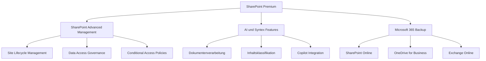
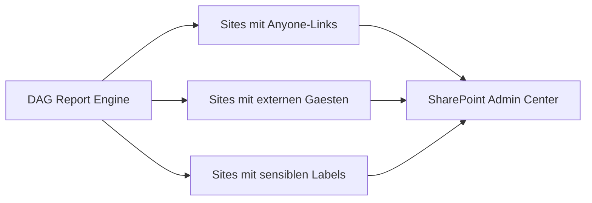
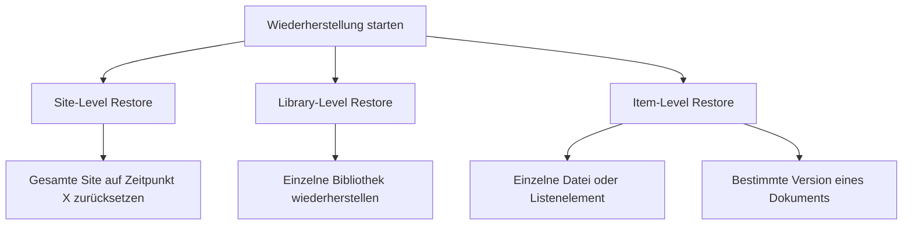
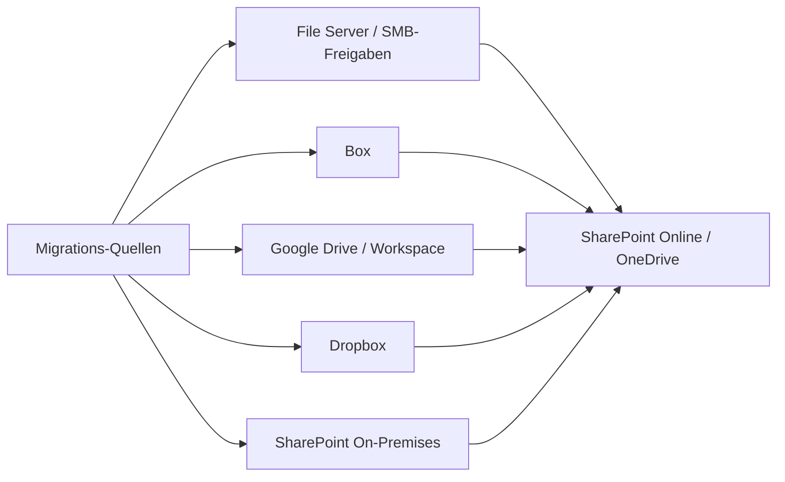
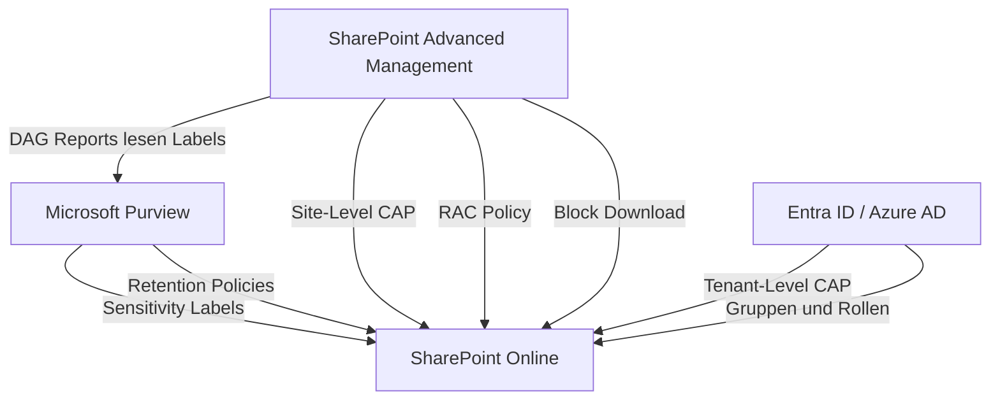

---
tags:
  - microsoft365
  - sharepoint
  - sharepoint-premium
  - sharepoint-advanced-management
  - governance
  - backup
  - compliance
  - lizenzierung
aliases:
  - SAM
  - SharePoint Advanced Management
  - SPP
---

# SharePoint Premium

> [!ABSTRACT] TL;DR
> SharePoint Premium ist ein kostenpflichtiges Add-on zu Microsoft 365, das zwei Säulen umfasst: **SharePoint Advanced Management (SAM)** für erweiterte Governance- und Sicherheitsfunktionen sowie **AI- und Syntex-Features** für intelligente Inhaltsverarbeitung. Zusätzlich gehört der **Microsoft 365 Backup**-Dienst zum Portfolio, der granulare Wiederherstellung für SharePoint, OneDrive und Exchange ermöglicht.

---

## Was ist SharePoint Premium?

SharePoint Premium (früher teilweise als „SharePoint Syntex" vermarktet) ist seit 2023/2024 die übergreifende Produktbezeichnung für erweiterte SharePoint-Funktionen, die über den im Microsoft-365-Abonnement enthaltenen Funktionsumfang hinausgehen.

Das Produkt gliedert sich in **zwei Kernkomponenten**:

| Komponente | Schwerpunkt | Zielgruppe |
|---|---|---|
| **SharePoint Advanced Management (SAM)** | Governance, Sicherheit, Site-Lifecycle | IT-Admins, Compliance-Teams |
| **AI & Syntex Features** | Dokumentenverarbeitung, KI-Klassifikation, Copilot-Integration | Information Worker, Knowledge Manager |

Ergänzend dazu ist **Microsoft 365 Backup** als separater Dienst erhältlich, der eng mit SharePoint Premium zusammenarbeitet.



> [!NOTE] Abgrenzung zu Microsoft 365 Copilot
> SharePoint Premium und Microsoft 365 Copilot sind separate Lizenzen. Einige Syntex-Funktionen setzen jedoch eine Copilot-Lizenz voraus oder ergänzen sich sinnvoll damit.

---

## Via SharePoint Admin Center (UI)

> [!NOTE]
> Die meisten SharePoint Premium- und SAM-Funktionen sind nativ im SharePoint Admin Center verfügbar. PowerShell wird vorwiegend für Automatisierung und Batch-Operationen benötigt.

### Inactive Site Policy konfigurieren

1. Öffne das **SharePoint Admin Center** unter [admin.microsoft.com/sharepoint](https://admin.microsoft.com/sharepoint)
2. Navigiere zu **Richtlinien → Datenverwaltung → Inaktive Sites**
3. Klicke auf **+ Richtlinie erstellen**
4. Konfiguriere:
   - **Inaktivitätszeitraum:** 90, 180 oder 365 Tage
   - **Scope:** Alle Sites oder Sites eines bestimmten Templates / Hub
   - **Aktion:** E-Mail-Benachrichtigung an Site-Besitzer oder automatisches Archivieren
5. Klicke auf **Speichern und aktivieren**

### Site Access Reviews starten

1. Navigiere zu **Richtlinien → Datenverwaltung → Zugriffsüberprüfungen**
2. Klicke auf **+ Neue Zugriffsüberprüfung**
3. Wähle den **Scope** (z. B. alle Sites mit externen Benutzern)
4. Setze die **Wiederholungsfrequenz** (einmalig, monatlich, vierteljährlich, jährlich)
5. Klicke auf **Starten**

### Restricted Access Control (RAC) pro Site aktivieren

1. Navigiere zu **Sites → Aktive Sites** → gewünschte Site auswählen
2. Öffne das Detailpanel → Tab **Einstellungen** oder **Richtlinien**
3. Aktiviere **Eingeschränkte Zugriffssteuerung**
4. Füge die erlaubten Gruppen hinzu → **Speichern**

### Data Access Governance (DAG) Reports aufrufen

1. Navigiere im SPAC zu **Berichte → Datenzugriffs-Governance**
2. Wähle einen Berichtstyp:
   - **Sites mit „Jeder"-Links** — übermäßige Freigabe aufdecken
   - **Sites mit sensiblen Labels und vielen externen Nutzern**
   - **Sites mit Block Download Policy**
3. Exportiere den Bericht als CSV für weitere Analyse

### Microsoft 365 Backup aktivieren

1. Öffne das **Microsoft 365 Admin Center** unter [admin.microsoft.com](https://admin.microsoft.com)
2. Navigiere zu **Setup → Microsoft 365 Backup**
3. Klicke auf **Erste Schritte**
4. Wähle die zu sichernden Workloads:
   - **SharePoint Online**
   - **OneDrive for Business**
   - **Exchange Online**
5. Bestätige die Aktivierung → Klicke auf **Aktivieren**

### Backup-Wiederherstellung durchführen

1. Im **Microsoft 365 Admin Center → Microsoft 365 Backup**
2. Wähle den Workload (SharePoint / OneDrive / Exchange)
3. Suche die Site / den Benutzer → klicke auf **Wiederherstellen**
4. Wähle einen **Wiederherstellungspunkt** (Datum und Uhrzeit)
5. Wähle den **Wiederherstellungsmodus** (überschreiben oder neben Original)
6. Klicke auf **Wiederherstellen** und verfolge den Fortschritt im Aktivitätsprotokoll

---

## SharePoint Advanced Management (SAM)

SAM ist die Governance-Komponente von SharePoint Premium. Sie richtet sich primär an **SharePoint-Administratoren und Compliance-Teams**, die große SharePoint-Umgebungen kontrollieren und steuern müssen.

### Inactive Site Policy

Mit der *Inactive Site Policy* können Administratoren automatisch **inaktive SharePoint-Sites identifizieren und archivieren** lassen.

- SAM erkennt Sites, die seit einem definierten Zeitraum (z. B. 180 Tage) keine Aktivität verzeichnet haben
- Automatische E-Mail-Benachrichtigung an Site-Besitzer mit der Möglichkeit zur Bestätigung der Weiternutzung
- Nicht bestätigte Sites werden automatisch in einen **Read-Only-Archivierungsstatus** versetzt
- Archivierte Sites verbrauchen reduzierten Storage-Kontingent

```powershell
# Inactive Site Policy über PnP PowerShell konfigurieren
Connect-PnPOnline -Url "https://contoso-admin.sharepoint.com" -Interactive

# Neue Policy erstellen (Inaktivität nach 180 Tagen)
New-PnPTenantSiteDesign  # Beispiel - tatsächliche Cmdlets über SPO Admin Center
```

> [!TIP] Best Practice für Site Lifecycle
> Kombiniere die Inactive Site Policy mit einer klaren **Site-Ownership-Strategie**. Jede Site sollte mindestens zwei Besitzer haben, damit Benachrichtigungen nicht ins Leere laufen.

---

### Site Access Reviews

Site Access Reviews ermöglichen es Administratoren, **regelmäßige Überprüfungen der Zugriffslisten** zu erzwingen.

- Site-Besitzer werden aufgefordert, Mitgliedschaften und Berechtigungen zu überprüfen und zu bestätigen
- Erinnerungen bei Nicht-Reaktion bis hin zur automatischen Deaktivierung von Zugriffsrechten
- Prüfprotokolle für Compliance-Nachweise (z. B. ISO 27001, SOC 2)

---

### Restricted Access Control Policy (RAC)

Die *Restricted Access Control Policy* schränkt den Zugriff auf eine SharePoint-Site oder eine OneDrive-Bibliothek auf eine **explizit definierte Azure-AD-Gruppe** ein — unabhängig von bereits vorhandenen Berechtigungen auf Tenant-Ebene.

| Szenario | Ohne RAC | Mit RAC |
|---|---|---|
| Globaler Admin | Hat Zugriff auf alle Sites | Wird auf bestimmten Sites blockiert |
| Gast-Benutzer | Kann eingeladen werden | Wird durch Gruppeneinschränkung blockiert |
| Sharing-Links | Können weitergegeben werden | Nur Mitglieder der definierten Gruppe können zugreifen |

```powershell
# Restricted Access Control für eine Site setzen
Set-SPOSite -Identity "https://contoso.sharepoint.com/sites/vertraulich" `
            -RestrictedAccessControl $true

# Zulässige Sicherheitsgruppe zuweisen
Set-SPOSite -Identity "https://contoso.sharepoint.com/sites/vertraulich" `
            -AddRestrictedAccessControlGroups "VertraulichZugelassen@contoso.com"
```

> [!IMPORTANT] Auswirkung auf Admins
> Selbst SharePoint-Administratoren und globale Admins können durch RAC vom Zugriff ausgeschlossen werden. Stelle sicher, dass mindestens ein Break-Glass-Account oder eine Notfallgruppe immer in der zugelassenen Gruppe enthalten ist.

---

### Data Access Governance Reports (DAG)

*Data Access Governance* Reports liefern **Einblick in übermäßig freigegebene oder sensible Inhalte** innerhalb des Tenants.

Die Reports beantworten u. a. folgende Fragen:
- Welche Sites enthalten Inhalte, die mit allen authentifizierten Benutzern geteilt wurden?
- Welche Sites haben viele externe Gastfreigaben?
- Wo befinden sich Dokumente mit Sensitivity Labels (z. B. „Vertraulich")?



> [!NOTE] Voraussetzung für DAG
> Microsoft Purview Sensitivity Labels müssen im Tenant aktiv sein und auf Dokumente angewendet werden, damit die labelbasierten DAG-Reports aussagekräftige Ergebnisse liefern.

---

### Block Download Policy

Mit der *Block Download Policy* können Dateien zwar **angezeigt, aber nicht heruntergeladen** werden. Nutzer können Dokumente im Browser lesen, ohne eine lokale Kopie erstellen zu können.

- Gilt per Site oder für nicht verwaltete Geräte (in Kombination mit Conditional Access)
- Unterstützt Office-Dokumente, PDFs und weitere Formate
- Ideal für Szenarien mit externen Mitarbeitern oder BYOD-Geräten

```powershell
# Block Download für eine spezifische Site aktivieren
Set-SPOSite -Identity "https://contoso.sharepoint.com/sites/vertraulich" `
            -BlockDownloadPolicy $true

# Nur für nicht verwaltete Geräte
Set-SPOTenant -ApplyAppEnforcedRestrictionsToAdHocRecipients $true
```

---

### Conditional Access Policy für Sites (Site-Level CAP)

Im Gegensatz zu Conditional-Access-Policies auf Tenant-Ebene ermöglicht SAM die Konfiguration von **standortspezifischen Zugriffsbedingungen**.

| Ebene | Scope | Konfiguriert in |
|---|---|---|
| Tenant-Level | Gilt für alle SharePoint-Zugriffe | Azure AD / Entra ID |
| Site-Level (SAM) | Gilt nur für eine bestimmte Site | SharePoint Admin Center / PnP |

Typische Szenarien:
- MFA nur für Sites mit sensiblen Finanzinformationen erzwingen
- Zugriff auf HR-Sites nur aus dem Unternehmensnetzwerk erlauben
- Bestimmte Sites nur auf compliant registrierten Geräten zugänglich machen

---

### Site Lifecycle Management

Das *Site Lifecycle Management* fasst mehrere Funktionen zusammen, die den **gesamten Lebenszyklus einer SharePoint-Site** abdecken:

- **Erstellungsworkflow:** Genehmigungsprozesse für neue Site-Anfragen
- **Governance-Regeln:** Automatische Zuweisung von Policies bei Site-Erstellung
- **Archivierung:** Automatische Archivierung inaktiver Sites (siehe Inactive Site Policy)
- **Löschworkflow:** Kontrollierter Löschprozess mit Bestätigung durch Site-Besitzer

> [!TIP] Empfehlung für große Tenants
> Aktiviere Site-Erstellungsworkflows, um unkontrolliertes Site-Sprawl zu vermeiden. Kombinierie dies mit Naming Conventions und automatischer Sensitivity-Label-Zuweisung.

---

### Storage Reports

SAM enthält erweiterte **Storage-Berichte** für den gesamten Tenant:

- Übersicht über den Storage-Verbrauch pro Site, Library und Nutzer
- Identifikation von Sites mit ungewöhnlich hohem Wachstum
- Trends über Zeit zur Kapazitätsplanung
- Unterstützung bei der Entscheidung, welche Sites archiviert oder bereinigt werden sollten

---

## Microsoft 365 Backup

Microsoft 365 Backup ist ein von Microsoft betriebener **nativer Backup- und Restore-Dienst** für die M365-Workloads SharePoint Online, OneDrive for Business und Exchange Online.

> [!IMPORTANT] Kein Ersatz für Third-Party-Backup
> Microsoft 365 Backup ist ein von Microsoft bereitgestellter Dienst – kein vollständiger Ersatz für eine unabhängige Backup-Lösung außerhalb des Microsoft-Tenants. Für Compliance-Szenarien, die eine Off-Tenant-Kopie erfordern, ist weiterhin eine Drittanbieterlösung nötig.

### Unterstützte Workloads

| Workload | Granularität | Aufbewahrung |
|---|---|---|
| SharePoint Online | Site, Library, Item | Bis zu 1 Jahr |
| OneDrive for Business | Konto, Library, Item | Bis zu 1 Jahr |
| Exchange Online | Postfach, Ordner, Element | Bis zu 1 Jahr |

### Restore-Granularität



### RPO und RTO

| Kennzahl | Wert | Beschreibung |
|---|---|---|
| **RPO** (Recovery Point Objective) | ~1 Stunde | Maximaler Datenverlust bei einem Vorfall |
| **RTO** (Recovery Time Objective) | Minuten bis Stunden | Zeitraum bis zur vollständigen Wiederherstellung (abhängig von Datenmenge) |
| Backup-Häufigkeit | Stündlich | Automatische, inkrementelle Snapshots |

> [!WARNING] RTO-Abhängigkeit von der Datenmenge
> Die Wiederherstellungszeit hängt stark von der Größe der Site oder des Postfachs ab. Eine Site mit mehreren Terabyte kann mehrere Stunden in Anspruch nehmen. Plane entsprechende Zeitpuffer für RTO-Kalkulationen ein.

### Backup konfigurieren (PowerShell)

```powershell
# Microsoft 365 Backup über Microsoft 365 Admin Center aktivieren
# Alternativ über Graph API / PowerShell (Preview)

# Status der Backup-Konfiguration prüfen
Get-MgBackupRestoreSharePointEnablementStatus

# OneDrive Backup-Policy erstellen
New-MgBackupRestoreOneDriveUserInclusionRule `
    -DirectoryObjectId "user-object-id-hier" `
    -BackupServiceEnabled $true
```

> [!NOTE] Admin Center
> Microsoft 365 Backup wird primär über das **Microsoft 365 Admin Center** unter `Admin > Backup & Restore` konfiguriert. Die PowerShell-Unterstützung über die Microsoft Graph API ist seit 2024 verfügbar, aber noch im Ausbau.

---

## Lizenzierung

### Kosten und Bezugsweg

SharePoint Premium ist ein **Add-on-Lizenz** und wird zusätzlich zu einer bestehenden Microsoft-365-Lizenz erworben.

| Lizenz | Preis (ca.) | Bemerkung |
|---|---|---|
| SharePoint Premium Add-on | ~ 2,00 USD / User / Monat | Zusätzlich zu M365 Business oder Enterprise |
| Microsoft 365 Backup | Nutzungsbasiert (pro GB) | Separate Abrechnung nach verbrauchtem Storage |
| Microsoft 365 Copilot | ~ 30,00 USD / User / Monat | Separate Lizenz, ergänzt Syntex-Features |

> [!WARNING] Lizenz-Zuweisung erforderlich
> SAM-Features sind zwar tenant-weit konfigurierbar, erfordern aber für die **betroffenen Benutzer** eine zugewiesene SharePoint-Premium-Lizenz. Inhaltsverarbeitungs-Features (Syntex) müssen pro Nutzer oder per Pay-as-you-go-Modell lizenziert werden.

### Pay-as-you-go (PAYG)

Für Syntex-Features (z. B. Dokumentenverarbeitung, Inhaltsklassifikation) existiert ein alternatives **Verbrauchsmodell**:

- Abrechnung pro verarbeitetes Dokument oder pro API-Aufruf
- Keine Vorab-Lizenzierung aller Nutzer notwendig
- Abrechnung über ein verknüpftes Azure-Abonnement

---

## SharePoint Standard vs. SharePoint Premium

> [!NOTE] Standard = Im M365-Abonnement enthalten
> Alle Funktionen in der „Standard"-Spalte sind ohne zusätzliche Lizenz in allen Microsoft 365 Business- und Enterprise-Plänen verfügbar.

| Feature | SharePoint Standard | SharePoint Premium |
|---|:---:|:---:|
| Dokumentbibliotheken und Listen | ✅ | ✅ |
| Versionsverlauf (Standard) | ✅ | ✅ |
| Sharing und Gastfreigabe | ✅ | ✅ |
| Sensitivity Labels (Purview) | ✅ | ✅ |
| Retention Policies (Purview) | ✅ | ✅ |
| eDiscovery (Standard) | ✅ | ✅ |
| Inactive Site Policy | ❌ | ✅ |
| Site Access Reviews | ❌ | ✅ |
| Restricted Access Control | ❌ | ✅ |
| Data Access Governance Reports | ❌ | ✅ |
| Block Download Policy | ❌ | ✅ |
| Site-Level Conditional Access | ❌ | ✅ |
| Erweiterte Storage Reports | ❌ | ✅ |
| Microsoft 365 Backup | ❌ | ✅ (Add-on) |
| Syntex Dokumentenverarbeitung | ❌ | ✅ (PAYG oder User) |
| Syntex Inhaltsklassifikation | ❌ | ✅ (PAYG oder User) |

---

## Migration Services

SharePoint Premium umfasst auch **Migration Manager** und erweiterte Migrationsfunktionen, die beim Umzug von Inhalten in SharePoint Online unterstützen.

### Unterstützte Quellen



### Migration Manager – Ablauf

```powershell
# Migration Manager Agent auf dem Quell-Server installieren
# Download: https://aka.ms/spmt-download

# Nach der Installation: Agent registrieren
# Dies erfolgt über das SharePoint Admin Center unter
# Migration > Migration Manager > Agents

# Scan-Bericht für einen File Server erstellen
# (im Admin Center konfiguriert, keine direkte PS-Cmdlets notwendig)
```

> [!TIP] Vor der Migration
> Führe immer einen **Pre-Migration Assessment** durch. Der Migration Manager bietet einen Scan-Modus, der Inkompatibilitäten (z. B. Sonderzeichen in Dateinamen, Pfadlängen > 400 Zeichen) identifiziert, bevor die eigentliche Migration startet.

| Einschränkung | Grenzwert |
|---|---|
| Max. Dateigröße | 250 GB |
| Max. Pfadlänge | 400 Zeichen (SharePoint-Limit) |
| Verbotene Zeichen | `" * : < > ? / \ |` |
| Max. Items pro Library | 30 Millionen (empfohlen: < 300.000) |

> [!DANGER] Sonderzeichen und lange Pfade
> Dateien mit verbotenen Sonderzeichen im Namen oder Pfaden über 400 Zeichen werden beim Migrationsvorgang übersprungen oder scheitern. Bereinige die Quell-Daten vor der Migration, um Datenverlust zu vermeiden.

---

## Governance-Zusammenspiel



> [!IMPORTANT] Layered Security
> SharePoint Premium ergänzt, ersetzt aber nicht die Sicherheitsfunktionen von Microsoft Purview und Entra ID. Die stärkste Schutzwirkung entsteht durch das **Zusammenspiel aller drei Ebenen**: Purview (Klassifikation), Entra ID (Identität) und SAM (Site-spezifische Kontrolle).

---

## Verwandte Notizen

- [[SharePoint Online Grundlagen]]
- [[Websitesammlungen verwalten]]
- [[SharePoint Governance]]
- [[Berechtigungen und Sharing]]
- [[SharePoint Syntex und Copilot]]
