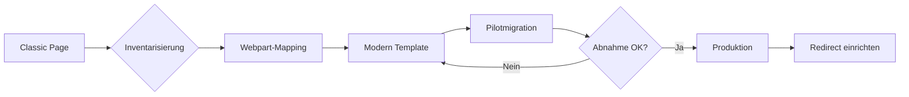
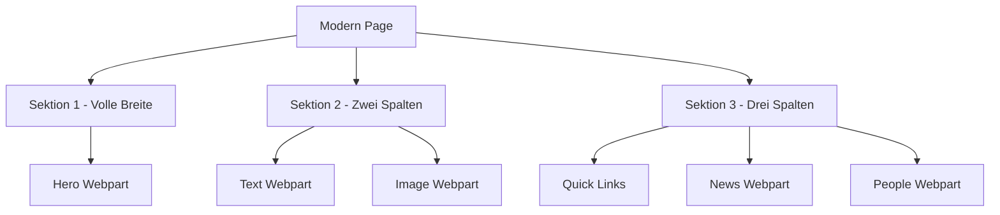
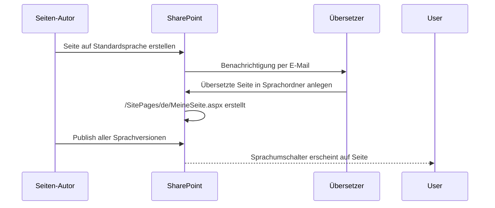
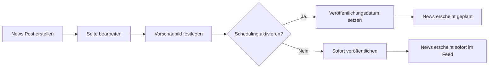
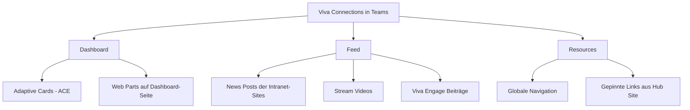
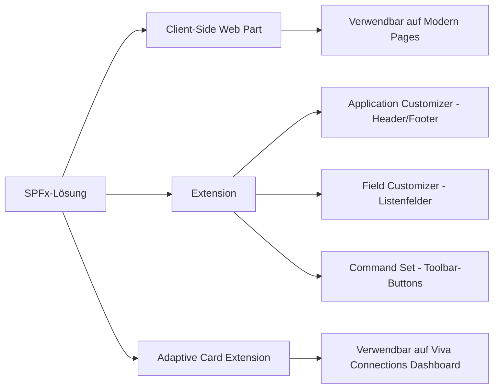

---
tags:
  - microsoft365
  - sharepoint
  - webparts
  - modern-pages
  - viva-connections
  - spfx
aliases:
  - SharePoint Pages
  - Webparts
  - SP Seiten
---

# SharePoint Seiten und Webparts

> [!ABSTRACT] TL;DR
> SharePoint Modern Pages sind der aktuelle Standard für Inhaltsseiten in SharePoint Online. Sie bestehen aus konfigurierbaren Sektionen und Webparts, unterstützen Zielgruppen-Targeting, Mehrsprachigkeit und News-Funktionen. Der SharePoint Framework (SPFx) ermöglicht die Entwicklung eigener Webparts und Erweiterungen.

---

## Modern Pages vs. Classic Pages

Microsoft hat mit SharePoint 2016/Online die **Modern Experience** eingeführt. Classic Pages sind technisch noch vorhanden, werden aber nicht mehr weiterentwickelt und sollen langfristig migriert werden.

### Vergleich

| Merkmal | Classic Pages | Modern Pages |
|---|---|---|
| Technologie | ASP.NET Web Forms | React / SPFx |
| Mobile-Optimierung | ❌ Kaum | ✅ Vollständig responsive |
| Bearbeitung | Ribbon-basiert | Inline-Toolbars |
| Webpart-Auswahl | ~40 Legacy-Webparts | 50+ Modern Webparts |
| Versionsverlauf | ✅ | ✅ |
| Audience Targeting | ❌ Nativ nicht vorhanden | ✅ Pro Webpart |
| Mehrsprachigkeit | ❌ | ✅ |
| Page Templates | Eingeschränkt | ✅ |
| Copilot / AI-Integration | ❌ | ✅ |
| SharePoint Framework | Limitiert | ✅ Vollständig |
| News-Features | ❌ | ✅ (Boost, Scheduling, etc.) |

### Migration Classic → Modern

> [!WARNING] Kein automatischer Migrationspfad
> Microsoft bietet kein natives Tool zur 1:1-Konvertierung von Classic Pages in Modern Pages. Inhalte müssen manuell oder über Drittanbieter-Tools (z. B. Sharegate, Metalogix) migriert werden.

Empfohlene Vorgehensweise bei der Migration:

1. **Inventarisierung** — alle Classic Pages und verwendeten Webparts erfassen
2. **Mapping** — Classic Webparts auf Modern Webparts mappen
3. **Template-Erstellung** — Modern Page Templates für wiederkehrende Layouts
4. **Pilotmigration** — Testsites zuerst migrieren
5. **Kommunikation** — Endnutzer über neue Oberfläche informieren
6. **Redirect einrichten** — `/SitePages/NameAlt.aspx → /SitePages/NameNeu.aspx`



---

## Seitentypen

SharePoint unterscheidet drei wesentliche Seitentypen innerhalb von Modern Sites.

### Team Site Page

- Erstellt in der **Site Pages Library** einer Team Site
- Zielgruppe: Interne Teammitglieder, Projektbeteiligte
- Zugriff: Standard gemäß Siteberechtigungen
- Typische Inhalte: Projektdokumentation, interne Anleitungen, Meeting-Notizen
- Navigation: Automatisch in die linke Sitenavigation integrierbar

### News Post

- Ebenfalls in der **Site Pages Library** gespeichert, aber Typ `News`
- Erscheint in News-Webparts auf anderen Seiten und im SharePoint-Startseiten-Feed
- Enthält Metadaten: Kategorie, Vorschaubild, Autor, Publish-Datum
- Unterstützt **News Boost**, **Scheduling** und **Audience Targeting**
- Auch per E-Mail an Abonnenten verteilbar (News E-Mail)

### Communication Site Page

- Hauptseite oder Unterseite einer **Communication Site**
- Zielgruppe: Breite Leserschaft (Intranet, Unternehmenskommunikation)
- Layouts stärker auf visuelle Präsentation ausgerichtet (Hero, volle Breite)
- Typische Inhalte: Unternehmens-News, HR-Portale, IT-Intranet

> [!NOTE] Hub Sites
> Hub Sites bündeln mehrere Team- und Communication Sites. News Posts der angebundenen Sites aggregieren automatisch auf der Hub Site.

---

## Sektionen und Page Layouts

Modern Pages sind in **Sektionen (Sections)** gegliedert, die jeweils ein eigenes Spalten-Layout haben.

### Verfügbare Spalten-Layouts

| Layout | Spalten | Typischer Einsatz |
|---|---|---|
| Volle Breite | 1 (100 %) | Hero-Webpart, Banner |
| Eine Spalte | 1 (100 %) | Textseiten, einfache Layouts |
| Zwei Spalten | 2 (50/50) | Nebeneinander-Inhalte |
| Zwei Spalten (links breit) | 2 (66/33) | Hauptinhalt + Seitenleiste |
| Zwei Spalten (rechts breit) | 2 (33/66) | Seitenleiste + Hauptinhalt |
| Drei Spalten | 3 (33/33/33) | Kachel-Layouts, Übersichtsseiten |
| Vertikal | Seitenleiste rechts | Fester vertikaler Bereich |

### Sektionen-Hintergrundfarben

Jede Sektion kann eine eigene Hintergrundfarbe erhalten:
- **Keine (weiß)** — Standard
- **Neutral (hellgrau)** — Visuelle Trennung
- **Weich (sanftes Blau/Grau)** — Akzentbereiche
- **Stark (dunkles Thema)** — Call-to-Action-Bereiche

> [!TIP] Sektions-Hintergrundfarben
> Durch den Wechsel von Hintergrundfarben zwischen Sektionen entsteht ein optisch strukturiertes Seitenlayout ohne zusätzliche Trennelemente.



---

## Webparts-Übersicht

Webparts sind die bausteinartige Inhaltskomponenten einer Modern Page. Sie werden über das **+**-Symbol in der Bearbeitungsansicht hinzugefügt.

### Inhalt & Medien

| Webpart | Funktion |
|---|---|
| **Text** | Rich-Text-Editor mit Formatierungsoptionen, Tabellen, Links |
| **Image** | Einzelbild mit optionalem Overlay-Text, Link und Alt-Text |
| **Hero** | Großformatiger visueller Bereich mit bis zu 5 Kacheln und CTA-Buttons |
| **File Viewer** | Vorschau von Word, Excel, PowerPoint, PDF direkt in der Seite |
| **Markdown** | Markdown-Text direkt in die Seite einbetten |
| **Code Snippet** | Formatierten Code mit Syntaxhervorhebung anzeigen |
| **Divider** | Horizontale Trennlinie zwischen Webparts |
| **Spacer** | Vertikaler Leerraum |
| **Countdown Timer** | Zählt zu einem definierten Datum/Ereignis herunter |
| **Weather** | Wetteranzeige für einen konfigurierten Ort |
| **World Clock** | Uhrzeiten verschiedener Zeitzonen gleichzeitig anzeigen |
| **Bing Maps** | Interaktive Karte für einen definierten Standort |

### Navigation & Links

| Webpart | Funktion |
|---|---|
| **Quick Links** | Kachelförmige oder Listendarstellung von Links |
| **Button** | Einzelner Call-to-Action-Button mit Link |
| **Site Navigation** | Anzeige der Sitenavigation auf der Seite |

### Listen & Bibliotheken

| Webpart | Funktion |
|---|---|
| **Document Library** | Ansicht einer Dokumentenbibliothek einbetten |
| **List** | Ansicht einer SharePoint-Liste einbetten |
| **Library** | Bibliotheksansicht mit konfigurierbaren Spalten |

### News & Personen

| Webpart | Funktion |
|---|---|
| **News** | Aggregiert News Posts der aktuellen Site oder verbundener Sites |
| **People** | Personenprofil-Kacheln aus Azure AD / Microsoft 365 |
| **My Feed** | Personalisierter Aktivitätsfeed des angemeldeten Benutzers |
| **Highlighted Content** | Dynamische Inhaltssuche nach Metadaten, Typ, Tag |

### Microsoft 365 Integrationen

| Webpart | Funktion |
|---|---|
| **Power BI** | Power BI Report oder Dashboard einbetten |
| **Microsoft Forms** | Formular direkt in die Seite einbetten |
| **Stream (on SharePoint)** | Video aus SharePoint/Teams einbetten |
| **Viva Engage** | Yammer-Konversation oder -Gruppe einbetten |
| **Viva Topics** | Topic-Karten aus Viva Topics anzeigen |
| **Planner** | Planner-Board oder -Aufgabenliste einbetten |
| **Power Apps** | Power App direkt in der Seite rendern |
| **Power Automate** | Flow-Button zum manuellen Auslösen eines Flows |

> [!NOTE] Stream on SharePoint vs. Stream Classic
> Seit 2024 ist Stream Classic abgekündigt. Videos werden nun direkt in SharePoint-Bibliotheken gespeichert. Das Stream-Webpart referenziert MP4-Dateien aus SharePoint.

### Suchbasierte Webparts

| Webpart | Funktion |
|---|---|
| **Highlighted Content** | Inhalte per KQL-Abfrage dynamisch anzeigen |
| **Search Results** | Suchergebnis-Webpart auf Ergebnisseiten |
| **Search Box** | Suchfeld mit Weiterleitung auf Suchergebnisseiten |
| **Sites** | Listet Sites an, denen der Nutzer folgt oder die häufig besucht werden |

---

## Via SharePoint Admin Center (UI)

### Neue SharePoint-Seite erstellen

1. Navigiere zur gewünschten SharePoint-Site
2. Klicke auf **+ Neu → Seite**
3. Wähle ein **Seitenlayout** (leer oder aus einer Vorlage)
4. Bearbeite den Seitentitel im oberen Bereich
5. Füge Webparts hinzu: Klicke auf das **+**-Symbol zwischen Sektionen → Webpart auswählen
6. Konfiguriere das Webpart im rechten Einstellungspanel
7. Klicke auf **Veröffentlichen** (oder **Als News-Post veröffentlichen**)

> [!TIP]
> Schneller Zugriff: **Einstellungen (Zahnrad) → Seite hinzufügen** oder über die Schnellstartleiste **Seiten → Neue Seite**

### Sektionen und Layout konfigurieren

1. Öffne eine Seite im **Bearbeitungsmodus** (Bleistift-Symbol oben rechts)
2. Klicke auf das **Sektions-Symbol** (links neben der Sektion) → Layout wählen
3. Verfügbare Layouts: 1 Spalte, 2 Spalten, 3 Spalten, 1/3 links, 1/3 rechts
4. Hintergrundfarbe der Sektion über **Sektionsfarbe** festlegen (Neutral, Weich, Stark, Akzent)

### Webpart hinzufügen und konfigurieren

1. Klicke im Bearbeitungsmodus auf das **+**-Symbol
2. Wähle ein Webpart aus der Galerie (z. B. **Hervorgehobene Inhalte**, **Neuigkeiten**, **Schnelllinks**)
3. Konfiguriere das Webpart im **Eigenschaftspanel** rechts
4. Ziehe Webparts per **Drag & Drop** an eine neue Position
5. Klicke auf **Neu veröffentlichen**

### Seitenvorlage erstellen und verwenden

**Vorlage speichern:**
1. Öffne eine fertig gestaltete Seite → klicke auf **⋮ (Weitere Optionen) → Als Vorlage speichern**
2. Gib der Vorlage einen Namen → **Vorlage speichern**

**Vorlage verwenden:**
1. **+ Neu → Seite → Aus vorhandener Vorlage**
2. Wähle die gespeicherte Vorlage → **Seite erstellen**

### Audience Targeting für Webparts aktivieren

1. Öffne **Site-Inhalte → Site Pages Bibliothek**
2. Klicke auf **⋮ → Einstellungen** (Bibliothekseinstellungen)
3. Aktiviere **Zielgruppen-Targeting** → **Speichern**
4. Öffne eine Seite im Bearbeitungsmodus → wähle ein unterstütztes Webpart (z. B. Hervorgehobene Inhalte, Neuigkeiten)
5. Im Webpart-Panel: **Zielgruppen** hinzufügen (M365-Gruppe, Sicherheitsgruppe oder Entra-Gruppe)

### Mehrsprachige Seite konfigurieren

1. Öffne **Site-Einstellungen (Zahnrad) → Mehrsprachige Einstellungen**
2. Aktiviere **Seiten und Nachrichtenartikel für mehrere Sprachen aktivieren**
3. Füge die gewünschten Sprachen hinzu (z. B. Englisch, Französisch)
4. Weise Übersetzer für die Sprachen zu
5. Bestätige mit **Speichern**

---

## Seitenvorlagen (Page Templates)

Templates ermöglichen es, Seitenlayouts mit vorbefüllten Webparts zu speichern und bei neuen Seiten wiederzuverwenden.

### Template erstellen

1. Seite vollständig gestalten (Sektionen, Webparts, Inhalte)
2. Oben rechts: **Seite speichern als Vorlage** (Schaltfläche im Drei-Punkte-Menü)
3. Name und Beschreibung vergeben
4. Optional: **Vorschaubild** hochladen
5. Template ist anschließend für alle Nutzer der Site verfügbar

### Template verwenden

1. Neue Seite erstellen → **+ Neue Seite**
2. Im Template-Picker erscheinen sowohl **Microsoft-Standard-Templates** als auch eigene
3. Template auswählen → Inhalt wird vorausgefüllt übernommen
4. Platzhalterkarten und Text anpassen

> [!TIP] Organisationsweite Templates
> Über den **Site Pages Content Type Hub** oder mit **PowerShell/PnP** können Templates an alle Subsites verteilt werden. Für großflächige Template-Governance eignet sich eine dedizierte **Template-Site**.

```bash
# Seitenvorlage per PnP PowerShell abrufen
Connect-PnPOnline -Url "https://tenant.sharepoint.com/sites/template-site" -Interactive

Get-PnPSiteTemplate -Out "template.xml" -Handlers PageContents
```

---

## Mehrsprachige Seiten (Multilingual Pages)

SharePoint Online unterstützt die Erstellung mehrsprachiger Intranet-Seiten ohne Drittanbieter-Tools.

### Voraussetzungen

- **Multilingual-Feature** auf der Site aktivieren (Site Settings → Language Settings)
- Zielsprachen hinzufügen (z. B. Deutsch, Englisch, Französisch)
- Sprachverantwortliche (**Translator**) pro Sprache definieren

### Funktionsweise



### Ordnerstruktur in der Site Pages Library

```
SitePages/
├── HomePage.aspx               ← Standardsprache (z. B. EN)
├── en/
│   └── HomePage.aspx           ← Englische Übersetzung
├── de/
│   └── HomePage.aspx           ← Deutsche Übersetzung
└── fr/
    └── HomePage.aspx           ← Französische Übersetzung
```

> [!IMPORTANT] Synchronisierung
> Änderungen an der Quellseite **lösen keine automatische Aktualisierung** der Übersetzungen aus. Übersetzer müssen manuell benachrichtigt und aktiv werden. Das Status-Badge zeigt an, ob eine Übersetzung veraltet ist.

---

## News-Funktionen

### News Post erstellen

News Posts unterscheiden sich von normalen Seiten durch den Inhaltstyp `Site Page` mit gesetztem Flag `PromotedState = 2`.



### News Boost

**News Boost** ermöglicht es, einen News Post für einen definierten Zeitraum an die Spitze des News-Feeds zu heben.

- Sichtbar in: SharePoint Startseite, Hub Site News Webpart, Viva Connections
- Dauer: Frei konfigurierbar (Standard 7 Tage)
- Berechtigung: Site Owner oder Site Member mit entsprechender Rolle
- Pfad: News Post öffnen → **Seite boosten** (Boost icon im oberen Menü)

### News Scheduling

Seiten und News Posts können zu einem zukünftigen Zeitpunkt automatisch veröffentlicht werden:

1. Seite in den Entwurfsmodus versetzen
2. Im Panel rechts: **Scheduling** aktivieren
3. Datum und Uhrzeit eintragen
4. Seite speichern (nicht manuell publishen)
5. SharePoint veröffentlicht automatisch zum festgelegten Zeitpunkt

> [!WARNING] Scheduling und Approval
> Wenn ein **Page Approval Flow** aktiviert ist, muss die Seite trotz Scheduling manuell durch einen Approver freigegeben werden. Das Scheduling löst keinen automatischen Approval aus.

### Audience Targeting für News

News Posts können gezielt an Sicherheitsgruppen oder Microsoft 365-Gruppen ausgespielt werden:

- Aktivierung: Site Settings → News → **Enable audience targeting**
- Pro News Post: Im Properties Panel → **Audience** auswählen
- Nicht zugeordnete Inhalte: Erscheinen nur für Nutzer, die zur Zielgruppe gehören (im Feed)

---

## Audience Targeting für Webparts

Audience Targeting ist nicht nur für News, sondern für viele Webparts verfügbar.

### Unterstützte Webparts

- News
- Quick Links
- Highlighted Content
- Hero
- People
- Events
- Sites

### Einrichtung

1. **Site-Level:** Features → Enable Audience Targeting
2. **Page-Level:** Webpart Properties → Audience Targeting aktivieren
3. **Zielgruppen:** Azure AD-Sicherheitsgruppen oder M365-Gruppen zuweisen
4. Im Bearbeitungsmodus ist der Inhalt für den Autor **immer sichtbar**

> [!NOTE] Audience Targeting ist kein Sicherheitsfeature
> Audience Targeting steuert die **Anzeige** von Inhalten, nicht den **Zugriff**. Ein Nutzer außerhalb der Zielgruppe kann den Inhalt direkt über die URL weiterhin erreichen, sofern er Leserechte auf die Site hat.

---

## Viva Connections Integration

Viva Connections bringt SharePoint-Inhalte und das Intranet direkt in **Microsoft Teams**.

### Dashboard vs. Feed vs. Resources



### Dashboard-Seite

- Spezielle SharePoint-Seite mit URL `/SitePages/Dashboard.aspx`
- Verwendet **Adaptive Card Extensions (ACE)** statt normaler Webparts
- Erscheint in Teams als mobile-optimierte Kachelansicht
- ACE werden via SPFx entwickelt oder als Standard-ACEs von Microsoft genutzt

### Standard-ACEs (keine Entwicklung erforderlich)

| ACE | Funktion |
|---|---|
| **Approvals** | Ausstehende Genehmigungen |
| **Assigned Tasks** | Aufgaben aus Planner / To Do |
| **Card Designer** | Eigene Kacheln ohne Code konfigurieren |
| **OneDrive** | Schnellzugriff auf eigene Dateien |
| **Shifts** | Schichtplan aus Teams |
| **Top News** | News aus dem Intranet |
| **Web Link** | Externer Link als Kachel |

---

## SharePoint Framework (SPFx)

SPFx ist das offizielle Entwicklungs-Framework für SharePoint- und Viva-Erweiterungen.

### Architektur



### Technologie-Stack

| Komponente | Technologie |
|---|---|
| Sprache | TypeScript |
| Framework | React (empfohlen) oder Vanilla JS |
| Build-Tool | Gulp / Webpack |
| Package Manager | npm / pnpm |
| Deployment | App Catalog (Site / Tenant) |
| Hosting | SharePoint CDN (automatisch) |

### SPFx-Lösung deployen

```bash
# Voraussetzungen installieren
npm install -g @microsoft/generator-sharepoint

# Neues Projekt erstellen
yo @microsoft/sharepoint

# Build & Package
gulp bundle --ship
gulp package-solution --ship
```

```bash
# Upload in App Catalog per PnP CLI
m365 spo app add --filePath ./sharepoint/solution/mein-webpart.sppkg \
  --appCatalogUrl "https://tenant.sharepoint.com/sites/appcatalog"

# Tenant-weit deployen
m365 spo app deploy --name mein-webpart.sppkg --skipFeatureDeployment
```

> [!IMPORTANT] SPFx-Versionskompatibilität
> SPFx-Lösungen sind an die SharePoint-Version gebunden. In SharePoint Online wird automatisch die neueste SPFx-Version unterstützt. Beim Upgrade einer SPFx-Lösung müssen alle npm-Abhängigkeiten geprüft und ggf. aktualisiert werden.

---

## SEO-Einstellungen für Seiten

SharePoint Online bietet native SEO-Einstellungen für Modern Pages, die besonders für öffentliche Intranet-Seiten relevant sind.

### Seitenmetadaten

Für jede Seite können im **Properties Panel** folgende SEO-relevanten Felder gesetzt werden:

| Feld | Beschreibung | Ort |
|---|---|---|
| **Seitentitel** | `<title>`-Tag der Seite | Page Header oder Details Panel |
| **Beschreibung** | Meta Description für Suchmaschinen | Page Details → Description |
| **Vorschaubild** | Open Graph Image für Social Sharing | Page Details → Thumbnail |
| **Benutzerdefinierte URL** | Freundliche URL für die Seite | Nicht nativ — via Redirect |

### Suchmaschinenindizierung

> [!NOTE] SharePoint-Suchindex vs. externe Suchmaschinen
> SharePoint hat einen **eigenen internen Suchindex** (Microsoft Search), der unabhängig von externen Suchmaschinen wie Google ist. Öffentliche SharePoint-Sites (externe Freigabe aktiv) können von Google indexiert werden — interne Sites nicht.

Steuerung der Indexierung:

```powershell
# Seite aus SharePoint-Suche ausschließen (PnP PowerShell)
Set-PnPListItem -List "Site Pages" -Identity 42 -Values @{
    "NoCrawl" = $true
}
```

### Kanonische URLs und Weiterleitungen

```powershell
# Redirect von alter Classic Page auf neue Modern Page
Add-PnPNavigationNode -Location "QuickLaunch" -Title "Redirect" `
  -Url "/sites/mySite/SitePages/NeuePage.aspx"

# SPO-spezifisch: Redirect über SharePoint URL Redirect Feature
# (via Site Pages Library → Page Properties → Custom Redirect)
```

> [!TIP] SEO Best Practices für SharePoint
> - Aussagekräftige Seitentitel wählen (max. 60 Zeichen)
> - Meta Description für jede Seite befüllen (max. 160 Zeichen)
> - Hero-Webpart-Bilder mit Alt-Text versehen
> - Sprechende Dateinamen für Seitendateien verwenden (z. B. `onboarding-guide.aspx` statt `SitePage-5.aspx`)
> - Veröffentlichte Seiten regelmäßig auf tote Links prüfen

---

## Seiten verwalten und überprüfen

### Site Pages Library

Alle Seiten einer Site sind in der **Site Pages Library** gespeichert:

```
https://tenant.sharepoint.com/sites/mySite/SitePages/
```

Nützliche Spalten in der Library-Ansicht:

| Spalte | Beschreibung |
|---|---|
| `Title` | Seiten-Titel |
| `Promoted State` | 0 = Normal, 1 = Entwurf-News, 2 = News |
| `First Published` | Erstveröffentlichungsdatum |
| `Modified` | Letzte Änderung |
| `Page Layout Type` | Home / Article / SingleWebPartAppPage |
| `Translations` | Verfügbare Sprachversionen |

### Seiten-Versionsverlauf

Jede Modern Page unterstützt Versionsverlauf (analog zu Bibliotheksdateien):

- Haupt- und Nebenversionen (1.0, 1.1, 2.0 etc.)
- Wiederherstellung älterer Versionen möglich
- Konfigurierbar: Site Settings → Versioning Settings

```powershell
# Alle Versionen einer Seite abrufen
$item = Get-PnPListItem -List "Site Pages" -Id 42
Get-PnPProperty -ClientObject $item -Property Versions
```

### Seiten-Analytics

Jede veröffentlichte Seite zeigt im Bearbeitungsmodus Analytics:

- Eindeutige Besucher (Unique Viewers)
- Seitenaufrufe (Views)
- Durchschnittliche Besuchszeit
- Abrufbar via: Seite öffnen → **Page Details** → **Analytics** Tab

---

## Verwandte Notizen

- [[SharePoint Online Grundlagen]]
- [[Websitesammlungen verwalten]]
- [[SharePoint Governance]]
- [[SharePoint Syntex und Copilot]]
