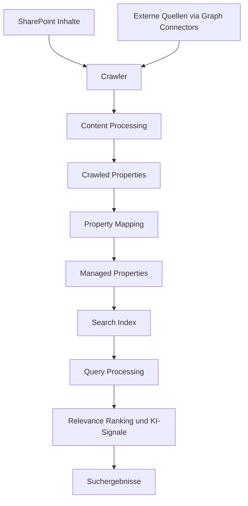
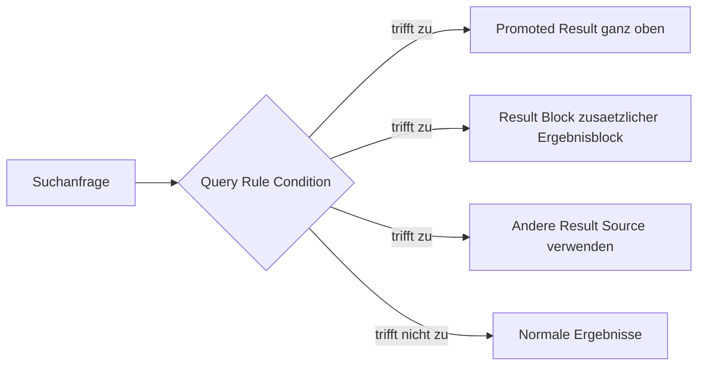
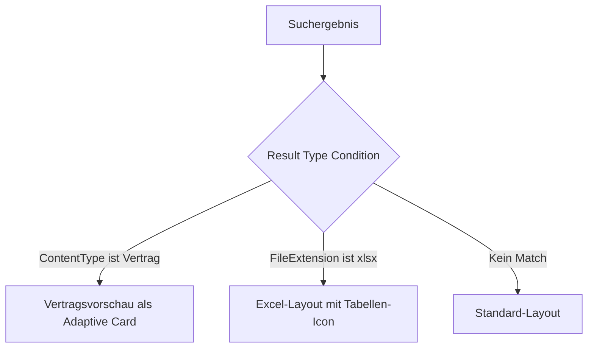
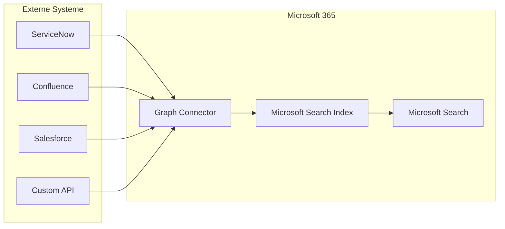
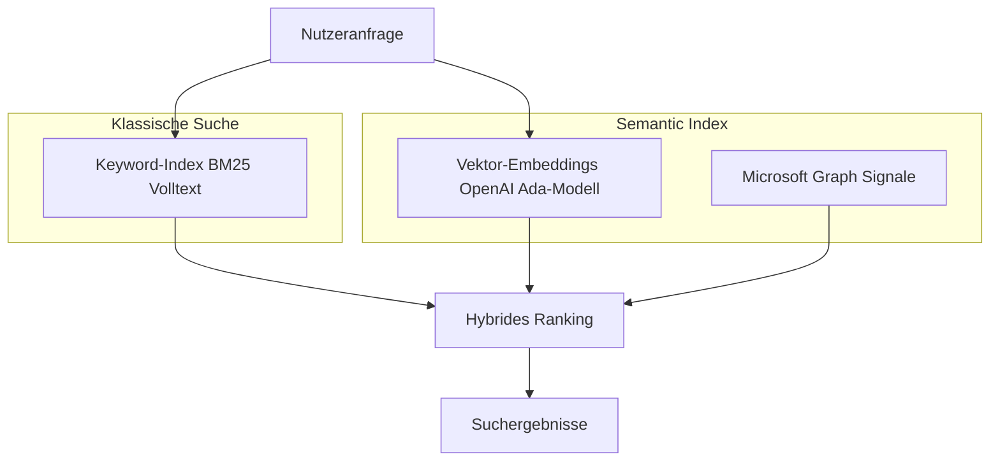
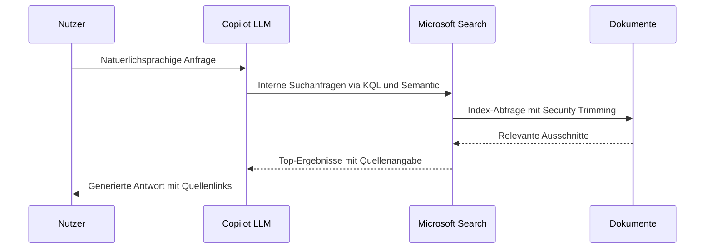
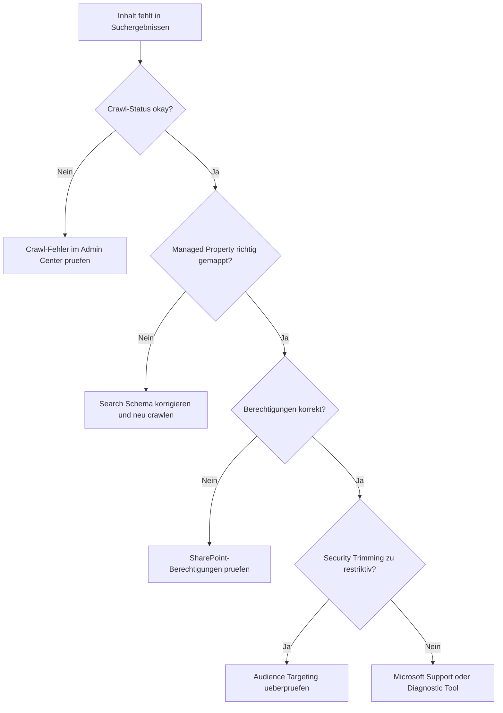

---
tags:
  - microsoft365
  - sharepoint
  - search
  - microsoft-search
  - graph-connectors
  - search-schema
  - copilot
aliases:
  - SPO Suche
  - Microsoft Search SharePoint
  - SharePoint Search
---

# SharePoint Suche

> [!ABSTRACT] TL;DR
> Die SharePoint-Suche basiert seit Microsoft 365 auf **Microsoft Search** — einer KI-gestützten, mandantenweiten Suchplattform, die SharePoint, Teams, Outlook und weitere M365-Dienste vereint. Das Herzstück bildet ein mehrstufiger Index aus Crawled Properties und Managed Properties (Search Schema). Über Graph Connectors lassen sich externe Inhaltsquellen einbinden, während der **Semantic Index** und Microsoft 365 Copilot seit 2024 semantische und natürlichsprachige Suche ermöglichen.

---

## Moderne Suche vs. Klassische Suche

SharePoint Online betreibt seit 2018 parallel zwei Sucharchitekturen. Neue Websites verwenden ausschließlich die **moderne Suche** (Microsoft Search).

| Merkmal | Moderne Suche (Microsoft Search) | Klassische Suche |
|---|---|---|
| Scope | Mandantenweit (Tenant) | Site Collection / Tenant |
| Webpart | Microsoft Search Box | Content Search / Search Results |
| Personalisierung | Ja — basiert auf Graph-Signalen | Eingeschränkt |
| Query Rules | Nicht unterstützt | Vollständig unterstützt |
| Search Schema | Gemeinsam (Tenant-Ebene) | Site Collection + Tenant |
| KI / Semantik | Semantic Index, Copilot | Nein |
| Suchanpassungen | Verticals, Result Types | Result Sources, Display Templates |
| Konfigurationsort | Microsoft 365 Admin Center | SharePoint Admin Center |

> [!NOTE] Klassische Suche noch aktiv
> Query Rules, Result Sources und klassische Search Webparts funktionieren weiterhin auf klassischen Teamwebsites und Veröffentlichungswebsites. Eine vollständige Migration zur modernen Suche erfordert das Umstellen betroffener Seiten.

---

## Such-Architektur: Crawler, Index, Query Processing



### Crawling-Phasen

1. **Crawl** — Der Crawler liest Inhalte aus SharePoint-Listen, Bibliotheken, Seiten und externen Quellen (Graph Connectors). Änderungen werden über den Change Log erkannt und inkrementell gecrawlt.
2. **Content Processing** — Texte werden extrahiert, Metadaten ausgelesen, und Spracherkennung sowie Entitätserkennung werden durchgeführt.
3. **Property Mapping** — Erkannte Metadaten (Crawled Properties) werden auf durchsuchbare Managed Properties abgebildet.
4. **Indexierung** — Der aufbereitete Inhalt landet im invertierten Suchindex.
5. **Query Processing** — Suchanfragen werden linguistisch verarbeitet (Stemming, Synonyme, Tippfehlerkorrektur) und gegen den Index ausgeführt.
6. **Ranking** — Ergebnisse werden nach Relevanz sortiert. Microsoft Search nutzt Graph-Signale (Kollaborationshistorie, soziale Nähe, Dokumentnutzung).

> [!TIP] Crawl-Zeitraum
> Neue oder geänderte SharePoint-Inhalte erscheinen in der Regel **innerhalb von Minuten** im Index (Continuous Crawl). Neu erstellte Managed Properties werden erst nach dem nächsten vollständigen Crawl sichtbar — dieser kann im Admin Center manuell ausgelöst werden.

---

## Search Schema: Crawled vs. Managed Properties

### Crawled Properties

Crawled Properties entstehen automatisch beim Crawl. Sie haben folgendes Schema:

```
ows_<Spaltenname>           → SharePoint-Listenfelder (Legacy)
ows_q_<Typ>_<Spaltenname>   → SharePoint-Listenfelder (modern)
People:<Attributname>       → Active Directory / Entra ID Attribute
```

Beispiele:

| Crawled Property | Quelle |
|---|---|
| `ows_Title` | Titel-Spalte in Bibliotheken |
| `ows_q_TEXT_Department` | Benutzerdefiniertes Textfeld "Department" |
| `People:AboutMe` | Azure AD Profilfeld "Über mich" |
| `BasicOWSURL` | URL des Dokuments |

### Managed Properties

Managed Properties sind die suchbaren, filterbaren und abrufbaren Felder im Index. Sie werden auf Crawled Properties gemappt.

| Attribut | Beschreibung |
|---|---|
| **Searchable** | Inhalte werden in die Volltextsuche einbezogen |
| **Queryable** | Feldname kann in KQL-Abfragen verwendet werden (`author:"Max"`) |
| **Retrievable** | Wert kann in Suchergebnissen angezeigt werden |
| **Refinable** | Feld kann als Suchfilter / Facette genutzt werden |
| **Sortable** | Ergebnisse können nach diesem Feld sortiert werden |
| **Alias** | Alternativer Name für die Managed Property |
| **Safe for Anonymous** | Wert wird auch für anonyme Nutzer zurückgegeben |

> [!IMPORTANT] Refinable Properties
> Für Filter und Facetten im Such-Webpart muss die Property **Refinable: Yes** gesetzt sein. Vordefinierte refinierbare Slots (`RefinableString00` bis `RefinableString99`) können direkt genutzt werden, ohne einen neuen Crawl abzuwarten.

### Neue Managed Property erstellen

**Pfad:** SharePoint Admin Center → Mehr Features → Suche → Search Schema → Managed Properties

```
Neue Managed Property anlegen:
- Name vergeben (nur Buchstaben, Zahlen, kein Leerzeichen)
- Typ wählen: Text, Integer, Decimal, DateTime, Yes/No, Double, Binary
- Attribute aktivieren: Searchable, Queryable, Retrievable, Refinable
- Crawled Property zuweisen (Mapping hinzufügen)
- Speichern und vollständigen Crawl anstoßen
```

> [!WARNING] Namenskonventionen
> Managed Property-Namen sind **mandantenweit eindeutig**. Einmal erstellte Properties können nicht umbenannt werden. Nutze ein klares Präfix-Schema wie `Org_ProjectCode` oder `HR_CostCenter`, um Kollisionen zu vermeiden.

---

## Suchergebnis-Quellen (Result Sources)

Result Sources begrenzen oder spezialisieren den Suchbereich. Sie werden für die klassische Suche verwendet und ermöglichen es, bestimmte Inhaltsquellen getrennt zu adressieren.

**Konfigurationsorte:**
- **Tenant-Ebene:** SharePoint Admin Center → Suche → Result Sources
- **Site Collection-Ebene:** Websiteeinstellungen → Suche → Ergebnisquellen
- **Site-Ebene:** Websiteeinstellungen → Suche → Ergebnisquellen

**Vordefinierte Result Sources (Auswahl):**

| Name | Beschreibung |
|---|---|
| Local SharePoint Results | Alle SharePoint-Inhalte des Tenants |
| Documents | Nur Dokumente (kein ContentClass site) |
| Pages | SharePoint-Seiten |
| People | Personenprofile |
| Conversations | Yammer / Viva Engage Posts |
| Items matching a content type | Eingrenzung auf Content Type |

**KQL-basierte Result Source (Beispiel):**

```kql
{searchTerms} ContentType:"Projektbericht" Path:"https://contoso.sharepoint.com/sites/projekte"
```

---

## Abfrageregeln (Query Rules)

Query Rules reagieren auf Suchanfragen und können Ergebnisse priorisieren, zusätzliche Ergebnisblöcke einfügen oder Nutzer auf andere Seiten weiterleiten.



**Condition-Typen:**

| Condition | Beispiel |
|---|---|
| Query matches keyword exactly | Suchbegriff ist genau "Urlaubsantrag" |
| Query contains action term | Suchbegriff enthält "Handbuch", "Formular" |
| Query matches a dictionary exactly | Benutzerdefiniertes Wörterbuch |
| Advanced query text match | Reguläre KQL-Bedingung |
| Result type commonly clicked | Nutzer klicken häufig auf Excel-Dateien |

> [!NOTE] Query Rules und moderne Suche
> Query Rules werden von **Microsoft Search nicht unterstützt**. Promoted Results in der modernen Suche werden über **Bookmarks** im Microsoft 365 Admin Center konfiguriert.

---

## Promoted Results und Bookmarks

### Klassische Suche — Promoted Results (Best Bets)

Im klassischen Search-Webpart erscheinen Promoted Results ganz oben, visuell hervorgehoben. Konfiguration über: Site Settings → Search → Query Rules → Add Result Block → Promoted Results

### Moderne Suche — Microsoft Search Bookmarks

Bookmarks erscheinen als hervorgehobener Kasten ganz oben in den Suchergebnissen.

**Pfad:** Microsoft 365 Admin Center → Suche & Intelligenz → Antworten → Lesezeichen

| Feld | Beschreibung |
|---|---|
| Titel und Beschreibung | Angezeigter Text im Bookmark-Kasten |
| URL | Zielseite des Bookmarks |
| Schlüsselwörter | Trigger-Begriffe für das Bookmark |
| Reservierte Schlüsselwörter | Exklusiv — kein anderes Bookmark überschreibt |
| Gültigkeitszeitraum | Start- und Enddatum (z. B. für Aktionen) |
| Gruppen-Filter | Nur für bestimmte Azure AD-Gruppen anzeigen |
| Geräteplattform | Desktop, Mobile, beides |

> [!TIP] Weitere Antwort-Typen
> Neben Bookmarks bietet Microsoft Search auch **Acronyms** (Abkürzungen erklären), **Q&A** (direkte Antworten auf Fragen) und **Floor Plans** (Gebäudepläne) als spezialisierte Antwortformate im Admin Center.

---

## Suchvertikalen (Search Verticals) und Result Types

### Search Verticals

Verticals sind die Reiter in der Microsoft Search-Ergebnisseite (z. B. "Alle", "Dateien", "Websites", "Personen"). Eigene Verticals ermöglichen gefilterte Ansichten für spezifische Inhalte.

**Konfiguration auf Tenant-Ebene:**
Microsoft 365 Admin Center → Suche & Intelligenz → Anpassungen → Vertikale

**Konfiguration auf Site-Ebene:**
SharePoint-Site → Einstellungen → Such-Vertikalen konfigurieren

**Beispiel: Vertical für Vertragsmanagement**

| Feld | Wert |
|---|---|
| Name | Verträge |
| Inhaltsquelle | SharePoint |
| Query | `ContentType:"Vertrag"` |
| Filter | Vertragsstatus, Vertragstyp |
| Result Type | Benutzerdefiniertes Adaptive Card Layout |

### Result Types

Result Types steuern, wie ein Suchergebnis dargestellt wird — basierend auf dem Inhaltstyp oder anderen Bedingungen.



**Layout-Definition:** Adaptive Card JSON — Editor unter `aka.ms/resultlayoutdesigner`

---

## People Search und Expertise-Suche

Microsoft Search bietet eine integrierte Personensuche, die auf **Viva Engage / Delve-Profilen** und **Azure AD-Attributen** basiert.

### Profilfelder im Index

| Managed Property | Quelle | Beispiel |
|---|---|---|
| `PreferredName` | Azure AD: displayName | Max Mustermann |
| `JobTitle` | Azure AD: jobTitle | Senior Developer |
| `Department` | Azure AD: department | IT Operations |
| `Skills` | SharePoint-Profil / Viva Skills | Python, Azure, SharePoint |
| `AboutMe` | SharePoint-Profil | Freitext Selbstbeschreibung |
| `PastProjects` | SharePoint-Profil | Projektliste |
| `Interests` | SharePoint-Profil | Interessensgebiete |

### Expertise-Suche (Skills)

Skills werden in Microsoft 365 über **Viva Skills** und **LinkedIn-Integration** gepflegt. Admins können Skills über das Microsoft Graph API (`/users/{id}/profile/skills`) bulk-importieren oder via Azure AD Connect aus HR-Systemen synchronisieren.

> [!TIP] Skills befüllen
> Nutzer können eigene Skills unter `myprofile.microsoft.com` pflegen. KI-gestützte Skill-Vorschläge basierend auf E-Mails und Dokumenten sind Teil von **Viva Insights**.

---

## Content Search Webpart vs. Microsoft Search Webpart

| Merkmal | Content Search Webpart | Microsoft Search Webpart |
|---|---|---|
| Verfügbar auf | Klassische und moderne Seiten | Nur moderne Seiten |
| Konfiguration | Result Source + Display Template | Vertikal + Result Type |
| Anpassung | Vollständig (HTML/JS) | Adaptive Card JSON |
| KI-Ranking | Nein | Ja |
| Graph Connectors | Nein | Ja |
| Personalisierung | Eingeschränkt | Vollständig |
| Query Rules | Ja | Nein |
| Empfehlung | Legacy-Szenarien | Alle neuen Projekte |

> [!WARNING] Display Templates sind deprecated
> Display Templates (`.js`-Dateien im Master Page Gallery) funktionieren weiterhin, werden aber nicht weiterentwickelt. Neue Anpassungen sollten als **Adaptive Card Layouts** in Result Types umgesetzt werden.

---

## Graph Connectors — Externe Inhalte indexieren

Graph Connectors ermöglichen es, Inhalte aus externen Systemen in den Microsoft Search-Index aufzunehmen.



**Vorgefertigte Microsoft-Connectors (Auswahl):**

| Connector | Inhalte |
|---|---|
| ServiceNow Knowledge | KB-Artikel |
| Confluence Cloud | Spaces und Pages |
| Salesforce | Objekte und Cases |
| Azure DevOps | Work Items und Repos |
| File Share | Netzlaufwerke (On-Premises) |
| Enterprise Websites | Beliebige Webseiten via Crawl |
| MediaWiki | Wiki-Seiten |

**Konfiguration:**
Microsoft 365 Admin Center → Suche & Intelligenz → Datenquellen → Verbindung hinzufügen

> [!IMPORTANT] Lizenzierung Graph Connectors
> Jede Verbindung (Connection) benötigt die **Microsoft Search API-Lizenz**, die in Microsoft 365 E3/E5 enthalten ist. Für mehr als die kostenlosen 500 Elemente pro Verbindung wird eine dedizierte **Graph Connector-Lizenz** (Microsoft Search Index Connector-Kapazität) benötigt.

---

## KI-Suche: Semantic Index und Microsoft 365 Copilot

### Semantic Index for Copilot

Der **Semantic Index** (GA seit 2024) ergänzt den klassischen Volltextindex um semantische Vektoreinbettungen. Damit versteht die Suche **Bedeutung** statt nur Schlüsselwörter.



**Was der Semantic Index verbessert:**
- Natürlichsprachige Suchanfragen ("Wie buche ich Urlaub?" findet das Urlaubsformular)
- Synonymerkennung ohne manuelle Konfiguration
- Kontextbezogene Relevanz (eigene Dokumente höher gewichtet)
- Grundlage für Copilot-Antworten aus dem Unternehmensinhalt

> [!NOTE] Semantic Index Rollout
> Der Semantic Index wird schrittweise für alle M365-Tenants ausgerollt. Voraussetzung ist eine Microsoft 365 E3- oder E5-Lizenz. Copilot für Microsoft 365 benötigt zusätzlich die **Copilot-Lizenz (M365 Copilot Add-on)**.

### Copilot und Suche (RAG-Ablauf)



---

## Suchberichte und Search Analytics

**Pfad:** Microsoft 365 Admin Center → Suche & Intelligenz → Einblicke

### Verfügbare Berichte

| Bericht | Inhalt |
|---|---|
| Suchanfragen | Top-Suchbegriffe, Trendanfragen, Anfragen ohne Ergebnisse |
| Impression-Berichte | Klicks auf Bookmarks, Q&A und Verticals |
| Connection Analytics | Klicks auf Ergebnisse aus Graph Connectors |
| Nutzungsbericht | Aktive Suchnutzer und Suchvolumen über Zeit |

> [!TIP] No-Results-Abfragen nutzen
> Der Bericht **"Suchanfragen ohne Ergebnisse"** ist der wertvollste Ausgangspunkt zur Suchoptimierung. Häufig auftauchende Begriffe ohne Ergebnis sind ideale Kandidaten für neue Bookmarks, Q&A-Antworten oder fehlende Inhalte.

**Retention:** Suchdaten werden standardmäßig **28 Tage** aufbewahrt. Für längere Auswertungen muss ein Export über die Microsoft Search API (`/reports/search/runUsageReport`) eingerichtet werden.

---

## Fehlerbehebung Suchergebnisse

### Diagnose-Checkliste



### Häufige Probleme und Lösungen

| Problem | Ursache | Lösung |
|---|---|---|
| Neues Dokument nicht auffindbar | Crawl noch nicht erfolgt | Warten (bis 15 Min.) oder manuellen Crawl anstoßen |
| Managed Property zeigt keine Werte | Crawled Property nicht gemappt | Search Schema prüfen, Mapping hinzufügen |
| Suchergebnisse fehlen für bestimmte Nutzer | Security Trimming / fehlende Berechtigungen | SharePoint-Berechtigungen auf Bibliothek/Seite prüfen |
| Graph Connector-Inhalte fehlen | Verbindungsfehler oder ACL-Fehler | Admin Center → Datenquellen → Verbindungsstatus |
| Veraltete Ergebnisse nach Löschung | Index noch nicht aktualisiert | Vollständiger Crawl oder Cache-Lebensdauer abwarten |
| Suche ignoriert neue Spalte | Crawled Property noch nicht bekannt | Dokument nach Spaltenhinzufügung erneut speichern |

### Crawl-Logs prüfen (klassische Suche)

**Pfad:** SharePoint Admin Center → Mehr Features → Suche → Crawl Log

| Fehlertyp | Bedeutung |
|---|---|
| Access Denied | Crawler hat keine Leserechte auf den Inhalt |
| Item Not Found | URL existiert nicht mehr — Index veraltet |
| Content Source Error | Verbindungsproblem zur Quelle |
| Excluded by Content Processing | Datei zu groß oder Dateityp nicht unterstützt |

> [!DANGER] Search Schema-Änderungen in Produktion
> Das Löschen oder Umbenennen von Managed Properties entfernt diese sofort aus dem Index. Suchanfragen und Webparts, die diese Properties referenzieren, schlagen stumm fehl. Änderungen immer zuerst in einer **Test-Site-Collection** validieren.

---

## KQL — Keyword Query Language Referenz

KQL ist die Abfragesprache für SharePoint Search und wird in Result Sources, Content Search Webparts und Query Rules verwendet.

```kql
# Volltextsuche
"SharePoint Governance"

# Feldbasierte Suche
author:"Max Mustermann"
ContentType:"Projektbericht"
FileExtension:xlsx

# Wildcards
share*

# Boolescher Ausdruck
budget AND 2024 NOT entwurf

# Proximity-Suche (Wörter max. 5 Positionen entfernt)
"budget plan"~5

# Datumsbereich
LastModifiedTime>=2024-01-01 AND LastModifiedTime<=2024-12-31

# Pfad-Eingrenzung
Path:"https://contoso.sharepoint.com/sites/finanzen"

# Kombinierte Abfrage
author:"Lisa Mayer" ContentType:"Protokoll" LastModifiedTime>=2024-06-01
```

> [!TIP] KQL im Content Search Webpart
> Im Content Search Webpart kann die KQL-Abfrage direkt im Query Builder eingegeben werden. Mit `{searchBoxQuery}` wird der aktuelle Suchbegriff des Nutzers dynamisch eingesetzt. `{User.AccountName}` liefert den aktuellen Nutzer für personalisierte Abfragen.

---

## Verwandte Notizen

- [[SharePoint Online Grundlagen]]
- [[Websitesammlungen verwalten]]
- [[SharePoint Syntex und Copilot]]
- [[SharePoint PowerShell und PnP]]
