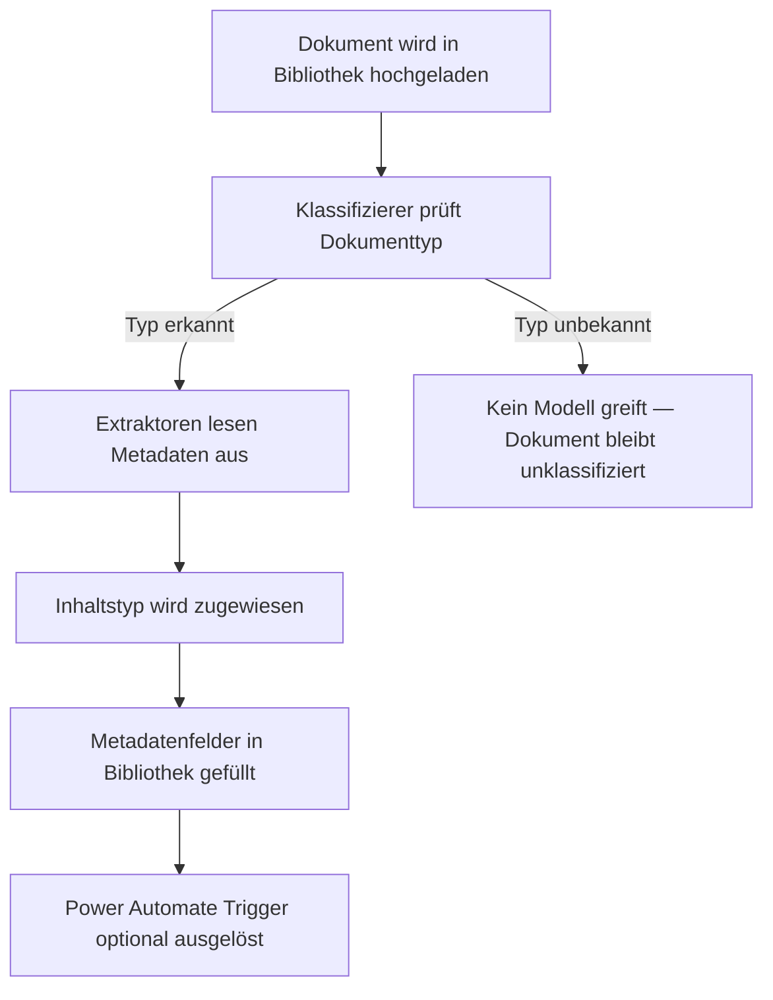
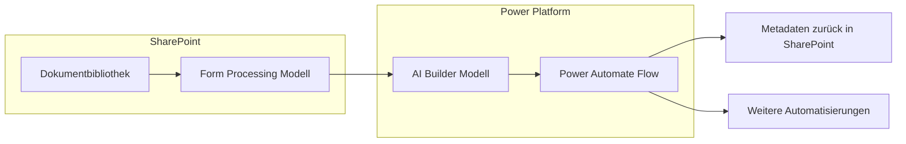
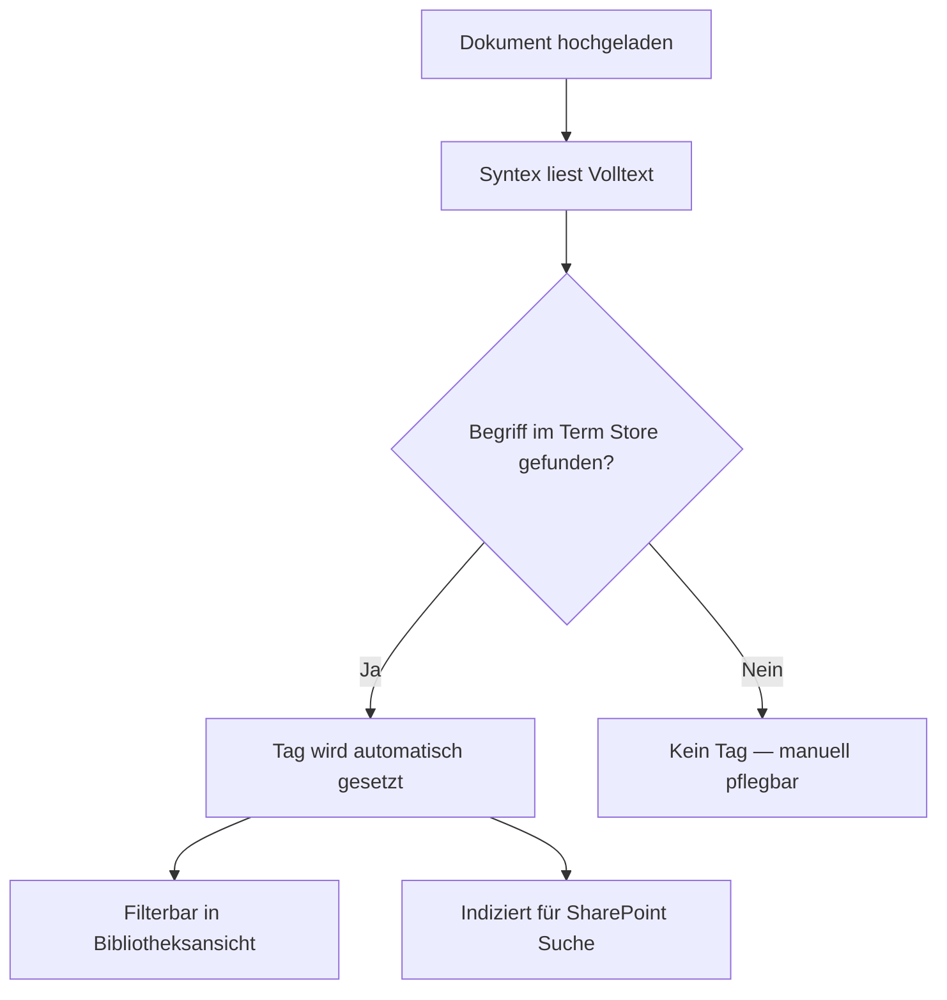
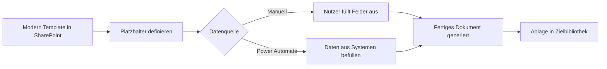
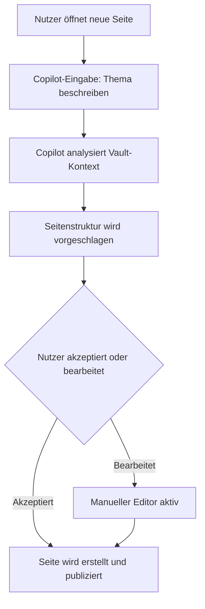
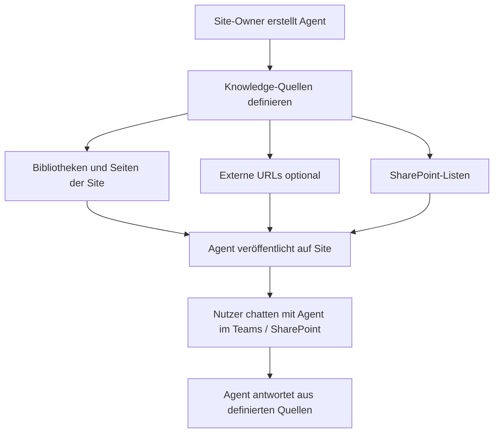
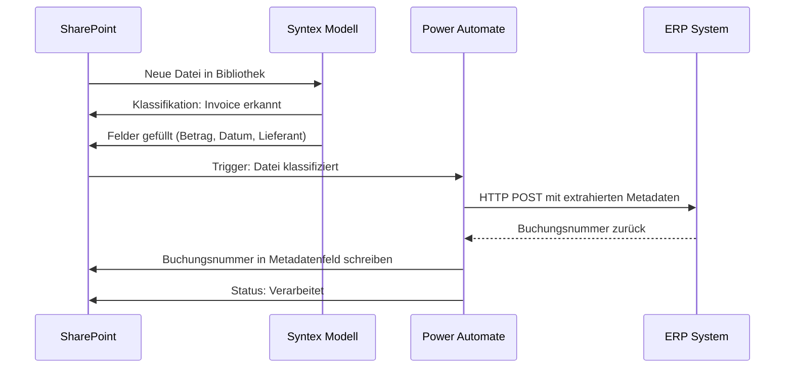
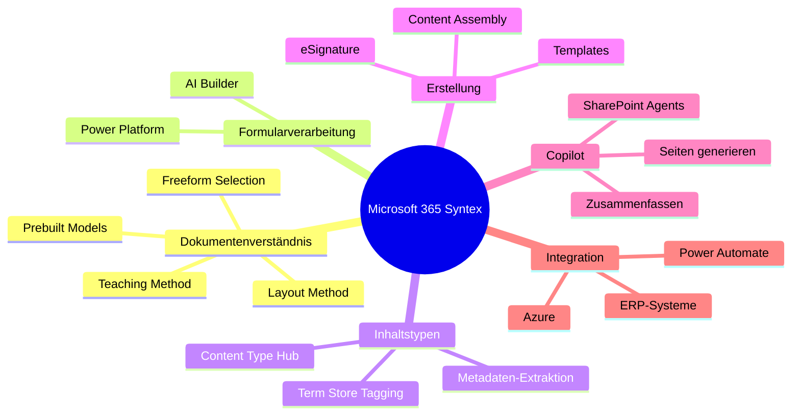

---
tags:
  - microsoft365
  - sharepoint
  - syntex
  - copilot
  - ai
  - dokumentenmanagement
  - power-platform
  - content-management
aliases:
  - SharePoint Premium Syntex
  - Syntex
  - Microsoft 365 Syntex
  - SharePoint Copilot
---

# SharePoint Syntex und Copilot

> [!ABSTRACT] TL;DR
> SharePoint Syntex (seit 2023 unter **Microsoft 365 Syntex** bzw. als **SharePoint Premium Add-on** vermarktet) nutzt KI-Modelle, um Dokumente automatisch zu klassifizieren, Metadaten zu extrahieren und Inhaltstypen zuzuweisen. Ergänzt durch **Copilot in SharePoint** und **SharePoint Agents** entsteht eine vollständige KI-Plattform für intelligentes Content-Management — lizenziert über Pay-as-you-go (Azure) oder per-User-Abonnement.

---

## Was ist Microsoft 365 Syntex?

**Microsoft 365 Syntex** ist das KI- und Automatisierungs-Add-on für SharePoint Online und Microsoft 365. Es wurde 2020 als *SharePoint Syntex* eingeführt und 2023 in das **SharePoint Premium**-Angebot integriert.

Syntex kombiniert mehrere KI-Technologien:

- **Document Understanding** — KI-Modelle, die Dokumentenstruktur erkennen (z. B. Verträge, Rechnungen)
- **Form Processing** — Strukturierte Formulare und PDFs verarbeiten (via AI Builder)
- **Prebuilt Models** — Fertige Modelle für Standarddokumente (Rechnungen, Quittungen, Verträge)
- **Content Assembly** — Dokumente automatisch aus Vorlagen generieren
- **eSignature** — Elektronische Unterschriften direkt in SharePoint
- **Auto-Tagging** — Automatische Verschlagwortung mit dem Term Store

> [!NOTE] Namensänderung beachten
> Microsoft hat *SharePoint Syntex* mit dem Rollout 2023/2024 in **Microsoft 365 Syntex** und **SharePoint Premium** umbenannt. Beide Begriffe bezeichnen dieselbe Funktionsfamilie. In Admin-Oberflächen und Dokumentationen tauchen alle drei Namen auf.

---

## Lizenzierung

### Modelle im Überblick

| Modell | Beschreibung | Empfehlung |
|--------|-------------|------------|
| **Pay-as-you-go** | Abrechnung per verarbeiteter Transaktion über Azure-Abonnement | Unregelmäßige / skalierte Nutzung |
| **Per-User-Lizenz** | Monatliche Lizenz pro Nutzer (SharePoint Premium Add-on) | Breite tägliche Nutzung im Unternehmen |

### Pay-as-you-go (Azure-Abrechnung)

Pay-as-you-go erfordert eine verknüpfte **Azure-Subscription** und wird im **Microsoft 365 Admin Center** unter *Setup → Microsoft 365 Syntex* konfiguriert.

```text
Abgerechnete Einheiten (Beispiele, Stand 2024):
- Document Understanding:      ~0,05 USD / Dokument
- Form Processing:             ~0,05 USD / Dokument
- Prebuilt Models:             ~0,01 USD / Seite
- Auto-Tagging:                ~0,05 USD / Dokument
- Content Assembly:            ~0,15 USD / generiertes Dokument
- eSignature:                  ~3,00 USD / gesendete Anfrage
```

> [!IMPORTANT] Azure-Verknüpfung notwendig
> Ohne aktive Azure-Subscription und konfiguriertes Billing-Profil lassen sich Pay-as-you-go-Features nicht aktivieren. Der Tenant-Admin muss die Verknüpfung im Admin Center herstellen.

### Per-User-Lizenz (SharePoint Premium Add-on)

- Wird dem Nutzer als **Add-on-Lizenz** zugewiesen (Microsoft 365 Admin Center → Lizenzen)
- Enthält ein monatliches Kontingent an Syntex-Transaktionen
- Sinnvoll bei Nutzern, die täglich mit Content-Processing arbeiten (z. B. Dokumenten-Sachbearbeitung)

---

## Document Understanding — Eigene KI-Modelle trainieren

### Funktionsprinzip

Document Understanding-Modelle lernen, **welcher Inhaltstyp** ein Dokument ist und **welche Informationen** darin stehen — auf Basis weniger Beispiel-Dokumente (Teaching Method).



### Modelltypen

| Modelltyp | Beste Eignung | Training |
|-----------|--------------|---------|
| **Teaching Method** | Unstrukturierte Dokumente (Verträge, Briefe) | Mind. 5 positive / 5 negative Beispiele |
| **Freeform Selection Method** | Semistrukturierte Inhalte | Freihand-Textauswahl |
| **Layout Method** | Stark strukturierte Formulare | Visuelle Feldmarkierung |
| **Prebuilt** | Rechnungen, Quittungen, Verträge | Kein Training nötig |

### Trainingsschritte (Teaching Method)

1. **Content Center aufrufen** — Dedizierte SharePoint-Websitesammlung (Typ: *Content Center*)
2. **Neues Modell anlegen** — Name, Beschreibung, Inhaltstyp auswählen/erstellen
3. **Klassifizierer trainieren**
   - Positive Beispiele hochladen (Dokumente, die dem Typ entsprechen)
   - Negative Beispiele hochladen (Dokumente anderer Typen)
   - **Explanations** hinzufügen: Phrasen, Muster, Nähe-Erklärungen
4. **Extraktoren definieren**
   - Für jedes Metadatenfeld einen Extraktor trainieren
   - Erklärungen: Position im Dokument, Begrenzer (Prefix/Suffix), Reguläre Ausdrücke
5. **Modell testen** — Mit Testdokumenten validieren
6. **Modell veröffentlichen** — Auf eine oder mehrere Dokumentbibliotheken anwenden

> [!TIP] Minimale Trainingsdaten
> Für einen ersten brauchbaren Klassifizierer reichen **5 positive + 5 negative** Beispiele. Für produktive Genauigkeit empfiehlt Microsoft **20+ Beispiele pro Kategorie**. Extraktoren für seltene Felder (z. B. optionale Klauseln) benötigen mehr Variation.

### Explanations (Erklärungen)

Explanations sind die Lernhilfen für den Klassifizierer und die Extraktoren:

| Explanation-Typ | Beschreibung | Beispiel |
|-----------------|-------------|---------|
| **Phrase List** | Spezifische Wörter/Phrasen als Hinweis | `"Rechnung"`, `"Invoice No."` |
| **Regular Expression** | Muster für Werte | `\d{2}\.\d{2}\.\d{4}` für Datum |
| **Proximity** | Zwei Elemente stehen nahe beieinander | Rechnungsnummer steht neben `"Re.-Nr."` |

---

## Form Processing (AI Builder)

Form Processing ist für **strukturierte und semistrukturierte** Formulare optimiert — PDFs, Scans, strukturierte Word-Dokumente.

> [!NOTE] Technologieunterschied
> Document Understanding läuft nativ in SharePoint. Form Processing nutzt **AI Builder** (Power Platform) im Hintergrund — beide werden über das Syntex-Interface konfiguriert, aber die Kosten fließen in unterschiedliche Bereiche.



### Erstellung eines Form Processing-Modells

```text
Pfad: SharePoint Bibliothek → Automate → Create a form processing model
```

1. Dokumente hochladen (mind. 5 Beispiele je Layout-Variante)
2. Felder markieren (visuell per Klick auf das Feld im Dokument)
3. Modell trainieren und validieren
4. Auf Bibliothek publizieren — AI Builder Flow wird automatisch erstellt

---

## Prebuilt Models

Prebuilt Models sind **vorkonfigurierte KI-Modelle** ohne eigenes Training — sofort einsatzbereit.

| Modell | Extrahierte Felder (Auswahl) |
|--------|------------------------------|
| **Invoice (Rechnung)** | Rechnungsnummer, Datum, Betrag, Lieferant, MwSt |
| **Receipt (Quittung)** | Händler, Datum, Gesamtbetrag, Zahlungsmethode |
| **Contract (Vertrag)** | Parteien, Laufzeit, Verlängerungsklauseln, Gerichtsstand |
| **Business Card** | Name, Firma, E-Mail, Telefon, Adresse |
| **Simple Document** | Generische Textextraktion ohne Felddefinition |
| **Sensitive Information** | Erkennt personenbezogene Daten (PII) |

> [!TIP] Schnellstart mit Prebuilt
> Für Rechnungsverarbeitung (häufigster Use Case) reicht ein **Invoice Prebuilt Model** — kein Training, direkt auf die Bibliothek anwenden, Power Automate Flow für ERP-Integration dranbauen.

---

## Taxonomie-Tagging und Term Store

### Auto-Tagging

Syntex kann Dokumente automatisch mit **Managed Metadata**-Tags (Term Store) versehen:

- Das Modell liest Dokumentinhalt und ordnet passende Terms zu
- Voraussetzung: **Term Set** im Term Store konfiguriert
- Zuordnung erfolgt nach Trainingsbeispielen oder regelbasiert



### Inhaltstyp-Extraktion

Wenn ein Syntex-Modell auf eine Bibliothek angewendet wird:

1. Erkannter **Inhaltstyp** wird dem Dokument zugewiesen
2. Alle **Metadatenfelder** des Inhaltstyps werden mit extrahierten Werten gefüllt
3. Das Dokument erscheint in der Bibliotheksansicht mit vollständigen Metadaten

> [!WARNING] Inhaltstypen-Konflikte vermeiden
> Wenn in einer Bibliothek mehrere Syntex-Modelle verschiedener Inhaltstypen aktiv sind, kann es zu Konflikten kommen, wenn ein Dokument von mehreren Modellen als passend erkannt wird. Jeweils nur ein Modell pro Inhaltstyp-Kategorie pro Bibliothek ist Best Practice.

---

## Content Assembly

Content Assembly ermöglicht die **automatische Dokumenterstellung** aus konfigurierten Templates.

### Funktionsweise



### Anwendungsfälle

- Automatische Vertragserstellung aus CRM-Daten
- Angebotsvorlagen mit dynamischen Preistabellen
- Standardisierte Berichte aus SharePoint-Listendaten
- Onboarding-Dokumente mit personalisierten Mitarbeiterdaten

```text
Konfiguration:
1. Bibliothek → New → Create a modern template
2. Word-Dokument als Basis hochladen
3. Platzhalter definieren: [[Feldname]] im Dokument markieren
4. Metadatenspalten der Bibliothek als Quelle verknüpfen
5. Template veröffentlichen
```

---

## eSignature

SharePoint Premium eSignature ermöglicht elektronische Signaturen **ohne externe Tools** (kein Adobe Sign, kein DocuSign nötig).

| Feature | Details |
|---------|---------|
| **Unterstützte Dateitypen** | PDF (primär), Word (Konvertierung) |
| **Signaturanfragen** | Per E-Mail an interne und externe Empfänger |
| **Audit Trail** | Vollständiger Log in SharePoint gespeichert |
| **Status-Tracking** | Pending, Signed, Rejected, Expired |
| **Integration** | Power Automate-Trigger nach Signatur |

> [!IMPORTANT] Geografische Verfügbarkeit
> eSignature ist (Stand 2024/2025) nur für Tenants in bestimmten Regionen verfügbar und erfordert Pay-as-you-go-Billing. Nicht-EU-Tenants müssen ggf. Datenschutzanforderungen prüfen.

```text
Signaturprozess:
Dokument in Bibliothek → Signatur anfordern (Rechtsklick-Menü)
→ Empfänger eingeben → Signaturfelder platzieren → Senden
→ Empfänger erhält E-Mail mit Signatur-Link
→ Signiertes PDF wird in Bibliothek zurückgespeichert
```

---

## Copilot in SharePoint

### SharePoint-Seiten mit Copilot erstellen

Copilot for SharePoint (als Teil von **Microsoft 365 Copilot**) kann ganze Seiten auf Basis von Texteingaben oder Quelldokumenten generieren.



**Unterstützte Copilot-Aktionen auf SharePoint-Seiten:**

- Neue Seite aus Beschreibung generieren (`/` → Copilot)
- Vorhandenen Text umschreiben / zusammenfassen
- Bilder zu Abschnitten vorschlagen lassen
- Webparts automatisch platzieren

> [!NOTE] Lizenzvoraussetzung
> Copilot-Features auf SharePoint-Seiten erfordern eine aktive **Microsoft 365 Copilot-Lizenz** (zusätzlich zu M365 E3/E5). SharePoint Syntex-Lizenzen allein reichen nicht aus.

### Inhalte zusammenfassen

In Dokumentbibliotheken können Nutzer mit Copilot:

- Ein markiertes Dokument **zusammenfassen** lassen (Summary im Seitenbereich)
- **Fragen an ein Dokument** stellen ("Was sind die wichtigsten Klauseln?")
- Mehrere Dokumente **vergleichen** lassen

---

## SharePoint Agents (Copilot-Agenten)

SharePoint Agents sind **konfigurierbare Wissensbots**, die per Site oder Bibliothek bereitgestellt werden — ohne Programmierkenntnisse.

### Konzept



### Konfiguration

```text
Pfad: SharePoint Site → Einstellungen → Copilot → Agent erstellen

Konfigurierbare Parameter:
- Name und Beschreibung des Agenten
- Wissensquellen (Bibliotheken, Seiten, Listen)
- Begrüßungsnachricht und Vorschlagsfragen
- Zugriffsberechtigungen (Site-Members oder alle)
```

### Unterschied zu Microsoft Copilot Studio

| Merkmal | SharePoint Agent | Copilot Studio Agent |
|---------|-----------------|---------------------|
| **Zielgruppe** | Site-Owner, Power User | Entwickler, IT-Pro |
| **Konfiguration** | No-Code, GUI | Low-Code / Pro-Code |
| **Wissensquellen** | SharePoint-Inhalte der Site | Beliebige Datenquellen |
| **Deployment** | SharePoint / Teams | Teams, Web, API |
| **Lizenz** | M365 Copilot | Copilot Studio (eigene Lizenz) |

> [!TIP] Agenten für Fachabteilungen
> SharePoint Agents sind ideal, um Fachabteilungen einen **eigenen Wissens-Bot** zu geben — z. B. ein HR-Agent auf der HR-Intranetseite, der Fragen zu Urlaubsregelungen, Onboarding-Prozessen und Richtlinien beantwortet.

---

## Integration mit Power Automate

Syntex und Power Automate sind eng verzahnt. Nach Klassifikation oder Extraktion können automatisch Flows ausgelöst werden.

### Typische Trigger

| Trigger | Beschreibung |
|---------|-------------|
| `When a file is classified by a content understanding model` | Startet nach erfolgreicher Syntex-Klassifikation |
| `When a file is created or modified` | Kombiniert mit Metadatenfilter auf zugewiesenen Inhaltstyp |
| `When an eSignature request is completed` | Nach Unterzeichnung eines Dokuments |

### Beispiel-Flow: Rechnungsverarbeitung



> [!WARNING] Flow-Lizenz beachten
> Power Automate Flows, die durch Form Processing (AI Builder) ausgelöst werden, verbrauchen **Power Automate-Kapazität**. Bei hohem Dokumentenvolumen kann dies die inkludierten Flow-Runs einer M365-Lizenz schnell übersteigen.

---

## Via SharePoint Admin Center (UI)

### Syntex-Dienste aktivieren (Pay-as-you-go)

1. Öffne das **Microsoft 365 Admin Center** unter [admin.microsoft.com](https://admin.microsoft.com)
2. Navigiere zu **Setup → Dateien und Inhalt → Inhaltsdienste mit Syntex automatisieren**
3. Klicke auf **Erste Schritte**
4. Verbinde ein **Azure-Abonnement** und wähle eine **Ressourcengruppe**
5. Aktiviere die gewünschten Syntex-Dienste
6. Klicke auf **Speichern**

### Document Understanding-Modell erstellen (Content Center)

1. Erstelle ein **Content Center** (falls noch keines vorhanden): **SPAC → Sites → + Erstellen → Andere Optionen → Content Center**
2. Öffne das Content Center → klicke auf **+ Neues Modell**
3. Wähle den Modelltyp:
   - **Unterrichtsmethode** — für unstrukturierte Dokumente (Verträge, Berichte)
   - **Freihandformular-Verständnis** — für halbstrukturierte Formulare
4. Benenne das Modell → **Erstellen**
5. Lade **Beispieldokumente** hoch (mind. 5 positive + 5 negative Beispiele)
6. Konfiguriere den **Klassifizierer**: Welche Merkmale identifizieren diesen Dokumententyp?
7. Füge **Extraktoren** hinzu: Welche Felder sollen als Metadaten extrahiert werden?
8. Klicke auf **Trainieren und testen** → Überprüfe die Genauigkeit
9. Klicke auf **Veröffentlichen**

### Modell auf eine Bibliothek anwenden

1. Öffne die Ziel-**Dokumentbibliothek** in SharePoint
2. Klicke auf **Automatisieren → KI-Modell anwenden**
3. Wähle ein veröffentlichtes Modell aus der Liste
4. Klicke auf **Bibliothek hinzufügen** → Das Modell klassifiziert neue Dokumente automatisch

### SharePoint Copilot-Agenten konfigurieren

1. Öffne die gewünschte **SharePoint-Site**
2. Klicke auf das **Copilot-Symbol** (rechts oben) oder: **Einstellungen (Zahnrad) → Copilot konfigurieren**
3. Klicke auf **+ Neuer Agent** (oder bearbeite den vorhandenen Site-Agenten)
4. Konfiguriere:
   - **Name** und **Beschreibung** des Agenten
   - **Wissensquellen**: Bibliotheken, Ordner oder gesamte Site
   - **Verhalten**: Systemanweisungen / Persona festlegen
5. Klicke auf **Erstellen** → Agent ist sofort im Copilot-Chat der Site verfügbar

> [!NOTE]
> Für erweiterte Agent-Konfigurationen (eigene Aktionen, API-Anbindungen, externe Wissensquellen) steht **Microsoft Copilot Studio** unter [copilotstudio.microsoft.com](https://copilotstudio.microsoft.com) zur Verfügung. Modelltraining und Corpus-Management können vollständig über das Content Center UI ohne PowerShell durchgeführt werden.

---

## Governance und Best Practices

> [!TIP] Syntex-Einführung strukturiert angehen
> 1. **Content Center** dediziert anlegen — nicht auf einer normalen Kommunikationssite trainieren
> 2. **Prebuilt Models zuerst** testen — häufig reichen sie für Rechnungen und Quittungen aus
> 3. **Training iterativ** — erst 5 Beispiele, Genauigkeit messen, dann erweitern
> 4. **Pay-as-you-go** für den Start — Kosten kontrollieren, bevor per-User-Lizenzen gekauft werden
> 5. **Power Automate-Flows** als lose Kopplung — Syntex klassifiziert, Automate orchestriert

> [!DANGER] Sensible Daten und PII
> Syntex-Modelle senden Dokumentinhalte zur Verarbeitung an Microsoft KI-Dienste. Für Dokumente mit besonders sensiblen Daten (Gesundheitsdaten, Personaldaten) die **Datenschutz-Folgenabschätzung** prüfen und ggf. Bibliotheken von der automatischen Verarbeitung ausschließen.

### Admin-Konfiguration

```text
Microsoft 365 Admin Center → Setup → Microsoft 365 Syntex:
- Azure-Billing verknüpfen (Pay-as-you-go)
- Syntex-Features aktivieren/deaktivieren (per Feature granular)
- Content Center-Erstellung delegieren
- Nutzungsberichte einsehen (pro Feature, pro Site)

SharePoint Admin Center → Content services:
- Aktive Modelle und deren Deployment-Status
- Term Store für Auto-Tagging konfigurieren
```

---

## Technologieübersicht



---

## Verwandte Notizen

- [[SharePoint Premium]]
- [[SharePoint Online Grundlagen]]
- [[SharePoint Seiten und Webparts]]
- [[SharePoint Suche]]
- [[SharePoint Governance]]
