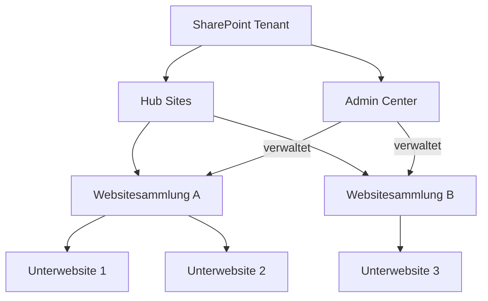
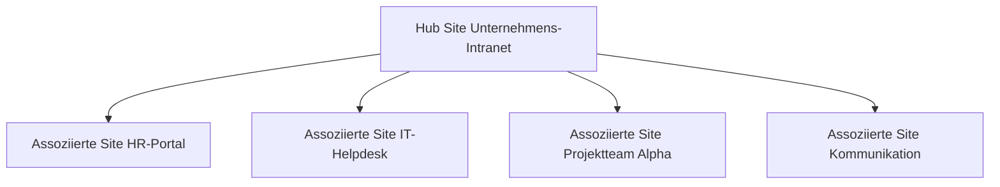
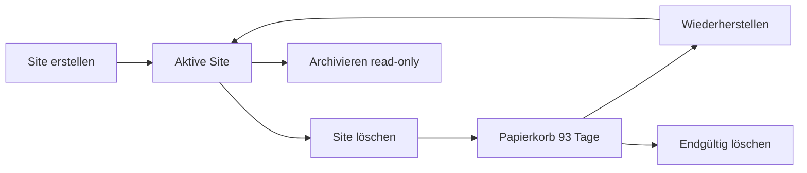

---
tags:
  - microsoft365
  - sharepoint
  - administration
  - powershell
  - governance
aliases:
  - Site Collections
  - Websitesammlungen
  - SPO Sites
---

# Websitesammlungen verwalten

> [!ABSTRACT] TL;DR
> Websitesammlungen (Site Collections) sind die grundlegende Verwaltungseinheit in SharePoint Online. Sie werden über das SharePoint Admin Center oder PowerShell erstellt, konfiguriert und überwacht. Jede Site Collection hat eigene Administratoren, Speicherkontingente, Freigabe-Einstellungen und einen definierten Lebenszyklus.

---

## Was ist eine Websitesammlung?

Eine **Websitesammlung** (Site Collection) ist ein Container in SharePoint Online, der eine Hauptwebsite und alle ihre Unterwebsites umfasst. Sie bildet die administrative Grenze für:

- **Berechtigungen** — Sitesammlungsadministratoren haben volle Kontrolle
- **Speicher** — jede Site hat ein eigenes Kontingent (oder teilt den Tenant-Pool)
- **Richtlinien** — externe Freigabe, Sensitivitätslabels, Compliance
- **Content Types & Features** — gelten innerhalb der Sammlung



> [!NOTE] Modern vs. klassisch
> Microsoft empfiehlt seit 2019 ausschließlich **moderne** Teamwebsites und Kommunikationswebsites. Klassische Websitesammlungen (Publishing Sites, etc.) werden weiterhin unterstützt, erhalten aber keine neuen Features mehr.

---

## Websitesammlungen erstellen

### Im SharePoint Admin Center

1. [admin.microsoft.com](https://admin.microsoft.com) → **SharePoint** → **Aktive Sites**
2. **+ Erstellen** wählen
3. Typ auswählen: Teamwebsite, Kommunikationswebsite oder andere Vorlagen
4. Felder ausfüllen: Name, primärer Administrator, Sprache, Zeitzone
5. Optional: Datenschutzeinstellungen, Sensitivitätslabel, Speicher

> [!TIP] Teamwebsite vs. Kommunikationswebsite
> - **Teamwebsite** → erstellt automatisch eine zugehörige Microsoft 365 Gruppe (mit Postfach, Teams, Planner)
> - **Kommunikationswebsite** → keine Gruppe, ideal für Intranet-Portale und breite Zielgruppen
> - **Andere Vorlagen** → Document Center, Enterprise Wiki (klassisch), etc.

### Per PowerShell (PnP / SPO)

```powershell
# Verbindung herstellen
Connect-SPOService -Url "https://contoso-admin.sharepoint.com"

# Moderne Teamwebsite (ohne M365-Gruppe)
New-SPOSite `
    -Url        "https://contoso.sharepoint.com/sites/Projektteam" `
    -Title      "Projektteam Alpha" `
    -Owner      "admin@contoso.com" `
    -StorageQuota 1024 `
    -Template   "STS#3"   # STS#3 = Modern Team Site ohne Gruppe

# Kommunikationswebsite
New-SPOSite `
    -Url          "https://contoso.sharepoint.com/sites/Intranet" `
    -Title        "Unternehmens-Intranet" `
    -Owner        "admin@contoso.com" `
    -StorageQuota 5120 `
    -Template     "SITEPAGEPUBLISHING#0"

# M365-Gruppenbasierte Teamwebsite (via PnP)
New-PnPSite `
    -Type        TeamSite `
    -Title       "Sales Team" `
    -Alias       "salesteam" `
    -Description "Kollaborationsbereich für Vertrieb"
```

---

## Site-Vorlagen (Templates)

| Template-ID | Bezeichnung | Typ |
|---|---|---|
| `STS#3` | Teamwebsite (ohne Gruppe) | Modern |
| `SITEPAGEPUBLISHING#0` | Kommunikationswebsite | Modern |
| `GROUP#0` | Teamwebsite (mit M365-Gruppe) | Modern |
| `BDR#0` | Document Center | Klassisch |
| `WIKI#0` | Wiki-Website | Klassisch |
| `BLANKINTERNET#0` | Publishing-Site | Klassisch |
| `STS#0` | Team Site (klassisch) | Klassisch |
| `STS#1` | Blank Site | Klassisch |

> [!WARNING] Vorlage ist unveränderlich
> Die Template-ID einer bestehenden Websitesammlung kann nachträglich **nicht geändert** werden. Bei falscher Auswahl muss die Site gelöscht und neu erstellt werden.

---

## Speicherkontingente

### Tenant-Pooling vs. manuelle Kontingente

SharePoint Online nutzt standardmäßig **automatisches Speichermanagement**: Der gesamte Tenant-Pool wird dynamisch unter allen Sites verteilt. Alternativ können Sites feste Kontingente erhalten.

```powershell
# Aktuelles Kontingent einer Site prüfen
Get-SPOSite -Identity "https://contoso.sharepoint.com/sites/Projektteam" |
    Select-Object Url, StorageQuota, StorageUsageCurrent

# Kontingent setzen (in MB)
Set-SPOSite `
    -Identity     "https://contoso.sharepoint.com/sites/Projektteam" `
    -StorageQuota 5120 `
    -StorageQuotaWarningLevel 4608   # Warnung bei 4,5 GB

# Alle Sites mit Speicherauslastung auflisten
Get-SPOSite -Limit All |
    Select-Object Url, StorageUsageCurrent, StorageQuota |
    Sort-Object StorageUsageCurrent -Descending
```

> [!NOTE] Einheit
> `StorageQuota` und `StorageUsageCurrent` werden in **Megabyte (MB)** angegeben. 1 GB = 1024 MB.

### Speicher im Admin Center überwachen

**Aktive Sites** → Spalte **Verwendeter Speicher** aktivieren → Sortierung nach Verbrauch.

Unter **Einstellungen** → **Speicher** kann zwischen automatischem Pooling und manuellen Limits umgeschaltet werden.

---

## Site Collection Administratoren

Sitesammlungsadministratoren haben uneingeschränkten Zugriff auf alle Inhalte der Websitesammlung – unabhängig von Bibliotheks- oder Listenberechtigungen.

```powershell
# Administratoren einer Site anzeigen
Get-SPOSiteCollectionAdmin -Site "https://contoso.sharepoint.com/sites/Projektteam"

# Administrator hinzufügen
Set-SPOSite `
    -Identity           "https://contoso.sharepoint.com/sites/Projektteam" `
    -SecondaryAdministrator "petra.muster@contoso.com"

# Administrator über PnP hinzufügen
Add-PnPSiteCollectionAdmin -Owners "petra.muster@contoso.com"

# Administrator entfernen (PnP)
Remove-PnPSiteCollectionAdmin -Owners "petra.muster@contoso.com"
```

> [!IMPORTANT] Primärer Administrator
> Der **primäre Administrator** einer Site wird als erster Ansprechpartner für Microsoft-Benachrichtigungen (Quota-Warnungen, Compliance-Alerts) genutzt. Er sollte immer ein aktives Konto sein – kein Service-Account ohne Postfach.

---

## Site-Einstellungen konfigurieren

### Externe Freigabe

```powershell
# Freigabestatus einer Site prüfen
Get-SPOSite -Identity "https://contoso.sharepoint.com/sites/Projektteam" |
    Select-Object Url, SharingCapability

# Externe Freigabe deaktivieren (nur interne Benutzer)
Set-SPOSite `
    -Identity          "https://contoso.sharepoint.com/sites/Projektteam" `
    -SharingCapability Disabled

# Nur bestehende externe Benutzer zulassen
Set-SPOSite `
    -Identity          "https://contoso.sharepoint.com/sites/Extern-Partner" `
    -SharingCapability ExistingExternalUserSharingOnly

# Anonyme Links erlauben (Anyone)
Set-SPOSite `
    -Identity          "https://contoso.sharepoint.com/sites/Oeffentlich" `
    -SharingCapability ExternalUserAndGuestSharing
```

| Wert | Bedeutung |
|---|---|
| `Disabled` | Keine externe Freigabe |
| `ExistingExternalUserSharingOnly` | Nur bereits bekannte Gäste |
| `ExternalUserSharingOnly` | Neue externe Benutzer (mit Anmeldung) |
| `ExternalUserAndGuestSharing` | Auch anonyme Links (Anyone) |

> [!WARNING] Tenant-Limit beachten
> Die Freigabeeinstellung einer einzelnen Site kann **nicht offener** sein als die Tenant-weite Einstellung. Ist der Tenant auf `ExternalUserSharingOnly` beschränkt, kann eine Site nicht auf `ExternalUserAndGuestSharing` gestellt werden.

### Regionale Einstellungen & Sprache

Im SharePoint Admin Center: **Aktive Sites** → Site auswählen → **Einstellungen** → **Standardsprache / Zeitzone**

```powershell
# Zeitzone setzen (ID 4 = UTC+01:00 Amsterdam, Berlin)
Set-SPOSite `
    -Identity "https://contoso.sharepoint.com/sites/Projektteam" `
    -TimeZoneId 4

# Verfügbare Zeitzonen anzeigen (via PnP)
Get-PnPAvailableTimeZone
```

> [!NOTE] Mehrsprachigkeit (MUI)
> Zusätzliche Anzeigesprachen werden auf Ebene der Website-Einstellungen unter **Website-Einstellungen** → **Sprachen** aktiviert (Multilingual User Interface). Dies betrifft UI-Elemente, nicht Inhalte.

---

## Site-Designs und Site-Scripts

**Site-Designs** (Site Designs) und **Site-Scripts** ermöglichen die automatisierte Standardisierung neu erstellter Sites: Bibliotheken anlegen, Berechtigungen setzen, Flows auslösen u.v.m.

```powershell
# Site-Script erstellen
$script = @"
{
  "\$schema": "schema.json",
  "actions": [
    {
      "verb": "createSPList",
      "listName": "Risikolog",
      "templateType": 100,
      "subactions": [
        { "verb": "setTitle", "title": "Risikolog" },
        { "verb": "addSPField", "fieldType": "Text", "displayName": "Risikobeschreibung", "isRequired": true }
      ]
    },
    {
      "verb": "applyTheme",
      "themeName": "Contoso Theme"
    }
  ],
  "version": 1
}
"@

Add-SPOSiteScript -Title "Contoso Basiskonfiguration" -Content $script

# Site-Design erstellen und Script verknüpfen
$scriptId = (Get-SPOSiteScript | Where-Object { $_.Title -eq "Contoso Basiskonfiguration" }).Id

Add-SPOSiteDesign `
    -Title              "Contoso Projektsite" `
    -WebTemplate        "64" `
    -SiteScripts        $scriptId `
    -Description        "Standardvorlage für Projektwebsites"

# Site-Design auf bestehende Site anwenden
Invoke-SPOSiteDesign `
    -Identity (Get-SPOSiteDesign | Where-Object { $_.Title -eq "Contoso Projektsite" }).Id `
    -WebUrl   "https://contoso.sharepoint.com/sites/Projektteam"
```

> [!TIP] Site-Designs vs. PnP-Provisioning
> Für einfache Standardisierungen (Listen, Designs, Flows) reichen Site-Designs. Für komplexe Templates mit vielen Inhalten, Seiten und Konfigurationen empfiehlt sich **PnP-Provisioning** mit XML-Vorlagen (`Apply-PnPProvisioningTemplate`).

---

## Hub Sites

Hub Sites verbinden thematisch verwandte Websitesammlungen und ermöglichen gemeinsame Navigation, Suche und Design.



```powershell
# Site als Hub registrieren
Register-SPOHubSite `
    -Site    "https://contoso.sharepoint.com/sites/Intranet" `
    -Principals "admin@contoso.com"

# Site einem Hub zuordnen
Add-SPOHubSiteAssociation `
    -Site    "https://contoso.sharepoint.com/sites/HR" `
    -HubSite "https://contoso.sharepoint.com/sites/Intranet"

# Zuordnung aufheben
Remove-SPOHubSiteAssociation -Site "https://contoso.sharepoint.com/sites/HR"

# Hub-Registrierung aufheben
Unregister-SPOHubSite -Identity "https://contoso.sharepoint.com/sites/Intranet"

# Alle Hub Sites auflisten
Get-SPOHubSite
```

> [!NOTE] Hub-Navigation
> Navigation und Design des Hub werden automatisch auf alle assoziierten Sites übertragen. Jede assoziierte Site behält aber ihre eigenen Inhalte und Berechtigungen.

---

## Site-Lebenszyklus

### Überblick



### Sites löschen und wiederherstellen

```powershell
# Site in den Papierkorb verschieben
Remove-SPOSite -Identity "https://contoso.sharepoint.com/sites/AltesProjekt" -NoWait

# Gelöschte Sites anzeigen
Get-SPODeletedSite

# Site wiederherstellen (innerhalb von 93 Tagen)
Restore-SPODeletedSite -Identity "https://contoso.sharepoint.com/sites/AltesProjekt"

# Site endgültig löschen (nicht wiederherstellbar!)
Remove-SPODeletedSite -Identity "https://contoso.sharepoint.com/sites/AltesProjekt"
```

> [!DANGER] Endgültiges Löschen
> `Remove-SPODeletedSite` löscht die Websitesammlung **unwiderruflich** – inklusive aller Dokumente, Listen, Seiten und Berechtigungen. Vor dem Ausführen unbedingt eine Sicherung oder ein Export prüfen.

### Archivierung (Microsoft 365 Archive)

Seit 2024 können Sites in den **Microsoft 365 Archive**-Modus versetzt werden (kostengünstiger Cold-Storage). Archivierte Sites sind read-only; ein Reaktivieren ist kostenpflichtig pro GB.

```powershell
# Site archivieren (Preview / GA je nach Tenant)
Set-SPOSite -Identity "https://contoso.sharepoint.com/sites/AltesIntranet" -Archive $true

# Archivierte Sites anzeigen
Get-SPOSite -Filter "IsArchivedAccessEnabled -eq $true"
```

---

## Tenant-weite Einstellungen

Im **SharePoint Admin Center** → **Einstellungen** werden globale Richtlinien festgelegt:

| Einstellung | Beschreibung |
|---|---|
| Externe Freigabe (Tenant) | Maximale Freigabestufe für alle Sites |
| Standardspeicher pro Site | Startkontingent für neue Sites |
| Aufbewahrung im Papierkorb | Standard: 93 Tage |
| Klassische Sites erlauben | Neue klassische Sites zulassen oder sperren |
| OneDrive-Retention | Aufbewahrung nach Kontolöschung (30–3650 Tage) |
| Site-Erstellung durch Benutzer | Self-Service Site Creation ein/aus |

```powershell
# Tenant-Einstellungen abrufen
Get-SPOTenant | Select-Object `
    SharingCapability,
    DefaultSharingLinkType,
    PreventExternalUsersFromResharing,
    FileAnonymousLinkType,
    StorageQuota,
    OneDriveStorageQuota

# Externe Freigabe auf Tenant-Ebene einschränken
Set-SPOTenant -SharingCapability ExternalUserSharingOnly

# Self-Service Site Creation deaktivieren
Set-SPOTenant -DisableSelfServiceSiteCreation $true

# Standardablaufzeit für Gastlinks setzen (Tage)
Set-SPOTenant -ExternalUserExpirationRequired $true -ExternalUserExpireInDays 180
```

> [!IMPORTANT] Reihenfolge der Richtlinien
> Tenant-Einstellungen setzen die **Obergrenze** – Site-Einstellungen können nur gleich restriktiv oder restriktiver sein, niemals offener. Änderungen auf Tenant-Ebene wirken sich unmittelbar auf alle Sites aus.

---

## PowerShell-Schnellreferenz

### Get-SPOSite – Wichtige Parameter

```powershell
# Einzelne Site
Get-SPOSite -Identity "https://contoso.sharepoint.com/sites/Projektteam"

# Alle Sites (inkl. OneDrive)
Get-SPOSite -IncludePersonalSite $true -Limit All

# Nur Gruppenbasierte Sites
Get-SPOSite -Limit All | Where-Object { $_.GroupId -ne "00000000-0000-0000-0000-000000000000" }

# Detaillierte Eigenschaften einer Site
Get-SPOSite -Identity "https://contoso.sharepoint.com/sites/Projektteam" -Detailed
```

### Set-SPOSite – Häufige Einstellungen

```powershell
Set-SPOSite -Identity $url `
    -Title                       "Neuer Titel" `
    -StorageQuota                10240 `
    -StorageQuotaWarningLevel    9216 `
    -SharingCapability           Disabled `
    -AllowSelfServiceUpgrade     $false `
    -DenyAddAndCustomizePages    1 `       # No-Script aktivieren
    -DefaultLinkPermission       View      # Standard-Link auf "Anzeigen"
```

### Bulk-Operationen

```powershell
# Externe Freigabe für alle Sites deaktivieren (Ausnahmen per Filter)
Get-SPOSite -Limit All |
    Where-Object { $_.Url -notlike "*/sites/Extern-*" } |
    ForEach-Object {
        Set-SPOSite -Identity $_.Url -SharingCapability Disabled
        Write-Host "Deaktiviert: $($_.Url)"
    }

# CSV-Export aller Sites
Get-SPOSite -Limit All |
    Select-Object Url, Title, Template, StorageUsageCurrent, SharingCapability, LastContentModifiedDate |
    Export-Csv -Path "C:\Reports\SPO_Sites_$(Get-Date -Format yyyyMMdd).csv" -NoTypeInformation -Encoding UTF8
```

> [!TIP] PnP PowerShell bevorzugen
> Für komplexere Operationen (Site-Provisioning, Content-Migration, Feature-Verwaltung) ist **PnP PowerShell** (`Connect-PnPOnline`) mächtiger und bietet mehr Cmdlets als das native SPO-Modul. Beide Module können parallel genutzt werden.

---

## Verwandte Notizen

- [[SharePoint Online Grundlagen]]
- [[Berechtigungen und Sharing]]
- [[SharePoint Governance]]
- [[SharePoint PowerShell und PnP]]
- [[OneDrive for Business]]
