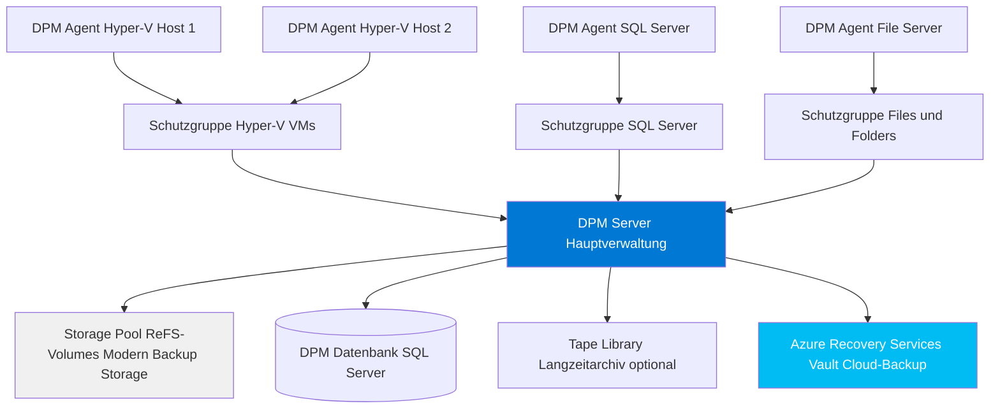
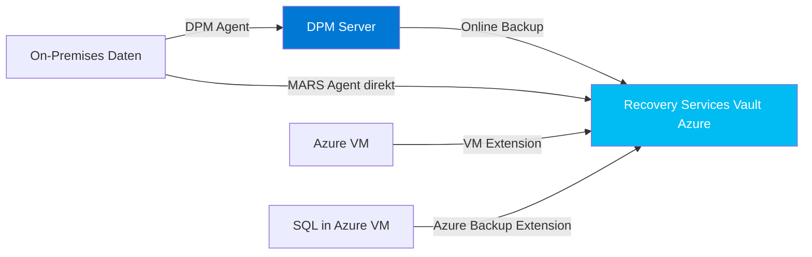

---
tags:
  - system-center
  - dpm
  - backup
  - datensicherung
  - recovery
  - mabs
  - azure-backup
aliases:
  - Data Protection Manager
  - DPM 2022
  - MABS
  - Microsoft Azure Backup Server
  - System Center DPM
---

# DPM Grundlagen

> [!ABSTRACT] TL;DR
> System Center Data Protection Manager (DPM) ist Microsofts Enterprise-Backup-Lösung für On-Premises-Workloads. DPM sichert Hyper-V-VMs, SQL Server, Exchange, SharePoint und Dateisysteme mit granularer Recovery. MABS (Microsoft Azure Backup Server) bietet denselben Funktionsumfang ohne System Center Lizenz. Die Azure Backup-Integration ermöglicht Langzeitarchivierung in Recovery Services Vaults.

---

## DPM-Überblick

| Produkt | Lizenz | Besonderheit |
|---------|--------|-------------|
| **System Center DPM 2022** | System Center-Lizenz | Vollständige Enterprise-Lösung |
| **MABS v4 (Azure Backup Server)** | Azure Backup (kostenlos) | Kein SC-Lizenz nötig, Cloud-fokussiert |
| **MARS Agent** | Azure Backup (kostenlos) | Nur Files/Folders/System State |

> [!NOTE] MABS als kostenlose Alternative
> Microsoft Azure Backup Server (MABS) ist funktional fast identisch mit DPM, erfordert aber keine System Center-Lizenz. Für neue Deployments ohne bestehende SC-Investitionen ist MABS die empfohlene Wahl.

---

## Architektur



### Storage Pool (Modern Backup Storage)

Ab DPM 2016 verwendet DPM **Modern Backup Storage (MBS)** mit ReFS-Volumes:

| Feature | Alter Storage Pool | Modern Backup Storage (MBS) |
|---------|------------------|----------------------------|
| **Dateisystem** | NTFS | ReFS 3.0 |
| **Deduplizierung** | Begrenzt | Block-Clone Technologie |
| **Performance** | Standard | 3× schneller bei Backup |
| **Storage-Effizienz** | ~40% Einsparung | ~50% Einsparung |

---

## Schutzgruppen (Protection Groups)

Schutzgruppen gruppieren Datenquellen mit identischen Backup-Anforderungen:

### Konfigurationsparameter

| Parameter | Kurzzeitschutz (D2D) | Langzeitschutz (D2D2C) |
|-----------|---------------------|----------------------|
| **Retention** | 7–30 Tage | Monate bis Jahre |
| **Express Full Backup** | Täglich | Wöchentlich |
| **Synchronisation** | Alle 15–30 Minuten | Täglich |
| **Storage** | Lokaler Storage Pool | Azure Recovery Services Vault |
| **Ziel** | Schnelle Wiederherstellung | Compliance, Archivierung |

---

## Unterstützte Workloads

| Workload | Backup-Methode | Recovery-Granularität |
|---------|---------------|----------------------|
| **Hyper-V VMs** | VSS via Hyper-V Integration Services | VM gesamt, einzelne Dateien aus VM |
| **SQL Server** | VSS SQL Writer + Log Shipping | Datenbank, Point-in-Time |
| **Exchange Server** | VSS Exchange Writer | Mailbox-DB, einzelne Mails (Brick-Level) |
| **SharePoint** | SharePoint Foundation VSS Writer | Farm, Site Collection, Liste, Element |
| **Files und Folders** | NTFS Change Journal (Incremental) | Datei und Ordner |
| **System State** | Windows Server Backup Writer | System State für BMR |
| **Bare Metal Recovery** | Windows Server Backup | Vollständige BMR |
| **VMware VMs** | Agentless via vCenter (DPM 2019+) | VM-Level |
| **Azure Stack HCI VMs** | Hyper-V VSS | VM-Level |

> [!IMPORTANT] SQL Server Backup-Empfehlung
> Für SQL Server sollte immer die **VSS-basierte DPM-Sicherung** kombiniert mit **Log-Backup** (alle 15 Min) verwendet werden. So werden Recovery Point Objectives (RPO) von unter 15 Minuten erreicht.

---

## Backup-Typen

### Express Full Backup vs. Incremental


| Backup-Typ | Beschreibung | Häufigkeit |
|-----------|-------------|-----------|
| **Express Full Backup** | Block-basiertes vollständiges Backup-Image | Täglich (Hyper-V/SQL) |
| **Synchronisation** | Nur geänderte Blöcke seit letztem Backup | Alle 15–30 Minuten |
| **Recovery Point** | Wiederherstellungspunkt = Express Full + alle Sync | Entspricht Sync-Frequenz |

> [!NOTE] Express Full ≠ Traditionelles Full Backup
> DPM verwendet blockbasierte "Express Full Backups" — obwohl täglich durchgeführt, werden nur geänderte Blöcke übertragen. Am Ziel entsteht trotzdem ein vollständiges konsistentes Recovery Point — deutlich schneller als klassische Full Backups.

---

## Azure-Integration

### Backup-Pfade



### Vergleich: MARS Agent vs. DPM/MABS

| Aspekt | MARS Agent | DPM / MABS |
|--------|-----------|-----------|
| **Installation** | Direkt auf Quell-Server | Separater Backup-Server |
| **Workloads** | Files, Folders, System State | Alle (VMs, SQL, Exchange, etc.) |
| **Lizenz** | Kostenlos mit Azure Backup | SC DPM-Lizenz oder MABS (kostenlos) |
| **Granularität** | Datei-Ebene | Workload-spezifisch (SQL, Exchange) |
| **Einsatz** | Einfache Dateisicherung | Enterprise-Workloads |

### Recovery Services Vault konfigurieren

```powershell
# Azure Backup-Integration in DPM konfigurieren
# Voraussetzung: MARS Agent auf DPM Server installiert

# Vault-Registrierung (in DPM Konsole oder via CLI)
az backup vault create `
  --resource-group "rg-backup" `
  --name "rsv-contoso-backup" `
  --location "westeurope"

# DPM-Server im Vault registrieren (via DPM Konsole):
# Protection → Online → Register
```

---

## Restore-Szenarien

### 1. Einzelne Dateien / Ordner

```powershell
# Über DPM Konsole: Recovery Wizard
# Alternativ: End-User Self-Service via Previous Versions

# Previous Versions aktiviert durch DPM Shadow Copies
# Benutzer: Rechtsklick auf Datei → Frühere Versionen → Wiederherstellen
```

### 2. SQL Server Datenbank

| Restore-Option | Beschreibung | Einsatz |
|---------------|-------------|---------|
| **Original-Instanz** | Restore auf dieselbe SQL-Instanz | Standard-Recovery |
| **Alternative Instanz** | Restore auf andere SQL-Instanz | Test, DR |
| **Point-in-Time** | Zu einem bestimmten Zeitpunkt | Log-basiertes Recovery |
| **Als Dateien** | MDF/LDF-Dateien exportieren | Manuelle Wiederherstellung |

### 3. Hyper-V VM

```powershell
# VM-Recovery über DPM PowerShell
$pg = Get-DPMProtectionGroup -DPMServerName "DPM01.contoso.com" |
  Where-Object {$_.FriendlyName -eq "Hyper-V Production VMs"}

$datasource = Get-DPMDatasource -ProtectionGroup $pg |
  Where-Object {$_.Name -like "VM-WEB-PROD-01"}

$rp = Get-DPMRecoveryPoint -Datasource $datasource |
  Sort-Object RepresentedPointInTime -Descending |
  Select-Object -First 1

# Recovery starten
Restore-DPMRecoverableItem `
  -RecoverableItem $rp `
  -RecoveryOption (New-DPMRecoveryOption -HyperVDatasource `
    -TargetServer "BER-HV-01.contoso.com" `
    -RecoveryLocation OriginalServer `
    -RecoveryType Recover)
```

### 4. Bare Metal Recovery (BMR)

BMR ermöglicht die vollständige Wiederherstellung auf identische oder neue Hardware:

1. Ziel-Server mit Windows Recovery Environment (WinRE) booten
2. DPM Recovery-Konsole starten
3. Netzwerkverbindung zum DPM Server herstellen
4. BMR-Recovery Point auswählen
5. Wiederherstellung starten (ca. 30–90 Minuten)

### 5. Exchange Mailbox

| Recovery-Typ | Beschreibung |
|-------------|-------------|
| **Mailbox-Datenbank** | Vollständige DB auf Original- oder Recovery-DB |
| **Einzelne Mailbox** | Export in Recovery-Datenbank, dann manuell |
| **Brick-Level** | Einzelne E-Mails (erfordert separate Lösung) |

---

## DPM 2022 Aktuelle Features

| Feature | Beschreibung |
|---------|-------------|
| **Windows Server 2022 Support** | Vollständige Unterstützung als Datenquelle und DPM-Host |
| **Azure Stack HCI VM-Backup** | Hyper-V VMs auf Azure Stack HCI sichern |
| **Modern Backup Storage** | ReFS-basierter Storage Pool (seit DPM 2016) |
| **VMware vSphere 7.0** | Agentlose VMware VM-Sicherung |
| **Verbesserte Azure Integration** | Unterstützung für neue Azure Backup-Features |
| **SQL Server 2019/2022** | Vollständige Unterstützung inkl. Always On AG |

---

## Wichtige PowerShell-Cmdlets

```powershell
# DPM-Verbindung
Connect-DPMServer -DPMServerName "DPM01.contoso.com"

# Schutzgruppen anzeigen
Get-DPMProtectionGroup -DPMServerName "DPM01.contoso.com" |
  Format-Table FriendlyName, CurrentProtectionGroupState

# Datenquellen einer Schutzgruppe
$pg = Get-DPMProtectionGroup -DPMServerName "DPM01" |
  Where-Object {$_.FriendlyName -eq "SQL Production"}
Get-DPMDatasource -ProtectionGroup $pg | Format-Table Name, ObjectType

# Recovery Points abfragen
Get-DPMRecoveryPoint -Datasource $datasource |
  Select-Object RepresentedPointInTime |
  Sort-Object RepresentedPointInTime -Descending |
  Select-Object -First 10 |
  Format-Table

# Backup-Status und Alerts
Get-DPMAlert -DPMServerName "DPM01.contoso.com" |
  Where-Object {$_.Severity -eq "Error"} |
  Select-Object AlertClassName, Resolution | Format-Table

# Consistency Check auslösen
$datasource = Get-DPMDatasource -ProtectionGroup $pg
Start-DPMConsistencyCheck -Datasource $datasource

# Neue Schutzgruppe erstellen
$newPG = New-DPMProtectionGroup -DPMServerName "DPM01" -Name "New File Servers"
Add-DPMChildDatasource -ProtectionGroup $newPG `
  -ChildDatasource (Get-DPMDatasource -ProductionServer (
    Get-DPMProductionServer -DPMServerName "DPM01" |
    Where-Object {$_.Name -eq "FILESERVER01"}))
Set-DPMProtectionGroup -ProtectionGroup $newPG
```

---

## Kapazitätsplanung

### Faustregeln für DPM-Sizing

| Workload | Storage-Faktor | Beispiel |
|---------|---------------|---------|
| **Datei-Server** | 1,5× Datenmenge | 1 TB Daten → 1,5 TB Storage Pool |
| **Hyper-V VMs** | 1,5–2× VM-Größe | 500 GB VMs → 750 GB–1 TB |
| **SQL Server** | 3–5× Datenbankgröße (inkl. Logs) | 100 GB DB → 300–500 GB |
| **Exchange** | 2–3× Mailbox-DB-Größe | 200 GB DB → 400–600 GB |

> [!TIP] Modern Backup Storage Einsparungen
> Mit ReFS-basiertem Modern Backup Storage (MBS) können durch Block-Cloning Einsparungen von 30–50% gegenüber dem kalkulierten Storage-Bedarf erzielt werden.

### DPM-Server-Dimensionierung

| Metrik | Empfehlung |
|--------|-----------|
| **CPU** | 8 Kerne (16 bei vielen geschützten Servern) |
| **RAM** | 16–32 GB |
| **OS-Disk** | 200 GB SSD |
| **DPM-Datenbank** | 150–300 GB SSD |
| **Storage Pool** | Abhängig von Datenmenge (ReFS-Volumes) |

---

## Monitoring und Alerting

### DPM-Alerts überwachen

```powershell
# Alle aktiven Alerts
Get-DPMAlert -DPMServerName "DPM01.contoso.com" |
  Where-Object {$_.AlertType -ne "AlertCleared"} |
  Select-Object AlertClassName, ComputerName, Resolution, OccurredSince |
  Format-Table

# Backup-Zusammenfassung (Letzte 24h)
Get-DPMJob -DPMServerName "DPM01.contoso.com" -Type BackUp |
  Where-Object {$_.StartTime -gt (Get-Date).AddDays(-1)} |
  Group-Object -Property Status |
  Select-Object Name, Count | Format-Table
```

### SCOM-Integration

DPM kann in SCOM überwacht werden über das **System Center Data Protection Manager Management Pack**:

- Backup-Job-Status als SCOM-Alerts
- Storage Pool-Kapazität als Performance-Counter
- DPM-Server-Verfügbarkeit
- Alert bei fehlgeschlagenen Recovery Points

---

## Security und Zugriffskontrolle

### DPM-Rollen

| Rolle | Berechtigungen |
|-------|--------------|
| **DPM Administrator** | Vollzugriff auf DPM-Konsole und alle Schutzgruppen |
| **Recovery Operator** | Kann Daten wiederherstellen, keine Konfiguration |
| **Read-Only Operator** | Nur Berichte und Statusanzeige |

### Self-Service Recovery Portal

Benutzer können selbst frühere Versionen ihrer Dateien wiederherstellen:

- Windows-Eigenschaft: **Frühere Versionen** (Previous Versions)
- DPM integriert sich als VSS-Provider
- Keine Admin-Intervention für Datei-Recovery nötig
- Konfigurierbar: Welche Shares Self-Service erlauben

---

## Verwandte Notizen

- [[SCVMM Grundlagen]]
- [[SCOM Grundlagen]]
- [[Azure Backup]]
- [[System Center Azure Migration]]
- [[Azure Arc Grundlagen]]
