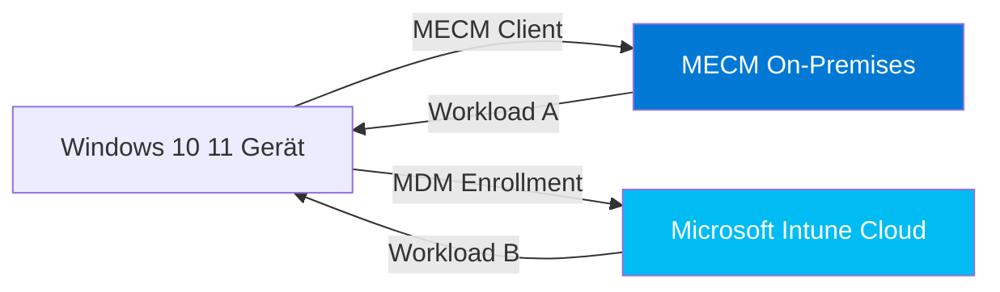
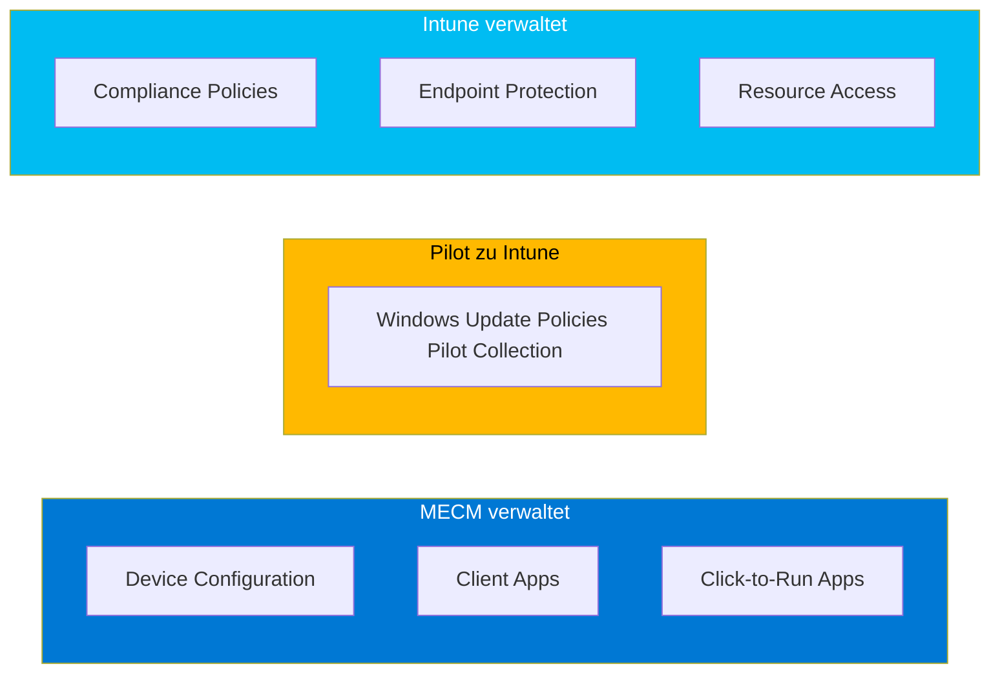
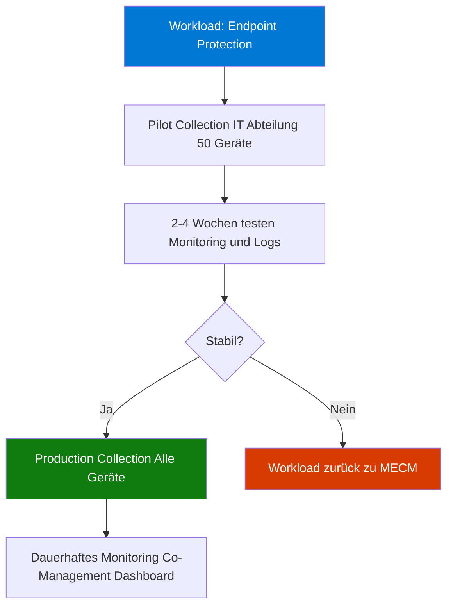
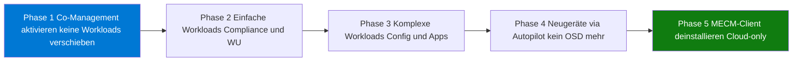
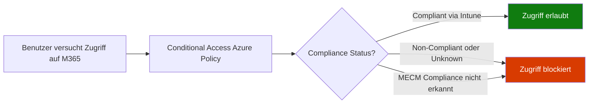

---
tags:
  - system-center
  - mecm
  - co-management
  - intune
  - hybrid
  - cloud
  - workloads
aliases:
  - ConfigMgr Co-Management
  - SCCM Co-Management
  - Hybrid Management
  - MECM Intune Co-Management
---

# MECM Co-Management

> [!ABSTRACT] TL;DR
> Co-Management ermöglicht die gleichzeitige Verwaltung von Windows 10/11-Geräten durch MECM **und** Microsoft Intune. Es ist die strategische Brücke zwischen On-Premises und Cloud. Sieben Workloads können schrittweise von MECM zu Intune verschoben werden — der Migrationspfad zu reinem Cloud-Management.

---

## Was ist Co-Management?

Co-Management bedeutet: Ein Windows-Gerät ist **gleichzeitig** beim MECM-Client und bei Microsoft Intune (MDM) eingeschrieben. Beide Systeme sind aktiv — es ist kein Entweder/Oder.



**Kernprinzip:** Für jeden der 7 Workloads entscheidet der Admin, ob MECM oder Intune die Kontrolle hat. Die Entscheidung kann pro Workload und sogar pro Collection (Pilot) getroffen werden.

---

## Voraussetzungen

| Komponente | Mindestanforderung | Empfehlung |
|-----------|-------------------|-----------|
| **MECM Version** | Current Branch 1710 | CB 2203 oder neuer |
| **Windows Version** | Windows 10 Version 1709 | Windows 10 2004+ oder Windows 11 |
| **Entra ID** | Hybrid Entra ID Join | Hybrid Join oder Full Entra ID Join |
| **Intune-Lizenz** | Intune Plan 1 | EMS E3/E5 oder Microsoft 365 E3/E5 |
| **CMG** | Empfohlen für Internet-Clients | Azure ARM-basiertes CMG |
| **HTTPS/eHTTP** | Enhanced HTTP mindestens | HTTPS bevorzugt |

> [!IMPORTANT] Hybrid Entra ID Join Voraussetzung
> Geräte müssen entweder **Hybrid Entra ID Join** (AD + Entra ID) oder **Entra ID Join** sein. Reine On-Premises-Domain-Joined-Geräte können nicht direkt bei Intune eingeschrieben werden — daher ist Hybrid Join der häufigste erste Schritt.

---

## Die 7 Co-Management Workloads

| Workload | Beschreibung | MECM-Tool | Intune-Tool |
|---------|-------------|-----------|------------|
| **Compliance Policies** | Compliance-Regeln für Conditional Access | MECM Compliance Settings | Intune Compliance Policies |
| **Resource Access** | VPN, Wi-Fi, Zertifikat-Profile | MECM Certificate Profiles | Intune Profiles |
| **Windows Update Policies** | Update-Ringe, Deferrals, Deadlines | MECM SUP + Maintenance Windows | WUfB Update Rings |
| **Endpoint Protection** | Defender ATP, Firewall, ASR | MECM Endpoint Protection | Microsoft Defender for Endpoint |
| **Device Configuration** | CSP-Policies, ADMX, Settings | MECM Configuration Items | Intune Config Profiles |
| **Click-to-Run Apps** | Microsoft 365 Apps Deployment | MECM Application | Intune M365 Apps |
| **Client Apps** | Win32, MSI, MSIX Apps | MECM Application Deployment | Intune Win32 Apps |

### Workload-Status visualisiert



---

## Pilot-Collections und schrittweise Migration

Jeder Workload kann für eine **Pilot-Collection** zu Intune verschoben werden, während die restlichen Geräte noch von MECM verwaltet werden:



---

## Co-Management aktivieren

### Schritt-für-Schritt

**1. Cloud Management Gateway (CMG) einrichten** (für Internet-Clients):
```powershell
# CMG Status prüfen
Get-CMCloudManagementGateway | Format-Table Name, Status, VMInstanceCount
```

**2. Co-Management in MECM aktivieren:**
- MECM Console → Administration → Cloud Services → Co-Management
- "Configure co-management" starten
- Intune-Tenant verbinden (automatische App-Registrierung in Entra ID)

**3. Workloads konfigurieren:**

```powershell
# Co-Management Status abfragen
Get-CMCoManagementSetting

# Workload-Status anzeigen
Get-CMCoManagementSetting | Select-Object -ExpandProperty WorkloadState
```

**4. Pilot-Collections zuweisen:**
- Für jeden Workload separate Pilot-Collection konfigurierbar
- Empfehlung: Starten mit 50–200 Geräten (IT-Abteilung)

**5. Hybrid Entra ID Join sicherstellen:**
```powershell
# Gerät-Status prüfen (auf dem Client ausführen)
dsregcmd /status
# AzureAdJoined: YES
# DomainJoined: YES
# -> Hybrid Entra ID Joined
```

---

## Co-Management Dashboard

Das Dashboard ist in der MECM-Konsole unter **Monitoring → Co-Management** verfügbar:

| Widget | Zeigt |
|--------|-------|
| **Co-Management Status** | Anzahl Geräte: Enrolled, Pending, Error |
| **Workload Status** | Welcher Workload durch MECM/Intune verwaltet |
| **Enrollment Status** | MDM-Enrollment-Status nach Betriebssystem |
| **Client OS Distribution** | Windows 10/11 Verteilung |

---

## Entscheidungsmatrix: Welcher Workload wann zu Intune?

| Workload | Empfehlung | Begründung |
|---------|-----------|-----------|
| **Compliance Policies** | Intune (früh) | Conditional Access benötigt Intune-Compliance |
| **Windows Update Policies** | Intune (mittel) | WUfB Cloud-nativ, einfacheres Management |
| **Endpoint Protection** | Intune (mittel) | MDE-Integration, bessere Cloud-Berichte |
| **Resource Access** | Intune (mittel) | Einfachere VPN/Wi-Fi-Profile in Intune |
| **Device Configuration** | Gemischt | Komplexe ADMX-Policies → MECM; einfache CSP → Intune |
| **Click-to-Run Apps** | Intune (wenn möglich) | M365 Apps Cloud-Management-Kanal |
| **Client Apps** | MECM (langfristig) | Komplexe Win32-Deployments, große Pakete |

> [!TIP] Reihenfolge der Migration
> Empfohlene Reihenfolge: 1. Compliance Policies → 2. Windows Update → 3. Endpoint Protection → 4. Resource Access → 5. Device Configuration → 6. M365 Apps → 7. Client Apps (optional)

---

## Migrationspfad zu reinem Intune



### Phase-Details

| Phase | Dauer | Aktivitäten |
|-------|-------|------------|
| **Phase 1** | 1–3 Monate | Co-Management aktivieren, Monitoring aufbauen, Hybrid Join sicherstellen |
| **Phase 2** | 3–6 Monate | Compliance, WU-Policies, Resource Access zu Intune |
| **Phase 3** | 6–12 Monate | Config, Endpoint Protection, M365 Apps zu Intune |
| **Phase 4** | Ongoing | Neue Geräte via Autopilot, MECM nur für Legacy-Geräte |
| **Phase 5** | Nach Bereinigung | MECM-Infrastruktur abschalten |

> [!NOTE] MECM-Client muss manuell deinstalliert werden
> Der MECM-Client deinstalliert sich nicht automatisch. Eine Intune-Remediation oder ein PowerShell-Skript muss `ccmsetup.exe /uninstall` ausführen, wenn die Migration abgeschlossen ist.

---

## Häufige Probleme und Lösungen

| Problem | Ursache | Lösung |
|---------|---------|--------|
| Gerät erscheint nicht in Intune | Kein MDM Auto-Enrollment | Hybrid Entra ID Join + Auto-Enrollment GPO prüfen |
| Workload wirkt nicht | Pilot-Collection nicht zugewiesen | Collection-Membership prüfen |
| CMG-Verbindung schlägt fehl | Zertifikat abgelaufen oder Firewall | CMG-Zertifikat erneuern, Port 443 öffnen |
| Compliance-Konflikt | Beide Systeme senden Compliance-Policies | Workload zu Intune verschieben, MECM-Policies deaktivieren |

---

## Via Configuration Manager Konsole (UI)

### Co-Management aktivieren

1. Öffne die **Configuration Manager Konsole**
2. Navigiere zu **Verwaltung → Cloud Services → Co-Verwaltung**
3. Klicke auf **Co-Verwaltung konfigurieren** in der Aktionsleiste
4. Im Assistenten:
   - **Anmeldung:** Azure-Mandanten auswählen und Anmeldeinformationen eingeben
   - **Aktivierung:** Automatische Registrierung auf **Pilot** oder **Alle** setzen
   - **Workloads:** Schieberegler für jeden Workload auf **Intune** oder **Pilot Intune** stellen
   - **Staging:** Pilot-Sammlung für schrittweise Migration auswählen
5. Klicke auf **Fertig stellen**

> [!IMPORTANT] Voraussetzungen
> MECM-Clients müssen **Hybrid-Azure-AD-joined** sein. Stelle sicher, dass **Azure AD Connect** konfiguriert und ein **Cloud Management Gateway (CMG)** erreichbar ist.

### Workload-Staging konfigurieren

1. Navigiere zu **Verwaltung → Cloud Services → Co-Verwaltung**
2. Doppelklicke auf die Co-Management-Konfiguration
3. Wechsle zur Registerkarte **Workloads**
4. Für jeden Workload (z.B. Compliance-Richtlinien, Endpoint Protection):
   - **Configuration Manager:** Workload vollständig in MECM belassen
   - **Pilot Intune:** Nur Geräte in der Pilot-Sammlung zu Intune verschieben
   - **Intune:** Alle co-verwalteten Geräte zu Intune verschieben
5. Klicke auf **OK**

### Co-Management Dashboard anzeigen

1. Navigiere zu **Überwachung → Co-Verwaltung**
2. Das Dashboard zeigt:
   - **Co-Management Enrollment Status** — Anzahl co-verwalteter Geräte
   - **Workload-Verteilung** — Welche Workloads von MECM vs. Intune verwaltet werden
   - **Client OS Distribution** — Geräteverteilung nach OS-Version
3. Klicke auf Dashboard-Kacheln für detaillierte Gerätelisten und Drill-Down

> [!NOTE] Pilot-Sammlung
> Starte mit einer kleinen Pilot-Sammlung (z.B. IT-Abteilung) um Workloads zu testen, bevor sie auf alle Geräte ausgerollt werden.

---

## PowerShell-Beispiele

```powershell
# Co-Management Status abfragen
Get-CMCoManagementSetting | Format-List

# Geräte-Co-Management-Status prüfen
Get-CMDevice -CollectionName "All Co-managed Devices" |
  Select-Object Name, IsCoManaged, SMSID | Format-Table

# Intune-Enrollment Status auf einem Gerät prüfen (remote)
Invoke-Command -ComputerName "PC-BERLIN-001" -ScriptBlock {
    Get-Item "HKLM:\SOFTWARE\Microsoft\Enrollments" |
      Get-ChildItem | Format-Table PSPath, Name
}

# Co-Management Workload für Collection setzen (Intune)
Set-CMCoManagementSetting `
  -CompliancePolicySetting Intune `
  -EndpointProtectionSetting Intune `
  -WindowsUpdateSetting Intune
```

---

## Intune-Konfiguration für Co-Management

Wenn Workloads zu Intune verschoben werden, müssen entsprechende Intune-Konfigurationen vorhanden sein:

### Compliance Policies in Intune

```powershell
# Intune Compliance Policy per Graph API erstellen
$compliancePolicy = @{
    "@odata.type" = "#microsoft.graph.windows10CompliancePolicy"
    displayName = "Windows 11 Baseline Compliance"
    osMinimumVersion = "10.0.22621"  # Windows 11 22H2
    bitLockerEnabled = $true
    secureBootEnabled = $true
    codeIntegrityEnabled = $true
    passwordRequired = $true
    passwordMinimumLength = 12
}

# Über Graph API senden
Invoke-MgGraphRequest `
  -Method POST `
  -Uri "https://graph.microsoft.com/v1.0/deviceManagement/deviceCompliancePolicies" `
  -Body ($compliancePolicy | ConvertTo-Json)
```

### Windows Update Rings in Intune

Nachdem der WU-Workload zu Intune verschoben wurde:

| Update Ring | Zielgruppe | Deferral (Quality) | Deferral (Feature) |
|------------|-----------|-------------------|-------------------|
| **Pilot Ring** | IT-Abteilung | 0 Tage | 0 Tage |
| **Early Adopter** | Power User | 7 Tage | 30 Tage |
| **Broad Ring** | Alle Benutzer | 14 Tage | 60 Tage |

---

## Häufige Co-Management Fehler und Diagnose

### Diagnose-Schritte

**Schritt 1: Hybrid Entra ID Join prüfen**

```powershell
# Auf dem Client ausführen
dsregcmd /status
# Erwartet:
# AzureAdJoined : YES
# DomainJoined : YES
```

**Schritt 2: Intune MDM Enrollment prüfen**

```powershell
# MDM-Enrollment Status
Get-Item "HKLM:\SOFTWARE\Microsoft\Enrollments\*" |
  ForEach-Object {
    Get-ItemProperty $_.PSPath |
      Select-Object EnrollmentType, ProviderID, UPN
  }
```

**Schritt 3: Co-Management Status im Gerät**

```powershell
# Co-Management Status Log
Get-Content "C:\Windows\CCM\Logs\CoManagementHandler.log" -Tail 50
```

### Häufige Fehlerursachen

| Fehler | Ursache | Lösung |
|--------|---------|--------|
| Gerät enrollt nicht bei Intune | Auto-Enrollment GPO fehlt | GPO `MDM Enrollment URL` setzen |
| Workload wirkt nicht | Pilot-Collection falsch | Collection-Membership und Workload prüfen |
| CMG nicht erreichbar | Zertifikat abgelaufen | CMG-Auth-Zertifikat erneuern |
| Compliance zeigt Unknown | MECM Compliance Workload noch aktiv | Workload zu Intune verschieben |

---

## Co-Management und Conditional Access

Ein Hauptgrund für die frühe Migration der Compliance-Workload zu Intune:



> [!IMPORTANT] Conditional Access benötigt Intune-Compliance
> Conditional Access in Entra ID erkennt nur **Intune-Compliance** — nicht MECM-Compliance. Daher ist der erste empfohlene Schritt beim Co-Management immer die Migration der **Compliance Policies**-Workload zu Intune.

---

## Verwandte Notizen

- [[MECM SCCM Grundlagen]]
- [[MECM Patch Management]]
- [[Intune Grundlagen]]
- [[Windows Autopilot]]
- [[System Center Azure Migration]]
