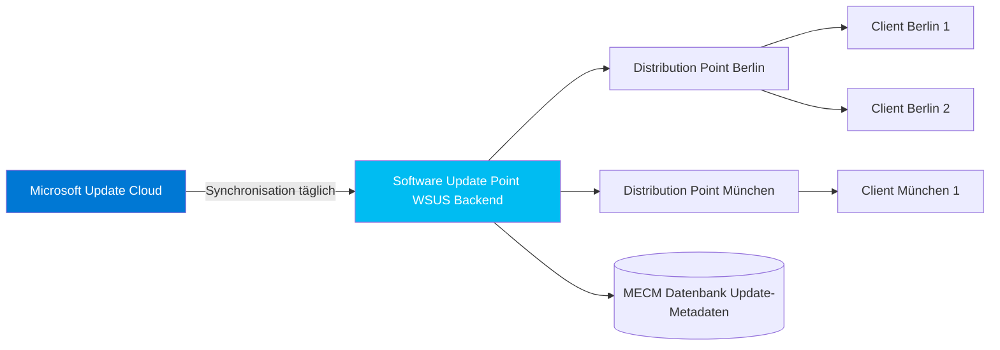
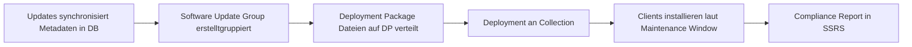
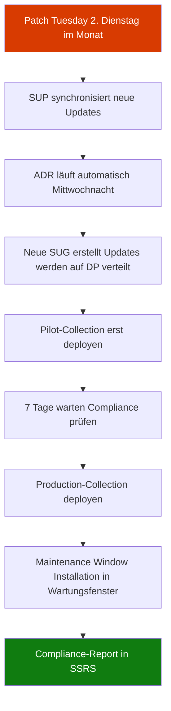

---
tags:
  - system-center
  - mecm
  - patch-management
  - wsus
  - software-updates
  - compliance
  - security
aliases:
  - ConfigMgr Patch Management
  - SCCM Updates
  - SUP MECM
  - Software Update Point
  - ADR MECM
---

# MECM Patch Management

> [!ABSTRACT] TL;DR
> MECM Patch Management basiert auf dem Software Update Point (SUP), der WSUS als Backend nutzt. Automatic Deployment Rules (ADR) automatisieren den Patch-Tuesday-Zyklus. Maintenance Windows kontrollieren den Installationszeitpunkt. MECM bietet detailliertere Compliance-Reports als Windows Update for Business oder Intune.

---

## Software Update Point (SUP)

Der Software Update Point ist die MECM-Rolle, die WSUS als Backend nutzt und Updates synchronisiert.

### Architektur



### SUP-Konfiguration

| Parameter | Empfohlener Wert | Beschreibung |
|-----------|-----------------|-------------|
| **Sync-Zeitplan** | Täglich 03:00 Uhr | Synchronisation mit Microsoft Update |
| **WSUS Port** | 8530 (HTTP) / 8531 (HTTPS) | Standard-WSUS-Ports |
| **SSL** | Ja (HTTPS) | Verschlüsselte Kommunikation |
| **Sprachen** | Deutsch, Englisch | Welche Sprachpakete synchronisiert werden |
| **Upstream-Source** | Microsoft Update oder internes WSUS | Bei mehreren Sites: Downstream-SUP |

> [!IMPORTANT] Enhanced HTTP ab 2403
> Ab MECM 2403 ist HTTP-only für Client-Kommunikation nicht mehr erlaubt. Der SUP muss HTTPS oder Enhanced HTTP verwenden.

---

## Update-Klassifikationen

In den SUP-Eigenschaften werden die zu synchronisierenden Klassifikationen definiert:

| Klassifikation | Beschreibung | Empfehlung |
|---------------|-------------|-----------|
| **Security Updates** | Sicherheits-Patches | Immer aktivieren |
| **Critical Updates** | Kritische Nicht-Sicherheits-Fixes | Immer aktivieren |
| **Update Rollups** | Kumulative Patches | Aktivieren |
| **Service Packs** | Große kumulative Updates | Aktivieren |
| **Feature Packs** | Neue Windows-Features | Optional |
| **Updates** | Allgemeine Korrekturen | Aktivieren |
| **Definition Updates** | Defender-Signaturen | Aktivieren (täglich) |
| **Drivers** | Hardware-Treiber via WU | Optional (Vorsicht) |
| **Upgrades** | Windows-Versions-Upgrades (z.B. 22H2 → 23H2) | Separat verwalten |

---

## Produkte konfigurieren

Nur synchronisierte Produkte erscheinen in MECM. Wichtige Produkte:

- Windows 10 (alle Versionen)
- Windows 11 (alle Versionen)
- Microsoft 365 Apps for Enterprise
- SQL Server (alle unterstützten Versionen)
- Windows Server (alle unterstützten Versionen)
- Microsoft Edge
- .NET Framework

> [!TIP] Produkte regelmäßig prüfen
> Nach dem Kauf neuer Software oder bei neuen Microsoft-Produkten muss die Produktliste manuell aktualisiert werden. Nicht gelistete Produkte werden nicht synchronisiert.

---

## Software Update Groups (SUG)

Software Update Groups sind logische Container für Updates:

| SUG-Typ | Erstellt von | Typischer Einsatz |
|---------|-------------|------------------|
| **Manuelle SUG** | Admin | Einmalige Deployments, Ausnahme-Patches |
| **ADR-erstellte SUG** | Automatic Deployment Rule | Monatliche Patch-Tuesday-Updates |
| **Deployment Package** | Basis-Container für Update-Binaries | Beinhaltet die eigentlichen Update-Dateien auf DP |

### SUG-Lifecycle



---

## Automatic Deployment Rules (ADR)

ADRs automatisieren den Patch-Tuesday-Prozess vollständig:

### Vollständige ADR-Konfiguration

| Parameter | Beispiel-Wert | Beschreibung |
|-----------|--------------|-------------|
| **Name** | Patch Tuesday - Security | Aussagekräftiger Name |
| **Collection** | All Windows Devices | Ziel-Collection |
| **Zeitplan** | Mi nach 2. Di im Monat | Tag nach Patch Tuesday |
| **Klassifikation** | Security Updates, Critical | Welche Update-Typen |
| **Produkte** | Windows 10, Windows 11, M365 Apps | Welche Produkte |
| **Release-Datum** | Letzte 4 Wochen | Nur neue Updates |
| **Severity** | Critical, Important | Nur relevante Schweregrade |
| **Superseded** | Nicht ersetzt | Keine abgelösten Updates |
| **Sprachen** | Deutsch, Englisch | Passt zu SUP-Konfiguration |
| **SUG-Aktion** | Neue SUG erstellen | Oder zu bestehender hinzufügen |
| **Deployment-Typ** | Required | Pflichtinstallation |
| **Deadline** | 7 Tage nach Deployment | Installationsfrist |
| **Maintenance Window** | Einhalten | Nur in definierten Fenstern |

### ADR per PowerShell erstellen

```powershell
# ADR für Patch Tuesday erstellen
$schedule = New-CMSchedule -Start "2024-04-10" -RecurCount 1 -RecurInterval Months

New-CMSoftwareUpdateAutoDeploymentRule `
  -Name "Patch Tuesday - Security Updates" `
  -CollectionName "All Windows Devices" `
  -AddToExistingSoftwareUpdateGroup $false `
  -EnabledAfterCreate $true `
  -Schedule $schedule `
  -UpdateClassification @("Security Updates", "Critical Updates") `
  -Product @("Windows 10", "Windows 11") `
  -DateReleasedOrRevised Last4Weeks `
  -Required $true `
  -DeadlineImmediately $false
```

---

## Maintenance Windows

Maintenance Windows definieren erlaubte Installationszeitfenster auf Device Collections:

### Konfiguration

```powershell
# Maintenance Window auf Collection setzen
$schedule = New-CMSchedule `
  -DayOfWeek Monday `
  -Start "2024-01-01 22:00:00" `
  -End "2024-01-02 02:00:00" `
  -RecurCount 1 `
  -RecurInterval Weeks

New-CMMaintenanceWindow `
  -CollectionID "P0100042" `
  -Name "Wochentliche Wartung Mo-Fr Nacht" `
  -Schedule $schedule `
  -ApplyToSoftwareUpdateOnly
```

### Maintenance Window Typen

| Typ | Beschreibung | Wann verwenden |
|-----|-------------|---------------|
| **Alle Programme** | Updates, Apps, Task Sequences | Allgemeines Wartungsfenster |
| **Nur Software Updates** | Ausschließlich Windows Updates | Separate Update-Fenster |
| **Nur Task Sequences** | Nur OSD/TS-Ausführung | OS-Deployments getrennt |

> [!WARNING] Kein Maintenance Window = sofortige Installation
> Wenn für eine Collection **kein Maintenance Window** konfiguriert ist, werden Required-Deployments mit Deadline **sofort** nach Ablauf der Deadline installiert — unabhängig von Tageszeit oder Benutzeraktivität. Immer Maintenance Windows für produktive Systeme konfigurieren!

### Überlappende Maintenance Windows

Mehrere Maintenance Windows können auf einer Collection aktiv sein. Alle gelten gleichzeitig — das Gerät wählt das passende Fenster.

---

## Compliance-Reporting

### SSRS-Standardberichte für Updates

| Bericht | Beschreibung | Pfad in SSRS |
|---------|-------------|-------------|
| **Compliance 1 - Overall** | Update-Compliance über alle Collections | Software Updates / Compliance |
| **Management 4 - Updates by Collection** | Compliance pro Collection | Software Updates / Management |
| **Management 7 - Scan Status** | Client-Scan-Status | Software Updates / Management |
| **Troubleshooting 1 - Scan Errors** | Clients mit Scan-Fehlern | Software Updates / Troubleshooting |

### Compliance-Status pro Update

| Status | Bedeutung |
|--------|-----------|
| **Installed** | Update erfolgreich installiert |
| **Required** | Update fehlt, muss installiert werden |
| **Not Required** | Nicht anwendbar (falsches OS, bereits superseded) |
| **Unknown** | Client hat noch nicht gescannt |
| **Error** | Installation fehlgeschlagen |

### Compliance per PowerShell abfragen

```powershell
# Compliance-Status für eine Collection
Get-CMSoftwareUpdateComplianceStatus `
  -CollectionName "All Windows 11 Devices" |
  Group-Object -Property StatusDescription |
  Select-Object Name, Count |
  Format-Table

# Fehlende Updates pro Gerät
Get-CMSoftwareUpdate |
  Where-Object {$_.IsDeployed -eq $true} |
  ForEach-Object {
    $update = $_
    Get-CMDeploymentStatusDetails -DeploymentID $update.CI_ID |
      Where-Object {$_.StatusDescription -eq "Required"}
  }
```

---

## Third-Party Software Updates

Ab MECM Version 1806 können externe Update-Kataloge eingebunden werden:

### Unterstützte Kataloge

| Hersteller | Katalog | Typische Updates |
|-----------|---------|-----------------|
| Dell | Dell Command Update Catalog | BIOS, Treiber, Firmware |
| HP | HP Client Management Solutions | BIOS, Treiber |
| Adobe | Adobe Application Manager | Acrobat, Creative Suite |
| Ivanti | Ivanti Patch for MEM | 3rd Party Applications |

### Katalog einbinden

```powershell
# Third-Party Katalog hinzufügen
New-CMThirdPartyUpdateCatalog `
  -Name "Dell Client Update Catalog" `
  -CatalogURL "https://downloads.dell.com/catalog/DellSDPCatalogPC.cab" `
  -SupportContact "Dell Support" `
  -Description "Dell BIOS und Treiber Updates"

# Katalog abonnieren und Kategorien wählen
Subscribe-CMThirdPartyUpdateCatalog -Id (Get-CMThirdPartyUpdateCatalog -Name "Dell Client Update Catalog").ID
```

---

## Express Updates (Windows 10/11)

Express Updates reduzieren die Download-Größe für Clients:

| Aspekt | Standard-Updates | Express Updates |
|--------|-----------------|----------------|
| **Download auf DP** | Vollständige Update-Datei | Alle Deltas aller Versionen |
| **Download auf Client** | Vollständig | Nur benötigtes Delta |
| **DP-Storage** | Kleiner | Größer (bis 10× mehr) |
| **Client-Bandbreite** | Mehr | Weniger |
| **Empfehlung** | Standard | Bei Bandbreiten-Engpässen |

---

## Vergleich: MECM vs. WUfB vs. Intune

| Merkmal | MECM Patch Management | Windows Update for Business | Intune (WUfB) |
|---------|----------------------|----------------------------|---------------|
| **Kontrolle** | Sehr hoch (jedes Update einzeln) | Mittel (Ringe, Deferrals) | Mittel |
| **Reporting** | SSRS mit 400+ Berichten | Azure Monitor / Log Analytics | Intune Dashboard |
| **Drittanbieter-Updates** | Ja (3rd Party Catalogs) | Nein | Nein (nur WU) |
| **Netzwerk** | Lokale Distribution Points | Microsoft CDN direkt | Microsoft CDN direkt |
| **Offline-Geräte** | Unterstützt (DP lokal) | Nur bei Internetverbindung | Nur bei Internetverbindung |
| **Co-Management** | Workload an Intune verschiebbar | Ja (WUfB-Integration) | Ja |
| **Lizenz** | SC DPM Lizenz | Windows E3/A3/Business | Intune Lizenz |
| **Empfehlung** | On-Premises, komplexe Anforderungen | Einfache Cloud-Environments | Intune-verwaltete Geräte |

> [!NOTE] Co-Management und Patch-Workload
> Mit Co-Management kann die **Windows Update Policies**-Workload schrittweise von MECM zu Intune/WUfB verschoben werden. Pilot-Collections ermöglichen einen kontrollierten Übergang.

---

## Typischer Patch-Tuesday Prozess



---

## Verwandte Notizen

- [[MECM SCCM Grundlagen]]
- [[MECM Software Deployment]]
- [[MECM Co-Management]]
- [[Intune Grundlagen]]
- [[System Center Azure Migration]]
