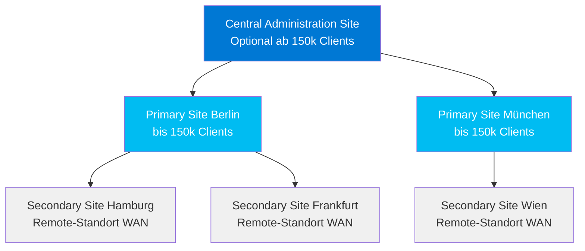

---
tags:
  - system-center
  - mecm
  - sccm
  - endpoint-management
  - deployment
  - grundlagen
aliases:
  - Configuration Manager
  - SCCM
  - ConfigMgr
  - Microsoft Configuration Manager
---

# MECM SCCM Grundlagen

> [!ABSTRACT] TL;DR
> Microsoft Configuration Manager (früher SCCM/MECM) ist die Enterprise-Plattform für Client-Management, Software-Deployment und OS-Deployment. Die Site-Hierarchie (CAS → Primary → Secondary) skaliert von kleinen bis zu sehr großen Umgebungen mit über 150.000 Clients. Current Branch 2403 ist die aktuelle Version (2024).

---

## Namensgeschichte

Configuration Manager hat eine lange Entwicklungsgeschichte mit mehrfachen Umbenennenungen:

| Jahr | Name | Abkürzung |
|------|------|-----------|
| 1994–2007 | Systems Management Server | SMS |
| 2007–2012 | System Center Configuration Manager 2007 | SCCM |
| 2012–2019 | System Center Configuration Manager (2012/CB) | SCCM / ConfigMgr |
| 2019–2022 | Microsoft Endpoint Configuration Manager | MECM |
| 2022–heute | Microsoft Configuration Manager | MCM / ConfigMgr |

> [!NOTE] Aktuelle Bezeichnung
> Seit der engeren Intune-Integration wird das Produkt offiziell als **Microsoft Configuration Manager** bezeichnet. In der Praxis sind „SCCM" und „ConfigMgr" weiterhin geläufig. Current Branch **2403** ist der aktuelle Release (April 2024).

---

## Site-Hierarchie



### Site-Typen im Überblick

| Site-Typ | Einsatz | Max. Clients | Datenbank |
|----------|---------|-------------|-----------|
| **Central Administration Site (CAS)** | Mehrere Primary Sites, >150k Clients | Keine Clients direkt | SQL Server Pflicht |
| **Standalone Primary Site** | Einzelne Site, kleiner bis mittlerer Kunde | 150.000 | SQL Server Pflicht |
| **Primary Site** (in CAS-Hierarchie) | Filiale oder Region | 150.000 | SQL Server Pflicht |
| **Secondary Site** | Remote-Standort mit schlechter WAN-Verbindung | 15.000 | SQL Server Express auto |

> [!TIP] Wann eine CAS benötigt wird
> Eine CAS ist nur nötig wenn mehr als **150.000 Clients** verwaltet werden oder wenn mehrere Primary Sites administrativ zusammengeführt werden sollen. Für die meisten Unternehmen reicht eine **Standalone Primary Site** vollständig aus.

---

## Site System Rollen

| Rolle | Funktion | Hinweis |
|-------|----------|---------|
| **Management Point (MP)** | Client-Kommunikation, Policy-Download, Inventory-Upload | Pflichtrolle auf jeder Primary Site |
| **Distribution Point (DP)** | Content-Verteilung (Pakete, Apps, Updates, Images) | PXE-Boot optional aktivierbar |
| **Software Update Point (SUP)** | WSUS-basierte Update-Synchronisation | Ein SUP pro Site, WSUS darunter |
| **Reporting Services Point (RSP)** | SSRS-Integration, 400+ vordefinierte Berichte | SQL Reporting Services erforderlich |
| **Fallback Status Point (FSP)** | Client-Status bei fehlgeschlagener MP-Verbindung | Unsignierte HTTP-Kommunikation |
| **Cloud Management Gateway (CMG)** | Internet-basiertes Client-Management | Azure-Dienst, ARM-basiert ab 2403 |
| **Enrollment Point** | Legacy Mobile Device Management | Deprecated |

> [!IMPORTANT] CMG in Version 2403
> Ab MECM 2403 sind **CMG Classic Cloud Services** (Azure Classic) nicht mehr unterstützt. Nur noch **ARM-basierte CMG-Deployments** werden akzeptiert. Bei Upgrade prüfen ob CMG migriert werden muss.

---

## Client-Deployment-Methoden

| Methode | Beschreibung | Voraussetzungen | Empfohlen für |
|---------|-------------|-----------------|---------------|
| **Client Push** | Automatische Installation via Site-Server | Lokale Admin-Rechte, Firewall frei | Domänen-Computer |
| **GPO-basiert** | MSI-Paket per Group Policy | AD, MECM-MSI-Paket | Standardumgebung |
| **Software Update Point** | Installation via WSUS/SUP | SUP konfiguriert | Wenn bereits SUP aktiv |
| **Task Sequence (OSD)** | Client wird bei OS-Deployment installiert | WinPE, DP | Neugeräte / Reimaging |
| **Manuelle Installation** | `ccmsetup.exe` mit Parametern | Physischer/Remote-Zugriff | Einzelne Geräte |
| **Login Script** | ccmsetup.exe via Anmeldeskript | AD-Anmeldeskript | Gemischte Umgebungen |
| **Cloud Management Gateway** | Internet-Client ohne VPN | CMG, Entra ID Join | Remote-Mitarbeiter |

### Client Push Konfiguration

```powershell
# Client Push über PowerShell auslösen
Install-CMClient `
  -DeviceName "PC-BERLIN-001" `
  -SiteCode "P01" `
  -AlwaysInstallClient $true

# Client Push Installation Status prüfen
Get-CMClientPushInstallation -SiteCode "P01"
```

---

## Discovery-Methoden

| Discovery-Methode | Findet | Frequenz (Standard) | Hinweis |
|-------------------|--------|---------------------|---------|
| **AD System Discovery** | Computer-Objekte aus Active Directory | Täglich | Empfohlen aktivieren |
| **AD User Discovery** | Benutzer-Objekte aus Active Directory | Täglich | Für User Collections |
| **AD Group Discovery** | AD-Gruppen und ihre Mitglieder | Täglich | Für Group-basierte Collections |
| **AD Forest Discovery** | AD Sites, Subnets, Trusted Forests | Wöchentlich | Für Network-Boundaries |
| **Heartbeat Discovery** | Registriert verwaltete Clients erneut | Alle 7 Tage | Immer aktiv, nicht deaktivieren |
| **Network Discovery** | Geräte via SNMP, DHCP, Router | Nach Bedarf | Langsam, nur bei Bedarf |

> [!WARNING] Heartbeat Discovery nicht deaktivieren
> Heartbeat Discovery dient als „Totmann-Schalter" — Clients, die sich 3× nicht gemeldet haben, werden als inaktiv markiert. Nie deaktivieren.

---

## Sammlungen (Collections)

Sammlungen sind die grundlegende Organisationseinheit in MECM. Alle Deployments, Berichte und Konfigurationen werden auf Collections angewendet.

### Collection-Typen

| Typ | Basis | Zweck |
|-----|-------|-------|
| **Device Collection** | Computer-Objekte | Software-Deployment, Patch Management, OSD |
| **User Collection** | Benutzer-Objekte | User-Centric App Deployment |

### Membership-Regeln

| Regeltyp | Beschreibung | Dynamisch? |
|----------|-------------|-----------|
| **Direct Rule** | Explizites Hinzufügen einzelner Geräte/Benutzer | Nein (statisch) |
| **Query Rule** | WMI-basierte Abfrage (WQL) | Ja (automatisch aktualisiert) |
| **Include Rule** | Andere Collection einschließen | Ja (erbt Änderungen) |
| **Exclude Rule** | Geräte einer anderen Collection ausschließen | Ja (erbt Änderungen) |

### Beispiel: WQL-Query für Windows 11

```sql
SELECT *
FROM SMS_R_SYSTEM
WHERE SMS_R_SYSTEM.OperatingSystemNameandVersion
LIKE "Microsoft Windows NT Workstation 10.0%"
AND SMS_R_SYSTEM.Build >= "22000"
```

> [!NOTE] Windows 11 Build-Nummer
> Windows 11 hat intern `NT Workstation 10.0` im Namen. Die Unterscheidung zu Windows 10 erfolgt über die Build-Nummer: Windows 11 startet ab Build **22000**.

### Nützliche Standard-Collections

- **All Systems** — Alle entdeckten Geräte (kein Deployment empfohlen)
- **All Desktop and Server Clients** — Alle aktiven MECM-Clients
- **All Windows 11** — Eigene Query-Collection anlegen
- **Pilot Groups** — Kleine Gruppen für phased Rollouts

---

## MECM 2403 Neuerungen (2024)

| Feature | Beschreibung |
|---------|-------------|
| Enhanced HTTP Pflicht | HTTP-only Client-Kommunikation entfernt (deprecated seit 2103) |
| Software Update Diagnostic Dashboard | Neues Dashboard zur Diagnose von Update-Problemen |
| Zentrales Suchfeld | Globale Suche in der Konsole |
| Script Folder Support | Ordnerstruktur für PowerShell-Skripte in der Konsole |
| Windows 11 ARM64 OSD | Verbesserte Unterstützung für ARM64-Deployments |
| CMG Classic deprecated | Nur noch ARM-basierte Cloud Management Gateways |
| Win Server 2012 EOL | Windows Server 2012/R2 nicht mehr als Site System unterstützt |

---

## Wichtige PowerShell-Cmdlets

```powershell
# ConfigMgr PowerShell-Modul laden (auf Site-Server oder mit AdminConsole)
Import-Module "$($ENV:SMS_ADMIN_UI_PATH)\..\ConfigurationManager.psd1"
Set-Location "P01:"  # P01 = Site Code

# Site-Informationen
Get-CMSite
Get-CMSiteSystemServer -SiteCode "P01"

# Collections
Get-CMCollection -Name "All Windows 11 Devices"
Get-CMCollectionMember -CollectionName "All Windows 11 Devices" |
  Select-Object Name, Domain | Format-Table

# Discovery manuell auslösen
Invoke-CMActiveDirectorySystemDiscovery -SiteCode "P01"
Invoke-CMActiveDirectoryUserDiscovery -SiteCode "P01"

# Client-Installation auslösen
Install-CMClient `
  -DeviceName "PC-BERLIN-001" `
  -SiteCode "P01"

# Boundaries und Boundary Groups
Get-CMBoundary | Format-Table DisplayName, BoundaryType, Value
Get-CMBoundaryGroup | Format-Table Name, DefaultSiteCode

# Rollen auf Site-Servern
Get-CMSiteRole -SiteSystemServerName "MECM01.contoso.com" |
  Select-Object RoleName | Format-Table
```

---

## Skalierungsrichtlinien

| Szenario | Empfohlene Architektur |
|----------|----------------------|
| < 25.000 Clients | Standalone Primary Site, 1 Server (alle Rollen) |
| 25.000–100.000 Clients | Standalone Primary, separate SQL, Remote-DPs |
| 100.000–150.000 Clients | Standalone Primary, dedizierter SQL-Cluster, viele DPs |
| > 150.000 Clients | CAS + mehrere Primary Sites |
| Remote-Standorte | Secondary Sites oder Cloud DP |
| Internet-Clients | Cloud Management Gateway (CMG) |

---

## Boundaries und Boundary Groups

Boundaries definieren den Bereich, aus dem Clients ihren nächsten Distribution Point oder Management Point finden:

| Boundary-Typ | Beschreibung | Beispiel |
|-------------|-------------|---------|
| **IP-Subnet** | Einzelnes Subnetz | 10.0.10.0/24 |
| **IP-Range** | IP-Adressbereich | 10.0.10.1 – 10.0.10.254 |
| **Active Directory Site** | AD-Site | Berlin-Site |
| **IPv6-Prefix** | IPv6-Subnetz | 2001:db8::/32 |

**Boundary Groups** fassen Boundaries zusammen und ordnen ihnen Distribution Points und Management Points zu:

```powershell
# Boundary Group erstellen und DP zuweisen
$bg = New-CMBoundaryGroup -Name "Berlin-BG" -DefaultSiteCode "P01"

# DP zur Boundary Group hinzufügen
Add-CMBoundaryGroupSiteSystem `
  -BoundaryGroupName "Berlin-BG" `
  -ServerName "DP-BERLIN01.contoso.com"

# Boundary zur Gruppe hinzufügen
Add-CMBoundaryToGroup `
  -BoundaryName "Berlin-Subnet-10.0.10.x" `
  -BoundaryGroupName "Berlin-BG"
```

> [!TIP] Fallback-Zeit konfigurieren
> Wenn kein DP in der eigenen Boundary Group verfügbar ist, fällt der Client nach konfigurierbarer Zeit (Standard: 120 Minuten) auf eine benachbarte Boundary Group oder den Fallback-DP zurück.

---

## Content Management

Distribution Points verteilen Inhalte (Pakete, Anwendungen, Boot Images, Updates):

### Content-Verteilung

```powershell
# Anwendung auf DP verteilen
Start-CMContentDistribution `
  -ApplicationName "Microsoft 365 Apps" `
  -DistributionPointName "DP-BERLIN01.contoso.com"

# Content-Verteilungs-Status prüfen
Get-CMDistributionStatus -PackageId "P0100001" |
  Select-Object TargetName, Status, BytesSentTCP | Format-Table

# Fehlgeschlagene Content-Verteilungen
Get-CMDistributionStatus | 
  Where-Object {$_.Status -eq "Failed"} | Format-Table
```

### Pull-Distribution Points

Pull-DPs laden Content vom übergeordneten DP selbst herunter (statt vom Site-Server gepusht zu werden):

| DP-Typ | Content-Quell | Einsatz |
|--------|--------------|--------|
| **Standard DP** | Site-Server pusht Content | Lokale Standorte |
| **Pull-DP** | Zieht Content selbst von Source-DP | Remote-Standorte mit WAN |
| **Cloud DP** | Azure Storage Blob | Internet-Clients ohne lokalen DP |

---

## Konfiguration der MECM-Konsole

Wichtige Konsolen-Bereiche für den täglichen Betrieb:

| Workspace | Unterbereich | Aufgaben |
|-----------|-------------|---------|
| **Assets and Compliance** | Device Collections, User Collections | Sammlungen verwalten, Compliance |
| **Software Library** | Applications, Packages, Task Sequences, Updates | Deployment-Objekte verwalten |
| **Monitoring** | Deployments, Software Updates, Client Status | Status überwachen |
| **Administration** | Site Configuration, Client Settings, Accounts | Infrastruktur konfigurieren |

---

## Client-Einstellungen (Client Settings)

Client-Einstellungen steuern das Verhalten des MECM-Agenten auf verwalteten Geräten:

| Einstellungs-Bereich | Wichtige Parameter |
|--------------------|------------------|
| **Computer Agent** | Software Center-Branding, Notification-Verhalten |
| **Software Deployment** | Schedule für Auswertung, Neustartverhalten |
| **Software Updates** | Scan-Frequenz, Express Updates aktivieren |
| **Hardware Inventory** | Intervall, welche Klassen gesammelt werden |
| **Software Inventory** | Datei-Typen die inventarisiert werden |
| **Remote Tools** | Remote Control, Remote Assistance |
| **Cloud Services** | CMG aktivieren, Azure AD-Integration |

```powershell
# Standard-Client-Einstellungen anzeigen
Get-CMClientSetting -SettingType Default

# Custom Client Setting für Laptops
New-CMClientSetting -Name "Laptop Client Settings" -Type Device
Set-CMClientSetting `
  -Name "Laptop Client Settings" `
  -SoftwareUpdatesSchedule (New-CMSchedule -RecurInterval Hours -RecurCount 4)
```

---

## Verwandte Notizen

- [[MECM Software Deployment]]
- [[MECM Patch Management]]
- [[MECM Co-Management]]
- [[Intune Grundlagen]]
- [[Windows Autopilot]]
- [[System Center Azure Migration]]
