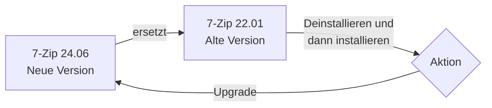
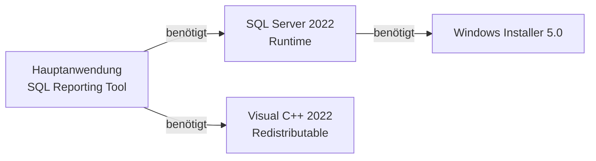
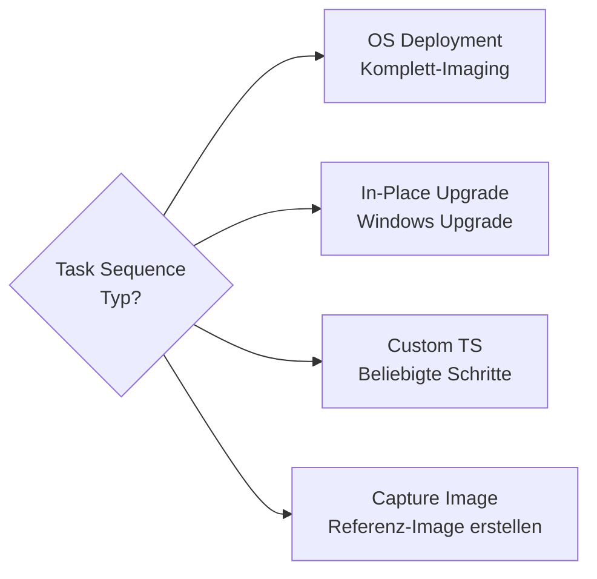
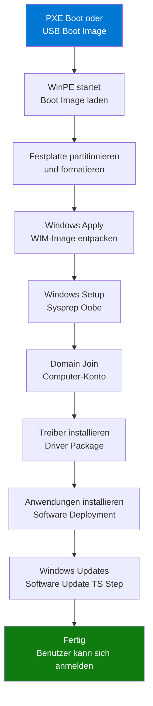
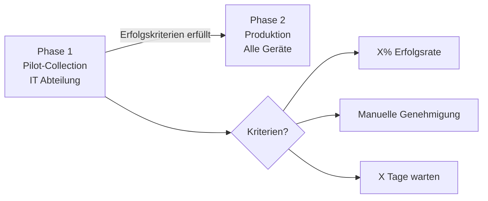

---
tags:
  - system-center
  - mecm
  - deployment
  - software-verteilung
  - task-sequence
  - osd
  - anwendungen
aliases:
  - ConfigMgr Software Deployment
  - SCCM Softwareverteilung
  - OSD MECM
  - Task Sequence MECM
---

# MECM Software Deployment

> [!ABSTRACT] TL;DR
> MECM bietet zwei Deployment-Modelle: **Pakete** (legacy, kein Detection) und **Anwendungen** (modern, mit Detection Rules, Requirements, Dependencies). OS Deployment (OSD) via Task Sequences erlaubt vollautomatisches Imaging. Software Center ist das moderne UI für Endbenutzer.

---

## Pakete vs. Anwendungen

Der grundlegende Unterschied zwischen den beiden Deployment-Modellen:

| Merkmal | Paket (Legacy) | Anwendung (Modern) |
|---------|---------------|-------------------|
| **Detection Method** | Keine — wird immer ausgeführt | Registry, Datei, WMI — prüft ob installiert |
| **Abhängigkeiten** | Nicht unterstützt | Ja, andere Anwendungen automatisch |
| **Supersedence** | Nicht unterstützt | Ja, ersetzt ältere Versionen |
| **Requirements** | Keine | OS, Hardware, WMI-Query, Sprache |
| **User-Centric** | Eingeschränkt | Ja, Available für Benutzer im Software Center |
| **Deployment Types** | Ein Programm | Mehrere (MSI, Script, App-V, MSIX) |
| **Rückgabe-Codes** | Begrenzt | Vollständig konfigurierbar |
| **Empfehlung** | Legacy-Anwendungen | Alle neuen Deployments |

> [!TIP] Wann noch Pakete verwenden?
> Pakete sind sinnvoll für einfache Skripte (z.B. Registry-Keys setzen), wenn kein Detection nötig ist. Für alle „echten" Anwendungsinstallationen sollten **Anwendungen** verwendet werden.

---

## Detection Rules (Erkennungsmethoden)

Detection Rules prüfen, ob eine Anwendung bereits installiert ist — verhindert Neuinstallation auf bereits aktuellen Systemen.

### Die drei Detection-Typen

**1. Registry-basiert**

```powershell
# Beispiel: Prüft ob 7-Zip installiert ist
# Schlüssel: HKLM\SOFTWARE\7-Zip
# Wert: Path (existiert)

# Oder mit Versionsprüfung:
# HKLM\SOFTWARE\Microsoft\Windows\CurrentVersion\Uninstall\{Produkt-GUID}
# Wert: DisplayVersion >= 23.01
```

**2. Datei/Ordner-basiert**

| Parameter | Beschreibung |
|-----------|-------------|
| Pfad | `%ProgramFiles%\7-Zip` |
| Datei | `7z.exe` |
| Eigenschaft | Datei vorhanden / Version / Datum |
| Operator | Existiert / Gleich / Größer als |

**3. WMI-Query**

```sql
SELECT * FROM Win32_Product WHERE Name LIKE '%7-Zip%'
```

> [!WARNING] WMI-Detection ist langsam
> `Win32_Product` löst eine vollständige MSI-Neuregistrierung aus und ist sehr langsam. Bevorzuge Registry oder Datei-basierte Detection. Alternativ: `Win32Reg_AddRemovePrograms` für schnellere Registry-Abfragen.

---

## Requirements (Anforderungen)

Anforderungen steuern, auf welchen Geräten/Benutzern ein Deployment angewendet wird:

| Requirement-Typ | Beispiel | Beschreibung |
|----------------|---------|-------------|
| **Betriebssystem** | Windows 11 x64 | Nur auf bestimmten OS-Versionen |
| **Prozessor-Architektur** | x64 | 32-bit vs. 64-bit |
| **RAM** | Mindestens 8 GB | Hardwareanforderungen |
| **Festplattenplatz** | Mindestens 20 GB frei | Speicheranforderungen |
| **WMI-Query** | Bestimmte Hardware | Beliebige WMI-Abfrage |
| **Inventar** | Specific HW-Inventar | Basiert auf Hardware Inventory |

---

## Supersedence (Ablösung)

Supersedence definiert, welche ältere Anwendung durch die neue ersetzt wird:



- **Uninstall and install**: Alte Version wird deinstalliert, neue installiert
- **Upgrade only**: Nur Upgrade (kein Uninstall), erfordert kompatibles Upgrade-Paket
- Supersedence wird in der Kette dargestellt (v3 → v2 → v1)

---

## Dependencies (Abhängigkeiten)

Abhängigkeiten werden **automatisch vor der Hauptanwendung** installiert:



- Tiefere Abhängigkeiten werden automatisch aufgelöst (bis Tiefe 5)
- Abhängigkeiten müssen als eigene Anwendungen definiert sein
- Auto-Install: Abhängigkeiten werden ohne Benutzerinteraktion installiert

---

## Task Sequences (TS)

Task Sequences sind Schritt-für-Schritt-Workflows für komplexe Operationen.

### Task Sequence Typen



### OS Deployment (OSD) Ablauf



### In-Place Upgrade (IPU)

Für Upgrades von Windows 10 → Windows 11 oder zwischen Windows 11 Versionen:

1. **Check Readiness** — Prüft Mindestanforderungen (TPM 2.0, SecureBoot etc.)
2. **Download OS Upgrade Package** — Windows 11 ISO/ESD herunterladen
3. **Upgrade Operating System** — `setup.exe /quiet /compat ignorewarning`
4. **Post-Migration Scripts** — Cleanup, Registry-Anpassungen, Einstellungen

> [!NOTE] IPU vs. Wipe-and-Reload
> In-Place Upgrade behält alle installierten Anwendungen und Benutzerprofile — deutlich schneller als komplettes Reimaging. Empfohlen für Windows 10 → Windows 11 Upgrades in bestehenden Umgebungen.

---

## PXE-Boot und WDS

### Voraussetzungen für PXE-Boot

| Komponente | Beschreibung |
|------------|-------------|
| **Distribution Point** | PXE-Option aktiviert auf DP |
| **Windows Deployment Services (WDS)** | Optional ab MECM 2012 R2 — MECM kann auch ohne WDS PXE |
| **DHCP** | Option 66 (Boot Server), Option 67 (Boot File) — oder IP-Helper |
| **Boot Image** | WinPE-basiertes Boot Image im MECM-DP hinterlegt |
| **ADK (Assessment and Deployment Kit)** | Windows PE muss zur MECM-Version passen |

### Boot Images

```powershell
# Boot Images in MECM abfragen
Get-CMBootImage | Select-Object Name, Version, PackageID | Format-Table

# Boot Image aktualisieren (nach ADK-Update)
Update-CMDistributionPoint -BootImageId "P010000A"
```

---

## Driver Management

### Driver Import und Pakete

```powershell
# Treiber importieren
$DriverPkg = New-CMDriverPackage -Name "HP EliteBook 840 G10 Drivers"

# Treiber-INF importieren
Import-CMDriver `
  -UncFileLocation "\\MECM-SRV\Drivers\HP\840G10" `
  -DriverPackage $DriverPkg `
  -ImportDuplicateDriverOption AppendCategory

# Treiber auf DP verteilen
Start-CMContentDistribution `
  -DriverPackageId $DriverPkg.PackageID `
  -DistributionPointName "DP01.contoso.com"
```

### Driver Strategy: Auto Apply vs. Driver Package

| Strategie | Beschreibung | Vorteil | Nachteil |
|-----------|-------------|---------|----------|
| **Auto Apply Drivers** | Windows wählt passende Treiber | Einfach, wenig Pflege | Unzuverlässig, unkontrolliert |
| **Apply Driver Package** | Spezifisches Paket per WMI-Query | Kontrolliert, reproduzierbar | Mehr Pflege, Paket pro Modell |

Empfehlung: **Apply Driver Package** mit WMI-Query auf `Win32_ComputerSystem.Model`.

---

## Software Center

Das Software Center ist das Endbenutzer-Interface für MECM-Deployments.

### Registerkarten

| Tab | Inhalt |
|-----|--------|
| **Anwendungen** | Verfügbare und erforderliche Apps |
| **Updates** | Ausstehende Windows Updates |
| **Betriebssysteme** | Verfügbare OS-Upgrades |
| **Installationsstatus** | Fortschritt, Fehler, Historie |
| **Gerätecompliance** | Compliance-Status |

> [!NOTE] App Catalog deprecated
> Der **Application Catalog** (WebService und Website) wurde in MECM 2107 vollständig entfernt. Alle Funktionen sind im **Software Center** integriert. Der Software Center kommuniziert direkt mit dem Management Point.

### Software Center Branding

Das Software Center kann pro Organisation gebrandeted werden:
- Firmenname und Logo
- Farbschema
- Support-Kontaktinformationen (Helpdesk-URL, Telefon, E-Mail)

---

## Phased Deployment (Stufenweise Bereitstellung)

Phased Deployments ermöglichen kontrollierte Rollouts in mehreren Phasen:



### Konfigurierbare Kriterien

| Kriterium | Beschreibung | Beispiel |
|-----------|-------------|---------|
| **Deployment-Erfolg** | Prozentualer Anteil erfolgreicher Installationen | 95% |
| **Wartezeit** | Zeitraum nach Phase 1 bis Phase 2 | 7 Tage |
| **Manuell** | Admin genehmigt Phase 2 manuell | Für kritische Updates |

---

## Deployment-Einstellungen im Detail

### Required vs. Available

| Einstellung | Beschreibung | Benutzer-Interaktion |
|-------------|-------------|---------------------|
| **Required** | Pflicht-Installation mit Deadline | Benachrichtigung, Countdown |
| **Available** | Im Software Center angeboten | Benutzer wählt Zeitpunkt |

### User Notification

| Option | Beschreibung |
|--------|-------------|
| `Display all notifications` | Vollständige Benachrichtigungen (Ballons, etc.) |
| `Display only in Software Center` | Nur im Software Center sichtbar |
| `Hide all notifications` | Kein UI — nur für Hintergrund-Deployments |

---

## PowerShell-Beispiele

```powershell
# Anwendung bereitstellen (Required)
New-CMApplicationDeployment `
  -Name "Microsoft 365 Apps for Enterprise" `
  -CollectionName "All Windows 11 Devices" `
  -DeployAction Install `
  -DeployPurpose Required `
  -DeadlineDateTime (Get-Date).AddDays(7) `
  -UserNotification DisplaySoftwareCenterOnly `
  -OverrideServiceWindow $false

# Anwendung als Available bereitstellen
New-CMApplicationDeployment `
  -Name "Visual Studio Code" `
  -CollectionName "All Developers" `
  -DeployAction Install `
  -DeployPurpose Available `
  -UserNotification DisplayAll

# Task Sequence bereitstellen
New-CMTaskSequenceDeployment `
  -TaskSequenceName "Windows 11 23H2 OSD" `
  -CollectionName "OSD Targets - Berlin" `
  -DeployPurpose Required `
  -AvailableDateTime (Get-Date) `
  -DeadlineDateTime (Get-Date).AddDays(14)

# Phased Deployment erstellen
New-CMApplicationPhase `
  -CollectionName "IT-Pilot-Collection" `
  -CriteriaOption Compliance `
  -CriteriaValue 95

# Deployment-Status abfragen
Get-CMDeployment -CollectionName "All Windows 11 Devices" |
  Select-Object ApplicationName, DeploymentIntent, NumberSuccess, NumberErrors |
  Format-Table
```

---

## Verwandte Notizen

- [[MECM SCCM Grundlagen]]
- [[MECM Patch Management]]
- [[MECM Co-Management]]
- [[Windows Autopilot]]
- [[Intune Grundlagen]]
