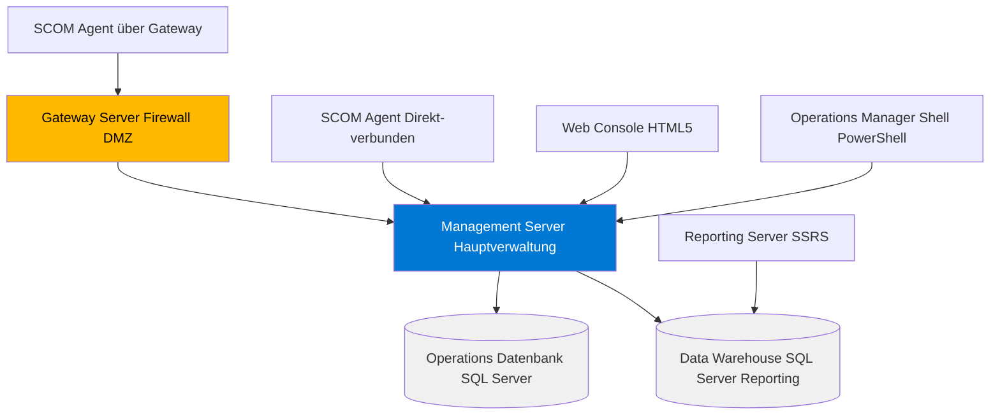
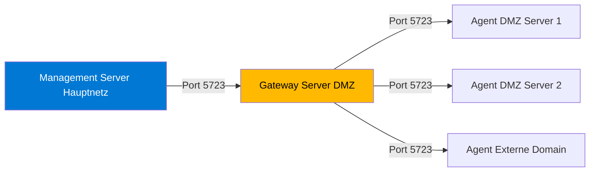

---
tags:
  - system-center
  - scom
  - monitoring
  - operations-manager
  - grundlagen
  - alerting
  - management-packs
aliases:
  - System Center Operations Manager
  - Operations Manager
  - SCOM 2022
  - SCOM MI
---

# SCOM Grundlagen

> [!ABSTRACT] TL;DR
> System Center Operations Manager (SCOM) ist Microsofts Enterprise-Monitoring-Plattform für Infrastruktur, Anwendungen und Dienste. Management Packs definieren die Überwachungslogik für spezifische Technologien. SCOM 2022 ist die aktuelle On-Premises-Version; SCOM Managed Instance (MI) bietet dieselbe Funktionalität als Azure-verwalteten Dienst.

---

## SCOM-Überblick

SCOM überwacht IT-Infrastruktur durch Agenten, die auf überwachten Systemen laufen und Daten an Management Server senden. Die Überwachungslogik ist in **Management Packs** (MPs) definiert — XML-Pakete, die Monitore, Regeln, Entdeckung und Berichte für eine bestimmte Technologie enthalten.

| Version | Support-Ende | Besonderheiten |
|---------|-------------|---------------|
| SCOM 2016 | Januar 2027 | HTML5 Web Console eingeführt |
| SCOM 2019 | Januar 2029 | Silverlight komplett entfernt |
| SCOM 2022 | Oktober 2032 | Azure AMA Integration, Linux Agent verbessert |
| SCOM MI | Ongoing | Azure-verwaltete Instanz |

---

## Architektur



### Datenbank-Rollen

| Datenbank | Inhalt | Retention |
|----------|--------|-----------|
| **OperationsDB** | Aktuelle Echtzeit-Daten, Alerts, Monitoring-Status | Kurz (7 Tage Performance) |
| **Data Warehouse (DW)** | Historische Daten für Reporting | Lang (400 Tage Standard) |

> [!NOTE] Zwei SQL-Server empfohlen
> Für produktive Umgebungen sollten OperationsDB und Data Warehouse auf **separaten SQL-Servern** liegen, da der DW durch Berichtsgenerierung deutlich mehr I/O erzeugt.

---

## Management Packs (MPs)

### Was enthält ein Management Pack?

| Komponente | Beschreibung |
|-----------|-------------|
| **Discoveries** | Findet Objekte (z.B. alle SQL-Instanzen) |
| **Monitors** | Überprüft Zustand (Health State: Healthy/Warning/Critical) |
| **Rules** | Sammelt Daten oder erzeugt Alerts basierend auf Regeln |
| **Tasks** | Ausführbare Aktionen (z.B. Dienst neu starten) |
| **Views** | Dashboards und Ansichten in der Console |
| **Reports** | SSRS-Berichte für das Data Warehouse |
| **Knowledge** | Dokumentation und Lösungshinweise pro Alert |

### Wichtige Microsoft Management Packs

| Management Pack | Überwacht |
|----------------|----------|
| **Windows Server OS** | OS-Events, Dienste, Festplatte, RAM, Netzwerk |
| **SQL Server** | Datenbanken, Jobs, Availability Groups, Backup |
| **Internet Information Services** | Websites, App Pools, Request-Queue |
| **Active Directory** | Domain Controller Health, Replikation, FSMO |
| **Exchange Server** | Mailflow, Mailbox-Datenbanken, Connectors |
| **Hyper-V** | Host-Health, VM-Status, Cluster |
| **Windows Client** | Workstation-Monitoring |
| **.NET Application Performance** | Anwendungs-Performance, Exceptions |

### MPs importieren

```powershell
# Management Pack-Datei importieren
Import-SCOMManagementPack `
  -FullName "C:\MPs\Microsoft.SQLServer.2022.Discovery.mp",
            "C:\MPs\Microsoft.SQLServer.2022.Monitoring.mp"

# Installierte MPs auflisten
Get-SCOMManagementPack |
  Select-Object DisplayName, Version, Sealed |
  Sort-Object DisplayName |
  Format-Table
```

---

## Management Pack Tuning (Overrides)

Overrides passen das Verhalten von Monitoren und Regeln an, ohne das originale MP zu modifizieren:

### Override-Typen

| Override-Typ | Beschreibung | Beispiel |
|-------------|-------------|---------|
| **Disable Monitor** | Deaktiviert einen Monitor | Bekanntes Problem unterdrücken |
| **Change Threshold** | Schwellenwert anpassen | CPU-Alert bei 90% statt 80% |
| **Change Parameter** | Parameter ändern | Probeintervall verlängern |
| **Change Priority** | Alert-Priorität ändern | Niedrigprioritäre Alerts |

### Override per PowerShell

```powershell
# Verbindung zum Management Server
New-SCOMManagementGroupConnection -ComputerName "SCOM01.contoso.com"

# Monitor-Override erstellen (CPU-Threshold anpassen)
$monitor = Get-SCOMMonitor -Name "Microsoft.Windows.Server.2022.LogicalDisk.FreeSpaceMonitor"
$class = Get-SCOMClass -Name "Microsoft.Windows.LogicalDisk"

$override = New-Object Microsoft.EnterpriseManagement.Configuration.ManagementPackMonitorPropertyOverride($monitor, "Override_DiskSpace_90")
$override.Property = "Threshold"
$override.Value = "10"  # 10% statt Standard

# Override in eigenem MP speichern
$customMP = Get-SCOMManagementPack -Name "Contoso.Overrides"
$override.Module = $customMP
$customMP.AcceptChanges()
```

> [!IMPORTANT] Overrides immer in eigenem MP speichern
> Niemals Overrides im Original-Management Pack speichern (falls vorhanden und nicht sealed). Erstelle ein eigenes **Overrides-MP** (z.B. `Contoso.Overrides`) für alle Anpassungen. Bei MP-Updates bleiben so alle Overrides erhalten.

---

## Monitoring-Typen

### Availability Monitoring

Überprüft ob Dienste, Prozesse und Anwendungen laufen:

```powershell
# Dienst-Monitor State abfragen
Get-SCOMClassInstance -Class (Get-SCOMClass -Name "Microsoft.Windows.Service") |
  Where-Object {$_.HealthState -ne "Success"} |
  Select-Object DisplayName, HealthState | Format-Table
```

### Performance Monitoring

Performance Counters sammeln und bei Schwellenwertüberschreitung alertieren:

| Counter | Typischer Threshold | Alert-Severity |
|---------|--------------------|----|
| CPU Utilization (%) | > 90% für 5 Min | Warning |
| Available Memory (MB) | < 512 MB | Critical |
| Disk Free Space (%) | < 10% | Warning / Critical |
| Network Utilization (%) | > 80% | Warning |

### Event-basierte Alerts

Bestimmte Windows-Ereignisse erzeugen automatisch SCOM-Alerts:

```powershell
# Event-basierte Alert-Regeln anzeigen
Get-SCOMRule |
  Where-Object {$_.Category -eq "Alert"} |
  Select-Object DisplayName, Enabled | Format-Table
```

### Maintenance Mode

Unterdrückt Alerts während geplanter Wartung:

```powershell
# Maintenance Mode für Server setzen
$instance = Get-SCOMClassInstance -Class (Get-SCOMClass -Name "Microsoft.Windows.Computer") |
  Where-Object {$_.DisplayName -eq "SERVER01.contoso.com"}

Start-SCOMMaintenanceMode `
  -Instance $instance `
  -EndTime (Get-Date).AddHours(4) `
  -Reason "PlannedMaintenance" `
  -Comment "OS-Patching Quartal 2"

# Maintenance Mode beenden
Get-SCOMMaintenanceModeSchedule -Instance $instance |
  Stop-SCOMMaintenanceMode
```

---

## Gateway Server

Gateway Server ermöglichen Monitoring über Firewall-Grenzen und in nicht-vertrauenswürdigen Domänen:



| Einsatzszenario | Beschreibung |
|----------------|-------------|
| **DMZ** | Server in der DMZ über Gateway monitoren |
| **Nicht-vertrauenswürdige Domain** | Kein Kerberos möglich, Zertifikat-Auth |
| **Remote-Standort** | Bandbreite sparen durch lokalen Gateway |
| **Failover** | Zwei Gateways für Redundanz konfigurierbar |

---

## Dashboards und Reporting

### Operations Manager Console

Die Windows-basierte Konsole bietet:
- **Monitoring**-Workspace: Aktive Alerts, Distributed Applications, Health Explorer
- **Authoring**-Workspace: MP-Authoring, Overrides, Distributed Applications
- **Administration**-Workspace: Agenten, Management Packs, Accounts

### Web Console (HTML5)

Ab SCOM 2019 vollständig Silverlight-frei:
- Browser-basiert (Chrome, Edge, Firefox)
- Dashboard-Ansichten
- Alert-Management
- Maintenance Mode

### SSRS Reporting

```powershell
# Reporting Services Point verbinden
# Berichte sind im Data Warehouse gespeichert

# Verfügbarkeits-Bericht als Beispiel
# Pfad in SSRS: Microsoft.SystemCenter.DataWarehouse.Report.Library
#   → Availability → Availability by Date
```

---

## Azure Monitor Agent (AMA) Integration

Ab SCOM 2022 unterstützt SCOM Multi-homing mit dem Azure Monitor Agent:

| Aspekt | MMA (alt) | AMA (neu) |
|--------|-----------|-----------|
| **Log Analytics** | Unterstützt | Unterstützt |
| **SCOM-Integration** | SCOM Agent separat | Multi-homing: AMA + SCOM |
| **Konfiguration** | Workspace-basiert | Data Collection Rules (DCR) |
| **Empfehlung** | Migration zu AMA | Bevorzugen |

Hybrid-Szenario: AMA sendet Logs an Log Analytics Workspace, SCOM-Agent überwacht Availability und Performance lokal — beide parallel auf demselben Server möglich.

---

## SCOM 2022 vs. SCOM Managed Instance (MI)

| Aspekt | SCOM 2022 On-Premises | SCOM MI (Cloud) |
|--------|----------------------|----------------|
| **Infrastruktur** | Eigene Server erforderlich | Microsoft vollständig managed |
| **SQL Server** | Selbst installiert und verwaltet | Azure SQL Managed Instance |
| **Kosten** | CapEx (Lizenzen + Hardware) | OpEx (verbrauchsbasiert) |
| **Management Packs** | Vollständig kompatibel | Vollständig kompatibel |
| **Hybrid-Monitoring** | Gateway Server | Azure VNet + VPN/ExpressRoute |
| **Skalierung** | Manuell (neue Server) | Azure-elastisch |
| **Backup** | Selbst verwaltet | Azure Backup automatisch |
| **Updates** | Manuell (Halbjährlich) | Microsoft verwaltet |
| **Empfehlung** | Bestehende komplexe Umgebungen | Neue Deployments und Migration |

> [!NOTE] SCOM MI als Migrationspfad
> SCOM MI ist ideal für Organisationen, die ihre SCOM-Umgebung in die Cloud verlagern möchten, ohne alle Management Packs und Overrides neu erstellen zu müssen. Volle Kompatibilität mit bestehenden MPs.

---

## Via SCOM Operations Console (UI)

### Management Pack importieren

1. Öffne die **SCOM Operations Console**
2. Navigiere zur Ansicht **Verwaltung → Management Packs**
3. Klicke auf **Management Packs importieren** im Aktionsbereich (rechts)
4. Im Assistenten:
   - **Quelle:** Aus Katalog online suchen oder **Aus Datei hinzufügen** (.mp / .mpb)
   - **Auswahl:** Gewünschte MPs markieren — Abhängigkeiten werden automatisch erkannt
   - **Import:** Übersicht prüfen und Warnungen beachten
5. Klicke auf **Installieren** und nach Abschluss **Fertig**

> [!NOTE] Test zuerst
> Neue Management Packs zuerst in der **Testumgebung** importieren und Overrides anpassen, bevor sie in Produktion eingesetzt werden.

### Override erstellen (MP Tuning)

1. Navigiere zu **Erstellen → Management Pack-Objekte → Monitore** (oder Regeln)
2. Wähle einen Monitor aus → Rechtsklick → **Außerkraftsetzungen → Außerkraftsetzung erstellen**
3. Wähle den Geltungsbereich:
   - **Für alle Objekte der Klasse:** Gilt für die gesamte Klasse
   - **Für eine bestimmte Gruppe:** Eingeschränkt auf eine Gruppe
   - **Für ein bestimmtes Objekt:** Zielgenau für einen einzelnen Server
4. Im Dialogfenster: Parameter anpassen (z.B. Schwellenwert, Aktivierungszustand)
5. Ziel-Management-Pack auswählen (eigenes benutzerdefiniertes MP empfohlen, **nicht** das ursprüngliche MP)
6. Klicke auf **OK**

### Alarmansicht und Benachrichtigung konfigurieren

1. Navigiere zu **Überwachung → Aktive Warnungen**
2. Klicke auf **Warnungsansicht erstellen** im Aktionsbereich um gefilterte Ansichten zu erstellen
3. Filter nach: Schweregrad (Kritisch/Warnung), Kategorie, Quelle, Zuweisungsstatus
4. Für E-Mail-Benachrichtigungen: **Verwaltung → Benachrichtigungen → Abonnements → Abonnement erstellen**
   - **Kriterien:** Filter für Alarm-Bedingungen
   - **Abonnenten:** Empfänger und E-Mail-Kanäle auswählen
5. Klicke auf **Fertig stellen**

> [!TIP] Dashboard nutzen
> Unter **Mein Arbeitsbereich → Dashboards** lassen sich eigene Monitoring-Dashboards mit Kacheln für Warnungen, Performance-Graphen und Zustandsansichten erstellen.

---

## Wichtige PowerShell-Cmdlets

```powershell
# Operations Manager Modul laden
Import-Module OperationsManager

# Verbindung zum Management Server
New-SCOMManagementGroupConnection -ComputerName "SCOM01.contoso.com"

# Alle aktiven Alerts anzeigen (ResolutionState 0 = Neu)
Get-SCOMAlert -ResolutionState 0 |
  Where-Object {$_.Severity -eq "Error"} |
  Select-Object Name, Description, TimeRaised, MonitoringObjectDisplayName |
  Format-Table

# Alert schließen
Get-SCOMAlert -Name "Disk Space Low" |
  Resolve-SCOMAlert -Comment "Festplatte bereinigt"

# Agenten-Status prüfen
Get-SCOMAgent |
  Where-Object {$_.HealthState -ne "Success"} |
  Select-Object DisplayName, HealthState, Version | Format-Table

# Management Group Informationen
Get-SCOMManagementGroup | Format-List

# Nicht verwaltete Geräte (Pending Agents)
Get-SCOMPendingManagement | Format-Table AgentPendingActionType, HostName

# Performance-Daten abfragen
Get-SCOMPerformanceData `
  -RuleDisplayName "Logical Disk % Free Space" `
  -StartTime (Get-Date).AddDays(-7)
```

---

## Verwandte Notizen

- [[SCVMM Grundlagen]]
- [[DPM Grundlagen]]
- [[System Center Orchestrator]]
- [[Azure Monitor Grundlagen]]
- [[Log Analytics Workspace]]
- [[System Center Azure Migration]]
