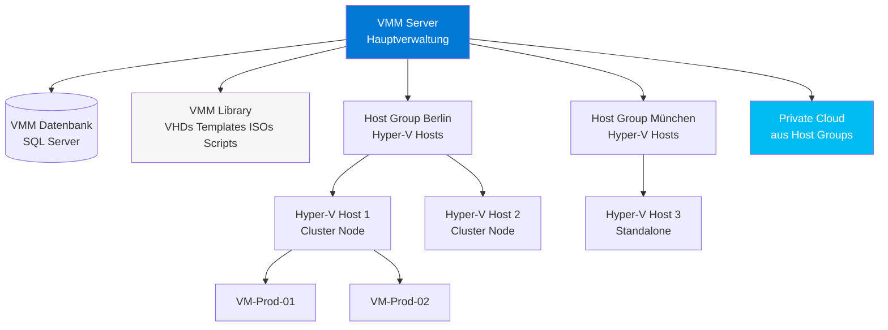
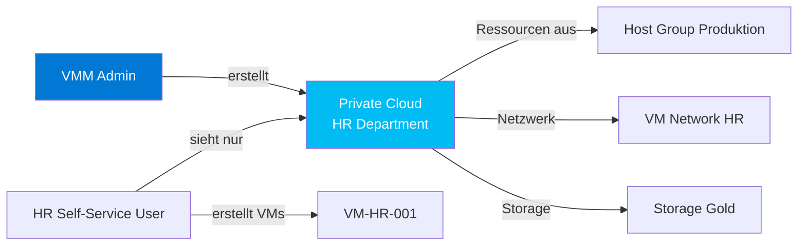
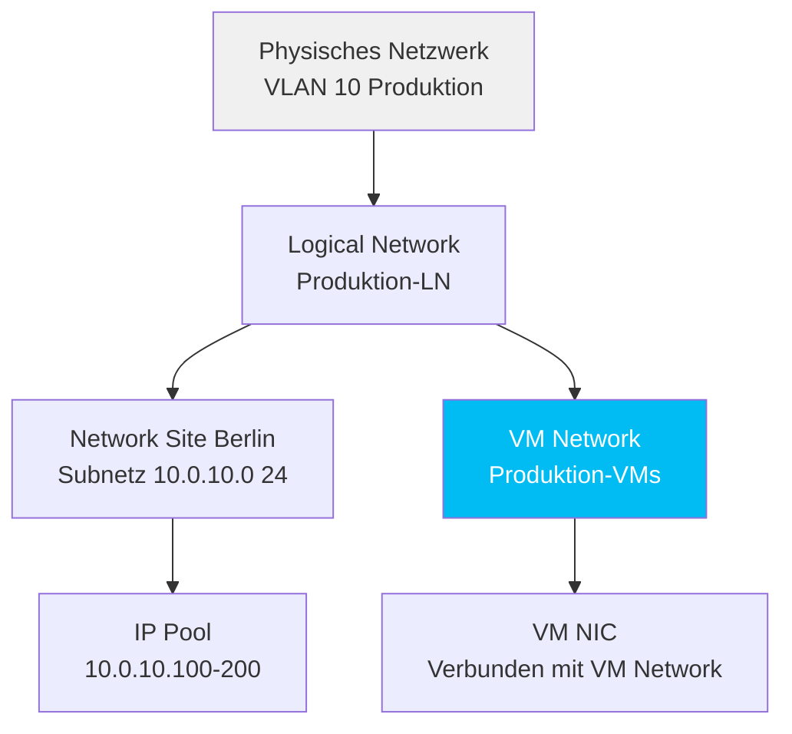
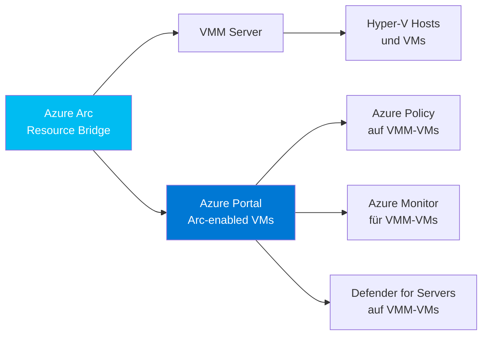

---
tags:
  - system-center
  - scvmm
  - virtualisierung
  - hyper-v
  - fabric
  - sdn
  - grundlagen
aliases:
  - System Center Virtual Machine Manager
  - Virtual Machine Manager
  - VMM
  - SCVMM 2022
---

# SCVMM Grundlagen

> [!ABSTRACT] TL;DR
> System Center Virtual Machine Manager (SCVMM) ist die zentrale Management-Plattform für Hyper-V-Umgebungen. SCVMM verwaltet Compute-Hosts, Logische Netzwerke, Storage und VMs über eine einheitliche Oberfläche. Private Clouds kapseln Ressourcen für Self-Service-Szenarien. SCVMM 2022 unterstützt Azure Stack HCI und Azure Arc-Integration.

---

## SCVMM-Überblick

SCVMM bietet eine zentrale Management-Oberfläche für Hyper-V-basierte Virtualisierungsumgebungen:

| Funktion | Beschreibung |
|---------|-------------|
| **Compute-Management** | Hyper-V Hosts und Cluster verwalten |
| **Netzwerk-Management** | Logical Networks, VM Networks, SDN |
| **Storage-Management** | SAN, SMB 3.0, Storage Pools |
| **Private Cloud** | Ressourcen-Pools für Self-Service |
| **VMM-Bibliothek** | Templates, VHDs, ISOs, Scripts |
| **Azure Arc-Integration** | VMM-verwaltete VMs in Azure registrieren |

| Version | Support | Hyper-V Unterstützung |
|---------|---------|----------------------|
| SCVMM 2016 | 2027 | Windows Server 2016 |
| SCVMM 2019 | 2029 | Windows Server 2019 |
| SCVMM 2022 | 2032 | Windows Server 2022, Azure Stack HCI |

---

## Architektur



### VMM-Komponenten

| Komponente | Funktion |
|-----------|---------|
| **VMM Server** | Hauptverwaltungsserver, enthält alle Services |
| **VMM Datenbank** | SQL Server — alle Konfigurations- und Zustandsdaten |
| **VMM Library** | Zentraler Speicher für VHDs, ISOs, Scripts, Templates |
| **VMM Agent** | Auf jedem Hyper-V Host installiert |
| **VMM Console** | Windows-Client für Admins |
| **REST API** | Für Automatisierung und Integration |

---

## Host Groups und Fabric

### Host Groups

Host Groups organisieren Hyper-V-Hosts hierarchisch:

```
All Hosts (Root)
├── Datacenter Berlin
│   ├── Produktion
│   │   ├── BER-HV-01 (Cluster Node)
│   │   └── BER-HV-02 (Cluster Node)
│   └── Test und Entwicklung
│       └── BER-HV-DEV-01
└── Datacenter München
    └── DR Standort
        └── MUC-HV-DR-01
```

- Richtlinien (Placement Rules, Netzwerkzuordnungen) können auf Host Group-Ebene gesetzt werden
- VMs werden gemäß Placement-Regeln auf passende Hosts verteilt

### Fabric-Komponenten

| Komponente | Beschreibung |
|-----------|-------------|
| **Compute** | Hyper-V Hosts und Failover Cluster |
| **Networking** | Logical Networks, VM Networks, IP-Pools |
| **Storage** | SAN (FC/iSCSI), SMB 3.0, Storage Classifications |
| **Library** | VHDs, ISOs, Service Templates, Scripts |

---

## Private Clouds

Eine Private Cloud kapselt Ressourcen für eine bestimmte Benutzergruppe oder Abteilung:



### Private Cloud Kapazitätsgrenzen

| Grenze | Beschreibung | Beispiel |
|--------|-------------|---------|
| **vCPU-Kerne** | Maximale virtuelle CPU-Kerne | 100 vCores |
| **RAM** | Maximaler RAM | 512 GB |
| **Storage** | Maximaler Storage-Verbrauch | 5 TB |
| **VMs** | Maximale VM-Anzahl | 50 VMs |
| **VM-Netzwerke** | Zugelassene Netzwerke | HR-VLAN, Management |

---

## VM-Templates und Profile

### Template-Hierarchie

| Objekt | Beschreibung | Enthält |
|--------|-------------|---------|
| **Hardware Profile** | Virtuelle Hardware-Konfiguration | vCPU, RAM, Netzwerkkarten, Festplatten |
| **Guest OS Profile** | Betriebssystem-Konfiguration | Domain Join, Admin-Konto, Produktschlüssel |
| **VM Template** | Vorlage für neue VMs | Hardware Profile + OS Profile + VHD |
| **Service Template** | Multi-Tier Dienste | Mehrere VM Templates mit Rollen |

### VM aus Template erstellen

```powershell
# VM aus Template erstellen
New-SCVirtualMachine `
  -Name "VM-Prod-Berlin-003" `
  -VMTemplate (Get-SCVMTemplate -Name "Win2022-Standard-Template") `
  -VMHost (Get-SCVMHost -ComputerName "BER-HV-01.contoso.com") `
  -Path "C:\ClusterStorage\Volume1\VMs" `
  -Description "Produktions-VM für SAP-Applikation"

# Alternativ: Cloud Deployment
New-SCVirtualMachine `
  -Name "VM-HR-001" `
  -VMTemplate (Get-SCVMTemplate -Name "Win2022-HR-Template") `
  -Cloud (Get-SCCloud -Name "Private Cloud HR")
```

---

## Logische Netzwerke und VM Networks

### Netzwerk-Abstraktions-Ebenen



| Konzept | Beschreibung | Beispiel |
|---------|-------------|---------|
| **Logical Network** | Abstrakte Netzwerk-Definition | "Produktion", "Management", "DMZ" |
| **Network Site** | IP-Subnetz-Zuordnung | 10.0.10.0/24 in Berlin |
| **IP-Pool** | Statische IP-Verwaltung | 10.0.10.100–200 für VMs |
| **VM Network** | VMs-sichtbares Netzwerk | Mappt auf Logical Network |

---

## Software Defined Networking (SDN)

SDN mit SCVMM ermöglicht netzwerkbasierte Virtualisierung ohne physische VLANs:

### SDN-Komponenten

| Komponente | Funktion | Windows Server Rolle |
|-----------|---------|---------------------|
| **Network Controller** | Zentrales SDN-Management | Windows Server 2016+ Rolle |
| **Software Load Balancer (SLB)** | Layer-4 Load Balancing | Hyper-V + SLB MUX |
| **RAS Gateway** | VPN-Gateway für Mandanten | Windows Server RAS |
| **HNV (Hyper-V Network Virtualization)** | VXLAN/NVGRE-Kapselung | Hyper-V Extension |

> [!NOTE] SDN-Voraussetzungen
> SDN mit SCVMM erfordert Windows Server 2016+ als Hyper-V Hosts, SCVMM 2016+ und Network Controller. SDN eignet sich hauptsächlich für Service Provider oder sehr große Unternehmen mit Multi-Tenant-Anforderungen.

---

## Storage-Management

### Unterstützte Storage-Typen

| Storage-Typ | Protokoll | Voraussetzung |
|------------|---------|--------------|
| **SAN - Fiber Channel** | FC | HBA, FC-Switch, LUN-Zuweisung |
| **SAN - iSCSI** | iSCSI | iSCSI Initiator, Netzwerk |
| **SMB 3.0** | SMB | Scale-Out File Server oder NAS |
| **Cluster Shared Volumes** | CSV (intern) | Failover Cluster |
| **Local Storage** | Lokal | Für non-clustered Hosts |

### Storage Classifications

Abstraktions-Layer für Storage:

```powershell
# Storage Classifications anzeigen
Get-SCStorageClassification | Format-Table Name, Description

# Beispiel-Classifications
# Gold = SSD-basiert, hohe Performance
# Silver = SAS HDD, mittlere Performance
# Bronze = NL-SAS, niedrige Performance, Archiv
```

---

## Azure Arc und Azure Stack HCI

### SCVMM und Azure Arc

Ab SCVMM 2022 Update Rollup 1 können VMM-verwaltete Ressourcen über Azure Arc in Azure registriert werden:



Mögliche Aktionen nach Arc-Enablement:
- Azure Policy auf VMM-verwaltete VMs anwenden
- Azure Monitor Agent (AMA) automatisch deployen
- Microsoft Defender for Servers für On-Premises VMs
- Azure Update Manager für Patch-Management

### Azure Stack HCI

SCVMM 2022 kann Azure Stack HCI-Cluster als Hyper-V Hosts verwalten:

| Aspekt | Azure Stack HCI mit SCVMM | Azure Stack HCI ohne SCVMM |
|--------|--------------------------|---------------------------|
| **Management-Tool** | SCVMM Konsole | Windows Admin Center + Azure Portal |
| **VM-Templates** | SCVMM Templates | Keine (manuell) |
| **Private Cloud** | Ja | Nein |
| **SDN** | Ja (vollständig) | Begrenzt |
| **Empfehlung** | Große bestehende SCVMM-Umgebungen | Neue HCI-Deployments |

---

## Wichtige PowerShell-Cmdlets

```powershell
# VMM-Verbindung herstellen
$VMMServer = Get-SCVMMServer -ComputerName "VMM01.contoso.com"

# Host Groups
Get-SCVMHostGroup | Format-Table Name, Description, Path

# Alle Hyper-V Hosts
Get-SCVMHost | Select-Object Name, OperatingSystem, OverallState | Format-Table

# Alle VMs
Get-SCVirtualMachine |
  Select-Object Name, Status, HostName, Cloud |
  Format-Table

# VM erstellen aus Template
New-SCVirtualMachine `
  -Name "VM-WEB-PROD-01" `
  -VMTemplate (Get-SCVMTemplate -Name "Win2022-IIS-Template") `
  -VMHost (Get-SCVMHost -ComputerName "BER-HV-01.contoso.com") `
  -Path "C:\ClusterStorage\Volume1"

# VM-Operationen
Start-SCVirtualMachine -VM (Get-SCVirtualMachine -Name "VM-WEB-PROD-01")
Stop-SCVirtualMachine -VM (Get-SCVirtualMachine -Name "VM-WEB-PROD-01") -Shutdown
Move-SCVirtualMachine `
  -VM (Get-SCVirtualMachine -Name "VM-WEB-PROD-01") `
  -VMHost (Get-SCVMHost -ComputerName "BER-HV-02.contoso.com")

# Logical Networks
Get-SCLogicalNetwork | Format-Table Name, Description
Get-SCVMNetwork | Format-Table Name, LogicalNetwork

# Private Cloud
Get-SCCloud | Format-Table Name, Description
Get-SCCloud -Name "Production Cloud" | Select-Object -ExpandProperty VMNetworks

# Storage
Get-SCStorageClassification | Format-Table Name, Description
Get-SCStoragePool | Format-Table Name, SizeMB, FreeSizeMB
```

---

## Verwandte Notizen

- [[SCOM Grundlagen]]
- [[DPM Grundlagen]]
- [[System Center Azure Migration]]
- [[Azure Stack HCI]]
- [[Arc-fähige Server]]
- [[Azure Arc Grundlagen]]
