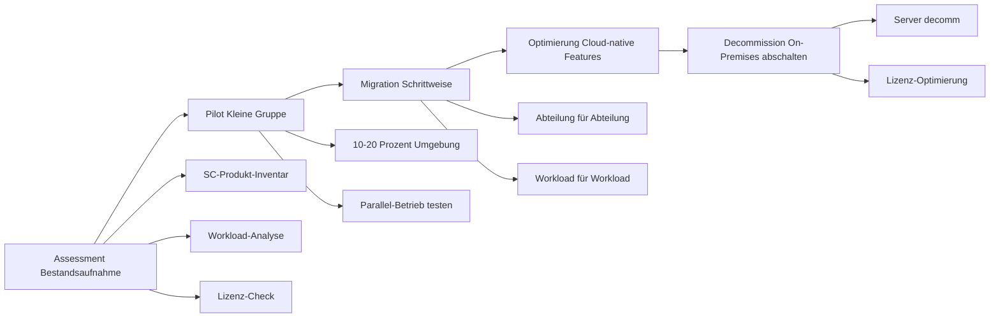
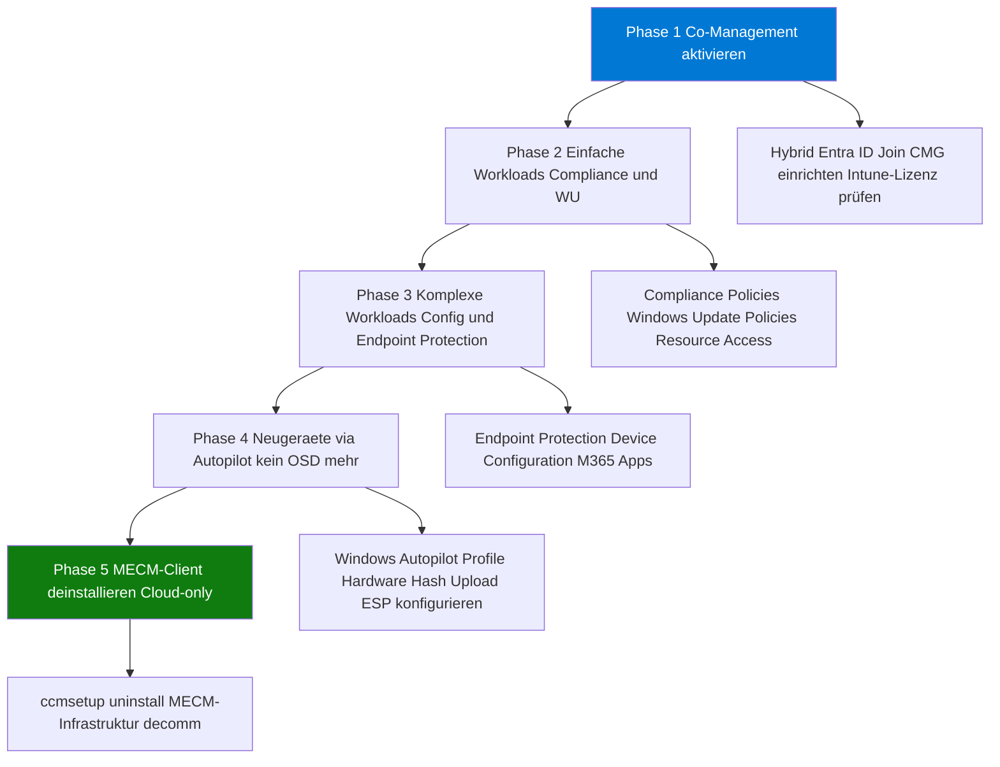
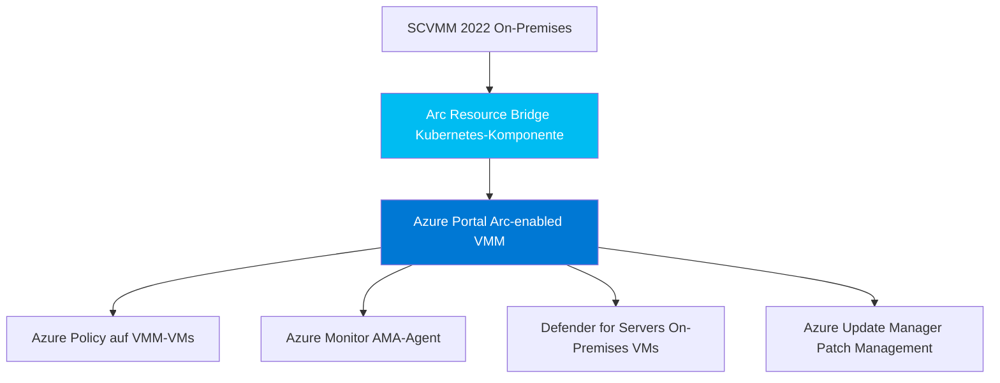
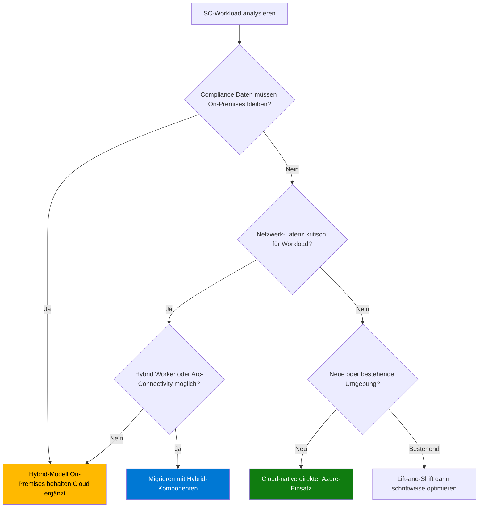

---
tags:
  - system-center
  - azure
  - migration
  - cloud
  - modernisierung
  - strategie
  - intune
  - azure-monitor
aliases:
  - SC zu Azure migrieren
  - System Center Migration
  - Cloud Migration System Center
  - SC Ablösung Azure
---

# System Center Azure Migration

> [!ABSTRACT] TL;DR
> Jedes System Center-Produkt hat ein Azure-Äquivalent oder einen klaren Migrationspfad. Die Migration erfolgt schrittweise: Assessment → Pilot → Migration → Decommission. Co-Management (MECM → Intune), SCOM MI und Azure Arc sind die wichtigsten Brückentechnologien für einen kontrollierten Übergang.

---

## Ablösungsstrategie: System Center → Azure

| SC-Produkt | Azure-Äquivalent | Migrationspfad | Empfehlung |
|-----------|----------------|---------------|-----------|
| **MECM/SCCM** | Microsoft Intune + Autopilot | Co-Management (Workload-Migration) | Schrittweise via Co-Management |
| **SCOM** | Azure Monitor + Log Analytics + Sentinel | SCOM MI als Zwischenstufe | SCOM MI → dann Azure Monitor |
| **SCVMM** | Azure Arc + Azure Stack HCI | Arc Resource Bridge für VMM | Arc-enabled VMM → Arc-Management |
| **DPM/MABS** | Azure Backup (Recovery Services Vault) | Parallel-Betrieb → ablösen | Azure Backup für Cloud-Workloads |
| **Orchestrator** | Azure Automation + Logic Apps + Power Automate | Runbook-für-Runbook-Migration | Neue Runbooks in Azure Automation |
| **SCSM** | Microsoft 365 Ticketing / ServiceNow | Kein direktes Äquivalent | Evaluation erforderlich |

> [!NOTE] System Center bleibt für On-Premises relevant
> System Center wird weiterhin entwickelt und unterstützt (LTSC-Releases alle 3 Jahre). Eine sofortige vollständige Migration ist selten notwendig oder sinnvoll. Hybride Szenarien mit schrittweiser Migration sind der empfohlene Weg.

---

## Migrationsphasen Überblick



### Phasen-Details

| Phase | Typische Dauer | Aktivitäten |
|-------|--------------|------------|
| **Assessment** | 4–8 Wochen | Inventar, Abhängigkeiten, Lizenz-Check, Kostenbewertung |
| **Pilot** | 8–16 Wochen | 10–20% der Workloads, Parallel-Betrieb, Monitoring |
| **Migration** | 6–24 Monate | Produktiv-Migration, Abteilung für Abteilung |
| **Optimierung** | Ongoing | Cloud-native Features nutzen, Kosten optimieren |
| **Decommission** | 4–8 Wochen | On-Premises-Server abschalten, Lizenzen anpassen |

---

## MECM → Intune/Autopilot

### Migrations-Phasendiagramm



### Voraussetzungen für Intune-Migration

| Voraussetzung | Beschreibung | Prüfung |
|-------------|-------------|--------|
| **Intune-Lizenz** | EMS E3/E5, M365 E3/E5, Business Premium | Lizenz-Portal |
| **Hybrid Entra ID Join** | Geräte in AD und Entra ID | `dsregcmd /status` |
| **CMG** | Für Internet-Clients | MECM Console → CMG |
| **Autopilot** | Hardware Hash bei Microsoft registriert | MECM OA-Report oder Autopilot-Upload |

---

## SCOM → Azure Monitor Migration

### SCOM-Konzept zu Azure Monitor Äquivalent

| SCOM-Konzept | Azure Monitor Äquivalent |
|-------------|------------------------|
| **Management Pack** | Azure Monitor Insights + Monitoring Solutions |
| **Alert** | Azure Monitor Alert Rule |
| **Performance Counter** | Azure Metrics + Log Analytics Queries |
| **Event-based Rule** | Log Analytics Alert Rule |
| **Maintenance Mode** | Azure Monitor Planned Maintenance |
| **SSRS Reporting** | Azure Monitor Workbooks |
| **Operations Console** | Azure Portal (Monitor) |
| **Gateway Server** | Azure Arc für On-Premises (kein direktes Äquivalent) |
| **Distributed Application** | Application Insights (für Apps) |

### Migrationsstrategie


**Phase 1 – SCOM MI (Zwischenstufe):**
- SCOM Managed Instance in Azure deployen
- Bestehende Management Packs vollständig kompatibel
- On-Premises-Agents weiterhin nutzbar (über VPN/ExpressRoute)
- Keine Infrastruktur mehr selbst verwalten

**Phase 2 – Azure Monitor Agent:**
- AMA (Azure Monitor Agent) auf alle Systeme deployen
- Data Collection Rules (DCR) definieren
- Logs in Log Analytics Workspace sammeln

**Phase 3 – Azure Monitor Insights nutzen:**
- VM Insights für Server-Monitoring
- Container Insights für Kubernetes
- Application Insights für Anwendungen
- Network Watcher für Netzwerk

---

## SCVMM → Azure Arc Migration

### Arc-Enablement für VMM



### Schritte zur Arc-Enablement

| Schritt | Aktion | Voraussetzung |
|---------|--------|--------------|
| 1 | Azure Arc Resource Bridge deployen | SCVMM 2022 UR1+, Azure Subscription |
| 2 | VMM-Hosts und VMs bei Arc registrieren | Resource Bridge aktiv |
| 3 | Azure Policy zuweisen | Arc-enabled VMs |
| 4 | Azure Monitor Agent deployen | Arc-Verbindung |
| 5 | Defender for Servers aktivieren | Defender for Cloud Plan 2 |

### Langfristig: Azure Stack HCI

Für neue Hyper-V-Infrastruktur ist **Azure Stack HCI** die strategische Plattform:

| Aspekt | Hyper-V + SCVMM | Azure Stack HCI |
|--------|----------------|----------------|
| **Management** | SCVMM + Windows Admin Center | Azure Portal + Windows Admin Center |
| **Updates** | SCVMM / WSUS | Azure Update Manager |
| **Billing** | CapEx | Hybrid (CapEx Hardware + OpEx Azure) |
| **Azure-Integration** | Via Arc (nachträglich) | Nativ von Anfang an |
| **Empfehlung** | Bestehende Investitionen | Neue Hardware-Käufe |

---

## DPM/MABS → Azure Backup

### Backup-Migration

| DPM-Konzept | Azure Backup Äquivalent |
|------------|------------------------|
| **Storage Pool** | Recovery Services Vault |
| **Protection Group** | Backup Policy |
| **Recovery Point** | Restore Point |
| **DPM Agent** | Azure Backup Extension / MARS Agent |
| **MABS** | Azure Backup Server (weiterhin nutzbar) |
| **Online Backup** | Recovery Services Vault |

### Migrations-Szenarios

**Azure VMs:** Direkt Azure Backup verwenden — kein DPM-Umweg nötig:

```powershell
# Azure VM Backup aktivieren
$vault = Get-AzRecoveryServicesVault -Name "rsv-contoso-prod"
Set-AzRecoveryServicesVaultContext -Vault $vault

$policy = Get-AzRecoveryServicesBackupProtectionPolicy -Name "DefaultPolicy"
Enable-AzRecoveryServicesBackupProtection `
  -ResourceGroupName "rg-prod" `
  -Name "VM-WEB-PROD-01" `
  -Policy $policy
```

**On-Premises Server:** MARS Agent für Dateien, MABS für komplexe Workloads:

```powershell
# Recovery Services Vault erstellen
az backup vault create \
  --resource-group "rg-backup" \
  --name "rsv-contoso-backup" \
  --location "westeurope"

# MABS/DPM im Vault registrieren (via DPM/MABS Konsole)
# Protection → Online → Register to Vault
```

---

## Orchestrator → Azure Automation / Logic Apps

### Migrations-Mapping

| SC Orchestrator | Azure-Äquivalent | Wann |
|----------------|-----------------|------|
| **Einfache PS-Runbooks** | Azure Automation Runbook | Zuerst migrieren |
| **Komplexe IT-Orchestrierung** | Azure Automation + Hybrid Worker | Für On-Premises-Zugriff |
| **Business-Prozesse** | Power Automate | Abteilungsübergreifend |
| **Komplexe Integrationen** | Logic Apps (Standard) | Viele Connectors nötig |
| **Monitor Activities** | Azure Automation Webhook / Event Grid | Event-getrieben |

### Hybrid Worker für On-Premises

Azure Automation Hybrid Worker ermöglicht die Ausführung von Runbooks auf On-Premises-Servern:

```powershell
# Hybrid Worker Group erstellen
New-AzAutomationHybridRunbookWorkerGroup `
  -AutomationAccountName "aa-contoso-prod" `
  -ResourceGroupName "rg-automation" `
  -Name "On-Premises-Workers"

# Hybrid Worker registrieren (auf dem On-Premises Server)
Add-HybridRunbookWorker `
  -Url "https://xxxx.agentsvc.azure-automation.net/accounts/xxxx" `
  -Key "PrimaryKey..." `
  -GroupName "On-Premises-Workers"
```

---

## Entscheidungsbaum: On-Premises behalten vs. migrieren



---

## Lizenz-Optimierung bei Migration

| Szenario | Empfehlung |
|---------|-----------|
| **Windows Server in Azure** | Azure Hybrid Benefit (AHUB) nutzen — spart bis 40% |
| **SQL Server in Azure** | AHUB + Reserved Instances |
| **Client-Management (Intune)** | Microsoft 365 E3/E5 enthält Intune |
| **Backup (Azure Backup)** | Nur für tatsächlich genutzte Storage zahlen |
| **Monitoring (Azure Monitor)** | Log Analytics Pay-per-GB |
| **SC Suite weiternutzen** | LTSC-Lizenz bis 2032 (SCVMM/DPM 2022) |

> [!IMPORTANT] System Center Lizenz-Übertragbarkeit
> System Center 2022-Lizenzen gelten bis **Oktober 2032** (Mainstream Support). Eine vorzeitige Migration ist keine Pflicht. Hybride Szenarien ermöglichen eine schrittweise Migration ohne Lizenzverschwendung.

---

## Monitoring der Migration

Während der Migration sollten beide Systeme parallel überwacht werden:

```powershell
# Gerät-Co-Management-Status in MECM prüfen
Get-CMDevice -CollectionName "All Co-managed Devices" |
  Select-Object Name, IsCoManaged |
  Format-Table

# Intune-Enrollment-Status per Graph API
$headers = @{ "Authorization" = "Bearer $token" }
Invoke-RestMethod `
  -Uri "https://graph.microsoft.com/v1.0/deviceManagement/managedDevices" `
  -Headers $headers |
  Select-Object -ExpandProperty value |
  Select-Object deviceName, managementAgent, complianceState |
  Format-Table
```

---

## Via Azure Portal (UI)

### Azure Migrate-Projekt erstellen

1. Öffne das **Azure Portal** (`portal.azure.com`)
2. Suche nach **Azure Migrate** und öffne den Dienst
3. Klicke auf **Projekt erstellen**
4. Im Assistenten:
   - **Abonnement & Ressourcengruppe:** Ziel-Ressourcengruppe auswählen oder neu erstellen
   - **Projektname:** Eindeutigen Namen vergeben (z.B. `SCVMM-Migration-2025`)
   - **Region:** Azure-Region für Migrationsmetadaten auswählen
5. Klicke auf **Erstellen**

### On-Premises-Server ermitteln (Discovery)

1. Navigiere im Migrate-Projekt zu **Server, Datenbanken und Web-Apps**
2. Klicke auf **Entdecken** im Abschnitt **Azure Migrate: Ermittlung und Bewertung**
3. Wähle den Virtualisierungstyp:
   - **Hyper-V** für SCVMM-Umgebungen
   - **VMware vSphere** für VMware-Umgebungen
   - **Physische oder andere Server** für Bare-Metal
4. Lade die **Azure Migrate-Appliance** (OVA / VHD) herunter und deploye sie On-Premises
5. Registriere die Appliance im Portal mit dem generierten **Projektschlüssel**
6. Starte die Discovery — nach 24 h sind Serverinventare und Abhängigkeiten verfügbar

### Bewertung erstellen und Migrationsplan ableiten

1. Navigiere zu **Bewertungstools → Bewertungen erstellen**
2. Wähle den Bewertungstyp:
   - **Azure VM** für Lift & Shift
   - **Azure VMware Solution** für VMware-Migration
   - **Azure SQL** für SQL Server-Migrationen
3. Konfiguriere Bewertungseinstellungen:
   - **Zielregion**, **Reservierungstyp** (Pay-as-you-go / 1-Jahr / 3-Jahr)
   - **VM-Größenkriterien** (leistungsbasiert oder lokal)
   - **Azure Hybrid Benefit** für Windows Server / SQL Server Lizenzen
4. Wähle die ermittelten Server aus und klicke auf **Bewertung erstellen**
5. Öffne den Bewertungsbericht für Kosten- und Bereitschaftsanalyse

> [!TIP] Kostenschätzung nutzen
> Die Bewertung zeigt **monatliche Azure-Kosten** und die **Azure-Bereitschaft** jedes Servers — nutze diese Daten als Entscheidungsgrundlage, welche Workloads migriert, modernisiert oder on-premises behalten werden sollen.

### Migration durchführen (Replikation und Failover)

1. Navigiere zu **Azure Migrate: Servermigration → Replizieren**
2. Wähle die zu migrierenden VMs aus
3. Konfiguriere Replikationseinstellungen:
   - **Zielressourcengruppe**, **Virtuelles Netzwerk**, **Verfügbarkeitsoption**
4. Starte die **Replikation** und überwache den Fortschritt
5. Klicke nach Abschluss auf **Testmigration** für einen unterbrechungsfreien Test
6. Nach erfolgreichen Tests: **Migration** durchführen und On-Premises-VMs abschalten

---

## Verwandte Notizen

- [[MECM SCCM Grundlagen]]
- [[MECM Co-Management]]
- [[SCOM Grundlagen]]
- [[SCVMM Grundlagen]]
- [[DPM Grundlagen]]
- [[System Center Orchestrator]]
- [[Intune Grundlagen]]
- [[Azure Monitor Grundlagen]]
- [[Log Analytics Workspace]]
- [[Azure Backup]]
- [[Azure Automation]]
- [[Azure Arc Grundlagen]]
- [[Arc-fähige Server]]
- [[Windows Autopilot]]
