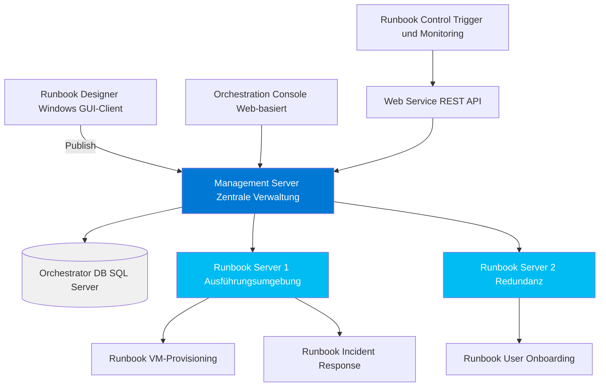
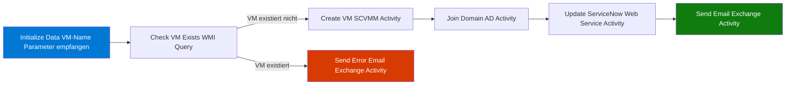

---
tags:
  - system-center
  - orchestrator
  - automatisierung
  - runbooks
  - integration
  - itil
aliases:
  - SCOrch
  - System Center Orchestrator
  - SCORCH
  - Runbook Automation
  - Opalis
---

# System Center Orchestrator

> [!ABSTRACT] TL;DR
> System Center Orchestrator (SCOrch) ist die IT-Automatisierungsplattform der System Center Suite. Runbooks — grafisch erstellte Workflows im Runbook Designer — automatisieren IT-Prozesse von VM-Provisioning bis Incident-Response. Integration Packs (IPs) verbinden Orchestrator mit allen System Center-Produkten, Microsoft-Diensten und Drittanbieter-Tools.

---

## Orchestrator-Überblick

Orchestrator ermöglicht die Automatisierung von IT-Prozessen ohne Programmierung — durch grafische Runbook-Erstellung:

| Merkmal | Beschreibung |
|---------|-------------|
| **Aktuelle Version** | System Center 2022 Orchestrator |
| **Früherer Name** | Opalis Software (vor Microsoft-Übernahme 2009) |
| **Hauptfunktion** | Workflow-Automatisierung für IT-Operationen |
| **Zielgruppe** | IT-Admins, Service Desk, Operations-Teams |
| **ITIL-Prozesse** | Incident, Change, Problem, Service Request |

---

## Architektur



### Komponenten im Detail

| Komponente | Funktion | Installation |
|-----------|---------|-------------|
| **Management Server** | Koordination, Runbook-Speicherung, Scheduling | Pflicht |
| **Orchestrator DB** | SQL Server — alle Runbooks, Logs, Konfiguration | Pflicht (SQL Server) |
| **Runbook Server** | Ausführungsumgebung für Runbooks | Pflicht (kann verteilt sein) |
| **Runbook Designer** | Windows-Client für Runbook-Erstellung | Auf Admin-Workstations |
| **Orchestration Console** | Web-Browser-Interface für Monitoring und Ausführung | Optional |
| **Web Service** | REST API für externe Integration | Optional |

---

## Runbook-Grundlagen

Ein Runbook ist ein grafischer Workflow aus **Activities** (Aktionen) verbunden durch **Links** (Bedingungen).

### Runbook-Typen

| Typ | Beschreibung | Trigger |
|-----|-------------|---------|
| **Normal** | Standard-Workflow mit Start und Ende | Manuell, Schedule, API, anderes Runbook |
| **Monitor** | Wartet auf Ereignis, dann triggert anderes Runbook | Event (Datei, WMI, Datenbank) |
| **Initialize Data** | Nimmt Eingabe-Parameter entgegen | Wird von anderen Runbooks aufgerufen |

### Runbook-Beispiel: VM erstellen



---

## Activity-Typen

### Standard Activities (eingebaut)

| Activity | Funktion |
|---------|---------|
| **Initialize Data** | Eingabe-Parameter empfangen |
| **Return Data** | Werte an aufrufendes Runbook zurückgeben |
| **Run .NET Script** | PowerShell, VBScript, JScript ausführen |
| **Read Line** | Datei lesen |
| **Append Line** | In Datei schreiben |
| **Query Database** | SQL-Abfrage ausführen |
| **Run Program** | Externes Programm starten |
| **Send Platform Event** | SCOM-Ereignis erzeugen |

### Spezial-Activities

| Activity | Funktion |
|---------|---------|
| **Junction** | Mehrere parallele Branches zusammenführen (wartet auf alle) |
| **Monitor Date/Time** | Warten auf bestimmten Zeitpunkt |
| **Monitor WMI** | Auf WMI-Ereignis warten |
| **Monitor File** | Auf Datei-Änderung warten |
| **Invoke Web Service** | HTTP GET/POST/PUT/DELETE |

---

## Links und Bedingungen

Links verbinden Activities und können Bedingungen enthalten:

| Link-Farbe | Bedeutung | Wann ausgeführt |
|-----------|-----------|----------------|
| **Grau (Standard)** | Immer | Nach jeder vorherigen Activity |
| **Gelb** | Erfolg | Wenn vorherige Activity erfolgreich |
| **Rot** | Fehler | Wenn vorherige Activity fehlschlägt |

### Smart Links (Bedingungen)

```
Bedingung: {Previous Activity Output: Status} gleich "Success"
→ Führt aus: Nächste Activity

Bedingung: {Read Line: Line Text} enthält "ERROR"
→ Führt aus: Fehler-Behandlung Activity
```

### Published Data

Jede Activity veröffentlicht Ausgabedaten (Published Data), die nachfolgende Activities als Input nutzen können:

```
[Create VM] → Published Data: {VM Name}, {VM ID}, {Host Name}
    ↓
[Join Domain] → Nutzt: {VM Name} aus vorheriger Activity
    ↓
[Send Email] → Nutzt: {VM Name}, {Host Name} im E-Mail-Text
```

---

## Integration Packs (IPs)

Integration Packs fügen workload-spezifische Activities hinzu:

### Microsoft Integration Packs

| Integration Pack | Verbindet mit | Beispiel-Activities |
|----------------|--------------|-------------------|
| **SC Configuration Manager** | MECM/SCCM | Deploy Application, Run Advertisement |
| **SC Operations Manager** | SCOM | Create Alert, Close Alert, Set Maintenance Mode |
| **SC Virtual Machine Manager** | SCVMM | Create VM, Move VM, Start/Stop VM |
| **SC Service Manager** | SCSM | Create Incident, Update Work Item |
| **Active Directory** | Active Directory | Create User, Add to Group, Reset Password |
| **Azure** | Microsoft Azure | Start/Stop VM, Create Resource Group |
| **Exchange** | Exchange Server | Send Email, Create Mailbox |
| **SharePoint** | SharePoint | Create List Item, Update Item |
| **FTP** | FTP-Server | Upload/Download Dateien |

### Drittanbieter Integration Packs

| Integration Pack | Hersteller |
|----------------|-----------|
| **ServiceNow** | ServiceNow |
| **Citrix XenApp** | Citrix |
| **HP Operations Manager** | HPE |
| **VMware vSphere** | VMware |

---

## Web Service Activity und REST-API-Aufrufe

### Invoke Web Service Activity

Die Activity ermöglicht HTTP-Aufrufe direkt in Runbooks:

```http
POST https://servicenow.contoso.com/api/now/table/incident
Authorization: Basic dXNlcjpwYXNz
Content-Type: application/json

{
  "short_description": "Automatisch erstellt: {VM Name} Provisioning fehlgeschlagen",
  "category": "Infrastructure",
  "priority": "2"
}
```

### Orchestrator REST API

Orchestrator selbst bietet eine REST API zum Triggern von Runbooks:

```powershell
# Runbook via REST API starten
$headers = @{
    "Authorization" = "Basic " + [Convert]::ToBase64String([Text.Encoding]::ASCII.GetBytes("user:password"))
    "Content-Type" = "application/json"
}

$body = @{
    Parameters = @(
        @{ Name = "VMName"; Value = "VM-TEST-001" }
        @{ Name = "Collection"; Value = "Test Collection" }
    )
} | ConvertTo-Json -Depth 3

Invoke-RestMethod `
  -Uri "http://ORCH01:81/Orchestrator2012/Orchestrator.svc/Runbooks(guid'<RunbookID>')/Start" `
  -Method POST `
  -Headers $headers `
  -Body $body
```

---

## PowerShell-Integration

### Run .NET Script Activity (PowerShell)

```powershell
# PowerShell-Script innerhalb einer Run .NET Script Activity
# Eingabe-Parameter kommen als $ActivityInput["ParameterName"]
$vmName = $ActivityInput["VMName"]
$collection = $ActivityInput["CollectionName"]

# Aktion ausführen
$result = Invoke-Command -ComputerName "MECM01.contoso.com" -ScriptBlock {
    param($vm, $coll)
    Import-Module ConfigurationManager
    Set-Location "P01:"
    $device = Get-CMDevice -Name $vm
    Add-CMDeviceCollectionDirectMembershipRule `
      -CollectionName $coll `
      -ResourceId $device.ResourceId
    return "Success"
} -ArgumentList $vmName, $collection

# Ausgabe für nachfolgende Activities
$ActivityOutput["Result"] = $result
$ActivityOutput["VMName"] = $vmName
```

---

## Vergleich: SCOrch vs. Azure Automation vs. Power Automate

| Merkmal | SC Orchestrator | Azure Automation | Power Automate |
|---------|---------------|-----------------|---------------|
| **Deployment** | On-Premises | Azure Cloud | Cloud (SaaS) |
| **Entwicklung** | Grafisch (Runbook Designer) | PowerShell / Python Code | Low-Code / No-Code |
| **Trigger** | Event, Schedule, API | Schedule, Webhook, Event Grid | Event, Schedule, manuell |
| **Legacy-Integration** | Sehr gut (viele IPs) | Gut (Module) | Gut (Connectors) |
| **Azure-Integration** | Begrenzt (IP erforderlich) | Nativ | Nativ |
| **Zielgruppe** | IT-Admins (Ops) | IT-Admins / DevOps | Business-User |
| **Lizenz** | System Center-Lizenz | Azure Verbrauch | Power Automate Lizenz |
| **Empfehlung** | Bestehende On-Premises | Neue Cloud-Deployments | Business-Prozesse |

> [!TIP] Wann SC Orchestrator behalten?
> SCOrch ist sinnvoll wenn viele bestehende Runbooks und Integration Packs vorhanden sind und eine On-Premises-Automatisierungsplattform benötigt wird. Für neue Automatisierungen sollte **Azure Automation** oder **Power Automate** evaluiert werden.

---

## Monitoring und Troubleshooting

### Orchestration Console

- Browser-basiertes Interface für Runbook-Monitoring
- Zeigt laufende, abgeschlossene und fehlgeschlagene Jobs
- Runbook-Instanz-Details: Jeder Schritt, Status, Daten

### Runbook Tester

- Schritt-für-Schritt Debugging im Runbook Designer
- Zeigt Published Data nach jedem Schritt
- Simuliert Ausführung ohne produktive Auswirkung

### Log-Quellen

| Log-Quelle | Inhalt |
|-----------|--------|
| **Orchestrator DB** | Alle Job-Ausführungen, Published Data |
| **Windows Event Log** | Orchestrator Service-Ereignisse |
| **Orchestration Console** | Web-basiertes Job-Monitoring |

---

## Verwandte Notizen

- [[MECM SCCM Grundlagen]]
- [[SCOM Grundlagen]]
- [[SCVMM Grundlagen]]
- [[Azure Automation]]
- [[System Center Azure Migration]]
