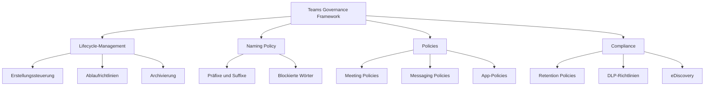
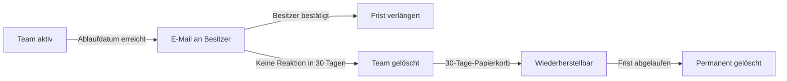

---
tags:
  - microsoft365
  - teams
  - governance
  - policies
  - compliance
aliases:
  - Teams Governance
  - Teams Policies
---

# Governance und Policies

> [!ABSTRACT] TL;DR
> Teams Governance umfasst alle Maßnahmen zur kontrollierten Verwaltung des Teams-Lebenszyklus: von der Team-Erstellung über Nutzungsrichtlinien bis zur Archivierung. Policies steuern das Verhalten in Meetings, Messaging, Apps und Telefonie. Eine durchdachte Governance verhindert Teams-Sprawl, sichert Compliance und reduziert administrativen Aufwand.

---

## Warum Governance?

Ohne Governance entstehen typische Probleme in gewachsenen Teams-Umgebungen:

- **Teams-Sprawl**: Hunderte verwaiste, inaktive Teams ohne Besitzer
- **Unkontrollierte Gasteinladungen**: Externe Benutzer mit Zugriff auf sensible Daten
- **Inkonsistente Benennung**: Teams mit kryptischen oder doppelten Namen
- **Datenschutzlücken**: Fehlende Retention Policies, keine Sensitivity Labels
- **Compliance-Risiken**: Fehlende eDiscovery-Fähigkeit, unzureichende Datenaufbewahrung



---

## Teams-Lifecycle-Management

### Phase 1 — Erstellung

Standardmäßig kann **jeder lizenzierte Benutzer** Teams erstellen. Dies lässt sich einschränken:

**Option A — Erstellung einschränken per Entra ID-Sicherheitsgruppe:**
1. Entra ID → Gruppen → Allgemein → Benutzer, die Sicherheitsgruppen erstellen können
2. Eine Sicherheitsgruppe `Teams-Ersteller` erstellen
3. Microsoft Graph oder PowerShell: `GroupCreationAllowedGroupId` auf diese Gruppe setzen

```powershell
# Teams-Erstellung auf Sicherheitsgruppe einschränken (Entra ID)
Install-Module AzureADPreview
$setting = Get-AzureADDirectorySetting | Where-Object { $_.DisplayName -eq "Group.Unified" }
$setting["EnableGroupCreation"] = "false"
$setting["GroupCreationAllowedGroupId"] = "<Objekt-ID der Sicherheitsgruppe>"
Set-AzureADDirectorySetting -Id $setting.Id -DirectorySetting $setting
```

> [!IMPORTANT] Einschränkung betrifft alle M365-Gruppen
> Die Einschränkung der Gruppen-Erstellung in Entra ID betrifft **alle Microsoft 365-Gruppen** — also auch Teams, SharePoint-Gruppen-Sites und Yammer-Communities. Nur zugelassene Sicherheitsgruppen-Mitglieder können dann noch Teams erstellen.

### Phase 2 — Nutzung

Aktive Teams werden durch **Policies** gesteuert (Meeting, Messaging, App Policies). Regelmäßige Überprüfungen über **Teams Activity Reports** helfen, inaktive Teams zu identifizieren.

### Phase 3 — Ablauf und Bereinigung

**M365 Groups Expiration Policy** (konfiguriert in Entra ID):



**Konfiguration in Entra ID:**
Entra ID → Gruppen → Ablauf → Lebensdauer: 180 / 365 Tage (oder benutzerdefiniert)

| Ablaufzeitraum | Benachrichtigungen | Empfehlung |
|---|---|---|
| 30 Tage | 30, 15, 1 Tag vor Ablauf | Kurze Projekte |
| 90 Tage | 30, 15, 1 Tag vor Ablauf | Standard |
| 180 Tage | 30, 15, 1 Tag vor Ablauf | Abteilungen |
| 365 Tage | 30, 15, 1 Tag vor Ablauf | Dauerhaft genutzte Teams |

> [!NOTE] Automatische Verlängerung bei Aktivität
> Microsoft 365 verlängert den Ablauf automatisch, wenn ein Team **aktiv genutzt** wird (Nachrichten, Meetings, Dateiuploads). Nur wirklich inaktive Teams erhalten die Ablaufbenachrichtigung.

### Phase 4 — Archivierung

Archivierung setzt ein Team auf **schreibgeschützt**, ohne Daten zu löschen.
Teams Admin Center → Teams verwalten → Team auswählen → Archivieren

---

## Naming Policy

Eine Naming Policy erzwingt konsistente Team-Namen und verhindert unerwünschte Bezeichnungen.

**Konfiguration:** Entra ID → Gruppen → Benennungsrichtlinie

### Präfixe und Suffixe

| Typ | Beispiel | Ergebnis |
|---|---|---|
| Statisches Präfix | `DEPT-` | `DEPT-Projektteam Alpha` |
| Attributbasiertes Präfix | `[Department]-` | `IT-Projektteam Alpha` |
| Statisches Suffix | `-Intern` | `Projektteam Alpha-Intern` |
| Statisches Suffix | `-2024` | `Projektteam Alpha-2024` |

### Blockierte Wörter

Bestimmte Wörter können in Team-Namen verboten werden (z.B. `CEO`, `Board`, `HR-Vertraulich`).

> [!NOTE] Naming Policy Einschränkungen
> Die Naming Policy gilt für **Endbenutzer**, nicht für Administratoren (Global Admin, User Admin). Admins können Teams mit beliebigem Namen erstellen. Präfixe und Suffixe werden im UI angezeigt, sind aber für den Benutzer unveränderlich.

---

## Teams Policies

Policies steuern das Verhalten einzelner Benutzer oder Gruppen in Teams. Jede Policy existiert als **Global-Richtlinie (org-wide default)** und kann durch benutzerspezifische Richtlinien überschrieben werden.

### Meeting Policies

**Konfiguration:** Teams Admin Center → Meetings → Meeting-Richtlinien

| Policy-Einstellung | Mögliche Werte | Beschreibung |
|---|---|---|
| **Audio & Video** | Ein/Aus pro Typ | Mikrofon/Kamera erlauben |
| **Aufzeichnung** | Organisator, Teilnehmer, Deaktiviert | Wer darf aufzeichnen? |
| **Automatisch aufzeichnen** | Ein/Aus | Meetings automatisch starten |
| **Transkription** | Ein/Aus | Live-Untertitel und Transkript |
| **Lobby-Einstellung** | Jeder, nur Org, nur Eingeladene | Wer wartet im Lobby? |
| **Content Sharing** | Vollständig, Eingeschränkt | Bildschirmfreigabe |
| **Whiteboard** | Ein/Aus | Microsoft Whiteboard in Meetings |
| **PowerPoint Live** | Ein/Aus | Interaktive Präsentation |
| **Externe Teilnehmer** | Erlaubt/Gesperrt | Gäste und Externe |

### Messaging Policies

**Konfiguration:** Teams Admin Center → Messaging → Messaging-Richtlinien

| Policy-Einstellung | Beschreibung |
|---|---|
| **Nachrichten bearbeiten** | Ob und wie lange Nachrichten bearbeitet werden dürfen |
| **Nachrichten löschen** | Eigene Nachrichten löschen |
| **Giphy** | Inhaltsbewertung: Streng/Moderat/Keine Einschränkung |
| **Memes/Sticker** | Aktivieren/Deaktivieren |
| **Priority Notifications** | Dringende Nachrichten mit wiederholter Benachrichtigung |
| **Voice Messages** | Sprachnachrichten senden/empfangen |
| **Externe Chats initiieren** | Kommunikation mit externen Tenants |
| **Read Receipts** | Lesebestätigungen aktivieren |

### App-Berechtigungsrichtlinien

Steuern, welche Apps Benutzer in Teams verwenden dürfen.

**Konfiguration:** Teams Admin Center → Apps → Berechtigungsrichtlinien

| App-Kategorie | Optionen |
|---|---|
| **Microsoft-Apps** | Alle zulassen, Bestimmte erlauben, Alle blockieren |
| **Drittanbieter-Apps** | Alle zulassen, Bestimmte erlauben, Alle blockieren |
| **Benutzerdefinierte Apps** | Alle zulassen, Bestimmte erlauben, Alle blockieren |

### Calling Policies

Steuern Anruf-Funktionen für Benutzer.

**Konfiguration:** Teams Admin Center → Sprache → Anrufrichtlinien

Wichtige Einstellungen: Private Anrufe, Anrufweiterleitung, Gleichzeitiges Klingeln, Voicemail, Anruf parken, PSTN-Anrufe.

---

## Policy-Zuweisung

Policies können zugewiesen werden an:
- **Einzelne Benutzer** (direkt)
- **Gruppen** (via Entra-ID-Sicherheitsgruppen)
- **Org-wide Default** (für alle ohne direkte Zuweisung)
- **Batch-Zuweisung** (per PowerShell für viele Benutzer)

```powershell
# Policy einzelnem Benutzer zuweisen
Grant-CsTeamsMeetingPolicy -Identity "user@contoso.com" -PolicyName "Executives-MeetingPolicy"

# Policy einer Gruppe zuweisen (empfohlen für große Rollouts)
New-CsGroupPolicyAssignment -GroupId "<Gruppe-ID>" `
    -PolicyType TeamsMeetingPolicy `
    -PolicyName "Executives-MeetingPolicy" `
    -Rank 1

# Aktuelle Policy-Zuweisung eines Benutzers prüfen
Get-CsUserPolicyAssignment -Identity "user@contoso.com" -PolicyType TeamsMeetingPolicy

# Bulk: Policy vielen Benutzern zuweisen
$users = Get-CsOnlineUser -Filter {Department -eq "Sales"}
foreach ($user in $users) {
    Grant-CsTeamsMessagingPolicy -Identity $user.UserPrincipalName -PolicyName "Sales-Messaging"
}
```

---

## Policy-Pakete

Policy-Pakete bündeln mehrere vordefinierte Policies für spezifische Benutzergruppen.

| Paket | Zielgruppe | Enthaltene Policies |
|---|---|---|
| **Frontline Worker** | Schichtarbeiter, Lager, Retail | Eingeschränkte Meeting- und App-Policies |
| **Frontline Manager** | Teamleiter im Außendienst | Erweiterte Frontline-Policies |
| **Education (Student)** | Schüler | Stark eingeschränkte Messaging/Meeting-Policies |
| **Education (Teacher)** | Lehrer | Vollständige Teams-Funktionalität |
| **Education (Staff)** | Schulpersonal | Moderate Einschränkungen |
| **Healthcare (Clinical)** | Klinisches Personal | Compliance-fokussiert, Priority Notifications |
| **Healthcare (Info Worker)** | Verwaltungspersonal | Standard mit Healthcare-Besonderheiten |
| **Small Business** | KMU-Standardbenutzer | Ausgewogene Standard-Policies |

```powershell
# Policy-Paket zuweisen
Grant-CsUserPolicyPackage -Identity "user@contoso.com" -PackageName "FrontlineWorker"

# Policy-Pakete anzeigen
Get-CsUserPolicyPackage
```

---

## Sensitivity Labels für Teams

Sensitivity Labels (aus Microsoft Purview) können auf Teams angewendet werden und steuern:

| Label-Einstellung | Beispiel |
|---|---|
| **Datenschutz** | Öffentlich / Privat / Intern |
| **Externe Freigabe** | Gäste erlaubt / verboten |
| **Nicht verwaltete Geräte** | Zugriff erlaubt / eingeschränkt / blockiert |
| **Conditional Access** | MFA erforderlich |

**Konfiguration:** Microsoft Purview Compliance Center → Informationsschutz → Labels → Label-Richtlinie erstellen → Auf Gruppen und Sites anwenden

> [!IMPORTANT] Voraussetzungen für Labels auf Teams
> Sensitivity Labels für Teams erfordern, dass die Labels in Microsoft Purview für **Gruppen und Sites** aktiviert wurden (nicht nur für Dokumente/E-Mails).

---

## Information Barriers

Information Barriers verhindern die Kommunikation zwischen definierten Benutzergruppen — z.B. in regulierten Branchen.

**Anwendungsfälle:**
- Investment Banking: Trennung zwischen Research und Handel
- Rechtskanzleien: Interessenkonflikte vermeiden
- Behörden: Informationstrennung zwischen Abteilungen

**Konfiguration:** Microsoft Purview Compliance Center → Information Barriers → Richtlinien

> [!WARNING] Information Barriers und Teams
> Information Barriers in Teams verhindern nicht nur Chats, sondern auch die **gemeinsame Nutzung von Kanälen** und das Hinzufügen einander zu Teams. Planung erfordert sorgfältige Segmentdefinition.

---

## Retention Policies für Teams

**Konfiguration:** Microsoft Purview Compliance Center → Datenlebenszyklusverwaltung → Aufbewahrungsrichtlinien

| Datentyp | Speicherort | Retention-Verhalten |
|---|---|---|
| **Teams-Kanal-Nachrichten** | Exchange Compliance-Store | Preserve/Delete nach X Jahren |
| **Teams-Chat-Nachrichten** | Exchange Compliance-Store (User-Mailbox) | Preserve/Delete nach X Jahren |
| **Teams-Kanal-Dateien** | SharePoint-Dokumentbibliothek | Über SharePoint-Retention |
| **Chat-Dateien** | OneDrive | Über OneDrive-Retention |

> [!NOTE] Retention gilt nicht automatisch für Dateien
> Eine Teams-Retention Policy gilt für **Nachrichten**, nicht für Dateien. Für Kanal-Dateien (SharePoint) und Chat-Dateien (OneDrive) müssen separate SharePoint/OneDrive-Retention Policies erstellt werden.

---

## DLP in Teams

Data Loss Prevention (DLP) erkennt und schützt sensible Informationen in Teams-Chats und Kanal-Nachrichten.

**Konfiguration:** Microsoft Purview Compliance Center → DLP → Richtlinien erstellen → Teams auswählen

Sensible Informationstypen (Beispiele): IBAN, Kreditkartennummer, deutsches Personalausweis-Muster, Sozialversicherungsnummer.

**DLP-Aktionen in Teams:**
- Nachricht blockieren und Benutzer benachrichtigen
- Administratoren-Benachrichtigung (Incident Report)
- Richtlinien-Tipp anzeigen (ohne Blockierung)

---

## eDiscovery für Teams

**Konfiguration:** Microsoft Purview Compliance Center → eDiscovery → Standard / Premium

Teams-Inhalte die durchsucht werden können:
- Channel-Nachrichten und Antworten
- Private Chat-Nachrichten
- Kanal-Dateien (über SharePoint)
- Chat-Dateien (über OneDrive)
- Meeting-Aufzeichnungen und Transkripte

> [!TIP] Legal Hold für Teams
> Beim Setzen eines **Legal Hold** auf eine Benutzer-Mailbox werden auch Teams-Chats dieses Benutzers unbegrenzt aufbewahrt — unabhängig von Retention-Einstellungen.

---

## Teams Activity Reports

**Teams Admin Center:** Analyse und Berichte → Nutzungsberichte

| Report | Inhalt |
|---|---|
| **Teams-Nutzungsbericht** | Aktive Teams, Nachrichten, Kanal-Posts, Mitglieder |
| **Teams-Benutzeraktivitätsbericht** | Individuelle Aktivität je Benutzer |
| **Teams-Gerätenutzung** | Welche Clients (Desktop, Web, Mobile) genutzt werden |
| **PSTN-Anrufbericht** | Anrufdauer, Kosten (bei Calling Plans) |
| **Anrufqualitätsbericht** | CQD-Dashboard |

```powershell
# Teams-Aktivitätsdaten per Graph API abrufen (Export)
Get-CsTeamsUserActivityReport -Period D30 -OutputPath "TeamsActivity.csv"
```

---

## Verwandte Notizen

- [[Teams Grundlagen]]
- [[Teams und Kanäle verwalten]]
- [[Teams PowerShell]]
- [[Meetings und Live Events]]
- [[Teams Premium]]
