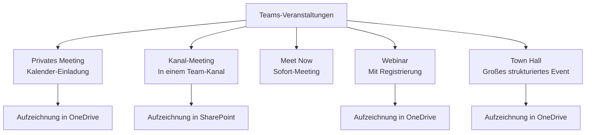

---
tags:
  - microsoft365
  - teams
  - meetings
  - webinare
  - town-hall
  - live-events
aliases:
  - Teams Meetings
  - Webinare Teams
  - Town Hall Teams
---

# Meetings und Live Events

> [!ABSTRACT] TL;DR
> Teams unterstützt drei Veranstaltungstypen: klassische Meetings (privat oder im Kanal), Webinare (strukturierte Events mit Registrierung) und Town Halls (große Unternehmens-Events bis 20.000 Teilnehmer). Live Events wurden 2024 eingestellt und durch Town Halls ersetzt. Meeting-Aufzeichnungen landen standardmäßig in OneDrive bzw. SharePoint. Teams Premium erweitert alle drei Typen mit KI-gestützten Features.

---

## Meeting-Typen im Überblick

| Typ | Max. Teilnehmer | Interaktivität | Registrierung |
|---|---|---|---|
| **Privates Meeting** | 1.000 (View-only ab 1.001) | Hoch | Nein |
| **Kanal-Meeting** | 1.000 | Hoch | Nein |
| **Webinar** | 1.000 | Mittel (kontrolliert) | Ja |
| **Town Hall** | 20.000 | Gering (strukturiert) | Optional |
| ~~Live Events~~ | ~~10.000~~ | ~~Gering~~ | ~~Ja~~ (eingestellt 2024) |

> [!NOTE] Live Events eingestellt
> Microsoft hat **Teams Live Events** zum 30. September 2024 eingestellt. Der Nachfolger sind **Town Halls**, die mehr Funktionen und eine bessere Skalierbarkeit bieten. Bestehende Live-Events-Richtlinien sollten auf Town Halls migriert werden.

---

## Meeting-Optionen

Für jedes Meeting können spezifische Einstellungen gesetzt werden (Organisator-seitig):

| Option | Beschreibung |
|---|---|
| **Lobby-Bypass** | Wer kommt direkt ins Meeting? (Jeder, nur Org, nur Eingeladene) |
| **Präsentation erlauben** | Wer darf Bildschirm teilen / präsentieren? |
| **Mikrofon für Teilnehmer** | Audio ein- oder ausschalten |
| **Kamera für Teilnehmer** | Video ein- oder ausschalten |
| **Meeting aufzeichnen** | Automatisch / Manuell / Deaktiviert |
| **Transkription** | Automatische Untertitel und Transkript aktivieren |
| **Q&A** | Strukturierte Frage-Antwort-Funktion |
| **Reaktionen** | Emoji-Reaktionen während Meeting |
| **Breakout Rooms** | Gruppenräume aktivieren |
| **Wasserzeichen** | Meeting-Inhalte mit Wasserzeichen schützen (Premium) |
| **End-to-End-Verschlüsselung** | E2E-Verschlüsselung (eingeschränkte Features) |

**Meeting-Optionen aufrufen:** Teams-Kalender → Meeting öffnen → Meeting-Optionen bearbeiten

---

## Meeting Policies (Admin-Steuerung)

Admins steuern Meeting-Verhalten über **Meeting Policies** im Teams Admin Center.

**Teams Admin Center → Meetings → Meeting-Richtlinien**

### Wichtige Policy-Einstellungen

| Kategorie | Einstellung | Optionen |
|---|---|---|
| **Audio & Video** | IP-Audio | Ein/Aus |
| **Audio & Video** | IP-Video | Ein/Aus |
| **Audio & Video** | Netzmodus-Video | Cloud / P2P |
| **Inhaltsfreigabe** | Bildschirmfreigabe-Modus | Gesamter Bildschirm, Einzelne App, Deaktiviert |
| **Inhaltsfreigabe** | Whiteboard | Ein/Aus |
| **Aufzeichnung und Transkription** | Cloud-Aufzeichnung | Ein/Aus |
| **Aufzeichnung und Transkription** | Aufzeichnung automatisch starten | Ein/Aus |
| **Aufzeichnung und Transkription** | Transkription | Ein/Aus |
| **Aufzeichnung und Transkription** | Aufzeichnung ablaufen lassen** | Tage bis zur Ablöschung |
| **Meeting Join** | Anonyme Teilnahme | Ein/Aus |
| **Meeting Join** | Externe Teilnehmer | Ein/Aus |

> [!TIP] Aufzeichnungsablauf
> Seit 2023 können Aufzeichnungen automatisch nach einer konfigurierten Anzahl von Tagen **ablaufen** (gelöscht werden). Dies gilt für Aufzeichnungen in OneDrive und SharePoint. Standard: 60 Tage (konfigurierbar 1–99.999 Tage oder kein Ablauf).

---

## Webinare

Webinare sind **strukturierte Meetings mit Registrierung** und klarer Trennung zwischen Präsentatoren und Teilnehmern.

### Webinar-Funktionen

| Funktion | Standard | Teams Premium |
|---|---|---|
| **Registrierungsseite** | ✅ | ✅ (mit Branding) |
| **Registrierungsformular** | Einfach | Erweitert (benutzerdefinierte Felder) |
| **Teilnehmer-Warteliste** | ❌ | ✅ |
| **Manuelle Genehmigung** | ❌ | ✅ |
| **Kapazitätsgrenze** | ❌ | ✅ |
| **Branding** | ❌ | ✅ (Logo, Farben, Theme) |
| **E-Mail-Anpassung** | Eingeschränkt | Vollständig |
| **Follow-up E-Mails** | ❌ | ✅ |
| **Q&A** | ✅ | ✅ (erweitert) |
| **Grüner Raum** | ❌ | ✅ (Presenter-Bereich vor Event) |
| **Intelligent Recap** | ❌ | ✅ |

### Webinar erstellen

Teams → Kalender → Neues Meeting → Webinar

**Konfigurierbare Elemente:**
- Registrierungsseite (Titel, Beschreibung, Datum, Banner-Bild)
- Registrierungsformular (Pflichtfelder: Name, E-Mail; optional: Abteilung, Frage)
- Referenten (als Co-Organizer oder Presenter)
- Webinar-Theme (Teams Premium)

---

## Town Halls

Town Halls sind **große, strukturierte Unternehmens-Events** für bis zu 20.000 Teilnehmer. Sie ersetzen die eingestellten Live Events.

### Unterschied Meeting vs. Town Hall

| Merkmal | Meeting | Town Hall |
|---|---|---|
| **Teilnehmer** | Bis 1.000 (aktiv) | Bis 20.000 |
| **Interaktivität** | Vollständig bidirektional | Eingeschränkt (Q&A, Reaktionen) |
| **Rollen** | Organisator, Moderator, Teilnehmer | Organisator, Moderator, Presenter, Teilnehmer |
| **Video** | Alle können Video senden | Nur Presenter |
| **Q&A** | Optional | Strukturiert |
| **Aufzeichnung** | OneDrive des Organisators | OneDrive des Organisators |
| **Simulcast** | ❌ | ✅ (RTMP-Out für externe Plattformen) |

### Town Hall konfigurieren

Teams → Kalender → Neues Meeting → Town Hall

**Town Hall-Einstellungen:**
- **RTMP-In**: Externe Video-Feeds einbinden
- **RTMP-Out**: Stream auf YouTube, Facebook, LinkedIn etc. (Teams Premium)
- **Q&A**: Aktivieren, anonyme Fragen zulassen
- **Aufzeichnung**: Automatisch starten
- **Übersetzung**: Live-Untertitel in verschiedenen Sprachen (Teams Premium)

### Town Hall Limits

| Ressource | Limit |
|---|---|
| Gleichzeitige Teilnehmer | 20.000 |
| Event-Dauer | 30 Stunden |
| Gleichzeitige Events im Tenant | 15 |
| Aufzeichnungsablauf | Standard OneDrive-Regeln |

---

## Q&A in Meetings und Events

Die **Q&A-Funktion** ermöglicht strukturierte Fragen in größeren Events:

- Teilnehmer können Fragen stellen (anonym oder mit Name)
- Moderatoren können Fragen genehmigen/ablehnen
- Fragen können anderen angezeigt werden
- Antworten können im Q&A-Panel gegeben werden (öffentlich oder privat)
- Moderatoren können Fragen hervorheben oder archivieren

---

## Breakout Rooms

Breakout Rooms erlauben das Aufteilen von Meeting-Teilnehmern in kleinere Gruppen:

- **Manuelle Zuweisung**: Organisator weist Teilnehmer Räumen zu
- **Automatische Zuweisung**: Gleichmäßige Verteilung
- Bis zu **50 Breakout Rooms** pro Meeting
- Organisator kann zwischen Räumen wechseln
- **Timer** für automatische Rückkehr ins Hauptmeeting
- Rooms können während des Meetings geöffnet und geschlossen werden

> [!TIP] Breakout Rooms vorbereiten
> Seit 2023 können Breakout Rooms **vor dem Meeting vorbereitet** werden — inklusive voreingestellter Teilnehmer-Zuweisung und Inhalte (z.B. Dokumente im Breakout-Chat hinterlegen).

---

## Meeting-Aufzeichnungen

### Speicherort

| Meeting-Typ | Aufzeichnungs-Speicherort |
|---|---|
| **Privates Meeting** | OneDrive des Organisators (`Recordings/`-Ordner) |
| **Kanal-Meeting** | SharePoint der Team-Site (`Recordings/`-Ordner im Kanal) |
| **Webinar** | OneDrive des Organisators |
| **Town Hall** | OneDrive des Organisators |

### Aufzeichnungs-Berechtigungen

- Aufzeichnungen in **OneDrive**: Standardmäßig für alle Meeting-Teilnehmer freigegeben (editierbar über Freigabe-Link)
- Aufzeichnungen in **SharePoint**: Zugriff über Kanalberechtigungen
- Ablauf: Konfigurierbar (Standard 60 Tage, dann gelöscht)

### Wer darf aufzeichnen?

Gesteuert durch **Meeting Policy**: `AllowCloudRecording`

| Rolle | Standard | Konfigurierbar |
|---|---|---|
| Organisator | ✅ | Ja |
| Presenter | ✅ | Ja |
| Teilnehmer | ❌ | Nein (nur Organisator-Rolle ermöglicht) |
| Externer Gast | ❌ | Nein |

---

## Transkription und Untertitel

| Funktion | Beschreibung |
|---|---|
| **Live-Untertitel** | Echtzeit-Untertitelung in der Meeting-Ansicht |
| **Transkription** | Vollständiges Wortprotokoll mit Sprecherzuordnung |
| **Sprachen** | 80+ Sprachen (Untertitel), ausgewählte Sprachen (Transkript) |
| **Übersetzung** | Live-Übersetzung in andere Sprachen (Teams Premium) |
| **Speicher** | `.vtt`-Datei neben Aufzeichnung in OneDrive/SharePoint |

> [!NOTE] Transkriptions-Aktivierung
> Transkription muss in der **Meeting Policy** durch den Admin aktiviert werden (`AllowTranscription`) UND im Meeting durch Organisator oder Teilnehmer gestartet werden.

---

## Teams Premium Meeting-Features

Teams Premium erweitert die Meeting-Erfahrung mit KI-gestützten Features:

### Intelligent Recap

Automatische KI-Zusammenfassung nach dem Meeting:
- **Meeting-Zusammenfassung**: Wichtigste Punkte aus Transkript extrahiert
- **Action Items**: Automatisch erkannte Aufgaben mit zugewiesenen Personen
- **Kapitel**: Meeting in thematische Abschnitte gegliedert
- **Sprecherzeitlinie**: Farb-codierte Zeitleiste wer wann gesprochen hat
- **@-Erwähnungen**: Direkt-Sprung zu Stellen wo man erwähnt wurde

> [!IMPORTANT] Intelligent Recap Lizenz
> Intelligent Recap steht nur Benutzern mit **Teams Premium** oder **Microsoft 365 Copilot**-Lizenz zur Verfügung. Verfügbar für Meetings, Webinare und Town Halls (ab Anfang 2025).

### Weitere Teams Premium Meeting-Features

| Feature | Beschreibung |
|---|---|
| **Watermarks** | Video-Feeds und freigegebene Inhalte mit Wasserzeichen |
| **E2E-Verschlüsselung** | End-to-End-Verschlüsselung (eingeschränkte Features) |
| **Sensitivity Labels** | Meeting-Sensitivität aus Purview |
| **Custom Meeting Templates** | Vordefinierte Meeting-Konfigurationen |
| **Custom Branding** | Unternehmenslogo in Meeting-Lobby |
| **Live-Übersetzung** | Untertitel in Echtzeit übersetzen (40+ Sprachen) |
| **Virtual Appointments** | Erweitertes Scheduling für Kundeninteraktionen |

---

## Copilot in Meetings

Microsoft 365 Copilot kann in Meetings genutzt werden:

- **Echtzeit-Zusammenfassung**: Während des Meetings aktuelle Zusammenfassung abrufen
- **Fragen stellen**: "Welche Punkte wurden bisher diskutiert?"
- **Aufholhilfe**: Bei verspäteter Teilnahme schnell einsteigen
- **Action Items**: Aufgaben aus laufendem Meeting extrahieren
- **Post-Meeting**: Vollständige Zusammenfassung und Follow-up-E-Mail generieren

> [!NOTE] Copilot-Voraussetzung
> Microsoft 365 Copilot-Lizenz erforderlich. Transkription muss im Meeting aktiv sein (ohne Transkription funktioniert Copilot nicht).

---

## Verwandte Notizen

- [[Teams Grundlagen]]
- [[Teams Premium]]
- [[Governance und Policies]]
- [[Teams Rooms]]
- [[Teams PowerShell]]
