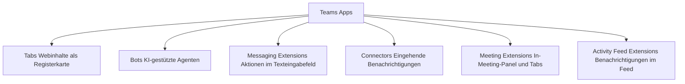
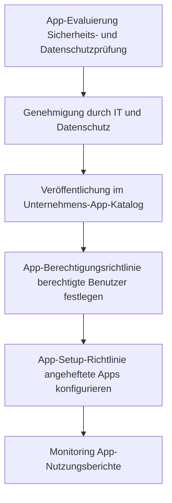

---
tags:
  - microsoft365
  - teams
  - apps
  - bots
  - power-platform
aliases:
  - Teams Apps
  - Teams Bots
  - Teams App-Governance
---

# Teams Apps und Bots

> [!ABSTRACT] TL;DR
> Das Teams-App-Ökosystem ermöglicht die Integration von Drittanbieter- und Microsoft-Diensten direkt in Teams über Tabs, Bots, Messaging Extensions und Meeting-Extensions. Admins steuern über App-Berechtigungs- und Setup-Richtlinien, welche Apps verfügbar sind und welche standardmäßig angeheftet werden. Power Apps, Power Automate und Viva Connections sind wichtige Microsoft-eigene App-Erweiterungen.

---

## Teams App-Ökosystem

Microsoft Teams ist eine **erweiterbare Plattform**. Apps können folgende Typen umfassen:



### App-Typen im Detail

| App-Typ | Beschreibung | Beispiele |
|---|---|---|
| **Tabs (statisch)** | Persönliche App-Ansicht (linke Seitenleiste) | OneDrive, Aufgaben, Kalender |
| **Tabs (konfigurierbar)** | Registerkarte in Kanal oder Chat | SharePoint-Seite, Planner-Board, Website |
| **Bots** | Konversationale KI-Agenten, reagieren auf Nachrichten | FAQ-Bot, Workflow-Bot, Copilot-Bot |
| **Messaging Extensions** | Suche und Aktionen aus dem Compose-Bereich | Jira-Issue erstellen, Giphy einfügen |
| **Meeting Extensions** | Apps die während Meetings aktiv sind | Live-Umfragen, Q&A, Notizen |
| **Connectors (Legacy)** | Eingehende Webhooks, werden durch Power Automate ersetzt | RSS-Feeds, GitHub-Benachrichtigungen |
| **Workflows** | Power Automate-Flows aus Teams heraus | Genehmigungsprozesse, Formular-Trigger |

---

## Via Teams Admin Center (UI)

### App-Berechtigungsrichtlinien konfigurieren

1. Öffne das **Teams Admin Center** unter [admin.teams.microsoft.com](https://admin.teams.microsoft.com)
2. Navigiere zu **Apps → App-Berechtigungsrichtlinien**
3. Klicke auf **+ Hinzufügen** um eine neue Richtlinie zu erstellen
4. Konfiguriere für jede App-Kategorie:
   - **Microsoft-Apps:** Alle zulassen / Bestimmte Apps erlauben oder blockieren / Alle blockieren
   - **Drittanbieter-Apps:** Alle zulassen / Bestimmte Apps erlauben oder blockieren / Alle blockieren
   - **Benutzerdefinierte Apps:** Alle zulassen / Bestimmte Apps erlauben oder blockieren / Alle blockieren
5. Klicke auf **Speichern**
6. Policy zuweisen: **Benutzer → Benutzer verwalten** → Benutzer auswählen → **Richtlinien bearbeiten**

### App-Setuprichtlinien konfigurieren (angeheftete Apps)

1. Navigiere zu **Apps → App-Setuprichtlinien**
2. Klicke auf **+ Hinzufügen**
3. Konfiguriere:
   - **Benutzerdefiniertes Pinning:** Ob Benutzer Apps in der Seitenleiste selbst anheften dürfen
   - **Apps hochladen:** Sideloading von benutzerdefinierten Apps erlauben oder verbieten
   - **Angeheftete Apps:** Reihenfolge der Standard-Apps in der linken Seitenleiste per Drag & Drop festlegen
4. Klicke auf **Speichern**
5. Policy zuweisen: **Benutzer → Benutzer verwalten** → Benutzer auswählen → **Richtlinien bearbeiten**

### Apps org-weit blockieren oder zulassen

1. Navigiere zu **Apps → Apps verwalten**
2. Suche nach der gewünschten App (Suchfeld oben rechts)
3. Klicke auf den App-Namen → **Zulassen** oder **Blockieren**
4. Alternativ: Mehrere Apps über die Kontrollkästchen auswählen → **Zulassen** oder **Blockieren** (Bulk-Aktion)

### Benutzerdefinierte App in den Unternehmens-App-Katalog hochladen

1. Navigiere zu **Apps → Apps verwalten**
2. Klicke auf **+ Hochladen** → **Benutzerdefinierte App hochladen**
3. Wähle das App-Paket (`.zip`-Datei mit `manifest.json`) aus
4. Die App erscheint im Unternehmens-App-Katalog und ist nur für die eigene Organisation sichtbar
5. Berechtigungs- und Setuprichtlinien steuern, wer die App nutzen oder anheften kann

> [!NOTE]
> Die **org-weite Blockierung** einer App unter **Apps → Apps verwalten** hat Vorrang vor allen Berechtigungsrichtlinien. Eine dort blockierte App kann von keinem Benutzer installiert werden — unabhängig von der zugewiesenen Policy.

> [!TIP]
> Unter **Apps → Apps verwalten** kann der **Zertifizierungsstatus** jeder App eingesehen werden (Publisher Attestation / Microsoft 365 Certified). Dies hilft bei der Risikoklassifizierung vor dem Freigeben von Drittanbieter-Apps.

---

## App-Governance im Teams Admin Center

**Teams Admin Center → Apps**

### App-Berechtigungsrichtlinien

Steuern, **welche Apps** Benutzer installieren und nutzen dürfen.

| Kategorie | Einstellungen |
|---|---|
| **Microsoft-Apps** | Alle zulassen / Bestimmte erlauben oder blockieren / Alle blockieren |
| **Drittanbieter-Apps** | Alle zulassen / Bestimmte erlauben oder blockieren / Alle blockieren |
| **Benutzerdefinierte Apps** | Alle zulassen / Bestimmte erlauben oder blockieren / Alle blockieren |

> [!IMPORTANT] Globale App-Sperren
> Einzelne Apps können **org-weit blockiert** werden (unabhängig von Policies): Teams Admin Center → Apps → App auswählen → Blockieren. Blockierte Apps können von keinem Benutzer installiert werden.

### App-Setup-Richtlinien

Steuern, welche Apps **standardmäßig angeheftet** werden (linke Seitenleiste).

**Konfiguration:** Teams Admin Center → Apps → Setup-Richtlinien

| Einstellung | Beschreibung |
|---|---|
| **Benutzerdefiniertes Pinning** | Ob Benutzer Apps selbst anheften dürfen |
| **Angeheftete Apps** | Reihenfolge der angehefteten Apps festlegen |
| **Hochgeladene Apps** | Benutzer dürfen eigene Apps hochladen (Sideloading) |

**Typische angeheftete Apps:**
- Aktivität, Chat, Teams, Kalender, Anrufe (Standard)
- + Genehmigungen, Aufgaben, Viva Connections (Enterprise-Policy)
- + Branchen-spezifische Apps (Custom Policy)

```powershell
# App-Setup-Policy erstellen
New-CsTeamsAppSetupPolicy -Identity "Vertrieb-Policy" `
    -AllowUserPinning $true `
    -AllowSideLoading $false

# Apps anheften
Set-CsTeamsAppSetupPolicy -Identity "Vertrieb-Policy" `
    -PinnedAppBarApps @(
        New-Object Microsoft.Teams.Policy.Administration.Cmdlets.Core.PinnedApp -Property @{Id="14d6962d-6eeb-4f48-8890-de55454bb136"}, # Aktivität
        New-Object Microsoft.Teams.Policy.Administration.Cmdlets.Core.PinnedApp -Property @{Id="2a84919f-59d8-4441-a975-2a8c2643b741"}  # Genehmigungen
    )

# Policy zuweisen
Grant-CsTeamsAppSetupPolicy -Identity "user@contoso.com" -PolicyName "Vertrieb-Policy"
```

---

## Benutzerdefinierte Apps (Custom Apps / Sideloading)

Organisationen können eigene Apps entwickeln und im Teams-App-Katalog veröffentlichen:

### Sideloading

Entwickler können Apps direkt in Teams hochladen (ohne App-Store-Veröffentlichung):
- Anforderung: `AllowSideLoading` in der App-Setup-Policy aktiviert
- Vorgehensweise: Teams → Apps → App hochladen → App-Paket (.zip) auswählen
- Sideloading gilt nur für den hochladenden Benutzer (persönlich) oder ein spezifisches Team

### App-Katalog (Unternehmens-App-Store)

**Teams Admin Center → Apps → Apps verwalten → Hochladen**

- Apps landen im **Unternehmens-App-Katalog** (nur für diese Organisation sichtbar)
- Benutzer können Apps aus dem Katalog in Teams hinzufügen
- Admins können Apps **vorab genehmigen** oder **Genehmigungsprozess** konfigurieren

### App-Zertifizierung

Drittanbieter-Apps können die **Microsoft 365-Zertifizierung** erhalten:
- **Publisher Attestation**: Herausgeber bestätigt Sicherheits- und Datenschutzpraktiken
- **Microsoft 365 Certified**: Microsoft verifiziert die Sicherheitsanforderungen

---

## Power Apps in Teams

Power Apps können als **persönliche App** oder **Kanal-Tab** in Teams eingebettet werden:

### Power Apps als Tab

1. Kanal → Tab hinzufügen → Power Apps
2. Bestehende Power App aus dem Katalog auswählen
3. App wird direkt im Teams-Kontext gerendert

### Dataverse for Teams

Power Apps können mit **Microsoft Dataverse for Teams** eine eingebettete Datenbank nutzen:
- Dataverse for Teams-Umgebung wird automatisch beim Erstellen einer App in Teams angelegt
- Keine separate Power Apps-Lizenz erforderlich (in M365-Abonnements enthalten)
- Limitierter Speicher und Funktionsumfang vs. vollständige Dataverse-Umgebung

> [!NOTE] Dataverse for Teams vs. Dataverse
> Dataverse for Teams ist eine vereinfachte Version — ausreichend für einfache Teamanwendungen. Für komplexe Unternehmensanwendungen empfiehlt sich die vollständige Dataverse-Umgebung in Power Platform.

---

## Power Automate in Teams

Power Automate-Flows können direkt aus Teams heraus erstellt und genutzt werden:

### Teams-spezifische Trigger

| Trigger | Beschreibung |
|---|---|
| **When a new message is added** | Flow startet bei neuer Kanalnachricht |
| **When a new team member is added** | Onboarding-Automatisierung |
| **When I am mentioned** | Reaktion auf @-Erwähnung |
| **For a selected message** | Manueller Trigger aus Nachricht-Kontext |

### Teams-spezifische Aktionen

| Aktion | Beschreibung |
|---|---|
| **Post message in chat or channel** | Automatisch Nachrichten senden |
| **Create a team** | Teams programmatisch erstellen |
| **Add a member to a team** | Mitglieder automatisch hinzufügen |
| **Send me a mobile notification** | Push-Benachrichtigung an Teams-App |
| **Post an Adaptive Card** | Interaktive Karte in Kanal oder Chat |

---

## Bots in Teams

Bots sind **konversationale Agenten**, die auf Nachrichten reagieren und Aufgaben automatisieren:

### Bot-Typen

| Bot-Typ | Beschreibung | Anwendungsfall |
|---|---|---|
| **FAQ-Bot** | Beantwortet häufige Fragen aus Wissensdatenbank | IT-Helpdesk, HR-Anfragen |
| **Workflow-Bot** | Löst Geschäftsprozesse aus | Genehmigungen, Ticket-Erstellung |
| **Notification-Bot** | Sendet proaktive Benachrichtigungen | Monitoring-Alerts, Deadlines |
| **Copilot Studio Bot** | KI-gestützter Bot aus Microsoft Copilot Studio | Komplexe dialogbasierte Szenarien |

### Microsoft-eigene Bots

- **Microsoft Copilot for Microsoft 365** — KI-Assistent direkt im Chat
- **Viva Engage Bot** — Benachrichtigungen aus Yammer/Viva Engage
- **Approvals Bot** — Genehmigungsworkflows
- **Power Virtual Agents (Copilot Studio)** — Benutzerdefinierte Bot-Plattform

### Bot mit Copilot Studio erstellen (Überblick)

1. `make.powerapps.com` → Copilot Studio öffnen
2. Neuen Copiloten erstellen
3. Topics und Trigger-Phrasen definieren
4. Wissensbasis (SharePoint, Websites) verbinden
5. In Microsoft Teams veröffentlichen

---

## Viva Connections in Teams

**Viva Connections** ist das Intranet-Portal innerhalb von Teams — basierend auf SharePoint:

- **Dashboard**: Adaptive Cards mit personalisierten Informationen (HR-Daten, Links, News)
- **Feed**: Personalisierter Newsfeed aus SharePoint-Kommunikationsseiten
- **Resources**: Navigation zu wichtigen Links und Apps

**Aktivierung:** Teams Admin Center → Apps → Viva Connections einrichten

> [!TIP] Viva Connections Voraussetzungen
> Viva Connections erfordert eine **SharePoint-Kommunikationswebsite als Home Site** des Tenants. Die Home Site wird im SharePoint Admin Center festgelegt.

---

## Microsoft 365 Copilot in Teams-Apps

Mit Microsoft 365 Copilot können Apps **Copilot-Erweiterungen** (früher: Plugins) bereitstellen:

- **Message Extensions als Copilot Plugins**: Copilot kann Drittanbieter-Dienste abfragen
- **Copilot Studio**: Eigene Copilot-Agenten als Teams-App veröffentlichen
- **Declarative Agents**: Copilot mit spezifischem Kontext und Capabilities konfigurieren

---

## Teams-App-Entwicklung (Überblick)

### Teams Toolkit

Das **Teams Toolkit** (VS Code Extension) vereinfacht die App-Entwicklung:

```
Teams Toolkit → Neues Projekt → Vorlage wählen:
├── Tab App (React)
├── Bot App (Node.js / Python)
├── Messaging Extension
├── Notification Bot
└── Workflow Bot
```

**App-Paket-Struktur:**
```json
// manifest.json (Kern jeder Teams-App)
{
  "manifestVersion": "1.17",
  "id": "xxxxxxxx-xxxx-xxxx-xxxx-xxxxxxxxxxxx",
  "name": { "short": "Meine App" },
  "description": { "short": "App-Beschreibung" },
  "staticTabs": [...],
  "bots": [...],
  "composeExtensions": [...]
}
```

---

## App-Monitoring und Reports

**Teams Admin Center → Analyse und Berichte → App-Nutzung**

| Report | Inhalt |
|---|---|
| **App-Nutzungsbericht** | Welche Apps werden genutzt, von wie vielen Benutzern |
| **App-Berechtigungsaudit** | Welche OAuth-Berechtigungen haben Apps |
| **Custom App-Uploads** | Hochgeladene benutzerdefinierte Apps |

---

## App-Governance Best Practices

### Empfohlene Vorgehensweise



### App-Governance Checkliste

| Schritt | Beschreibung | Tool |
|---|---|---|
| App-Inventar | Welche Apps werden aktuell genutzt? | Teams Admin Center → Berichte |
| Risikoklassifizierung | Microsoft-/Drittanbieter-/Custom-Apps kategorisieren | Manuell |
| Standardmäßig blockieren | Alle unbekannten Drittanbieter-Apps blockieren | Berechtigungsrichtlinie |
| Genehmigungsprozess | Formular für App-Anfragen einführen | Microsoft Forms + Power Automate |
| Regelmäßige Review | Quartalsweise nicht genutzte Apps entfernen | Nutzungsberichte |

---

## Verwandte Notizen

- [[Teams Grundlagen]]
- [[Governance und Policies]]
- [[Teams PowerShell]]
- [[Teams Premium]]
