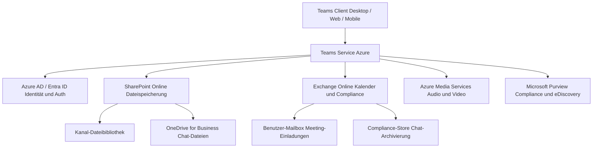
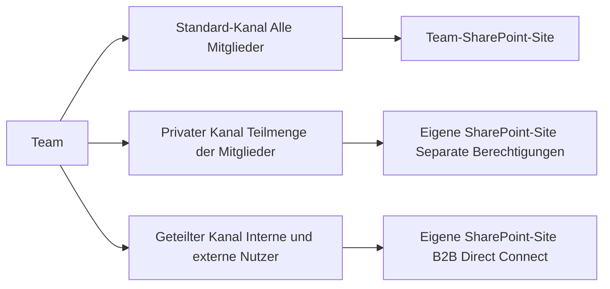
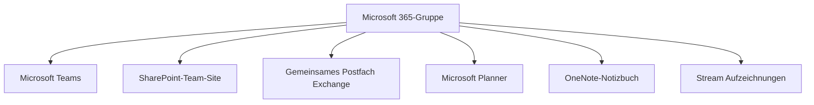

---
tags:
  - microsoft365
  - teams
  - grundlagen
aliases:
  - Teams Einführung
  - MS Teams Grundlagen
---

# Teams Grundlagen

> [!ABSTRACT] TL;DR
> Microsoft Teams ist der zentrale Hub für Teamarbeit in Microsoft 365 und kombiniert Chat, Meetings, Anrufe und Dateizusammenarbeit in einer einzigen Oberfläche. Teams basiert auf Microsoft 365-Gruppen und nutzt SharePoint für die Dateispeicherung, Exchange für Kalender und Compliance sowie Azure AD für Identitäten. Das Verständnis der Kernkonzepte (Teams, Kanäle, Chats, Apps) und der Datenspeicherung ist Grundlage für eine solide Administration.

---

## Was ist Microsoft Teams?

Microsoft Teams (kurz: Teams) ist eine cloudbasierte Kollaborationsplattform innerhalb von Microsoft 365, die 2017 eingeführt wurde. Teams fungiert als **zentraler Hub für Teamarbeit** und vereint:

- **Chat** — Einzel- und Gruppennachrichten, persistent und durchsuchbar
- **Meetings** — Audio-, Video- und Webkonferenzen
- **Anrufe** — VoIP und PSTN-Telefonie (mit Teams Phone)
- **Dateien** — Dokumente direkt in Kanälen und Chats bearbeiten
- **Apps und Tabs** — Integration von Drittanbieter- und Microsoft-Diensten

Teams ersetzt Skype for Business und integriert sich tief in alle anderen Microsoft 365-Dienste.

---

## Architektur

Teams ist kein monolithischer Dienst, sondern ein Orchestrator über mehrere Microsoft-Backenddienste:

### Komponentenübersicht

| Komponente | Funktion in Teams |
|---|---|
| **Azure AD / Entra ID** | Authentifizierung, Benutzeridentitäten, Gruppen |
| **SharePoint Online** | Kanal-Dateibibliotheken, Private Channel Sites |
| **Exchange Online** | Meeting-Einladungen, Kalender, Compliance-Archiv |
| **Azure Media Services** | Audio/Video-Verarbeitung für Meetings und Anrufe |
| **Microsoft Purview** | Retention Policies, eDiscovery, DLP |
| **Teams Service** | Chat-Routing, Präsenzstatus, App-Plattform |

---

## Kernkonzepte

### Teams

Ein **Team** ist ein Container für die Zusammenarbeit einer Gruppe. Jedes Team besitzt:
- Einen oder mehrere **Kanäle** für thematische Unterbereiche
- Eine verbundene **Microsoft 365-Gruppe** (Backing Group)
- Eine **SharePoint-Website** für Dateiablage
- Ein **gemeinsames Postfach** (Exchange) und **OneNote-Notizbuch**

### Kanäle

Kanäle strukturieren die Kommunikation innerhalb eines Teams. Jede Unterhaltung in einem Kanal ist **persistent** und für alle Kanalmitglieder sichtbar.

### Chats

**Chats** sind private Unterhaltungen zwischen zwei oder mehr Personen — unabhängig von Teams und Kanälen. Chat-Dateien werden in der **OneDrive**-Bibliothek des Absenders gespeichert.

### Apps und Tabs

- **Tabs**: Websites, SharePoint-Seiten, Planner-Boards, Power Apps etc. als Registerkarte im Kanal
- **Bots**: Automatisierte Agenten, die auf Nachrichten reagieren
- **Messaging Extensions**: Aktionen direkt aus dem Texteingabefeld
- **Connectors**: Benachrichtigungen aus Drittsystemen

---

## Kanal-Typen

| Kanal-Typ | Sichtbarkeit | SharePoint-Site | Externe Nutzer | Limit pro Team |
|---|---|---|---|---|
| **Standard** | Alle Team-Mitglieder | Team-Site (gemeinsam) | Nein (nur Gäste) | 1.000 gesamt |
| **Privat** | Ausgewählte Mitglieder | Eigene Site | Nein (nur Gäste) | 30 (→ 1.000 ab 2025/26) |
| **Geteilt (Shared)** | Intern + Extern | Eigene Site | Ja (Direct Connect) | Im 1.000er-Limit |

> [!NOTE] Private Channel SharePoint-Sites
> Private Kanäle erhalten eine eigene SharePoint-Site mit dem Muster `/sites/[Teamname]-[Kanalname]`. Diese Site ist **nicht** über die Haupt-Team-Site zugänglich und hat eigene Berechtigungsverwaltung.

> [!NOTE] Shared Channels und B2B Direct Connect
> Shared Channels nutzen **Azure AD B2B Direct Connect** statt der klassischen Gasteinladung. Externe Nutzer bleiben in ihrer eigenen Organisation angemeldet und benötigen kein Gastkonto im Ziel-Tenant.

---

## Datenspeicherung

Die Datenspeicherung in Teams ist auf mehrere Dienste verteilt:

| Datentyp | Speicherort | Zugriff über |
|---|---|---|
| **Kanal-Dateien** | SharePoint-Dokumentbibliothek der Team-Site | Teams Dateien-Tab, SharePoint |
| **Chat-Dateien** | OneDrive des sendenden Benutzers | Teams Chat, OneDrive |
| **Kanal-Posts** | Exchange Compliance-Store (Hidden Folder) | eDiscovery, Compliance |
| **Chat-Nachrichten** | Exchange Compliance-Store | eDiscovery, Compliance |
| **Besprechungsaufzeichnungen** | OneDrive (private Meetings) oder SharePoint (Kanal) | Teams, OneDrive, SharePoint |
| **Meeting-Transkripte** | OneDrive / SharePoint (neben Aufzeichnung) | Teams Recap-Tab |
| **Voicemail** | Exchange Online Mailbox | Teams, Outlook |

> [!IMPORTANT] Datenspeicherung bei Kanälen
> Kanal-Dateien liegen in SharePoint unter `Dokumente / [Kanalname] /`. Wenn ein Team gelöscht wird, werden SharePoint-Site und damit alle Kanaldateien ebenfalls in den SharePoint-Papierkorb verschoben — 93 Tage Wiederherstellungsfenster.

---

## Teams Client

| Client | Plattform | Besonderheiten |
|---|---|---|
| **Desktop** | Windows, macOS | Vollständiger Funktionsumfang, lokale Benachrichtigungen |
| **Web** | Browser (Edge, Chrome, Firefox, Safari) | Kein Plugin erforderlich, eingeschränkte Audio/Video-Features in Firefox/Safari |
| **Mobile** | iOS, Android | Optimiert für Unterwegs, Push-Benachrichtigungen |
| **Teams Rooms** | Windows, Android | Für Konferenzräume, dedizierte Hardware |
| **Teams Displays** | Android | Dediziertes Gerät für persönliche Arbeitsbereiche |

> [!TIP] Neue Teams-Client-Version
> Seit 2023/2024 steht der **neue Teams-Client** (basierend auf React/Edge WebView2) zur Verfügung. Er bietet schnellere Performance, geringeren RAM-Verbrauch und Multi-Account-Unterstützung. Für Organisationen ist das Rollout über Admin Center steuerbar.

---

## Microsoft 365-Gruppen-Backing

Jedes Team basiert auf einer **Microsoft 365-Gruppe** (früher: Office 365-Gruppe). Beim Erstellen eines Teams wird automatisch eine M365-Gruppe angelegt und umgekehrt.

> [!WARNING] Gruppen-Löschung
> Wenn ein Team oder die zugrunde liegende M365-Gruppe gelöscht wird, werden **alle verbundenen Ressourcen** (SharePoint, Postfach, Planner, OneNote) in den Papierkorb verschoben. Das Wiederherstellungsfenster beträgt **30 Tage**.

---

## Teams-Typen

| Teams-Typ | Beschreibung | Zielgruppe |
|---|---|---|
| **Standard** | Allgemeines Team, manuell Mitglieder hinzufügen | Alle Organisationen |
| **Org-weit** | Automatisch alle Tenant-Benutzer als Mitglieder (max. 10.000) | Kleine bis mittlere Orgs |
| **Klasse** | Lehrer als Owner, Schüler als Member; eigene EDU-Features (Aufgaben, Noten) | Education-Tenant |
| **PLC** | Professional Learning Community für Lehrerteams | Education-Tenant |
| **Staff** | Für Schulleitung und Verwaltungsteams | Education-Tenant |

> [!NOTE] Org-weites Team
> Ein org-weites Team kann nur von **globalen Administratoren** erstellt werden. Neue Benutzer im Tenant werden automatisch hinzugefügt. Maximal **5 org-weite Teams** pro Tenant, maximal **10.000 Mitglieder**.

---

## Via Teams Admin Center (UI)

### Gastzugang konfigurieren

1. Öffne das **Teams Admin Center** unter [admin.teams.microsoft.com](https://admin.teams.microsoft.com)
2. Navigiere zu **Org-weite Einstellungen → Gastzugang**
3. Aktiviere **Gastzugang in Microsoft Teams zulassen**
4. Konfiguriere die Berechtigungen für Gäste:
   - **Anruf:** Private Anrufe erlauben
   - **Besprechung:** IP-Video und Bildschirmfreigabe-Modus
   - **Messaging:** Nachrichten bearbeiten/löschen, Giphy, Memes, Sticker
5. Klicke auf **Speichern**

> [!WARNING]
> Gastzugang muss an **drei Stellen** aktiviert werden: (1) Teams Admin Center → Org-weite Einstellungen → Gastzugang, (2) Microsoft 365 Admin Center → Einstellungen → Org-Einstellungen → Microsoft 365-Gruppen → Gruppen-Gastmitgliedschaft, (3) Microsoft Entra Admin Center → Externe Identitäten → Externe Zusammenarbeit → Einladungseinstellungen. Alle drei Schalter müssen aktiv sein.

### Externen Zugriff (Federation) konfigurieren

1. Navigiere zu **Org-weite Einstellungen → Externer Zugriff**
2. Wähle die gewünschte Einstellung:
   - **Alle externen Domänen zulassen** (Standard)
   - **Nur bestimmte externe Domänen zulassen** → Domäne hinzufügen (Whitelist)
   - **Alle externen Domänen blockieren** (kein externer Chat oder Anrufe)
3. Für **Teams Connect (Shared Channels / B2B Direct Connect):** Aktiviere **Teams Connect konfigurieren**
4. Klicke auf **Speichern**

### Neue Teams-Client-Version steuern

1. Navigiere zu **Teams → Teams-Updaterichtlinien**
2. Wähle eine bestehende Richtlinie oder klicke auf **+ Hinzufügen**
3. Konfiguriere:
   - **App-Update-Kanal:** Vorschau / Aktuell / Standard
   - **Neuen Teams-Client verwenden:** Aktivieren oder deaktivieren
4. Klicke auf **Speichern** und weise die Policy unter **Benutzer → Benutzer verwalten** zu

> [!TIP]
> Unter **Org-weite Einstellungen → Teams-Einstellungen** findest du weitere grundlegende Konfigurationen wie E-Mail-Integration für Kanäle, erlaubte Dateispeicher-Dienste und die Org-Diagramm-Anzeige in Benutzerprofilen.

---

## Gastbenutzer vs. External Access

### Gastbenutzer (Guest Access)

Externe Personen werden per **Azure AD B2B-Einladung** als Gastbenutzer in den Tenant eingeladen. Sie:
- Erhalten ein `user@extern.com#EXT#@[tenant].onmicrosoft.com`-Konto im Ziel-Tenant
- Sind vollständige Mitglieder des einladenden Teams
- Können auf Kanäle, Dateien und Chat zugreifen (konfigurierbar)
- Können **keine** Meetings starten oder Teams erstellen (standardmäßig)

### External Access (Federation)

External Access ermöglicht die direkte Kommunikation zwischen **zwei Teams-Tenants** ohne Gasteinladung:
- Nutzer bleiben in ihrer eigenen Organisation
- Nur 1:1-Chat und Anrufe (keine Kanal-Teilnahme)
- Konfigurierbar: Allow All, Allow Specific Domains, Block All

| Merkmal | Guest Access | External Access |
|---|---|---|
| Konto im Tenant | Ja (B2B-Gast) | Nein |
| Kanal-Zugriff | Ja | Nein |
| Chat | Ja | Ja (1:1) |
| Meetings | Ja (als Teilnehmer) | Ja |
| Teams erstellen | Nein | Nein |
| Datei-Zugriff | Ja | Nein |
| Konfiguration | Teams Admin Center → Gastbenutzer | Teams Admin Center → Externer Zugriff |

> [!TIP] Shared Channels als Alternative
> Für strukturierte externe Zusammenarbeit mit vollem Kanal-Zugriff sind **Shared Channels** (B2B Direct Connect) die modernere Alternative zu Gastbenutzer-Einladungen — ohne Konto im Ziel-Tenant.

---

## Teams Limits und Spezifikationen (2024/2025)

| Ressource | Limit |
|---|---|
| Teams pro Tenant | 500.000 |
| Mitglieder pro Team | 25.000 |
| Org-weites Team: max. Mitglieder | 10.000 |
| Besitzer pro Team | 100 |
| Kanäle pro Team (gesamt) | 1.000 |
| Private Kanäle pro Team | 30 (steigt auf 1.000 ab 2025/26) |
| Teams pro Benutzer (Mitgliedschaft) | 1.000 |
| Teams erstellen (nicht-Admin) | 250 (Entra ID Objektlimit) |
| Mitglieder in privatem Kanal | 250 (steigt auf 5.000 ab 2025/26) |
| Mitglieder in Shared Channel | 5.000 (inkl. bis zu 50 Teams) |
| Dateigröße (Upload in Teams) | 250 GB |
| Nachrichten-Post-Größe | ~28 KB |
| Teams-Mandanten pro Nacht synchronisiert | — |

> [!NOTE] Aktuelle Limits prüfen
> Microsoft aktualisiert die Limits regelmäßig. Die offizielle Quelle: [Limits and specifications for Microsoft Teams](https://learn.microsoft.com/en-us/microsoftteams/limits-specifications-teams)

---

## Teams in der Microsoft 365-Produktfamilie

Teams ist der zentrale Knotenpunkt, der viele Microsoft 365-Dienste zusammenführt:

| Dienst | Rolle in Teams |
|---|---|
| **SharePoint Online** | Dateispeicher für Kanal-Bibliotheken; Viva Connections; SharePoint-Seiten als Tab |
| **Exchange Online** | Meeting-Einladungen, Kalender, Compliance-Archiv, Voicemail |
| **OneDrive for Business** | Chat-Dateien, Besprechungsaufzeichnungen (private Meetings) |
| **Microsoft Planner** | Aufgabenverwaltung als Tab, via M365-Gruppe verbunden |
| **Power Platform** | Power Apps-Tabs, Power Automate-Workflows, Copilot Studio Bots |
| **Microsoft Purview** | Compliance, Retention, eDiscovery, DLP, Sensitivity Labels |
| **Azure AD / Entra ID** | Identität, MFA, Conditional Access, Gasteinladungen (B2B) |
| **Microsoft Viva** | Viva Connections als Teams-App, Viva Engage, Viva Insights |
| **Microsoft 365 Copilot** | KI-Assistent direkt im Chat und in Meetings |

---

## Teams Client-Versionen

| Version | Beschreibung |
|---|---|
| **Neuer Teams-Client (2024)** | React-basiert, Edge WebView2, schneller Start, weniger RAM, Multi-Account |
| **Klassischer Teams-Client** | Electron-basiert, wird 2025 eingestellt |
| **Teams Lite** | Eingeschränkte Version für ältere Geräte |
| **Teams Web** | `teams.microsoft.com` — kein Plugin, voller Funktionsumfang in Chrome/Edge |

> [!TIP] Migration zum neuen Teams
> Der neue Teams-Client ist seit 2024 Standard für neue Installationen. Admins können die Migration über den Cloud-Policy-Service steuern: Teams Admin Center → Teams-Update-Richtlinien.

---

## Verwandte Notizen

- [[Teams und Kanäle verwalten]]
- [[Governance und Policies]]
- [[Teams-Telefonie]]
- [[Meetings und Live Events]]
- [[Teams Rooms]]
- [[Teams Apps und Bots]]
- [[Teams Phone Mobile]]
- [[Teams Premium]]
- [[Teams PowerShell]]
- [[Governance und Policies]]
- [[Teams-Telefonie]]
- [[Meetings und Live Events]]
- [[Teams Rooms]]
- [[Teams Apps und Bots]]
- [[Teams Phone Mobile]]
- [[Teams Premium]]
- [[Teams PowerShell]]
