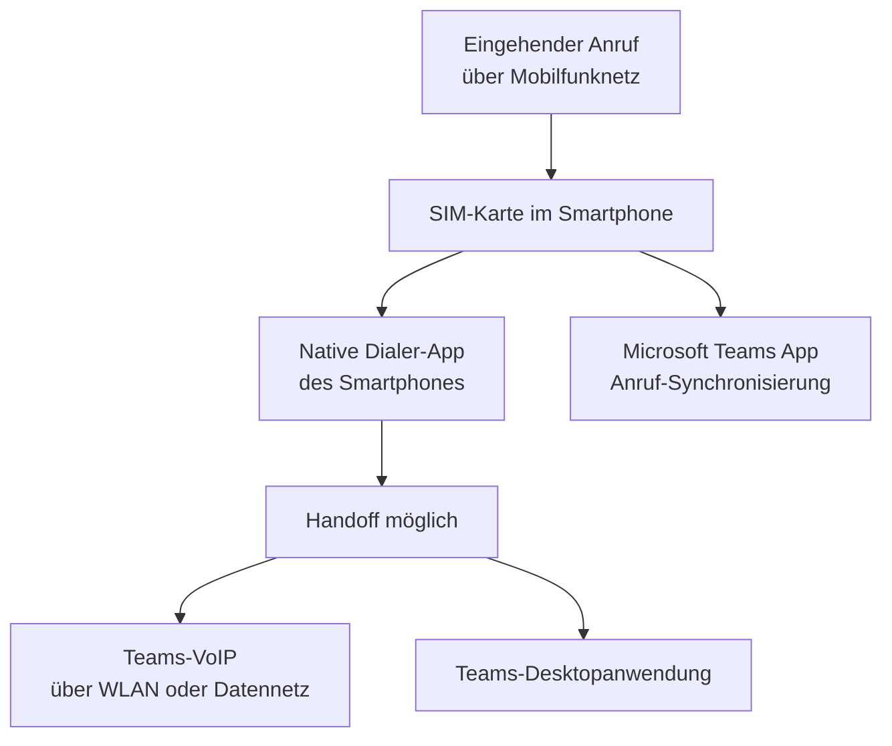

---
tags:
  - microsoft365
  - teams
  - telefonie
  - mobile
  - sim
aliases:
  - Teams Phone Mobile
  - SIM-Enabled Teams
  - Operator Connect Mobile
---

# Teams Phone Mobile

> [!ABSTRACT] TL;DR
> Teams Phone Mobile (ehemals: Operator Connect Mobile) ermöglicht es, die eigene SIM-Karte als Teams-Telefonnummer zu nutzen. Eingehende und ausgehende Anrufe über das Mobilfunknetz werden nahtlos in Teams integriert — ohne VoIP. Der native Dialer des Smartphones wählt über das Mobilfunknetz, Microsoft Teams empfängt und zeigt die Anruf-Informationen. In Deutschland wird Teams Phone Mobile von Telekom, Vodafone und o2 unterstützt.

---

## Was ist Teams Phone Mobile?

Teams Phone Mobile ist ein **SIM-basiertes Telefoniesystem** für Microsoft Teams. Im Gegensatz zu VoIP-Lösungen (Calling Plan, Direct Routing) nutzt Teams Phone Mobile das **native Mobilfunknetz** des Carriers:

- Die **Handynummer** wird zur Teams-Telefonnummer
- Anrufe laufen über das **4G/5G-Mobilfunknetz** (nicht über das Internet/VoIP)
- Der Teams-Client auf dem Smartphone zeigt Anruf-Informationen an
- **Nahtloses Handoff** zwischen Mobilfunkanruf und Teams-VoIP möglich



---

## Technischer Hintergrund

### SIM-Enabled Phone System

Teams Phone Mobile basiert auf dem **SIM-Enabled Phone System**-Konzept:

1. Der Carrier integriert seine Mobilfunk-Infrastruktur direkt in Microsoft Teams
2. Die Handynummer des Benutzers wird in Teams als Telefonnummer registriert
3. Anrufe über das Mobilfunknetz werden vom Carrier an die Teams-Schnittstelle gemeldet
4. Teams kann so Anruf-Verlauf, Voicemail und Anruf-Transfer verwalten

### Unterschied zu anderen Anbindungsmodellen

| Merkmal | Teams Phone Mobile | Direct Routing | Calling Plan | Operator Connect |
|---|---|---|---|---|
| **Verbindungsweg** | Mobilfunknetz (SIM) | Internet + SBC (VoIP) | Internet (VoIP) | Internet (Carrier-Cloud) |
| **Gerät** | Smartphone (SIM) | Alle Teams-Clients | Alle Teams-Clients | Alle Teams-Clients |
| **Nummerntyp** | Mobilfunknummer | Festnetz/Mobil | Festnetz | Festnetz/Mobil |
| **Offline-Fähigkeit** | Ja (Mobilfunknetz) | Nein (Internet nötig) | Nein | Nein |
| **Anruf-Qualität** | Mobilfunk-abhängig | Internet-abhängig | Internet-abhängig | Internet-abhängig |
| **SBC erforderlich** | Nein | Ja | Nein | Nein |

---

## Unterstützte Mobilfunkanbieter

Teams Phone Mobile wird von **Microsoft-zertifizierten Mobilfunk-Operatoren** bereitgestellt:

### Deutschland

| Carrier | Status |
|---|---|
| **Deutsche Telekom** | Verfügbar |
| **Vodafone Deutschland** | Verfügbar |
| **Telefónica / o2** | Verfügbar |

### International (Auswahl)

| Carrier | Land |
|---|---|
| AT&T | USA |
| T-Mobile US | USA |
| Rogers | Kanada |
| BT | Großbritannien |
| Elisa | Finnland |
| KDDI | Japan |

> [!NOTE] Aktuelle Carrier-Liste
> Die Liste der verfügbaren Carrier wird kontinuierlich erweitert. Aktuelle Liste: [Teams Phone Mobile - Operator Availability](https://learn.microsoft.com/en-us/microsoftteams/operator-connect-mobile-plan)

---

## Anforderungen

### Geräte-Anforderungen

| Anforderung | Details |
|---|---|
| **Betriebssystem** | iOS 16+ oder Android 9+ |
| **Teams-App** | Aktuelle Version (aus App Store/Play Store) |
| **SIM-Karte** | Unterstützte Carrier (s. oben) |
| **Vertrag** | SIM-Enabled-fähiger Tarif beim Carrier |
| **Teams-Lizenz** | Teams Phone Standard + Teams Phone Mobile Add-on |

### Lizenzierungs-Anforderungen

| Lizenz | Pflicht/Optional |
|---|---|
| **Microsoft 365 / Office 365 mit Teams** | Pflicht |
| **Teams Phone Standard** | Pflicht |
| **Teams Phone Mobile** | Pflicht (Add-on, ~10 USD/Monat) |

> [!WARNING] Carrier-Tarif erforderlich
> Zusätzlich zur Microsoft-Lizenz muss ein **SIM-Enabled-fähiger Mobilfunktarif** beim Carrier gebucht werden. Die Preise und Verfügbarkeit hängen vom jeweiligen Carrier ab.

---

## Einrichtung und Konfiguration

### Einrichtungsschritte (Admin)


**Schritt 1: Carrier autorisieren**
Teams Admin Center → Sprache → Operators → Operator auswählen → Autorisieren

**Schritt 2: Nummern bestellen**
Im Carrier-Portal die gewünschten Mobilfunknummern bestellen und mit Teams verknüpfen lassen.

**Schritt 3: Nummer zuweisen**
```powershell
# Telefonnummer aus Operator Connect Mobile zuweisen
Set-CsPhoneNumberAssignment -Identity "user@contoso.com" `
    -PhoneNumber "+491512345678" `
    -PhoneNumberType OperatorConnect
```

**Schritt 4: Lizenz zuweisen**
M365 Admin Center → Aktive Benutzer → Benutzer auswählen → Lizenzen → Teams Phone Mobile aktivieren

---

## Native Dialer-Integration

Teams Phone Mobile integriert sich in den **nativen Dialer** des Smartphones:

### Eingehende Anrufe

- Anruf klingelt über **nativen Dialer** (Telefon-App des Smartphones)
- Teams-App zeigt parallel Anruf-Benachrichtigung
- Benutzer kann Anruf über Telefon-App oder Teams-App annehmen
- Kontaktinformationen aus Teams/Outlook werden angezeigt

### Ausgehende Anrufe

- Wählen aus **Teams-App**: Anruf wird über SIM-Karte getätigt (nicht VoIP)
- Wählen aus **nativer Dialer-App**: Anruf wird ebenfalls in Teams-Verlauf protokolliert

### Anruf-Verlauf

- Alle Anrufe (über SIM und Teams-VoIP) erscheinen im **Teams-Anruf-Verlauf**
- Voicemail wird in **Teams Voicemail** gespeichert (Cloud Voicemail)

---

## Nahtloses Handoff

Ein herausragendes Feature von Teams Phone Mobile ist der **nahtlose Wechsel** zwischen Verbindungstypen:

**Szenario: Mobilfunk → WLAN**
1. Benutzer ist unterwegs, Anruf läuft über 4G/5G-Mobilfunknetz
2. Benutzer kommt ins Büro und verbindet sich mit WLAN
3. Teams bietet automatisch an, den Anruf auf **Teams-VoIP** zu wechseln
4. Anruf wird nahtlos ohne Unterbrechung übertragen

**Szenario: Smartphone → Desktop**
1. Anruf läuft auf dem Smartphone (Mobilfunknetz)
2. Benutzer möchte zum PC-Desktop wechseln
3. Teams-Desktop-Client zeigt "Anruf übernehmen"-Option
4. Nahtloser Transfer ohne Gesprächsunterbrechung

> [!TIP] Handoff-Voraussetzungen
> Der Handoff von Mobilfunk zu VoIP erfordert, dass die Teams-App auf dem Smartphone **im Vordergrund oder aktiv** ist und eine stabile Daten-/WLAN-Verbindung verfügbar ist.

---

## Vergleich: Teams Phone Mobile vs. Alternativen

| Szenario | Empfehlung |
|---|---|
| Büromitarbeiter, statisch, Festnetz-Nummer | Calling Plan oder Operator Connect |
| Außendienst, häufig unterwegs, Mobilnummer | Teams Phone Mobile |
| Komplexe Anforderungen, eigener Carrier | Direct Routing |
| Gemischte Belegschaft | Kombination: Desktop → Operator Connect, Mobile → Teams Phone Mobile |
| Frontline Worker ohne eigenes Gerät | Shared Device (Calling Plan) |

---

## Einschränkungen und Verfügbarkeit

| Einschränkung | Details |
|---|---|
| **Länder** | Nur in Ländern verfügbar, wo Carrier aktiv sind |
| **Gerät** | Nur auf dem Smartphone mit SIM-Karte |
| **Carrier-Bindung** | Wechsel des Carriers erfordert Umnummierung oder Portierung |
| **Emergency Calling** | Standort-basiertes Emergency Calling eingeschränkt |
| **Feature-Verfügbarkeit** | Nicht alle Teams Phone-Features in Mobile-Variante (z.B. Call Park eingeschränkt) |
| **Dual-SIM** | Verhalten bei Dual-SIM-Geräten carrier-abhängig |

> [!NOTE] Verfügbarkeits-Status
> Teams Phone Mobile ist ein vergleichsweise neues Produkt (GA seit 2022). Der Rollout auf weitere Carrier und Regionen läuft kontinuierlich. Regelmäßig in der [Microsoft 365 Roadmap](https://www.microsoft.com/en-us/microsoft-365/roadmap) auf neue Carrier prüfen.

---

## Troubleshooting

| Problem | Mögliche Ursache | Lösung |
|---|---|---|
| Anrufe klingeln nicht in Teams | Carrier-Synchronisation nicht abgeschlossen | Admin: Carrier-Konfiguration prüfen, ggf. Neu-Provisionierung |
| Handoff funktioniert nicht | Teams-App-Version veraltet | App aktualisieren |
| Voicemail nicht in Teams | Cloud Voicemail nicht aktiviert | Teams Phone Standard Lizenz prüfen |
| Nummer nicht sichtbar in Teams | Zuweisung noch in Bearbeitung | 24h warten, dann Admin-Center prüfen |
| Anruf-Verlauf unvollständig | Sync-Verzögerung | Bekannte Einschränkung, Sync erfolgt asynchron |

---

## Vergleich: Teams Phone Mobile vs. Traditionelles Mobiltelefon

| Szenario | Traditionelles Mobiltelefon | Teams Phone Mobile |
|---|---|---|
| Eingehender Anruf | Klingelt auf Smartphone | Klingelt auf Smartphone + in Teams |
| Anruf-Verlauf | Nur in Telefon-App | In Teams und Telefon-App |
| Voicemail | Carrier-Voicemail | Cloud Voicemail in Teams |
| Anruf-Transfer | Nicht möglich | Zu Teams-Nutzern möglich |
| Desktop-Nutzung | Nicht möglich | Handoff zum Teams-Desktop-Client |
| Teams-Integration | Keine | Vollständig (Chat, Kalender, Kontakte) |
| Unternehmens-Governance | Eingeschränkt | Vollständig (Policies, DLP, eDiscovery) |

---

## Verwaltung und Monitoring

### Admin-Übersicht

```powershell
# Alle Benutzer mit Operator Connect Mobile Nummern
Get-CsPhoneNumberAssignment -NumberType OperatorConnect |
    Where-Object { $_.NumberType -eq "OperatorConnect" } |
    Select-Object TelephoneNumber, UserPrincipalName, AssignmentCategory

# Benutzer-spezifische Telefonie-Konfiguration
Get-CsOnlineUser -Identity "user@contoso.com" |
    Select-Object UserPrincipalName, LineUri, EnterpriseVoiceEnabled, HostedVoiceMail
```

### Monitoring im Teams Admin Center

**Teams Admin Center → Benutzer → Benutzer auswählen → Anrufqualität**

- Anruf-Verlauf der letzten 30 Tage
- Paketverlustwerte, Jitter, Round-Trip-Time
- Netzwerk-Typ je Anruf (WLAN, Mobilfunk, kabelgebunden)

---

## Verwandte Notizen

- [[Teams-Telefonie]]
- [[Teams Grundlagen]]
- [[Teams PowerShell]]
- [[Teams Apps und Bots]]
- [[Teams Grundlagen]]
- [[Teams PowerShell]]
