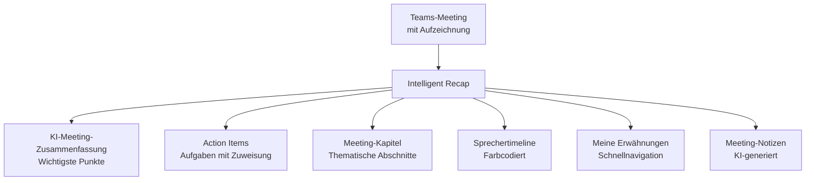

---
tags:
  - microsoft365
  - teams
  - teams-premium
  - ki
  - copilot
aliases:
  - Teams Premium Features
  - Intelligent Recap
---

# Teams Premium

> [!ABSTRACT] TL;DR
> Teams Premium ist ein Add-on zu Microsoft Teams, das KI-gestützte Meeting-Features (Intelligent Recap, Live-Übersetzung), erweiterte Event-Typen (Advanced Webinars, Town Halls), Meeting-Schutzfunktionen (Wasserzeichen, Sensitivitätslabels, E2E-Verschlüsselung) und Custom Branding hinzufügt. Die Lizenz kostet ca. 7 USD/Benutzer/Monat und baut auf einer bestehenden Teams-Lizenz auf.

---

## Was ist Teams Premium?

Teams Premium ist ein **Add-on-Abonnement** für Microsoft Teams, das über die Standardfunktionen hinaus KI-gestützte, Sicherheits- und Produktivitäts-Features bietet. Es richtet sich an Organisationen, die:

- **KI-gestützte Meeting-Zusammenfassungen** und Nachbereitung benötigen
- **Große Events** (Webinare, Town Halls) professionell durchführen
- **Erhöhte Meeting-Sicherheit** durch Wasserzeichen und Verschlüsselung benötigen
- **Einheitliches Branding** für externe Meetings wünschen

> [!NOTE] Teams Premium vs. Microsoft 365 Copilot
> Teams Premium fokussiert auf Meeting- und Event-Features. Microsoft 365 Copilot ist breiter und umfasst Copilot in Word, Excel, Outlook, etc. Beide Lizenzen enthalten **Intelligent Recap** für Meetings — sie ergänzen sich aber nicht doppelt.

---

## Lizenzierung

| Lizenz | Preis (ca.) | Enthält |
|---|---|---|
| **Teams Premium** | ~7 USD/Benutzer/Monat | Alle Premium-Features für diesen Benutzer |
| **Microsoft 365 Copilot** | ~30 USD/Benutzer/Monat | Copilot überall + Intelligent Recap |

**Voraussetzungen:**
- Aktive Microsoft 365 / Teams-Lizenz (F1, F3, E1, E3, E5, Business Basic/Standard/Premium)
- Teams Premium ist ein **Add-on** — nicht eigenständig

**Zuweisung:**
```powershell
# Teams Premium Lizenz prüfen und zuweisen
# Via M365 Admin Center oder Graph PowerShell
$user = Get-MgUser -UserId "user@contoso.com"
Set-MgUserLicense -UserId $user.Id `
    -AddLicenses @{SkuId = "<Teams-Premium-SKU-ID>"} `
    -RemoveLicenses @()
```

---

## Intelligent Recap

Intelligent Recap ist das **Kernfeature von Teams Premium** — eine KI-gestützte automatische Meeting-Nachbereitung.

### Funktionsumfang



| Feature | Beschreibung |
|---|---|
| **Zusammenfassung** | KI-generierter Text mit den wichtigsten Diskussionspunkten |
| **Action Items** | Automatisch erkannte Aufgaben mit zugewiesenen Personen |
| **Kapitel** | Meeting in thematische Abschnitte unterteilt mit Zeitstempeln |
| **Sprechertimeline** | Farbcodierte Zeitleiste: wer hat wann gesprochen |
| **@-Erwähnungen** | Direkte Navigation zu Stellen, wo man namentlich erwähnt wurde |
| **Meeting-Notizen** | Vollständig strukturierte Notizen aus dem Transkript |

### Verfügbarkeit und Voraussetzungen

- Meeting **muss aufgezeichnet** werden (OneDrive/SharePoint)
- **Transkription** muss aktiv sein während des Meetings
- Nur der **Organisator, Co-Organizer und Presenter** mit Teams Premium haben Zugriff auf den Recap-Tab
- Verfügbar für: Meetings, Webinare, Town Halls (GA ab Anfang 2025)
- Zugriff: Teams-Kalender → Meeting → Reiter **Recap**

> [!IMPORTANT] Recap-Lizenz-Anforderung
> Nur Benutzer mit **Teams Premium oder M365 Copilot**-Lizenz sehen den Recap-Tab. Teilnehmer ohne diese Lizenz sehen nur die Aufzeichnung und das Transkript (falls freigegeben).

---

## Advanced Webinars

Teams Premium erweitert die Standard-Webinar-Funktionen erheblich:

| Feature | Standard-Webinar | Teams Premium Webinar |
|---|---|---|
| **Registrierungsseite** | ✅ Einfach | ✅ Mit Custom Branding |
| **Registrierungsfelder** | Vordefiniert | ✅ Benutzerdefinierte Felder |
| **Teilnehmer-Warteliste** | ❌ | ✅ |
| **Manuelle Genehmigung** | ❌ | ✅ Registrierungsanfragen genehmigen |
| **Kapazitätsgrenze** | ❌ | ✅ Max. Teilnehmerzahl festlegen |
| **Grüner Raum (Green Room)** | ❌ | ✅ Vorbesprechung für Referenten |
| **Follow-up E-Mails** | ❌ | ✅ Automatische Nachfass-E-Mails |
| **Q&A** | ✅ Basic | ✅ Erweitert (Moderation, anonym) |
| **Intelligent Recap** | ❌ | ✅ |
| **RTMP-Streaming** | ❌ | ✅ (via Town Hall) |

### Green Room (Grüner Raum)

Der **Green Room** ermöglicht es Referenten, sich vor dem Event zu treffen, ohne dass Teilnehmer zugehört werden:
- Referenten können Präsentationen und Technik testen
- Teilnehmer sehen bis zum Event-Start einen Warteraum
- Keine separaten Meeting-Links nötig

---

## Town Halls (erweitert)

Teams Premium erweitert Town Halls um professionelle Broadcast-Features:

| Feature | Standard Town Hall | Teams Premium Town Hall |
|---|---|---|
| **Teilnehmer** | Bis 10.000 | Bis 20.000 |
| **RTMP-Out** | ❌ | ✅ Stream zu YouTube, LinkedIn etc. |
| **Live-Übersetzung** | ❌ | ✅ 40+ Sprachen |
| **Intelligent Recap** | ❌ | ✅ (ab 2025) |
| **Q&A erweitert** | Basic | ✅ Moderiert, anonyme Fragen |
| **Custom Event Theme** | ❌ | ✅ |
| **Gleichzeitige Events** | 15 | 50 |

---

## Meeting-Schutzfunktionen

### Wasserzeichen (Watermarks)

Wasserzeichen blenden die **E-Mail-Adresse jedes Teilnehmers** als visuelles Overlay ein:
- Auf geteilten Inhalten (Präsentationen, Bildschirmfreigaben)
- Auf Video-Feeds der Teilnehmer
- Verhindert Screenshot-basiertes Leaken von sensiblen Inhalten

**Aktivierung:** Meeting-Optionen → Wasserzeichen aktivieren (nur mit Teams Premium)

> [!WARNING] Wasserzeichen-Einschränkungen
> Wenn Wasserzeichen aktiviert sind, sind **bestimmte Features deaktiviert**: Aufzeichnung für Teilnehmer, zusammen notieren, Whiteboard. Kompatibler mit compliance-kritischen Meetings als mit kollaborativen Workshops.

### End-to-End-Verschlüsselung (E2EE)

E2E-Verschlüsselung für höchste Meeting-Sicherheit:
- Verschlüsselung direkt zwischen Teilnehmern
- Microsoft hat **keinen Zugriff** auf Meeting-Inhalte
- **Einschränkungen**: Kein Aufzeichnen, keine Live-Untertitel, max. 200 Teilnehmer, kein PSTN

### Sensitivity Labels für Meetings

- Meeting erhält ein **Purview Sensitivity Label** (z.B. "Vertraulich", "Intern")
- Label steuert automatisch: Lobby-Bypass, Aufzeichnung, externe Teilnehmer
- Label ist im Meeting-Titel für alle Teilnehmer sichtbar

---

## Custom Meeting Templates

Vordefinierte Meeting-Konfigurationen, die Meetingseinstellungen erzwingen oder vorbelegen:

| Template-Einstellung | Beschreibung |
|---|---|
| **Lobby-Bypass** | Vordefiniert, nicht änderbar |
| **Aufzeichnung** | Automatisch starten und sperren |
| **Wasserzeichen** | Pflichtmäßig aktivieren |
| **Sensitivity Label** | Vordefiniertes Label |
| **Beschriftung** | Template-Name für Benutzer sichtbar |

**Konfiguration:** Teams Admin Center → Meetings → Meeting-Vorlagen → Vorlage hinzufügen

---

## Custom Meeting Branding

Organisationen können die **Meeting-Lobby** und Beitrittsseite individuell gestalten:

| Branding-Element | Beschreibung |
|---|---|
| **Logo** | Unternehmenslogo in der Meeting-Lobby |
| **Hintergrundbild** | Benutzerdefiniertes Lobby-Hintergrundbild |
| **Organisation** | Unternehmensname in der Lobby |
| **Theme-Farben** | Akzentfarben |

**Konfiguration:** Teams Admin Center → Meetings → Meeting-Anpassung → Designs

---

## Advanced Virtual Appointments

Teams Premium erweitert **Virtual Appointments** (früher Bookings-Meetings) für Kundeninteraktionen:

| Feature | Standard | Teams Premium |
|---|---|---|
| **Appointment-Lobby** | Basic | ✅ Gebrandete Warteseite |
| **SMS-Benachrichtigungen** | ❌ | ✅ Termin-Erinnerungen |
| **Analytics** | ❌ | ✅ Wartezeiten, Abbruchraten |
| **Queue-Ansicht** | ❌ | ✅ Alle Termine im Überblick |

---

## Features-Vergleich: Standard vs. Premium

| Feature-Kategorie | Teams Standard | Teams Premium |
|---|---|---|
| **Meetings** | Bis 1.000 Teilnehmer | = (kein Limit-Unterschied) |
| **Webinare** | Einfache Registrierung | Erweiterte Registrierung, Green Room, Follow-up |
| **Town Halls** | Bis 10.000, 15 gleichzeitig | Bis 20.000, 50 gleichzeitig, RTMP-Out |
| **Intelligent Recap** | ❌ | ✅ |
| **Live-Übersetzung** | ❌ | ✅ (Town Hall, 40+ Sprachen) |
| **Wasserzeichen** | ❌ | ✅ |
| **E2EE Meetings** | ❌ (nur 1:1 Calls) | ✅ (bis 200 Teilnehmer) |
| **Sensitivity Labels** | ❌ | ✅ |
| **Meeting Templates** | ❌ | ✅ |
| **Meeting Branding** | ❌ | ✅ |
| **Teams Rooms KI** | Eingeschränkt | ✅ (mit Teams Rooms Pro) |
| **Virtual Appointments** | Basic | ✅ Erweitert |

---

## Roadmap und aktuelle Features 2024/2025

| Feature | Status (Stand 2024/2025) |
|---|---|
| Intelligent Recap für Town Halls und Webinare | GA ab Anfang 2025 |
| RTMP-Out für Town Halls | GA |
| Live-Untertitel-Übersetzung (40+ Sprachen) | GA |
| Town Hall: 20.000 Teilnehmer | GA |
| Custom Meeting Templates | GA |
| Intelligent Speaker in Teams Rooms | GA (mit Teams Rooms Pro) |
| Copilot-Integration in Teams Premium | Fortlaufende Erweiterung |

---

## Teams Premium Administration

### Policy-Konfiguration

```powershell
# Teams Premium Features in Meeting Policy aktivieren
Set-CsTeamsMeetingPolicy -Identity "Global" `
    -AllowWatermarkForCameraVideo $false `
    -AllowWatermarkForScreenSharing $false

# Für Premium-Benutzer Wasserzeichen erlauben
New-CsTeamsMeetingPolicy -Identity "Premium-Users" `
    -AllowWatermarkForCameraVideo $true `
    -AllowWatermarkForScreenSharing $true

Grant-CsTeamsMeetingPolicy -Identity "executive@contoso.com" -PolicyName "Premium-Users"
```

### Meeting-Vorlage erstellen (Admin Center)

Teams Admin Center → Meetings → Meeting-Vorlagen → Vorlage hinzufügen:

1. Vorlage benennen (sichtbar für Organisator beim Meeting erstellen)
2. Meeting-Einstellungen konfigurieren (mit "Gesperrt" vs. "Standard" Verhalten)
3. Sensitivity Label zuweisen (optional)
4. Vorlage für alle oder bestimmte Benutzer verfügbar machen (Meeting-Vorlagenrichtlinie)

---

## Häufige Teams Premium Anwendungsszenarien

| Szenario | Empfohlene Premium-Features |
|---|---|
| **Aufsichtsrat-Meetings** | Wasserzeichen + E2EE + Sensitivity Label "Vertraulich" |
| **Kunden-Webinare** | Advanced Webinars + Custom Branding + Follow-up E-Mails |
| **All-Hands-Meeting** | Town Hall + RTMP-Out + Intelligent Recap |
| **Training und Schulungen** | Webinare + Warteliste + Manuelle Genehmigung |
| **Compliance-kritische Calls** | E2EE + Sensitivity Labels + Intelligent Recap |
| **Große Unternehmens-Events** | Town Hall + Live-Übersetzung + Q&A |

---

## Verwandte Notizen

- [[Teams Grundlagen]]
- [[Meetings und Live Events]]
- [[Governance und Policies]]
- [[Teams Rooms]]
- [[Teams PowerShell]]
- [[Meetings und Live Events]]
- [[Governance und Policies]]
- [[Teams Rooms]]
- [[Teams PowerShell]]
