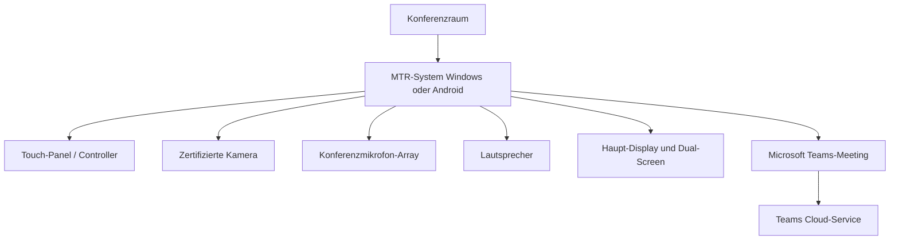

---
tags:
  - microsoft365
  - teams
  - teams-rooms
  - hardware
  - konferenzraum
aliases:
  - MTR
  - Teams Rooms MTR
  - Microsoft Teams Rooms
---

# Teams Rooms

> [!ABSTRACT] TL;DR
> Microsoft Teams Rooms (MTR) sind dedizierte Konferenzraumsysteme, die Teams-Meetings auf zertifizierter Hardware nativ ausführen. MTR gibt es auf Windows- und Android-Basis und wird durch Teams Rooms Basic (kostenlos, eingeschränkt) oder Teams Rooms Pro (vollständig, KI-Features) lizenziert. Das Teams Rooms Pro Management Portal ermöglicht zentrale Remote-Verwaltung aller Räume.

---

## Konzept: Microsoft Teams Rooms

Microsoft Teams Rooms (MTR) ist ein System für **Konferenzräume**, das eine native Teams-Erfahrung auf dedizierter Hardware bereitstellt — ohne PC und ohne manuelles Meeting-Beitreten über den Laptop.

**Kernfunktionen:**
- **One-Touch Join**: Geplante Meetings mit einem Tastendruck starten
- **Raumkalender**: Raum-Mailbox zeigt Tagesbuchungen auf dem Touch-Panel
- **Kamera, Mikrofon, Lautsprecher**: Zertifizierte Peripherie für optimale Audio/Video-Qualität
- **Content-Sharing**: Kabellos oder kabelgebunden (HDMI, Surface Hub)
- **Proximity Join**: PC-Nutzer im Raum joinen Meeting über den Raum-Computer
- **Intelligenzte Kamerasysteme**: Rednerverfolgungs-KI, Gesichtserkennung für Teilnehmer-Listen



---

## MTR on Windows vs. MTR on Android

Beide Plattformen ermöglichen Teams Rooms, unterscheiden sich aber in Verwaltung, Funktionsumfang und Hardware-Ökosystem:

| Merkmal | MTR on Windows | MTR on Android |
|---|---|---|
| **Betriebssystem** | Windows 10/11 IoT Enterprise | Android 9–12 (herstellerabhängig) |
| **App-Basis** | UWP Teams Rooms App | Teams Android-App (angepasst) |
| **Verwaltung** | Intune (Windows-Profil) | Teams Admin Center + Intune |
| **Feature-Parität** | Vollständig (first to receive) | Leicht nachgelagert |
| **Dual-Screen** | Vollständig unterstützt | Eingeschränkt (herstellerabhängig) |
| **Front Row Layout** | Ja | Ja |
| **Content Camera** | Ja | Eingeschränkt |
| **Surface Hub** | Eigenständige Kategorie | Nein |
| **Update-Modell** | Windows Update + Store | OTA-Update vom Hersteller |
| **Preis** | Tendenziell höher | Tendenziell günstiger |

> [!TIP] Wahl der Plattform
> **MTR on Windows** empfiehlt sich für Enterprise-Umgebungen mit komplexen Anforderungen und Dual-Screen-Setups. **MTR on Android** ist für einfachere Räume und mittlere Unternehmen eine kosteneffizientere Wahl.

---

## Zertifizierte Hardware und Hersteller

Nur **Microsoft-zertifizierte Hardware** wird offiziell für Teams Rooms unterstützt:

### MTR on Windows — Systeme (Auswahl)

| Hersteller | Gerät |
|---|---|
| **Logitech** | Rally Bar, Rally Bar Mini, Tap IP System |
| **Poly** | Studio X70, G10-T, G10 |
| **Crestron** | Flex UC-M150-T, Flex UC-M70 |
| **Lenovo** | ThinkSmart Hub 500, ThinkSmart Core |
| **HP** | Slice for Meeting Rooms |
| **Yealink** | MVC640, MVC930 |

### MTR on Android — Systeme (Auswahl)

| Hersteller | Gerät |
|---|---|
| **Logitech** | Rally Bar, Rally Bar Mini (Android-Variante) |
| **Yealink** | MVC840, MVC940, A20, A30 |
| **DTEN** | D7X 55, D7X 75 |
| **Neat** | Neat Board, Neat Bar Pro |
| **Poly** | Studio X30, Studio X50, Studio X70 |
| **Cisco** | Room Bar, Room Kit EQ |

### Zertifizierte Peripherie

| Kategorie | Beispiele |
|---|---|
| **Kameras** | Logitech PTZ Pro 2, Poly Eagle Eye IV, Jabra PanaCast 50 |
| **Mikrofone** | Shure Stem Ceiling, Jabra Speak2 75, Nureva HDL310 |
| **Touch-Controller** | Logitech Tap, Crestron TSS-7, Yealink CTP18 |
| **Interaktive Displays** | Surface Hub, SMART Board GX |

Vollständige Liste: [Teams devices certified for Microsoft Teams](https://learn.microsoft.com/en-us/microsoftteams/rooms/certified-hardware)

---

## Surface Hub

Der **Microsoft Surface Hub** (Surface Hub 2S, Surface Hub 3) ist ein eigenständiges All-in-One-Gerät für Besprechungen und kreative Zusammenarbeit:

- Integriertes 4K-Display (55" oder 85")
- Windows 11 Team-Edition (Surface Hub 3) oder Teams Rooms on Windows
- Stift- und Touch-Bedienung für interaktive Zusammenarbeit
- Integrierte Kamera, Mikrofon und Lautsprecher
- **Microsoft Whiteboard** als primäre Kollaborationsanwendung
- Kann als MTR-System für Teams-Meetings genutzt werden

> [!NOTE] Surface Hub 3
> Surface Hub 3 (ab 2023) läuft auf **Windows 11 mit Teams Rooms**. Es unterstützt als erstes Surface Hub Intelligent Speaker-Erkennung und Front Row. Ältere Surface Hub 2S-Geräte können per Upgrade-Cartridge auf Surface Hub 3 upgegradet werden.

---

## Via Teams Admin Center (UI)

### Teams Rooms-Geräte verwalten

1. Öffne das **Teams Admin Center** unter [admin.teams.microsoft.com](https://admin.teams.microsoft.com)
2. Navigiere zu **Geräte → Teams Rooms unter Windows** (oder **Teams Rooms unter Android**)
3. Hier siehst du alle registrierten MTR-Geräte mit Status (Online/Offline), App-Version und letzter Aktivität
4. Klicke auf einen Raum um Details einzusehen:
   - **Übersicht:** Gerätezustand, Hardware-Status, installierte App-Version
   - **Aktivität:** Meeting-Verlauf und Nutzungsdaten der letzten 30 Tage
   - **Diagnose:** Verbindungs- und Audio/Video-Tests direkt aus dem Admin Center starten
5. Aktionen pro Gerät (oben rechts oder per Kontextmenü):
   - **Neustart:** Remote-Neustart des MTR-Systems auslösen
   - **Einstellungen:** Konfiguration pushen (Theme, Anmeldeeinstellungen)
   - **Tags:** Raum mit Tags versehen für bessere Filterung und Gruppenoperationen
   - **Diagnose:** Automatische Netzwerk- und Medientests starten

### Mehrere Geräte gleichzeitig verwalten

1. Navigiere zu **Geräte → Teams Rooms unter Windows** (oder Android)
2. Aktiviere die Kontrollkästchen mehrerer Räume
3. Wähle eine Bulk-Aktion: **Neustart**, **Tags hinzufügen** oder **Update** anstoßen

### Raum-Lizenz zuweisen

1. Öffne das **Microsoft 365 Admin Center** unter [admin.microsoft.com](https://admin.microsoft.com)
2. Navigiere zu **Benutzer → Aktive Benutzer**
3. Suche das Raumkonto (z.B. `konferenzraum-a@contoso.com`)
4. Klicke auf das Raumkonto → **Lizenzen und Apps**
5. Wähle **Teams Rooms Basic** (kostenlos, max. 25 Räume pro Tenant) oder **Teams Rooms Pro**
6. Klicke auf **Änderungen speichern**

> [!TIP]
> Für erweiterte Raumverwaltung mit automatischen Updates, Health-Score, Incident-Erkennung und Update-Ringen steht das **Teams Rooms Pro Management Portal** unter [portal.rooms.microsoft.com](https://portal.rooms.microsoft.com) zur Verfügung — erfordert Teams Rooms Pro-Lizenz pro Raum.

> [!NOTE]
> Das **Raumkonto** (Exchange Online-Ressourcenpostfach) muss vorab per PowerShell oder im **Exchange Admin Center** erstellt und konfiguriert werden (`Set-CalendarProcessing -AutomateProcessing AutoAccept`). Das Teams Admin Center erkennt das Gerät erst nach der ersten erfolgreichen Anmeldung des MTR-Systems mit dem Raumkonto.

---

## Teams Rooms Lizenzierung

Teams Rooms benötigt ein **Raumkonto** und eine **Lizenz**:

### Raumkonto einrichten

Das Raumkonto ist ein Exchange Online **Ressourcen-Postfach** mit Teams-Lizenz:

```powershell
# 1. Ressourcen-Mailbox erstellen (Exchange Online)
New-Mailbox -MicrosoftOnlineServicesID "konferenz-a@contoso.com" `
    -Name "Konferenzraum A" `
    -Room `
    -EnableRoomMailboxAccount $true `
    -RoomMailboxPassword (ConvertTo-SecureString -AsPlainText "P@ssw0rd!" -Force)

# 2. Kalender-Einstellungen konfigurieren
Set-CalendarProcessing -Identity "konferenz-a@contoso.com" `
    -AutomateProcessing AutoAccept `
    -AddOrganizerToSubject $false `
    -DeleteComments $false `
    -DeleteSubject $false `
    -RemovePrivateProperty $false

# 3. Lizenz zuweisen (über M365 Admin Center oder PowerShell)
# Teams Rooms Basic oder Teams Rooms Pro
```

### Lizenz-Vergleich

| Feature | Teams Rooms Basic | Teams Rooms Pro |
|---|---|---|
| **Preis** | Kostenlos (bis 25 Räume) | ~15 USD/Raum/Monat |
| **Meeting Join** | ✅ | ✅ |
| **Raumkalender** | ✅ | ✅ |
| **Content-Sharing** | ✅ | ✅ |
| **Teams Admin Center** | Eingeschränkt | ✅ Vollständig |
| **Pro Management Portal** | ❌ | ✅ |
| **Remote-Diagnose** | ❌ | ✅ |
| **KI-Funktionen** | ❌ | ✅ (Redner-Tracking, etc.) |
| **Intelligent Speaker** | ❌ | ✅ |
| **Front Row** | ❌ | ✅ |
| **Supporttickets** | Standard | Priorität |
| **Firmware-Updates** | Manuell | Automatisiert mit Ringen |

> [!IMPORTANT] Basic-Limit
> Teams Rooms Basic ist kostenlos, aber auf **25 Räume pro Tenant** begrenzt. Ab dem 26. Raum oder für erweiterte Verwaltungsfunktionen ist Teams Rooms Pro erforderlich.

---

## Teams Admin Center: Raumverwaltung

**Teams Admin Center → Geräte → Teams Rooms on Windows / Android**

### Verfügbare Aktionen pro Gerät:

| Aktion | Beschreibung |
|---|---|
| **Gerätestatus** | Online/Offline, App-Version, Hardware-Status |
| **Diagnose** | Verbindungstest, Audio/Video-Test |
| **Neustart** | Remote-Neustart des MTR-Systems |
| **App-Update** | Teams Rooms App-Version aktualisieren |
| **Settings** | Konfiguration pushen (Anmeldeeinstellungen, Theme) |
| **Tags** | Räume mit Tags versehen für Filterung |
| **Konferenzraum-Anzeige** | Raumstatus und nächste Buchungen |

---

## Teams Rooms Pro Management Portal

Das **Pro Management Portal** (`portal.rooms.microsoft.com`) ist der erweiterte Verwaltungsbereich für Teams Rooms Pro:

| Bereich | Inhalt |
|---|---|
| **Übersicht** | Health-Score aller Räume, offene Incidents |
| **Räume** | Individuelle Raum-Status, Diagnosedaten |
| **Incidents** | Automatisch erkannte Probleme mit Empfehlungen |
| **Inventar** | Alle MTR-Geräte mit Hardware-Details |
| **Berichte** | Nutzungsstatistiken, Meeting-Qualität pro Raum |
| **Einstellungen** | Update-Ringe, Benachrichtigungen |

### Update-Ringe im Pro Portal


> [!TIP] Update-Ringe nutzen
> Konfiguriere einige Testräume im **Preview-Ring** und den Rest im **General-Ring**. So können neue Features getestet werden, bevor sie in alle Produktionsräume ausgerollt werden.

---

## Dual-Screen-Setups

Viele Konferenzräume nutzen zwei Bildschirme:

| Bildschirm | Inhalt |
|---|---|
| **Display 1 (links)** | Video-Feed der Remote-Teilnehmer (Meeting-Galerie) |
| **Display 2 (rechts)** | Geteilte Inhalte (Präsentation, Whiteboard) |

**Front Row Layout** (Teams Rooms Pro): Remote-Teilnehmer werden am **unteren Bildschirmrand** angezeigt — ermöglicht natürlicheren Blickkontakt zum Display.

---

## Häufige Probleme und Fehlerbehebung

| Problem | Mögliche Ursache | Lösung |
|---|---|---|
| Raum erscheint offline | Netzwerk-Problem, Absturz | Netzwerk prüfen, Remote-Neustart über Admin Center |
| Meeting kann nicht gestartet werden | Ablaufene Lizenz, Konto-Problem | Lizenz und Exchange-Mailbox prüfen |
| Schlechte Audio-Qualität | Falsche Peripherie-Konfiguration | Mikrofon/Lautsprecher-Einstellungen im Admin Center prüfen |
| Kamera-Freezing | USB-Treiber, Kamera-Firmware | Firmware-Update, USB-Hub prüfen |
| Kein Content-Sharing | HDMI-Verbindung, Treiberproblem | Kabel prüfen, Neustart |
| Updates werden nicht installiert | Update-Ring-Konfiguration | Pro Management Portal: Update-Ring prüfen |
| Auto-Accept funktioniert nicht | CalendarProcessing-Fehler | `Get-CalendarProcessing` und `Set-CalendarProcessing` prüfen |

```powershell
# Raumkonto-Konfiguration prüfen
Get-CalendarProcessing -Identity "konferenz-a@contoso.com" | 
    Select-Object AutomateProcessing, AddOrganizerToSubject, DeleteComments

# Raum-Mailbox-Status prüfen
Get-Mailbox -Identity "konferenz-a@contoso.com" | 
    Select-Object RoomMailboxAccountEnabled, AccountDisabled, IsResource
```

---

## Raumplanung und Sizing

### Raumgrößen und Hardware-Empfehlungen

| Raumgröße | Empfehlung | Kamera | Mikrofon |
|---|---|---|---|
| **Huddleraum** (2–4 Personen) | MTR on Android, kleine Formfaktor-Geräte | Logitech Brio oder integriert | Jabra Speak |
| **Kleiner Konferenzraum** (4–8 Personen) | Logitech Rally Bar Mini, DTEN D7X 55 | Weitwinkel-Kamera | Konferenzmikrofon |
| **Mittlerer Konferenzraum** (8–15 Personen) | Logitech Rally System, Poly Studio X50 | PTZ-Kamera | Deckenmikrofon-Array |
| **Großer Konferenzraum** (15–30 Personen) | Crestron Flex, Poly G10-T Dual | Dual-Kamera-Setup | Mehrere Mikrofon-Einheiten |
| **Boardroom** | Surface Hub 3 oder Premium-MTR | Kamera mit AI-Tracking | Professionelles Mikrofon-Array |

### Raumkonto-Checkliste

```powershell
# Vollständige Raumkonto-Überprüfung
$room = "konferenz-a@contoso.com"

# 1. Mailbox-Status
Get-Mailbox $room | Select-Object RoomMailboxAccountEnabled, AccountDisabled, IsResource

# 2. CalendarProcessing
Get-CalendarProcessing $room | Select-Object AutomateProcessing, AddOrganizerToSubject, DeleteComments

# 3. Lizenz prüfen
Get-MsolUser -UserPrincipalName $room | Select-Object Licenses

# 4. Teams-Registrierung
Get-CsOnlineUser -Identity $room | Select-Object UserPrincipalName, HostedVoiceMail
```

---

## Verwandte Notizen

- [[Teams Grundlagen]]
- [[Meetings und Live Events]]
- [[Teams PowerShell]]
- [[Teams Premium]]
- [[Meetings und Live Events]]
- [[Teams PowerShell]]
- [[Teams Premium]]
