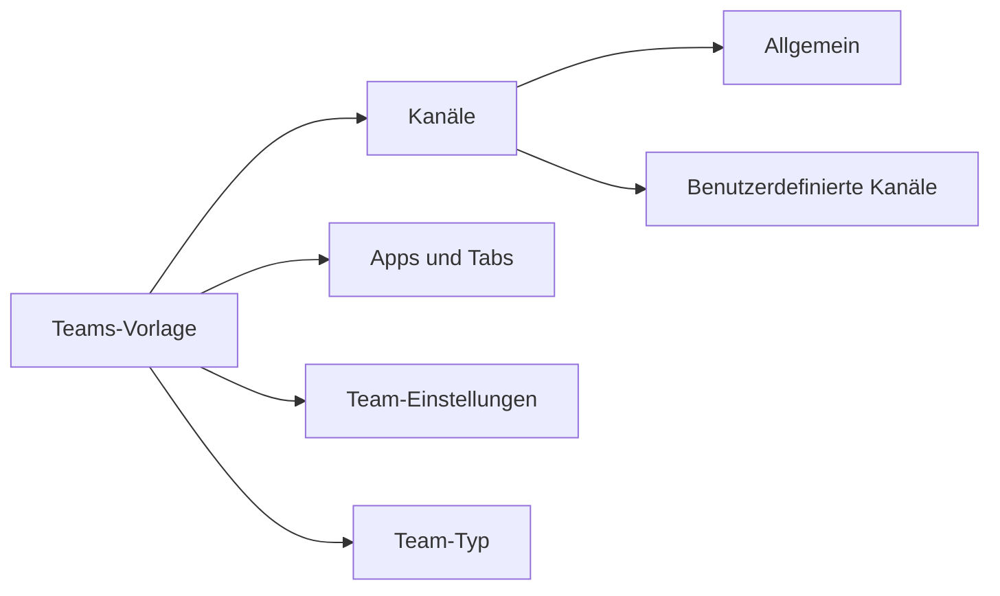
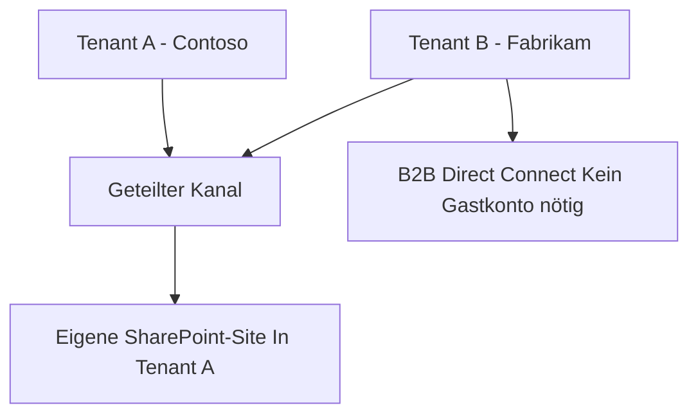
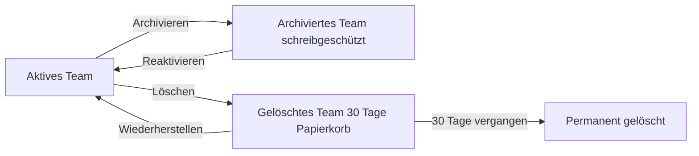

---
tags:
  - microsoft365
  - teams
  - administration
  - kanäle
aliases:
  - Teams verwalten
  - Kanäle verwalten
---

# Teams und Kanäle verwalten

> [!ABSTRACT] TL;DR
> Teams und Kanäle können über das Teams Admin Center, direkt im Teams-Client oder per PowerShell verwaltet werden. Jedes Team basiert auf einer Microsoft 365-Gruppe mit drei Rollen (Owner, Member, Guest). Die drei Kanal-Typen Standard, Privat und Geteilt haben unterschiedliche Speicher- und Zugriffsmodelle. Gelöschte Teams können innerhalb von 30 Tagen wiederhergestellt werden.

---

## Teams erstellen

### Methoden zur Team-Erstellung

| Methode | Vorgehen | Geeignet für |
|---|---|---|
| **Teams-Client** | Teams → Teams beitreten oder erstellen → Team erstellen | Endbenutzer und Admins |
| **Teams Admin Center** | Teams → Teams verwalten → Hinzufügen | IT-Administratoren |
| **PowerShell** | `New-Team` | Bulk-Erstellung, Automatisierung |
| **Microsoft Graph** | REST API `POST /teams` | Entwickler, CI/CD |
| **Admin Center (M365)** | M365 Admin Center → Aktive Teams und Gruppen | Admins (über M365-Gruppen) |

### Team-Erstellung aus Vorlage

Teams-Vorlagen definieren vordefinierte Kanäle, Apps und Einstellungen:



Vordefinierte Vorlagen (Auswahl):
- **Projektmanagement** — Kanäle: Allgemein, Planung, Lieferung
- **Verwalten eines Projekts** — für IT-Teams
- **Onboarding von Mitarbeitern** — HR-Prozesse
- **Healthcare Patient Care** — Klinischer Workflow
- **Retail - Store** — Einzelhandel-spezifisch
- **Klassen-Team** — nur in Education-Tenants

> [!TIP] Eigene Vorlagen
> Im Teams Admin Center unter **Teams → Team-Vorlagen** können eigene Vorlagen (Custom Templates) erstellt werden — auch aus bestehenden Teams heraus. Vorlagen können auf bestimmte Benutzergruppen beschränkt werden.

---

## Via Teams Admin Center (UI)

### Teams erstellen

1. Öffne das **Teams Admin Center** unter [admin.teams.microsoft.com](https://admin.teams.microsoft.com)
2. Navigiere zu **Teams → Teams verwalten**
3. Klicke auf **+ Hinzufügen**
4. Konfiguriere:
   - **Name:** Teamname (unter Berücksichtigung der Naming Policy)
   - **Beschreibung:** Kurze Beschreibung des Zwecks
   - **Datenschutz:** Privat (nur eingeladene Mitglieder) oder Öffentlich (jeder im Tenant kann beitreten)
   - **Vorlage:** Optional eine Team-Vorlage für vordefinierte Kanäle und Apps auswählen
5. Klicke auf **Übernehmen**

### Vorhandenes Team bearbeiten und Mitglieder verwalten

1. Navigiere zu **Teams → Teams verwalten**
2. Klicke auf den **Teamnamen** in der Liste
3. Auf dem Tab **Mitglieder:**
   - Mitglieder hinzufügen: **+ Mitglieder hinzufügen** → Benutzer suchen und Rolle wählen
   - Rolle ändern: Mitglied in der Liste anklicken → Rolle auf **Besitzer** oder **Mitglied** setzen
   - Mitglied entfernen: Mitglied markieren → **Entfernen**
4. Auf dem Tab **Einstellungen:**
   - **Team-Bild** hochladen
   - **Mitgliederberechtigungen** konfigurieren (Kanäle erstellen, Apps hinzufügen, etc.)
   - **Gastberechtigungen** für dieses spezifische Team anpassen
5. Klicke auf **Aktualisieren**

### Team archivieren oder löschen

1. Navigiere zu **Teams → Teams verwalten**
2. Aktiviere das Kontrollkästchen neben dem Team
3. Klicke auf **Archivieren** (schreibgeschützt, alle Daten bleiben erhalten) oder **Löschen** (30 Tage Papierkorb)
4. Gelöschte Teams wiederherstellen: **Filter → Gelöscht** → Team auswählen → **Wiederherstellen**

### Gastzugang konfigurieren

1. Navigiere zu **Org-weite Einstellungen → Gastzugang**
2. Aktiviere **Gastzugang in Microsoft Teams zulassen**
3. Konfiguriere Gast-Berechtigungen für Anrufe, Meetings und Messaging
4. Klicke auf **Speichern**

### Externen Zugriff (Federation) konfigurieren

1. Navigiere zu **Org-weite Einstellungen → Externer Zugriff**
2. Wähle die Einstellung für externe Domänen:
   - **Alle externen Domänen zulassen** (Standard)
   - **Nur bestimmte Domänen zulassen** → Domänen einzeln hinzufügen
   - **Alle externen Domänen blockieren**
3. Aktiviere bei Bedarf **Teams Connect (Shared Channels / B2B Direct Connect)**
4. Klicke auf **Speichern**

> [!TIP]
> Verwaiste Teams (Orphaned Teams ohne Besitzer) findest du im Teams Admin Center unter **Teams → Teams verwalten** mit dem Filter **Keine Besitzer**. Als Admin kannst du dich selbst als Besitzer hinzufügen und das Team anschließend reaktivieren, archivieren oder an einen neuen Besitzer übergeben.

---

## Mitglieder und Rollen

Jedes Team verfügt über drei Rollen mit unterschiedlichen Berechtigungen:

| Aktion | Owner | Member | Guest |
|---|---|---|---|
| Team-Einstellungen ändern | ✅ | ❌ | ❌ |
| Mitglieder hinzufügen/entfernen | ✅ | Konfigurierbar | ❌ |
| Kanäle erstellen (Standard) | ✅ | Konfigurierbar | ❌ |
| Private Kanäle erstellen | ✅ | ✅ | ❌ |
| Shared Channels erstellen | ✅ | ❌ | ❌ |
| Team löschen | ✅ | ❌ | ❌ |
| Team archivieren | ✅ (Admin) | ❌ | ❌ |
| Apps hinzufügen | ✅ | Konfigurierbar | ❌ |
| Tabs hinzufügen | ✅ | ✅ | ❌ |
| Nachrichten senden | ✅ | ✅ | ✅ |
| Nachrichten löschen (eigene) | ✅ | Konfigurierbar | Konfigurierbar |
| @Kanal erwähnen | ✅ | Konfigurierbar | ❌ |

> [!NOTE] Maximal 100 Besitzer pro Team
> Ein Team kann maximal **100 Besitzer** haben. Es wird empfohlen, mindestens **2 Besitzer** pro Team zu konfigurieren, um Orphaned Teams (besitzerlose Teams) zu vermeiden.

> [!WARNING] Verwaiste Teams (Orphaned Teams)
> Wenn alle Besitzer das Unternehmen verlassen, wird das Team zum **Orphaned Team**. Administratoren können sich selbst als Besitzer hinzufügen: Teams Admin Center → Team auswählen → Mitglieder bearbeiten.

### Mitgliederverwaltung per PowerShell

```powershell
# Mitglied hinzufügen
Add-TeamUser -GroupId "xxxxxxxx-xxxx-xxxx-xxxx-xxxxxxxxxxxx" -User "anna@contoso.com" -Role Member

# Besitzer hinzufügen
Add-TeamUser -GroupId "xxxxxxxx-xxxx-xxxx-xxxx-xxxxxxxxxxxx" -User "max@contoso.com" -Role Owner

# Mitglied entfernen
Remove-TeamUser -GroupId "xxxxxxxx-xxxx-xxxx-xxxx-xxxxxxxxxxxx" -User "user@contoso.com"

# Alle Mitglieder eines Teams anzeigen
Get-TeamUser -GroupId "xxxxxxxx-xxxx-xxxx-xxxx-xxxxxxxxxxxx" | Select-Object Name, Role, User
```

---

## Kanal-Typen im Detail

### Standard-Kanal

- Alle Team-Mitglieder haben automatisch Zugriff
- Dateien gespeichert in der **Team-SharePoint-Site** unter `Dokumente/[Kanalname]`
- Unterhaltungen für alle Mitglieder sichtbar
- Jedes Team hat mindestens den **Allgemein**-Kanal (nicht löschbar)

### Privater Kanal

- Nur ausgewählte Team-Mitglieder haben Zugriff
- Erhält eine **eigene SharePoint-Site** (`/sites/[Team]-[Kanal]`)
- Dateien nicht über die Haupt-Team-Site erreichbar
- Maximal **30 private Kanäle** pro Team (Erhöhung auf 1.000 ab 2025/26)
- Maximal **250 Mitglieder** pro privatem Kanal (Erhöhung auf 5.000 geplant)
- Meetings in privaten Kanälen ab 2025 möglich

> [!IMPORTANT] Separate SharePoint-Site für Private Channels
> Die SharePoint-Site eines privaten Kanals ist eine **vollständig separate Site Collection** mit eigenem Speicherkontingent und eigenen Berechtigungen. Sie erscheint im SharePoint Admin Center als eigenständige Site.

### Geteilter Kanal (Shared Channel)

- Ermöglicht die Zusammenarbeit mit **externen Benutzern** aus anderen Tenants
- Nutzt **Azure AD B2B Direct Connect** — keine Gasteinladung nötig
- Externe Nutzer bleiben in ihrer eigenen Organisation angemeldet
- Eigene SharePoint-Site (ähnlich Private Channels)
- Im Teams Admin Center muss **Teams Connect (Shared Channels)** aktiviert sein



### Kanal-Vergleich

| Merkmal | Standard | Privat | Geteilt |
|---|---|---|---|
| Mitgliedschaft | Alle Team-Mitglieder | Teilmenge | Intern + Extern |
| SharePoint-Site | Team-Site (gemeinsam) | Eigene Site | Eigene Site |
| Externe Nutzer | Nein | Nein | Ja (Direct Connect) |
| Max. Mitglieder | 25.000 (wie Team) | 250 (→ 5.000) | 5.000 |
| Limit pro Team | 1.000 gesamt | 30 (→ 1.000) | Im 1.000er-Limit |
| Moderation | Optional | Eingeschränkt | Optional |

---

## Teams archivieren und löschen

### Archivierung

Ein **archiviertes Team** ist schreibgeschützt — Mitglieder können weiterhin Inhalte lesen, aber nichts Neues posten.



**Archivierung über Admin Center:**
Teams Admin Center → Teams verwalten → Team auswählen → Archivieren

**Archivierung per PowerShell:**
```powershell
# Team archivieren (über Graph API)
$groupId = "xxxxxxxx-xxxx-xxxx-xxxx-xxxxxxxxxxxx"
Invoke-MgGraphRequest -Method POST -Uri "https://graph.microsoft.com/v1.0/teams/$groupId/archive"

# Team reaktivieren
Invoke-MgGraphRequest -Method POST -Uri "https://graph.microsoft.com/v1.0/teams/$groupId/unarchive"
```

### Löschen

**Löschen über Admin Center:**
Teams Admin Center → Teams verwalten → Team auswählen → Löschen

**Löschen per PowerShell:**
```powershell
# Team löschen
Remove-Team -GroupId "xxxxxxxx-xxxx-xxxx-xxxx-xxxxxxxxxxxx"
```

> [!DANGER] Datenverlust beim Löschen
> Beim Löschen eines Teams werden die Microsoft 365-Gruppe, SharePoint-Site, gemeinsames Postfach, Planner und OneNote in den **Papierkorb** verschoben. Nach **30 Tagen** ist keine Wiederherstellung mehr möglich.

### Wiederherstellung

**Wiederherstellung über Admin Center:**
Teams Admin Center → Teams verwalten → Filter: Gelöscht → Team auswählen → Wiederherstellen

**Wiederherstellung per PowerShell:**
```powershell
# Gelöschte Gruppen anzeigen
Get-MgDirectoryDeletedItemAsGroup | Select-Object DisplayName, DeletedDateTime

# Gruppe (Team) wiederherstellen
Restore-MgDirectoryDeletedItem -DirectoryObjectId "xxxxxxxx-xxxx-xxxx-xxxx-xxxxxxxxxxxx"
```

---

## Gastzugang konfigurieren

### Aktivierung (zwei Ebenen)

Der Gastzugang muss an **zwei Stellen** aktiviert werden:

1. **Microsoft 365 Admin Center** → Einstellungen → Org-Einstellungen → Dienste → Microsoft 365-Gruppen → Gruppen-Gastmitgliedschaft aktivieren
2. **Teams Admin Center** → Organisationsweite Einstellungen → Gastzugang → Gastzugang in Teams erlauben

> [!WARNING] Weiterer Schalter in Entra ID
> Auch in **Entra ID** → Externe Identitäten → Externe Zusammenarbeit → Einladungseinstellungen muss die Gasteinladung aktiviert sein. Alle drei Schalter müssen aktiv sein.

### Was Gäste können/nicht können

| Funktion | Standard-Gast | Konfigurierbar |
|---|---|---|
| Nachrichten senden und empfangen | ✅ | Nein |
| Dateien hochladen/teilen | ✅ | Nein |
| Meetings beitreten | ✅ | Nein |
| Meetings starten | ❌ | Ja |
| Private Kanäle erstellen | ❌ | Nein |
| Kanäle erstellen (Standard) | ❌ | Ja |
| Team-Einstellungen ändern | ❌ | Nein |
| Andere Mitglieder hinzufügen | ❌ | Nein |
| Apps hinzufügen | ❌ | Ja |
| Giphy/Memes nutzen | ❌ | Ja |

### Gastdomänen einschränken

Im **Teams Admin Center** → Externer Zugriff → Externe Domänen:

```
Erlauben:  partner.com, lieferant.de
Blockieren: wettbewerber.com
```

---

## External Access (Verbund / Federation)

External Access ermöglicht Benutzern, direkt mit Personen in **fremden Teams-Tenants** zu chatten und Anrufe zu tätigen — ohne Gasteinladung.

**Konfiguration:** Teams Admin Center → Externer Zugriff

| Einstellung | Verhalten |
|---|---|
| Externe Zugriffseinstellung: Alle externen Domänen zulassen | Kommunikation mit jedem Teams/Skype-Tenant |
| Nur bestimmte Domänen zulassen | Whitelist-Ansatz |
| Alle blockieren | Keine externe Kommunikation |
| Teams Connect (Shared Channels) | Aktivierung von B2B Direct Connect |

> [!NOTE] Gegenseitigkeit
> External Access funktioniert nur, wenn **beide Tenants** die externe Kommunikation mit der jeweils anderen Domäne erlauben.

---

## Teams Admin Center — Überblick

Das Teams Admin Center (`https://admin.teams.microsoft.com`) ist die zentrale Verwaltungsoberfläche:

| Bereich | Inhalt |
|---|---|
| **Dashboard** | Übersicht Benutzer, Anrufqualität, Service-Health |
| **Teams → Teams verwalten** | Alle Teams anzeigen, erstellen, löschen, archivieren |
| **Teams → Team-Vorlagen** | Standard- und benutzerdefinierte Vorlagen |
| **Benutzer** | Einzelne Benutzer-Policies und Telefonie verwalten |
| **Meetings** | Meeting Policies, Live Events, Conference Bridges |
| **Messaging** | Messaging Policies |
| **Sprache** | Telefonie: Dial Plans, Direct Routing, Calling Plans |
| **Apps** | App-Berechtigungs- und Setup-Policies |
| **Geräte** | Teams Rooms, IP-Telefone, Displays verwalten |
| **Analyse und Berichte** | Nutzungsberichte, Anrufqualitäts-Dashboard |
| **Org-weite Einstellungen** | Gastzugang, Externer Zugriff, Teams-Einstellungen |

---

## Bulk-Operationen per PowerShell

```powershell
# Verbindung herstellen
Connect-MicrosoftTeams

# Alle Teams anzeigen
Get-Team | Select-Object DisplayName, GroupId, Visibility, Archived |
    Sort-Object DisplayName | Export-Csv -Path "Teams-Report.csv" -NoTypeInformation

# Neues Team erstellen
$team = New-Team `
    -DisplayName "Projektteam Alpha" `
    -Description "Projektteam für das Alpha-Projekt 2024" `
    -Visibility Private `
    -AllowGuestCreateUpdateChannels $false

# Mehrere Kanäle zum Team hinzufügen
$channels = @("Planung", "Entwicklung", "Testing", "Deployment")
foreach ($channel in $channels) {
    New-TeamChannel -GroupId $team.GroupId -DisplayName $channel
}

# Mitglieder aus CSV importieren
Import-Csv "Mitglieder.csv" | ForEach-Object {
    Add-TeamUser -GroupId $team.GroupId -User $_.Email -Role $_.Role
}

# Alle Gäste in allen Teams finden
Get-Team | ForEach-Object {
    $teamName = $_.DisplayName
    Get-TeamUser -GroupId $_.GroupId |
        Where-Object { $_.Role -eq "Guest" } |
        Select-Object @{N="Team";E={$teamName}}, Name, User
} | Export-Csv "Gäste-Report.csv" -NoTypeInformation
```

> [!TIP] GroupId vs. TeamId
> Die `GroupId` in Teams-PowerShell-Cmdlets entspricht der **Object-ID der Microsoft 365-Gruppe** in Entra ID. Sie kann auch aus `Get-Team` oder dem Teams Admin Center abgelesen werden.

---

## Verwandte Notizen

- [[Teams Grundlagen]]
- [[Governance und Policies]]
- [[Teams PowerShell]]
- [[Teams Apps und Bots]]
- [[Teams Rooms]]
