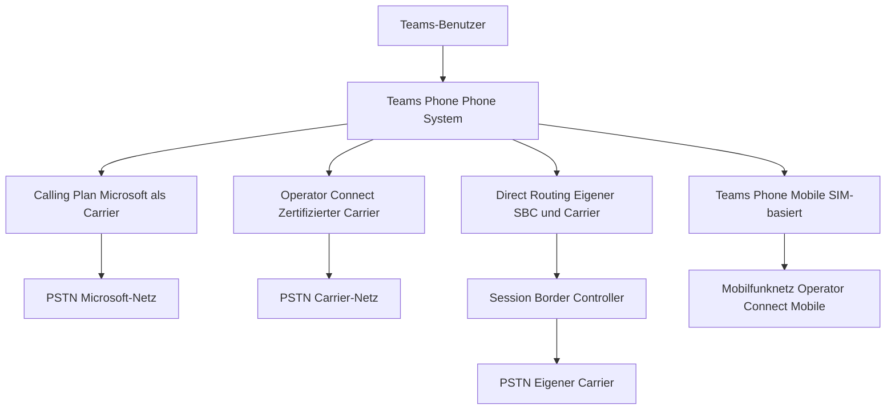
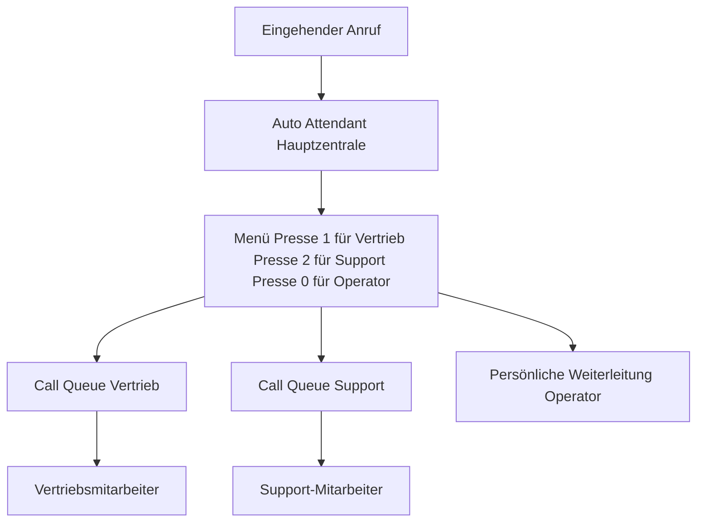

---
tags:
  - microsoft365
  - teams
  - telefonie
  - direct-routing
  - calling-plans
aliases:
  - Teams Phone
  - Teams Telefonie
  - PSTN Teams
---

# Teams-Telefonie

> [!ABSTRACT] TL;DR
> Microsoft Teams Phone ermöglicht klassische PSTN-Telefonie direkt aus Teams heraus. Es gibt drei Anbindungsmodelle: Calling Plans (Microsoft als Carrier), Operator Connect (zertifizierter Carrier) und Direct Routing (eigene SBC-Infrastruktur). Jedes Modell hat eigene Lizenz-, Hardware- und Konfigurationsanforderungen. Für Deutschland stehen alle drei Modelle zur Verfügung.

---

## Microsoft Teams Phone — Überblick

Teams Phone (ehemals: Phone System) ist das cloudbasierte Telefoniesystem von Microsoft, das klassische PBX-Funktionalität in Teams integriert:

- **Anrufe empfangen und tätigen** (intern und extern via PSTN)
- **Auto Attendant** (automatische Telefonzentrale)
- **Call Queues** (Warteschlangen)
- **Voicemail** (Cloud Voicemail)
- **Call Transfer, Hold, Park**
- **Simultanruf und Anrufweiterleitung**
- **E.164-Rufnummernformat** für alle Nummern



---

## Anbindungsmodelle im Vergleich

| Merkmal | Calling Plan | Operator Connect | Direct Routing |
|---|---|---|---|
| **Carrier** | Microsoft | Zertifizierter Partner-Carrier | Beliebiger Carrier |
| **Hardware** | Keine | Keine (SBC beim Carrier) | Eigener/gehosteter SBC |
| **Komplexität** | Sehr gering | Gering | Hoch |
| **Flexibilität** | Gering | Mittel | Sehr hoch |
| **Kosten (pro User)** | Hoch (~15–21 USD/Monat) | Mittel | Gering bei großem Volumen |
| **Länderabdeckung** | ~35 Länder | Carrier-abhängig | Global |
| **Bestehende Nummern portieren** | Ja | Ja | Ja |
| **Legacy-PBX-Integration** | Nein | Eingeschränkt | Ja |
| **Analog-Geräte** | Nein | Nein | Ja (via SBC/ATA) |
| **Verwaltung** | Teams Admin Center | Teams Admin Center + Carrier-Portal | Teams Admin Center + SBC-Konfiguration |

> [!TIP] Wahl des richtigen Modells
> - **Kleines Unternehmen, einfache Anforderungen**: Calling Plan
> - **Mittleres Unternehmen, bestehender Carrier-Vertrag**: Operator Connect
> - **Großes Unternehmen, komplexe Anforderungen, Bestandssystem**: Direct Routing

---

## Calling Plans

Microsoft übernimmt die Rolle des Telefonanbieters. Alle Nummern und Minutenpakete werden direkt von Microsoft bezogen.

### Lizenzierung

| Lizenz | Inhalt |
|---|---|
| **Teams Phone Standard** | Phone System (PBX-Funktionalität) |
| **Teams Phone with Calling Plan** | Phone System + Domestic Calling Plan gebündelt |
| **Domestic Calling Plan** | Inlandsminuten (1.200 oder 3.000 Min./Monat) |
| **International Calling Plan** | Auslandsminuten |
| **Pay-As-You-Go Plan** | Minutengenau abgerechnet |

### Nummernverwaltung

**Teams Admin Center → Sprache → Telefonnummern:**
- Neue Nummern bestellen (je nach Verfügbarkeit im Land)
- Bestehende Nummern portieren (Number Porting)
- Nummern Benutzern oder Diensten (Auto Attendant, Queue) zuweisen

```powershell
# Verfügbare Nummern abfragen
Get-CsPhoneNumberAssignment -CapabilitiesContain VoiceApplicationAssignment

# Nummer einem Benutzer zuweisen
Set-CsPhoneNumberAssignment -Identity "user@contoso.com" `
    -PhoneNumber "+4930123456789" `
    -PhoneNumberType DirectRouting
```

---

## Operator Connect

Operator Connect verbindet Teams über zertifizierte Microsoft-Partner-Carrier. Der Carrier verwaltet den SBC in der Cloud — keine eigene Infrastruktur nötig.

**Konfiguration:** Teams Admin Center → Sprache → Operators

**Verfügbare Carrier für Deutschland (Auswahl):**
- Deutsche Telekom (über Telekom Deutschland)
- Vodafone
- o2 Telefónica
- BT
- Colt Technology Services
- BICS

**Einrichtungsschritte:**
1. Carrier im Teams Admin Center auswählen und autorisieren
2. Nummern beim Carrier bestellen (im Carrier-Portal)
3. Nummern in Teams Admin Center Benutzern zuweisen

> [!NOTE] Operator Connect Accelerator
> Microsoft bietet einen **Operator Connect Accelerator** für schnellere Onboarding-Prozesse. Die Konfigurationstiefe variiert je nach Carrier.

---

## Direct Routing

Direct Routing verbindet Teams über einen **Session Border Controller (SBC)** mit dem öffentlichen Telefonnetz (PSTN) und ermöglicht maximale Flexibilität.

### SBC-Anforderungen

Nur **Microsoft-zertifizierte SBCs** werden für Direct Routing unterstützt:

| Hersteller | Modelle (Auswahl) |
|---|---|
| **AudioCodes** | Mediant 500, 800, 4000 |
| **Ribbon (GENBAND)** | SBC 1000, 2000, 5400 |
| **Oracle** | AP 1100, 3900, 4600 |
| **TE-Systems** | anynode SBC |
| **Cisco** | CUBE Enterprise |
| **Enghouse Networks** | SmartNode |

Vollständige Liste: [Microsoft Teams Certified SBCs](https://learn.microsoft.com/en-us/microsoftteams/direct-routing-border-controllers)

### SBC-Konfigurationsschritte

```powershell
# 1. SBC im Tenant registrieren
New-CsOnlinePSTNGateway `
    -Fqdn "sbc.contoso.com" `
    -SipSignalingPort 5067 `
    -MaxConcurrentSessions 100 `
    -Enabled $true `
    -MediaBypass $false

# 2. Voice Route erstellen (wohin gehen Anrufe?)
New-CsOnlineVoiceRoute `
    -Name "DE-Festnetz" `
    -NumberPattern "^\+49" `
    -OnlinePstnGatewayList "sbc.contoso.com" `
    -Priority 1

# 3. PSTN Usage erstellen
Set-CsOnlinePstnUsage -Usage @{Add = "DE-Standard"}

# 4. Voice Routing Policy erstellen
New-CsOnlineVoiceRoutingPolicy `
    -Name "DE-Standard-Policy" `
    -OnlinePstnUsages "DE-Standard"

# 5. Voice Route mit PSTN Usage verknüpfen
Set-CsOnlineVoiceRoute -Name "DE-Festnetz" -OnlinePstnUsages "DE-Standard"

# 6. Routing Policy einem Benutzer zuweisen
Grant-CsOnlineVoiceRoutingPolicy -Identity "user@contoso.com" -PolicyName "DE-Standard-Policy"

# 7. Telefonnummer zuweisen
Set-CsPhoneNumberAssignment -Identity "user@contoso.com" `
    -PhoneNumber "+4930123456789" `
    -PhoneNumberType DirectRouting
```

### Dial Plans (Normalization Rules)

Dial Plans übersetzen intern gewählte Nummernformate ins E.164-Format (`+49...`).

```powershell
# Normalization Rule erstellen (Beispiel: 0-Vorwahl → +49)
$rule = New-CsVoiceNormalizationRule `
    -Name "DE-Nationalformat" `
    -Description "0XXX → +49XXX" `
    -Pattern "^0(\d+)$" `
    -Translation "+49$1" `
    -IsInternalExtension $false `
    -InMemory

New-CsOnlineDialPlan `
    -Identity "DE-Dialplan" `
    -NormalizationRules @{Add = $rule}

Grant-CsTenantDialPlan -Identity "user@contoso.com" -PolicyName "DE-Dialplan"
```

---

## Voicemail (Cloud Voicemail)

Cloud Voicemail ist automatisch für alle Teams Phone-Benutzer mit Exchange Online verfügbar:

- Voicemail-Nachrichten landen in der **Exchange Online-Mailbox** (Voicemail-Ordner)
- Automatische **Transkription** der Sprachnachricht
- Konfigurierbare **Begrüßungsnachrichten**
- Weiterleitung an E-Mail möglich

**Konfiguration per PowerShell:**
```powershell
# Voicemail-Einstellungen für Benutzer
Set-CsOnlineVoicemailUserSettings -Identity "user@contoso.com" `
    -VoicemailEnabled $true `
    -OofGreetingEnabled $false

# Voicemail-Policy erstellen
New-CsOnlineVoicemailPolicy -Identity "Executives" `
    -EnableTranscription $true `
    -EnableEditingCallAnswerRulesSetting $true
```

---

## Auto Attendant (Telefonzentrale)

Auto Attendants sind automatische Telefonzentralen, die Anrufer durch ein Menüsystem leiten.

**Funktionen:**
- Sprachgesteuerte Navigation (Speech Recognition)
- DTMF-Menüoptionen (Tastendrücke)
- Begrüßungsnachrichten (Text-to-Speech oder Audiodatei)
- Weiterleitungen zu: Benutzer, Call Queue, Voicemail, andere Auto Attendants
- Zeitbasierte Weiterleitungen (Öffnungszeiten vs. Außerhalb der Öffnungszeiten)
- Feiertags-Konfiguration

**Lizenzierung:** Ressourcenkonto + **Microsoft Teams Phone Resource Account**-Lizenz (kostenlos)



---

## Call Queues (Warteschlangen)

Call Queues nehmen eingehende Anrufe an und verteilen sie nach konfigurierbaren Regeln auf Agenten.

**Routing-Methoden:**

| Methode | Verhalten |
|---|---|
| **Attendant** | Alle Agenten klingeln gleichzeitig |
| **Serial** | Agenten in definierter Reihenfolge |
| **Round Robin** | Gleichmäßig rotierend |
| **Longest Idle** | Längste Leerlaufzeit zuerst |

**Weitere Einstellungen:**
- Maximale Warteschlangenlänge (Anzahl Anrufe)
- Maximale Wartezeit
- Musik beim Warten (Audiodatei)
- Overflow-Aktion (bei Überlauf: Voicemail, Weiterleitung, Trennung)
- Timeout-Aktion (bei Ablauf der Wartezeit)

---

## Rufnummern-Verwaltung

### Nummernformate

Teams Phone verwendet ausschließlich das **E.164-Format**: `+[Ländervorwahl][Vorwahl][Rufnummer]`

| Beispiel | Format |
|---|---|
| Deutsche Festnetznummer | `+4930123456789` |
| Deutsche Mobilnummer | `+4917612345678` |
| US-Nummer | `+12125551234` |

### Number Porting

Bestehende Nummern können zu Teams portiert werden:
1. **Letter of Authorization (LOA)** beim aktuellen Carrier anfordern
2. LOA im Teams Admin Center hochladen
3. Portierungsantrag stellen
4. Portierungsdatum bestätigen (Carrier-abhängig: 2–6 Wochen)

---

## Emergency Calling

Teams unterstützt **dynamisches Emergency Calling** (Enhanced 911 / E112):

- **Standortbasiert**: Teams ermittelt den physischen Standort des Anrufers
- **Netzwerk-basierte Standorterkennung**: Subnetz-IP-Adressen werden mit Standorten verknüpft
- **Notfall-Routing**: Anrufe gehen an die lokale Rettungsstelle (PSAP)
- **Benachrichtigung**: Sicherheitspersonal im Unternehmen kann benachrichtigt werden

**Konfiguration:** Teams Admin Center → Sprache → Notfallrichtlinien und Notfall-Adressen

---

## Call Quality Dashboard (CQD)

Das **Call Quality Dashboard** (CQD) ermöglicht detaillierte Analyse der Anrufqualität:

- **Zugriff:** `cqd.teams.microsoft.com`
- **Daten:** Netzwerk-Metriken, Jitter, Paketverlust, Round-Trip-Time
- **Reports:** Poor Call Rate, Audio/Video-Qualität pro Standort/Gebäude
- **Gebäude-Daten hochladen**: Subnetz → Gebäude-Mapping für standortspezifische Analyse

```powershell
# Anrufqualität per PowerShell abfragen
Get-CsUserCallRecord -Identity "user@contoso.com" -StartTime (Get-Date).AddDays(-7)

# Direkt Routing SBC-Status prüfen
Get-CsOnlinePSTNGateway | Select-Object Fqdn, Enabled, SipSignalingPort
```

---

## Lizenzierungsübersicht

| Szenario | Benötigte Lizenz(en) |
|---|---|
| PBX-Funktionen (intern) | Teams Phone Standard |
| + Calling Plan (Microsoft als Carrier) | Teams Phone Standard + Domestic/International Calling Plan |
| + Operator Connect | Teams Phone Standard (Carrier-Vertrag separat) |
| + Direct Routing | Teams Phone Standard (SBC + Carrier separat) |
| Auto Attendant / Call Queue | Microsoft Teams Phone Resource Account (kostenlos) |
| Teams Phone Mobile | Teams Phone Standard + Mobile Operator Connect Lizenz |

---

## Verwandte Notizen

- [[Teams Grundlagen]]
- [[Teams Phone Mobile]]
- [[Teams PowerShell]]
- [[Governance und Policies]]
