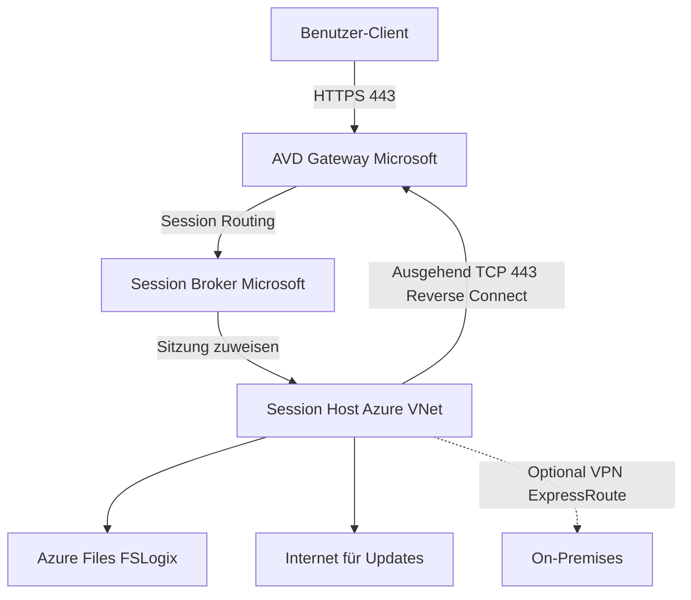
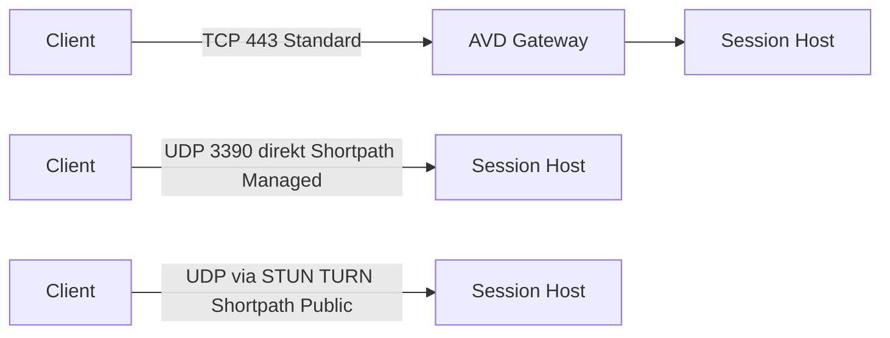

---
tags:
  - microsoft365
  - azure
  - avd
  - networking
  - identity
  - entra-id
  - rdp-shortpath
aliases:
  - AVD Netzwerk
  - AVD Identität
  - AVD Connectivity
---

# AVD Netzwerk und Identität

> [!ABSTRACT] TL;DR
> AVD-Session-Hosts kommunizieren über ausgehende Verbindungen (Reverse Connect) mit dem Microsoft-verwalteten Control Plane — keine eingehenden Ports nötig. Entra ID Join oder Hybrid Entra Join steuern die Identität. RDP Shortpath, Private Link und Teams Optimization optimieren Leistung und Sicherheit.

---

## Netzwerkarchitektur

### Grundprinzip: Reverse Connect

Das wichtigste Konzept im AVD-Netzwerk ist **Reverse Connect**: Session Hosts bauen ausgehende Verbindungen zum Microsoft AVD Gateway auf — es gibt **keine eingehenden Verbindungen** aus dem Internet zu den Session Hosts. Kein RDP-Port 3389 muss nach außen geöffnet werden.



Die Verbindung funktioniert so:
1. Client verbindet sich zum AVD Gateway (HTTPS/443)
2. Broker weist eine verfügbare Session Host VM zu
3. Session Host hat bereits eine ausgehende Verbindung zum Gateway registriert
4. Datenkanal wird über diese bestehende Verbindung aufgebaut

> [!WARNING] Reverse Connect — Kein RDP offen lassen
> Da AVD Reverse Connect nutzt, müssen KEINE eingehenden Ports (TCP 3389 oder andere) auf Session Hosts geöffnet werden. NSG-Regeln sollten explizit eingehenden RDP-Traffic blockieren.

---

## Erforderliche URLs und Ports (Firewall-Whitelist)

Session Hosts benötigen ausgehenden Zugriff auf folgende Endpunkte:

| Kategorie | URL / Bereich | Protokoll | Port |
|-----------|---------------|-----------|------|
| AVD Control Plane | *.wvd.microsoft.com | TCP | 443 |
| AVD Gateway | rdgateway.wvd.microsoft.com | TCP | 443 |
| Entra ID / Azure AD | login.microsoftonline.com | TCP | 443 |
| Microsoft Graph | graph.microsoft.com | TCP | 443 |
| Windows Update | *.update.microsoft.com | TCP | 443/80 |
| Azure DNS | 168.63.129.16 | UDP/TCP | 53 |
| Intune | *.manage.microsoft.com | TCP | 443 |
| RDP Shortpath (Public) | STUN: *.relay.teams.microsoft.com | UDP | 3478 |
| RDP Shortpath (Managed) | Direkte UDP-Verbindung | UDP | 3390 |
| NTP | time.windows.com | UDP | 123 |

> [!TIP] Azure Service Tags nutzen
> Statt einzelne IP-Bereiche zu pflegen, empfiehlt Microsoft die Nutzung von Azure Service Tags in NSG-Regeln: `WindowsVirtualDesktop`, `AzureActiveDirectory`, `AzureMonitor`, `Storage`.

```powershell
# NSG-Regel für AVD Control Plane (ausgehend)
New-AzNetworkSecurityRuleConfig `
    -Name "Allow-AVD-ControlPlane" `
    -Access Allow `
    -Protocol Tcp `
    -Direction Outbound `
    -Priority 100 `
    -SourceAddressPrefix VirtualNetwork `
    -SourcePortRange * `
    -DestinationAddressPrefix WindowsVirtualDesktop `
    -DestinationPortRange 443
```

---

## Entra ID Join vs. Hybrid Entra Join

Die Wahl des Join-Typs entscheidet über die Identitätsintegration der Session Hosts:

| Kriterium | Entra ID Join (Cloud-only) | Hybrid Entra Join |
|-----------|--------------------------|-------------------|
| AD DS On-Premises | Nicht erforderlich | Erforderlich (Domain Controller) |
| Azure Network Connection | Nicht zwingend | Zwingend (für DC-Verbindung) |
| SSO zu On-Prem-Ressourcen | Eingeschränkt (Kerberos via Entra) | Vollständig (nativer Kerberos) |
| FSLogix Storage Auth | Azure Files + Entra ID Kerberos | AD DS Kerberos |
| Einfachheit | Hoch | Mittel |
| Empfohlen für | Cloud-first Organisationen | Hybride Umgebungen |
| Kosten | Geringer (kein DC in Azure nötig) | Höher (DC-VMs oder AD DS) |

> [!NOTE] Entra ID Join als Trend
> Microsoft empfiehlt zunehmend den reinen Entra ID Join, da Azure Files nun Entra ID Kerberos-Authentifizierung unterstützt. Dies ermöglicht FSLogix ohne lokale AD-Infrastruktur — ideal für cloud-only Deployments.

---

## Single Sign-On (SSO) mit Entra ID

SSO für AVD ermöglicht es Benutzern, sich ohne erneute Anmeldedateneingabe mit ihrem Session Host zu verbinden. Die Entra ID-Authentifizierung des Clients wird direkt für die AVD-Verbindung genutzt.

### Voraussetzungen für SSO
- Session Hosts: Entra ID Join oder Hybrid Entra Join
- Windows 11 oder Windows 10 21H2+ auf Session Hosts
- Aktueller Remote Desktop Client oder Windows App
- SSO in den Host Pool RDP Properties aktiviert

### SSO konfigurieren

```powershell
# SSO für Host Pool über PowerShell aktivieren
Update-AzWvdHostPool `
    -ResourceGroupName "rg-avd-prod" `
    -Name "hp-avd-pooled" `
    -SingleSignOnWithEntraId Enabled

# Alternativ: RDP Properties direkt setzen
Update-AzWvdHostPool `
    -ResourceGroupName "rg-avd-prod" `
    -Name "hp-avd-pooled" `
    -CustomRdpProperty "enablerdsaadauth:i:1;"
```

SSO unterstützt auch **Passwordless Authentication** (FIDO2-Keys, Windows Hello for Business), wenn dies in Entra ID konfiguriert ist.

---

## Conditional Access für AVD

AVD-Verbindungen lassen sich mit Entra ID Conditional Access Policies steuern. Zwei Service Principals sind für AVD relevant:

- **Azure Virtual Desktop**: Steuert Feed-Zugriff und Web-Client
- **Windows Virtual Desktop**: Steuert den eigentlichen Verbindungsaufbau

### Empfohlene CA-Policies

| Policy | Bedingung | Aktion |
|--------|-----------|--------|
| MFA für externe Nutzer | Standort != Firmennetz | MFA erfordern |
| Geräte-Compliance | Device nicht compliant | Zugriff blockieren |
| Session Controls | Alle AVD-Verbindungen | Session-Timeout, App-Controls |

```powershell
# Conditional Access Policy für AVD (Beispiel via Graph API)
$CAPolicy = @{
    displayName = "AVD - MFA für externe Nutzer"
    state = "enabled"
    conditions = @{
        applications = @{
            includeApplications = @("9cdead84-a844-4324-93f2-b2e6bb768d07") # Azure Virtual Desktop
        }
        locations = @{
            excludeLocations = @("AllTrusted")
        }
    }
    grantControls = @{
        operator = "OR"
        builtInControls = @("mfa")
    }
}
```

> [!IMPORTANT] CA auf beide App IDs anwenden
> Conditional Access muss auf "Azure Virtual Desktop" (Feed) UND "Windows Virtual Desktop" (Verbindung) angewendet werden, um vollständig zu greifen. Nur eine App zu schützen reicht nicht.

---

## RDP-Eigenschaften konfigurieren

Host Pool RDP Properties steuern das Verhalten der Remote Desktop Verbindung:

| Property | Wert | Beschreibung |
|---------|------|-------------|
| `audiocapturemode:i:1` | 1 = aktiviert | Mikrofon-Weiterleitung zum Session Host |
| `camerastoredirect:s:*` | * = alle | Kamera-Weiterleitung |
| `drivestoredirect:s:` | leer = deaktiviert | Laufwerks-Umleitung (Sicherheit: deaktivieren) |
| `redirectclipboard:i:1` | 1 = aktiviert | Zwischenablage-Umleitung |
| `use multimon:i:1` | 1 = aktiviert | Multi-Monitor-Unterstützung |
| `enablerdsaadauth:i:1` | 1 = aktiviert | SSO mit Entra ID |
| `videoplaybackmode:i:1` | 1 = aktiviert | Multimedia-Weiterleitung |

```powershell
# RDP Properties für Host Pool setzen
$RDPProperties = "audiocapturemode:i:1;camerastoredirect:s:*;drivestoredirect:s:;redirectclipboard:i:0;use multimon:i:1;"

Update-AzWvdHostPool `
    -ResourceGroupName "rg-avd" `
    -Name "hp-avd-prod" `
    -CustomRdpProperty $RDPProperties
```

---

## RDP Shortpath

RDP Shortpath verbessert die Verbindungsqualität, indem es eine **direkte UDP-Verbindung** zwischen Client und Session Host (oder über STUN/TURN-Relay) aufbaut, anstatt den gesamten Datenstrom über das HTTPS-Gateway zu leiten.



| Modus | Voraussetzung | Port | Latenz-Vorteil |
|-------|--------------|------|----------------|
| **Reverse Connect (Standard)** | Nur HTTPS | TCP 443 | Baseline |
| **Shortpath Managed** | ExpressRoute oder VPN zum Client | UDP 3390 | Sehr hoch |
| **Shortpath Public** | STUN/TURN-Relay erreichbar | UDP 3478 | Mittel bis hoch |

```powershell
# RDP Shortpath auf Session Host aktivieren (Registry)
$RegPath = "HKLM:\SYSTEM\CurrentControlSet\Control\Terminal Server\WinStations"
Set-ItemProperty -Path $RegPath -Name "ICEControl" -Value 2 -Type DWORD

# Windows Firewall: UDP 3390 eingehend für Shortpath Managed
New-NetFirewallRule `
    -DisplayName "AVD RDP Shortpath UDP" `
    -Direction Inbound `
    -Protocol UDP `
    -LocalPort 3390 `
    -Action Allow
```

---

## Private Link für AVD

Azure Private Link ermöglicht es, AVD-Verbindungen vollständig über das private Microsoft-Netzwerk zu führen — ohne öffentliche Internet-Verbindungen.

### Private Endpoints in AVD

| Endpoint-Typ | Ressource | Beschreibung |
|-------------|----------|-------------|
| Feed Discovery | Global AVD Service | Einmalig pro Tenant |
| Feed Download | Workspace | Pro Workspace ein Endpoint |
| Host Pool Connection | Host Pool | Pro Host Pool ein Endpoint |

Für jeden Private Endpoint werden entsprechende **Private DNS Zones** benötigt:
- `privatelink.wvd.microsoft.com`
- `privatelink.servicebus.windows.net`

> [!NOTE] Private Link für regulierte Umgebungen
> Private Link eignet sich besonders für Branchen mit strengen Compliance-Anforderungen (Finanzwesen, Gesundheitswesen, Behörden), wo kein Datenverkehr über das öffentliche Internet fließen darf.

---

## Bandwidth-Empfehlungen

| Szenario | Empfohlene Bandbreite pro Benutzer |
|---------|-----------------------------------|
| Einfache Office-Arbeit (kein Video) | 1,5 Mbps |
| Teams Audio-Anruf | 1,5 Mbps |
| Teams Video-Anruf (720p) | 3–4 Mbps |
| Teams Bildschirmfreigabe | 4 Mbps |
| 4K Video-Wiedergabe | 15 Mbps |
| 3D/CAD-Anwendungen | 10–20 Mbps |

---

## Teams Optimization (WebRTC Redirect)

Teams Media-Daten werden bei korrekt konfigurierter Optimization direkt zwischen Client und Teams-Server ausgetauscht — der Session Host überträgt nur die Steuerbefehle. Dies reduziert die Serverlast und verbessert die Audio-/Videoqualität erheblich.

### Voraussetzungen
- **Session Host**: Remote Desktop WebRTC Redirector Service (`MsRdcWebRTCSvc`) installiert
- **Client**: Aktueller Remote Desktop Client oder Windows App
- **Netzwerk**: Client hat direkten Internet-Zugriff zu Teams-Servern

```powershell
# WebRTC Redirector Service auf Session Host installieren
$WebRTCUrl = "https://aka.ms/msrdcwebrtcsvc/msi"
$WebRTCFile = "$env:TEMP\MsRdcWebRTCSvc.msi"

Invoke-WebRequest -Uri $WebRTCUrl -OutFile $WebRTCFile
Start-Process msiexec.exe -ArgumentList "/i $WebRTCFile /quiet /qn" -Wait

# Service prüfen
Get-Service -Name "RDWebRTCSvc" | Select-Object Status, StartType
```

> [!TIP] Teams Optimization prüfen
> In einer AVD-Sitzung: Teams → Einstellungen → Diagnose und Feedback. Dort steht "Virtuelle Desktop-Optimierung: aktiviert", wenn WebRTC Redirect funktioniert.

---

## GPU-Treiber für Session Hosts

Für GPU-beschleunigte Workloads (Grafikrendering, CAD, KI):

| GPU-Typ | VM-Series | Treiber | Installation |
|---------|-----------|---------|-------------|
| NVIDIA GRID | NV, NVv3 | NVIDIA GRID Driver | VM Extension oder manuell |
| AMD | NVv4 | AMD GPU Driver | VM Extension |

```powershell
# NVIDIA GPU-Treiber via VM Extension installieren
Set-AzVMExtension `
    -ResourceGroupName "rg-avd" `
    -VMName "avd-sessionhost-01" `
    -Name "NvidiaGpuDriverWindows" `
    -Publisher "Microsoft.HpcCompute" `
    -Type "NvidiaGpuDriverWindows" `
    -TypeHandlerVersion "1.3" `
    -Location "westeurope"
```

---

## Proximity Placement Groups

Proximity Placement Groups (PPG) stellen sicher, dass Session Hosts und Azure Files Storage in derselben Availability Zone platziert sind — minimiert die Latenz für FSLogix-Profilzugriffe.

```powershell
# Proximity Placement Group erstellen
New-AzProximityPlacementGroup `
    -ResourceGroupName "rg-avd" `
    -Name "ppg-avd-westeu" `
    -Location "westeurope" `
    -ProximityPlacementGroupType Standard

# VM in PPG deployen
$PPG = Get-AzProximityPlacementGroup -ResourceGroupName "rg-avd" -Name "ppg-avd-westeu"
# PPG beim VM-Deployment in der VM-Konfiguration referenzieren
```

---

## Troubleshooting Verbindungsprobleme

| Fehlermeldung | Wahrscheinliche Ursache | Lösung |
|---------------|------------------------|--------|
| "No resources available" | Alle VMs ausgelastet oder offline | VM-Status prüfen, Scaling Plan prüfen |
| "Can't connect to gateway" | Firewall blockiert *.wvd.microsoft.com | NSG und Firewall-Regeln prüfen |
| "Authentication failed" | Token abgelaufen, CA-Policy | Re-Login, CA-Audit-Logs prüfen |
| Langsame oder stockende Verbindung | RDP Shortpath nicht aktiv | Shortpath aktivieren, UDP-Ports prüfen |
| Audio/Video-Probleme in Teams | WebRTC Redirector fehlt | MsRdcWebRTCSvc installieren |
| "Profile not loaded" | FSLogix-Fehler | FSLogix Logs unter C:\ProgramData\FSLogix\Logs prüfen |
| Schwarzer Bildschirm | Display-Treiber-Problem | GPU-Treiber prüfen / VM neu starten |

```powershell
# Konnektivität zu AVD Control Plane prüfen
$EndPoints = @(
    "rdgateway.wvd.microsoft.com",
    "rdbroker.wvd.microsoft.com",
    "login.microsoftonline.com"
)

foreach ($EP in $EndPoints) {
    $Result = Test-NetConnection -ComputerName $EP -Port 443
    Write-Host "$EP : $($Result.TcpTestSucceeded)" -ForegroundColor $(if($Result.TcpTestSucceeded){"Green"}else{"Red"})
}
```

---

## Verwandte Notizen

- [[Azure Virtual Desktop AVD]]
- [[FSLogix]]
- [[Windows 365 Cloud PC]]
- [[RDS vs AVD vs W365 Vergleich]]
