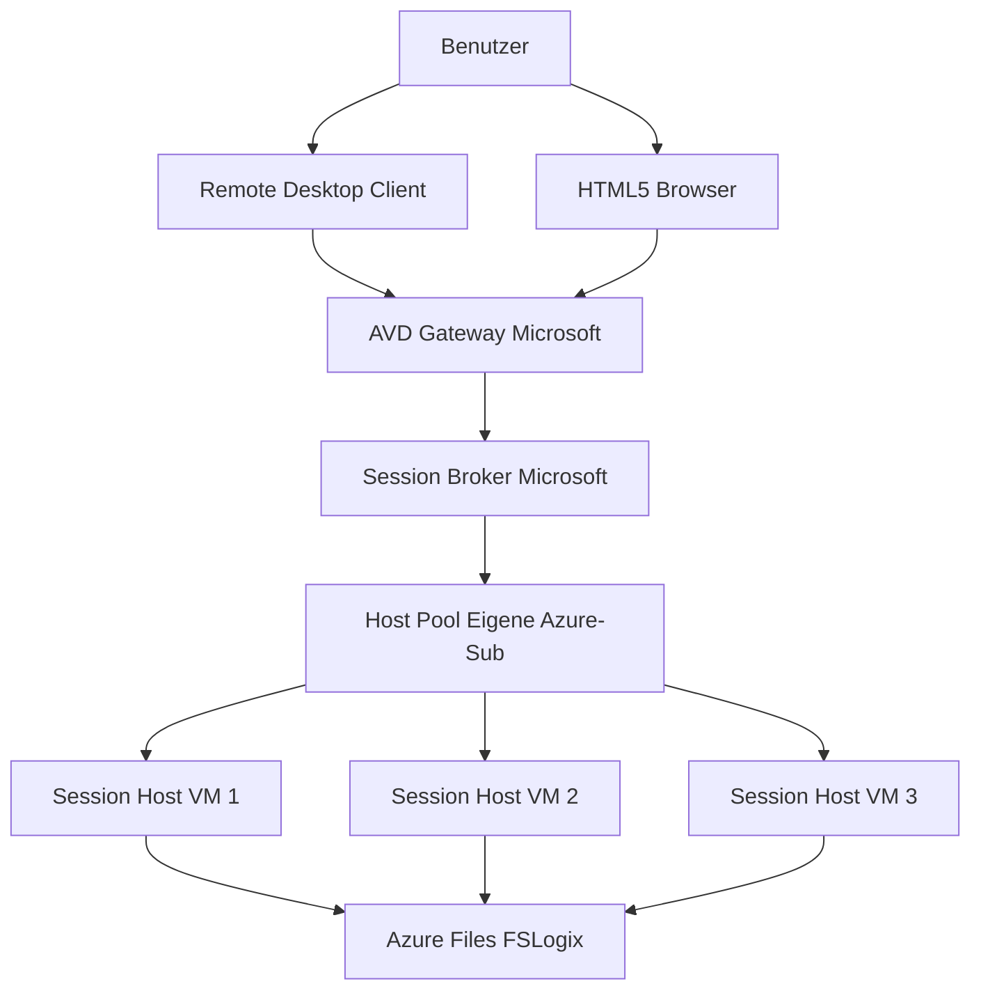
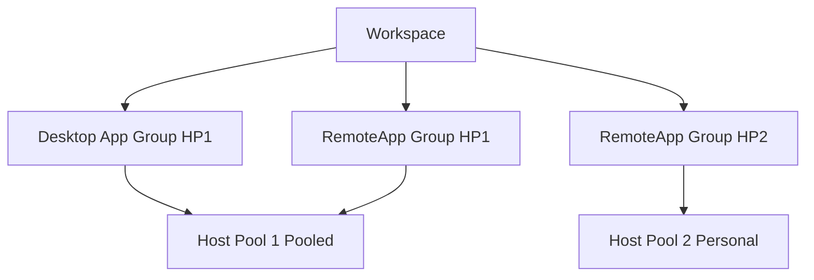

---
tags:
  - microsoft365
  - azure
  - avd
  - virtual-desktop
  - host-pool
  - fslogix
aliases:
  - AVD
  - Azure Virtual Desktop
  - Windows Virtual Desktop
  - WVD
---

# Azure Virtual Desktop AVD

> [!ABSTRACT] TL;DR
> Azure Virtual Desktop (AVD) ist Microsofts cloud-native Desktop- und App-Virtualisierungsdienst. Der Control Plane wird vollständig von Microsoft verwaltet, Session Hosts laufen in der eigenen Azure-Subscription. AVD unterstützt Windows 10/11 Multi-Session und ist in M365 E3/E5 inkludiert.

---

## Was ist Azure Virtual Desktop?

Azure Virtual Desktop — früher als **Windows Virtual Desktop (WVD)** bekannt — ist eine PaaS-Lösung für Desktop- und Anwendungsvirtualisierung in der Azure-Cloud. Im Gegensatz zu klassischen Remote Desktop Services (RDS) übernimmt Microsoft den **Control Plane** vollständig: Connection Broker, Gateway, Web Access und Lizenzserver werden nicht mehr selbst betrieben.

Was in der eigenen Azure-Subscription verbleibt: die **Session Host VMs**, das Netzwerk (VNet, NSG, Firewall) und der Storage (z.B. Azure Files für FSLogix Profile Container). Diese Trennung ermöglicht maximale Flexibilität bei gleichzeitig reduziertem Infrastruktur-Aufwand.

Ein wichtiger Unterschied zu Windows 365: AVD bietet **Windows 10/11 Multi-Session** — mehrere Benutzer können gleichzeitig dieselbe VM nutzen. Dies macht AVD deutlich kosteneffizienter für Szenarien, in denen viele Standard-Büroarbeitsplätze benötigt werden.

---

## Architektur

### Überblick



### Microsoft-verwalteter Control Plane

Microsoft betreibt folgende Dienste vollständig (ohne Kosten für eigene VMs):

| Komponente | Funktion |
|-----------|----------|
| **Web Access** | HTML5-Webclient und Feed-API |
| **Gateway** | Sichere Verbindungsvermittlung (RDP over HTTPS / UDP Shortpath) |
| **Broker** | Session-Load-Balancing und Verbindungswiederherstellung |
| **Diagnostics** | Telemetrie und Monitoring-Datensammlung |
| **Resource Directory** | Verzeichnis der veröffentlichten Ressourcen |

### Eigene Azure-Subscription

In der eigenen Subscription befinden sich:
- **Session Host VMs** im Azure VNet
- **Azure Storage** für FSLogix Profile Container
- **Networking** (VNet, Subnets, NSG, optional Azure Firewall)
- **Log Analytics Workspace** für AVD Insights

---

## Kernkomponenten

### Host Pools

Ein **Host Pool** ist der zentrale Container in AVD. Er fasst eine Gruppe von Session Host VMs zusammen, die denselben Load Balancer, dieselben App Groups und dieselbe Konfiguration teilen. Jeder Host Pool hat mindestens eine App Group, über die Benutzer Zugriff erhalten.

**Host Pool Typen:**
- **Pooled**: Mehrere Benutzer teilen sich eine VM (Windows 10/11 Multi-Session). Kosteneffizient für Standard-Arbeitsplätze.
- **Personal**: Jede VM ist exklusiv einem Benutzer zugewiesen. Für Power-User, Entwickler oder Anwendungen mit besonderen Anforderungen.

### Session Hosts

Session Hosts sind die Azure VMs, auf denen Benutzersitzungen ausgeführt werden. Sie werden beim Host Pool über ein **Registration Token** registriert. Jeder Session Host hat den **AVD Agent** und den **AVD Bootloader** installiert.

Unterstützte Betriebssysteme:

| Betriebssystem | Multi-Session | Empfohlen für |
|----------------|---------------|----------------|
| Windows 11 Enterprise Multi-Session | Ja | Pooled — Standard-Arbeitsplätze |
| Windows 10 Enterprise Multi-Session | Ja | Pooled — Legacy |
| Windows 11 Enterprise | Nein | Personal Host Pool |
| Windows Server 2022 Datacenter | Ja | Legacy-Anwendungen |
| Windows Server 2019 Datacenter | Ja | Ältere App-Kompatibilität |

> [!NOTE] Windows Multi-Session ist Azure-exklusiv
> Windows 10/11 Enterprise Multi-Session darf nur in Azure (und damit in AVD) eingesetzt werden. Diese OS-Version ist nicht für On-Premises lizenziert.

### App Groups

App Groups definieren, welche Ressourcen Benutzer aus einem Host Pool nutzen können:

- **Desktop App Group**: Stellt einen vollständigen Windows-Desktop bereit. Pro Host Pool kann nur eine Desktop App Group existieren.
- **RemoteApp Group**: Veröffentlicht einzelne Anwendungen, die für den Benutzer wie lokale Apps aussehen. Mehrere RemoteApp Groups pro Host Pool möglich.

### Workspaces

Ein **Workspace** ist der Einstiegspunkt für Benutzer — er fasst mehrere App Groups aus verschiedenen Host Pools zusammen. Im Remote Desktop Client oder Browser sieht der Benutzer alle ihm zugewiesenen Ressourcen gebündelt in einem Workspace.



---

## Host Pool Typen im Detail

### Pooled Host Pools — Load Balancing

Bei Pooled Host Pools entscheidet der Load-Balancing-Algorithmus, auf welchem Session Host eine neue Sitzung gestartet wird:

| Algorithmus | Verhalten | Geeignet für |
|-------------|-----------|--------------|
| **BreadthFirst** | Verteilt Sitzungen gleichmäßig auf alle VMs | Hohe Verfügbarkeit, gleichmäßige Last |
| **DepthFirst** | Füllt zuerst eine VM vollständig, dann die nächste | Kostenoptimierung (weniger VMs nötig) |

Die maximale Anzahl gleichzeitiger Sitzungen pro VM wird mit `MaxSessionLimit` konfiguriert.

### Personal Host Pools — Zuweisung

Bei Personal Host Pools wird jedem Benutzer eine dedizierte VM zugewiesen:

- **Automatische Zuweisung**: Beim ersten Login erhält der Benutzer eine noch nicht zugewiesene VM
- **Direkte Zuweisung**: Administrator weist manuell eine VM einem Benutzer zu

---

## AVD Agent und Bootloader

Jeder Session Host benötigt zwei Komponenten für die Kommunikation mit dem AVD Control Plane:

- **AVD Agent** (`Microsoft.RDInfra.RDAgent`): Stellt die Verbindung zum Control Plane her und verwaltet Sitzungen
- **AVD Bootloader** (`Microsoft.RDInfra.RDAgentBootLoader`): Verwaltet Updates des AVD Agents

```powershell
# AVD Agent herunterladen und installieren
$AgentURL = "https://query.prod.cms.rt.microsoft.com/cms/api/am/binary/RWrmXv"
$BootloaderURL = "https://query.prod.cms.rt.microsoft.com/cms/api/am/binary/RWrxrH"

$AgentFile = "$env:TEMP\AVDAgent.msi"
$BootloaderFile = "$env:TEMP\AVDBootloader.msi"

Invoke-WebRequest -Uri $AgentURL -OutFile $AgentFile
Invoke-WebRequest -Uri $BootloaderURL -OutFile $BootloaderFile

# Bootloader zuerst installieren
Start-Process msiexec.exe -ArgumentList "/i $BootloaderFile /quiet /qn" -Wait

# Dann Agent mit Registration Token
Start-Process msiexec.exe `
    -ArgumentList "/i $AgentFile /quiet /qn REGISTRATIONTOKEN=<RegistrationToken>" `
    -Wait

Write-Host "AVD Agent Installation abgeschlossen" -ForegroundColor Green
```

> [!TIP] Automatisierung via Azure Image Builder
> Für Produktionsumgebungen empfiehlt sich die Automatisierung über Azure Image Builder (Packer-basiert) oder Custom Script Extensions beim VM-Deployment. Agent-Updates erfolgen danach automatisch durch den Bootloader.

---

## Scaling Plans (Autoscaling)

Scaling Plans automatisieren das Ein- und Ausschalten von Session Hosts basierend auf Zeitplänen und Auslastung — eine der wichtigsten Kostenspar-Funktionen in AVD.

### Phasen eines Scaling Plans


| Phase | Typische Zeiten | Verhalten |
|-------|----------------|-----------|
| **Ramp-up** | 07:00–09:00 | VMs hochfahren vor dem Arbeitsbeginn |
| **Peak** | 09:00–17:00 | Maximale Kapazität, Schwellenwert für neue VMs |
| **Ramp-down** | 17:00–20:00 | Benutzer abmelden (nach Timeout), VMs runterfahren |
| **Off-peak** | 20:00–07:00 | Minimale VMs aktiv (z.B. 1 für Notfälle) |

```powershell
# Scaling Plan erstellen
New-AzWvdScalingPlan -ResourceGroupName "rg-avd" `
    -Name "sp-business-hours" `
    -Location "westeurope" `
    -HostPoolType Pooled `
    -TimeZone "W. Europe Standard Time"
```

---

## RemoteApp vs. Full Desktop

| Merkmal | RemoteApp | Full Desktop |
|---------|-----------|-------------|
| Nutzererlebnis | Einzelne App läuft wie lokal | Vollständiger Windows-Desktop in RDP-Fenster |
| Ressourcen | Geteilt (Pooled) oder dediziert | Geteilt oder dediziert |
| Technologie | App erscheint nahtlos im lokalen Desktop | Klassische RDP-Sitzung |
| Anwendungsfall | Einzelne Legacy-App veröffentlichen | Vollständiger Arbeitsplatz |
| Verwaltung | App Group veröffentlicht .exe-Pfad | Desktop App Group |

**RemoteApp-Beispiel**: Ein Unternehmen hat eine Legacy-Anwendung, die nur auf Windows Server 2019 läuft. Mit RemoteApp erscheint diese Anwendung für Benutzer wie eine lokale Anwendung, läuft aber tatsächlich auf dem AVD Session Host.

---

## Images für Session Hosts

### Azure Marketplace Images

Microsoft stellt optimierte Multi-Session-Images bereit:

| Image | Inhalt | Geeignet für |
|-------|--------|--------------|
| Windows 11 Enterprise Multi-Session + M365 Apps | Win 11, Teams, Office | Standard-Arbeitsplatz |
| Windows 10 Enterprise Multi-Session + M365 Apps | Win 10, Teams, Office | Legacy-Kompatibilität |
| Windows 11 Enterprise Multi-Session | Win 11, kein Office | Office separat installieren |

### Custom Images mit Azure Compute Gallery

```powershell
# Custom Image aus generalisierter VM erstellen
# Schritt 1: VM generalisieren (auf der Quell-VM)
& "$env:SystemRoot\System32\Sysprep\sysprep.exe" /oobe /generalize /shutdown /mode:vm

# Schritt 2: Image in Compute Gallery erstellen
$ImageDefinition = New-AzGalleryImageDefinition `
    -ResourceGroupName "rg-images" `
    -GalleryName "acg-avd" `
    -GalleryImageDefinitionName "avd-win11-ms" `
    -Location "westeurope" `
    -Publisher "Contoso" `
    -Offer "AVD-Image" `
    -Sku "Win11-MS" `
    -OsState Generalized `
    -OsType Windows `
    -HyperVGeneration V2
```

---

## Monitoring mit Azure Monitor und AVD Insights

AVD bietet ein integriertes Monitoring-Dashboard — **AVD Insights** — direkt im Azure Portal:

| Metrik | Beschreibung | Schwellenwert |
|--------|-------------|---------------|
| **User Input Delay** | Zeit bis zur Reaktion auf Eingaben | < 150 ms (gut), > 500 ms (kritisch) |
| **Frame Skip** | Ausgefallene Frames bei der Übertragung | < 5% |
| **Session Count** | Aktive Sitzungen pro VM | Nahe MaxSessionLimit = warnen |
| **Round Trip Time** | Netzwerklatenz Client↔Gateway | < 100 ms (optimal) |
| **CPU/RAM** | VM-Ressourcenauslastung | > 85% = weitere VMs benötigt |

```powershell
# Diagnostics an Log Analytics Workspace senden
$DiagSettings = @{
    WorkspaceId = "/subscriptions/<Sub>/resourceGroups/<RG>/providers/Microsoft.OperationalInsights/workspaces/<WS>"
    Logs = @(
        @{ Category = "Checkpoint"; Enabled = $true },
        @{ Category = "Error"; Enabled = $true },
        @{ Category = "Management"; Enabled = $true },
        @{ Category = "Connection"; Enabled = $true },
        @{ Category = "HostRegistration"; Enabled = $true }
    )
}

Set-AzDiagnosticSetting -ResourceId "/subscriptions/<Sub>/resourceGroups/<RG>/providers/Microsoft.DesktopVirtualization/hostPools/hp-avd" @DiagSettings
```

---

## Lizenzierung

AVD-Nutzungsrechte sind in folgenden Lizenzen enthalten — ohne Zusatzkosten für die AVD-Plattform selbst:

| Lizenz | AVD-Berechtigung |
|--------|-----------------|
| Microsoft 365 E3/E5 | Ja — Windows Multi-Session inkludiert |
| Microsoft 365 Business Premium | Ja |
| Windows E3/E5 (mit Azure) | Ja |
| Windows VDA (pro Gerät) | Ja |

> [!IMPORTANT] Es fallen Azure-Compute-Kosten an
> Die AVD-Plattform selbst ist kostenlos (kein Aufschlag für Broker/Gateway). Kosten entstehen für die Azure VMs (Session Hosts), den Storage (Azure Files für FSLogix) und das Netzwerk. Scaling Plans reduzieren diese Kosten erheblich durch automatisches Herunterfahren inaktiver VMs.

---

## Verwandte Notizen

- [[Windows 365 Cloud PC]]
- [[AVD Netzwerk und Identität]]
- [[FSLogix]]
- [[RDS vs AVD vs W365 Vergleich]]
