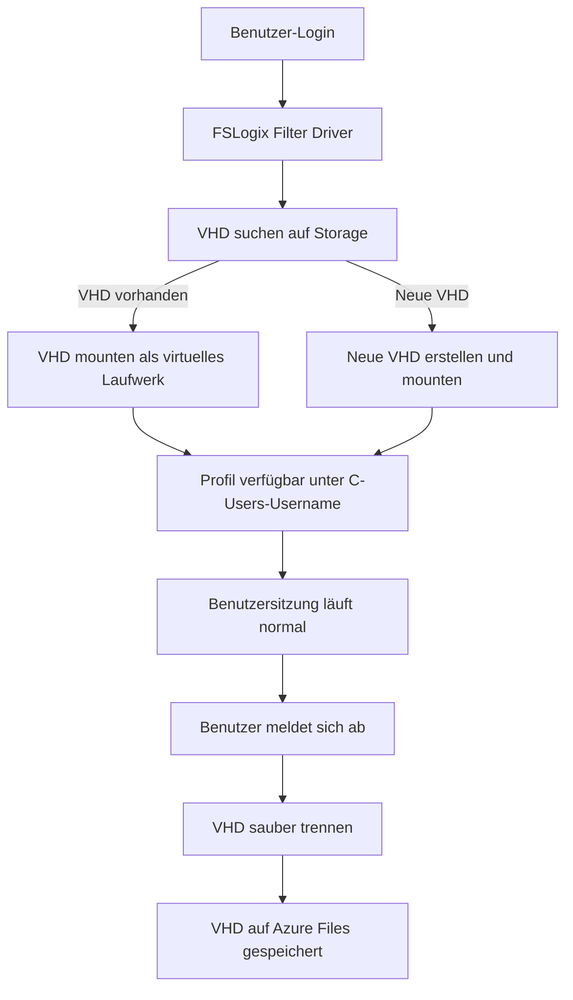
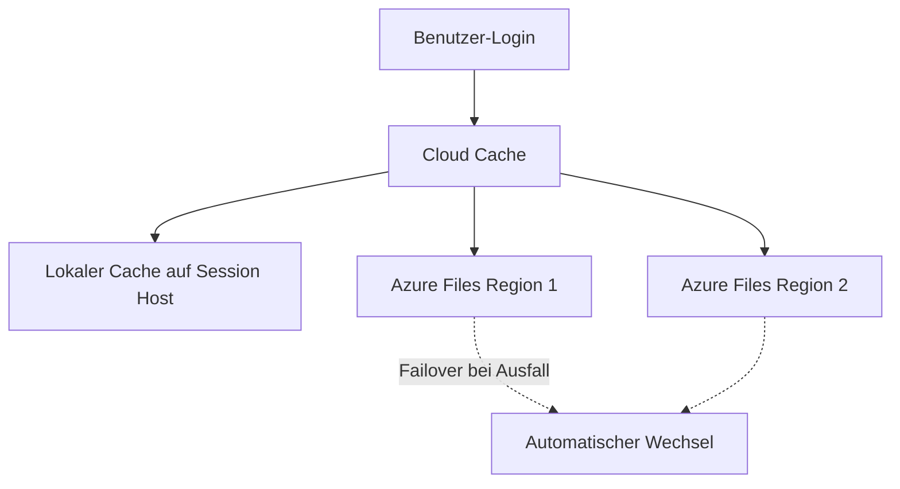

---
tags:
  - microsoft365
  - avd
  - fslogix
  - profile-container
  - azure-files
  - vhd
aliases:
  - FSLogix Profile Container
  - FSLogix Office Container
  - Profile Container
---

# FSLogix

> [!ABSTRACT] TL;DR
> FSLogix ist Microsofts Lösung für User Profile Management in VDI- und AVD-Umgebungen. Profile werden als VHD/VHDX-Dateien auf zentralem Storage (Azure Files, Azure NetApp Files) gespeichert und bei jeder Anmeldung dynamisch eingebunden — für nahtloses Roaming ohne klassische Roaming-Profile-Probleme.

---

## Was ist FSLogix?

Microsoft übernahm FSLogix 2018 und integrierte es seither als zentrales Profil-Management-Tool für Azure Virtual Desktop. FSLogix löst ein grundlegendes Problem in nicht-persistenten VDI-Umgebungen: Wie behält ein Benutzer seine personalisierten Einstellungen, wenn er jedes Mal auf einer anderen (frisch provisionierten) VM landet?

Die Antwort ist elegant: Das gesamte Benutzerprofil — inklusive Outlook-Cache, Teams-Daten, Browser-Favoriten und Desktop-Einstellungen — wird in einer **VHD/VHDX-Datei** auf einem Netzwerk-Speicher abgelegt. Bei der Anmeldung mountet FSLogix diese Datei als virtuelles Laufwerk, und für das Betriebssystem sieht es so aus, als würde der Benutzer ein lokales Profil auf dem Gerät haben. Bei der Abmeldung wird die VHD getrennt und zurückgeschrieben.

FSLogix ist **kostenlos** enthalten in:
- Azure Virtual Desktop (alle Varianten)
- Microsoft 365 E3/E5, Business Premium
- Remote Desktop Services (RDS CALs)
- Windows 365

---

## Profile Container vs. Office Container

FSLogix bietet zwei Arten von Containern:

| Merkmal | Profile Container | Office Container |
|---------|-----------------|-----------------|
| **Inhalt** | Gesamtes Benutzerprofil (C:\Users\Username) | Nur Outlook OST, Teams-Cache, OneDrive-Daten |
| **VHD-Dateiname** | Profile_Username_SID.vhdx | ODFC_Username_SID.vhdx |
| **Registry-Pfad** | HKLM:\SOFTWARE\FSLogix\Profiles | HKLM:\SOFTWARE\Policies\FSLogix\ODFC |
| **Anwendungsfall** | Standard-Profilverwaltung | Ergänzung für separaten Office-Storage |
| **Empfehlung** | Immer verwenden | Nur bei spezifischen Anforderungen |

> [!NOTE] Profile Container enthält Office Container
> Wenn der Profile Container aktiviert ist, ist der Office Container redundant — der Profile Container enthält bereits alle Office/Teams-Daten. Den Office Container separat nutzen macht Sinn, wenn z.B. Office-Daten auf eigenem High-Performance-Storage liegen sollen, während normale Profildaten auf günstigerem Storage bleiben.

---

## Architektur und Funktionsweise



Der **FSLogix Filter Driver** (frxdrvvt) hängt sich tief in den Windows-Anmeldeprozess ein. Er arbeitet auf Kernel-Ebene und ist für Windows vollkommen transparent — Anwendungen, die auf das Benutzerprofil zugreifen, merken keinen Unterschied zu einem echten lokalen Profil.

### VHD-Dateistruktur auf dem Storage

```
\\storage.file.core.windows.net\profiles\
├── SID_Username\            (wenn FlipFlopProfileDirectoryName=1)
│   └── Profile_SID.vhdx     (Profile Container)
│   └── ODFC_SID.vhdx        (Office Container, falls separat)
└── Username_SID\            (Standard ohne FlipFlopProfileDirectoryName)
    └── Profile_SID.vhdx
```

---

## Cloud Cache

Cloud Cache ist eine erweiterte FSLogix-Funktion für **Multi-Site-Redundanz**. Anstatt nur auf einen Speicherort zu schreiben, repliziert Cloud Cache die VHD-Daten synchron auf mehrere Storage-Locations.



**Vorteile von Cloud Cache:**
- Kein Single Point of Failure beim Profilspeicher
- Automatischer Failover bei Storage-Ausfall
- Geringere Latenz durch lokalen Cache
- Ideal für Multi-Region-Deployments

**Konfiguration via Registry:**

```powershell
# Cloud Cache statt VHDLocations verwenden
$RegPath = "HKLM:\SOFTWARE\FSLogix\Profiles"

# CCDLocations = mehrere Storage-Locations (Pipe-getrennt)
$CCDValue = "type=smb,connectionString=\\stavdprod.file.core.windows.net\profiles|type=smb,connectionString=\\stavdbackup.file.core.windows.net\profiles"

Set-ItemProperty -Path $RegPath -Name "CCDLocations" -Value $CCDValue -Type MultiString
```

---

## Storage-Optionen

Die Wahl des richtigen Speichers für FSLogix-Container ist kritisch für die Performance:

| Storage-Option | Max IOPS | Latenz | Empfohlen für | Kosten |
|----------------|----------|--------|---------------|--------|
| Azure Files Standard | 1.000 | Mittel | Entwicklung/Test | Gering |
| Azure Files Premium (LRS) | 100.000+ | Niedrig | Produktion AVD | Mittel |
| Azure Files Premium (ZRS) | 100.000+ | Niedrig | Hochverfügbarkeit | Mittel-Hoch |
| Azure NetApp Files Standard | 16 MiB/s/TiB | Sehr niedrig | Viele parallele User | Hoch |
| Azure NetApp Files Premium | 64 MiB/s/TiB | Extrem niedrig | Enterprise AVD | Sehr hoch |
| Storage Spaces Direct | Abhängig | Niedrig | On-Premises RDS | Investition |

> [!TIP] Azure Files Premium ist der Standard
> Für produktive AVD-Deployments mit mehr als 20 gleichzeitigen Benutzern ist Azure Files Premium (FileStorage, LRS) der empfohlene Startpunkt. Standard-Tier hat zu geringe IOPS und verursacht langsame Anmeldezeiten.

```powershell
# Azure Files Premium Storage Account für FSLogix erstellen
New-AzStorageAccount `
    -ResourceGroupName "rg-avd" `
    -Name "stavdfslogixprod" `
    -Location "westeurope" `
    -SkuName Premium_LRS `
    -Kind FileStorage `
    -MinimumTlsVersion TLS1_2

# File Share erstellen
$StorageContext = (Get-AzStorageAccount -ResourceGroupName "rg-avd" -Name "stavdfslogixprod").Context
New-AzStorageShare -Name "profiles" -Context $StorageContext
```

---

## Azure Files mit Entra ID Kerberos-Authentifizierung

Seit 2022 unterstützt Azure Files die **Entra ID Kerberos-Authentifizierung** — damit kann FSLogix ohne On-Premises Active Directory verwendet werden. Ideal für cloud-only AVD-Deployments.

### Voraussetzungen
- Azure Files Premium Storage Account
- Entra ID Hybrid Identity (Nutzer in Entra ID, synchronisiert oder cloud-only)
- Entra ID Kerberos-Feature auf Storage Account aktiviert

```powershell
# Schritt 1: Entra ID Kerberos für Storage Account aktivieren
Update-AzStorageAccount `
    -ResourceGroupName "rg-avd" `
    -Name "stavdfslogixprod" `
    -EnableAzureActiveDirectoryKerberosForFile $true

# Schritt 2: RBAC-Berechtigung für Benutzer setzen (Share-Ebene)
$StorageAccount = Get-AzStorageAccount -ResourceGroupName "rg-avd" -Name "stavdfslogixprod"

New-AzRoleAssignment `
    -SignInName "user@contoso.com" `
    -RoleDefinitionName "Storage File Data SMB Share Contributor" `
    -Scope $StorageAccount.Id

# Für alle AVD-Benutzer (Security Group empfohlen):
New-AzRoleAssignment `
    -ObjectId "<EntraID-Group-ObjectId>" `
    -RoleDefinitionName "Storage File Data SMB Share Contributor" `
    -Scope "$($StorageAccount.Id)/fileServices/default/shares/profiles"
```

> [!IMPORTANT] NTFS-Berechtigungen nach RBAC setzen
> Die RBAC-Berechtigung gewährt Share-Level-Zugriff. Zusätzlich müssen NTFS-Berechtigungen auf dem Share gesetzt werden: Nutzer brauchen `Modify` auf ihren eigenen Ordner, aber keine Rechte auf Ordner anderer Nutzer.

---

## FSLogix-Konfiguration (Registry / GPO)

Die empfohlene Konfigurationsmethode ist GPO (Group Policy) oder direkte Registry-Einstellung via PowerShell oder Intune.

**Registry-Pfad:** `HKLM:\SOFTWARE\FSLogix\Profiles`

| Registry-Wert | Typ | Empfohlener Wert | Beschreibung |
|---------------|-----|-----------------|-------------|
| `Enabled` | DWORD | 1 | FSLogix Profile Container aktivieren |
| `VHDLocations` | REG_MULTI_SZ | `\\server\share` | UNC-Pfad zum Profile-Storage |
| `DeleteLocalProfileWhenVHDShouldApply` | DWORD | 1 | Lokales Profil löschen, wenn VHD verfügbar |
| `FlipFlopProfileDirectoryName` | DWORD | 1 | Ordnername: SID_Username statt Username_SID |
| `VolumeType` | REG_SZ | VHDX | VHDX (stabiler und größer als VHD) |
| `SizeInMBs` | DWORD | 30000 | VHD-Maximalgröße (30 GB) |
| `LockedRetryCount` | DWORD | 3 | Versuche bei gesperrter VHD |
| `LockedRetryInterval` | DWORD | 15 | Wartezeit zwischen Versuchen (Sek.) |
| `ProfileType` | DWORD | 0 | 0=Read-Write, 3=Read-Write Primary mit Fallback |
| `IsDynamic` | DWORD | 1 | VHD wächst dynamisch (spart Speicher) |

```powershell
# FSLogix vollständig via PowerShell konfigurieren
$RegPath = "HKLM:\SOFTWARE\FSLogix\Profiles"
New-Item -Path $RegPath -Force | Out-Null

$Settings = @{
    "Enabled"                                   = @{ Value = 1;         Type = "DWord" }
    "VHDLocations"                              = @{ Value = "\\stavdfslogixprod.file.core.windows.net\profiles"; Type = "MultiString" }
    "DeleteLocalProfileWhenVHDShouldApply"      = @{ Value = 1;         Type = "DWord" }
    "FlipFlopProfileDirectoryName"              = @{ Value = 1;         Type = "DWord" }
    "VolumeType"                                = @{ Value = "VHDX";    Type = "String" }
    "SizeInMBs"                                 = @{ Value = 30000;     Type = "DWord" }
    "LockedRetryCount"                          = @{ Value = 3;         Type = "DWord" }
    "LockedRetryInterval"                       = @{ Value = 15;        Type = "DWord" }
    "IsDynamic"                                 = @{ Value = 1;         Type = "DWord" }
}

foreach ($Key in $Settings.Keys) {
    Set-ItemProperty -Path $RegPath -Name $Key -Value $Settings[$Key].Value -Type $Settings[$Key].Type
}

Write-Host "FSLogix Konfiguration abgeschlossen." -ForegroundColor Green
```

---

## App Masking

**FSLogix Application Masking** ermöglicht es, Anwendungen oder Registry-Einträge für bestimmte Benutzergruppen ein- oder auszublenden — ohne die Anwendung zu deinstallieren.

**Anwendungsfall:** Adobe Acrobat Pro ist auf allen Session Hosts installiert (vereinfacht Image-Management), aber nur für die Designabteilung sichtbar. Für alle anderen Nutzer ist die Anwendung ausgeblendet.

**Konfiguration:**
1. FSLogix Rule Editor (GUI-Tool, auf Session Host installiert)
2. Neue Assignment-Regel erstellen
3. Anwendungspfad oder Registry-Key definieren
4. Zielgruppe (AD-Gruppe) und Aktion (verstecken/zeigen) festlegen
5. Regeldatei (`.fxa` + `.fxr`) auf zentralem Share ablegen

---

## Redirections.xml

Die `redirections.xml`-Datei definiert Ausnahmen vom Profile Container — Dateien oder Ordner, die **nicht** im Container gespeichert werden, sondern lokal auf dem Session Host verbleiben oder umgeleitet werden.

**Typische Ausnahmen:**
- Große temporäre Dateien (Downloads, Temp)
- Teams-Cache (wenn Teams neu installiert wird)
- Browser-Cache (bei non-persistent VMs unnötig im Profil)

**Pfad:** `C:\Program Files\FSLogix\Apps\redirections.xml`

```xml
<?xml version="1.0" encoding="UTF-8"?>
<FrxProfileFolderRedirection ExcludeCommonFolders="0">
  <Excludes>
    <!-- Temporäre Dateien nicht im Profil speichern -->
    <Exclude Copy="0">AppData\Local\Temp</Exclude>
    <!-- Downloads nicht im Profil (Nutzer sollen OneDrive verwenden) -->
    <Exclude Copy="0">Downloads</Exclude>
    <!-- Teams temporäre Cache-Dateien -->
    <Exclude Copy="0">AppData\Local\Microsoft\Teams\tmp</Exclude>
    <Exclude Copy="0">AppData\Local\Microsoft\Teams\meeting-addin\Cache</Exclude>
    <!-- Browser-Caches -->
    <Exclude Copy="0">AppData\Local\Google\Chrome\User Data\Default\Cache</Exclude>
    <Exclude Copy="0">AppData\Local\Microsoft\Edge\User Data\Default\Cache</Exclude>
  </Excludes>
</FrxProfileFolderRedirection>
```

---

## Troubleshooting

### Log-Dateien

| Log-Pfad | Inhalt |
|---------|--------|
| `C:\ProgramData\FSLogix\Logs\Profile` | Profile Container Logs (Mount/Unmount) |
| `C:\ProgramData\FSLogix\Logs\ODFC` | Office Container Logs |
| `C:\ProgramData\FSLogix\Logs\Rules` | App Masking Logs |
| Ereignisanzeige → FSLogix | Windows Event Log Einträge |

```powershell
# FSLogix Diagnose über frx.exe CLI
$FrxPath = "C:\Program Files\FSLogix\Apps\frx.exe"

# Aktuellen Mount-Status anzeigen
& $FrxPath list-redirects

# Profil eines bestimmten Nutzers abfragen
& $FrxPath query -sid S-1-5-21-...

# FSLogix-Logs sammeln (Support-Paket)
& $FrxPath collect-logs -output "$env:TEMP\FSLogix_Logs.zip"
```

### Häufige Fehler und Lösungen

| Fehler | Ursache | Lösung |
|--------|---------|--------|
| "Profile Container not found" | VHDLocations-Pfad falsch oder nicht erreichbar | Pfad prüfen, Storage-Verbindung testen |
| "VHD is locked" | Vorherige Session nicht sauber getrennt | VM neu starten oder VHD-Lock manuell aufheben |
| "Access denied to profile storage" | NTFS-Rechte oder RBAC fehlen | Azure Files Berechtigungen prüfen |
| Sehr langsame Anmeldung | Azure Files Standard (geringe IOPS) | Auf Azure Files Premium upgraden |
| Profil zu groß / VHD voll | OST/Teams-Cache wächst unkontrolliert | SizeInMBs erhöhen oder Office Container separieren |
| "Could not expand virtual disk" | Storage-Platz auf Share erschöpft | Storage-Quota erhöhen |
| Profil-Inkonsistenz nach VM-Crash | Unsauberes Unmount | Profile reparieren: frx repair-vhd |

> [!WARNING] VHD-Lock und Notfallmaßnahmen
> Wenn eine VHD gesperrt ist und sich nicht trennen lässt, kann dies die Anmeldung dauerhaft blockieren. Im Notfall:
> 1. Session Host neu starten (löst die meisten Locks)
> 2. `frx delete-profile -sid <SID>` (löscht lokalen Cache, nicht die VHD)
> 3. VHD auf Storage direkt prüfen und manuell trennen

```powershell
# VHD-Dateigröße aller Profile überwachen
$ProfileShare = "\\stavdfslogixprod.file.core.windows.net\profiles"

Get-ChildItem -Path $ProfileShare -Recurse -Filter "*.vhdx" |
    Select-Object Name, @{N="SizeGB";E={[math]::Round($_.Length/1GB, 2)}}, LastWriteTime |
    Sort-Object SizeGB -Descending |
    Format-Table -AutoSize
```

---

## Verwandte Notizen

- [[Azure Virtual Desktop AVD]]
- [[AVD Netzwerk und Identität]]
- [[Windows 365 Cloud PC]]
- [[RDS vs AVD vs W365 Vergleich]]
