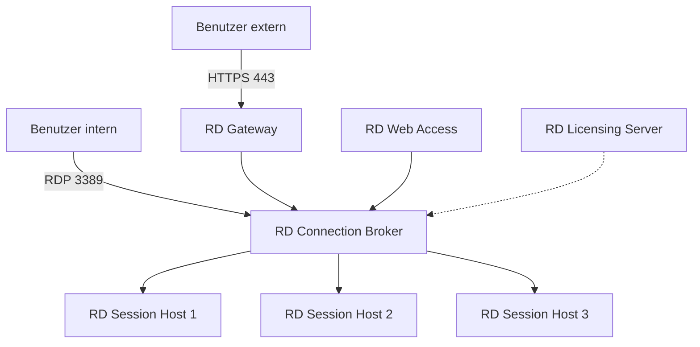
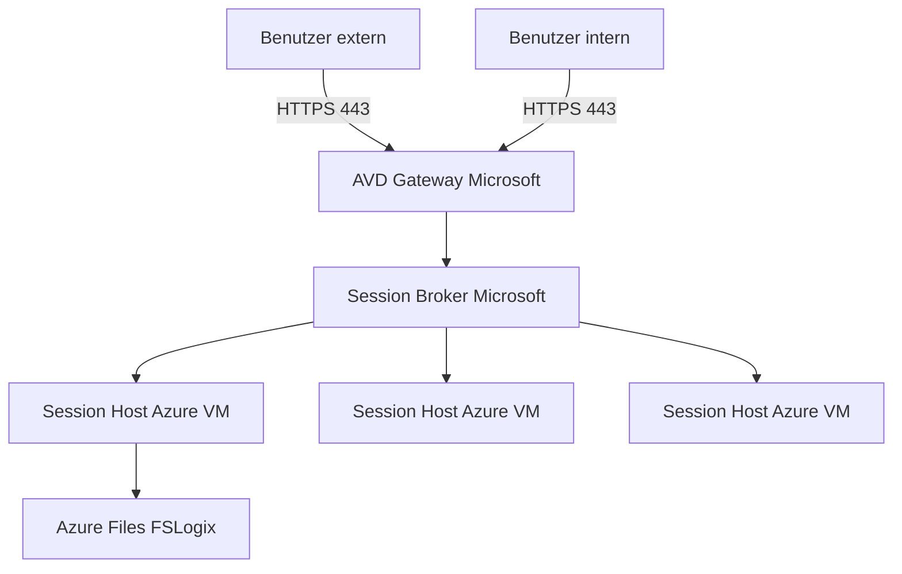
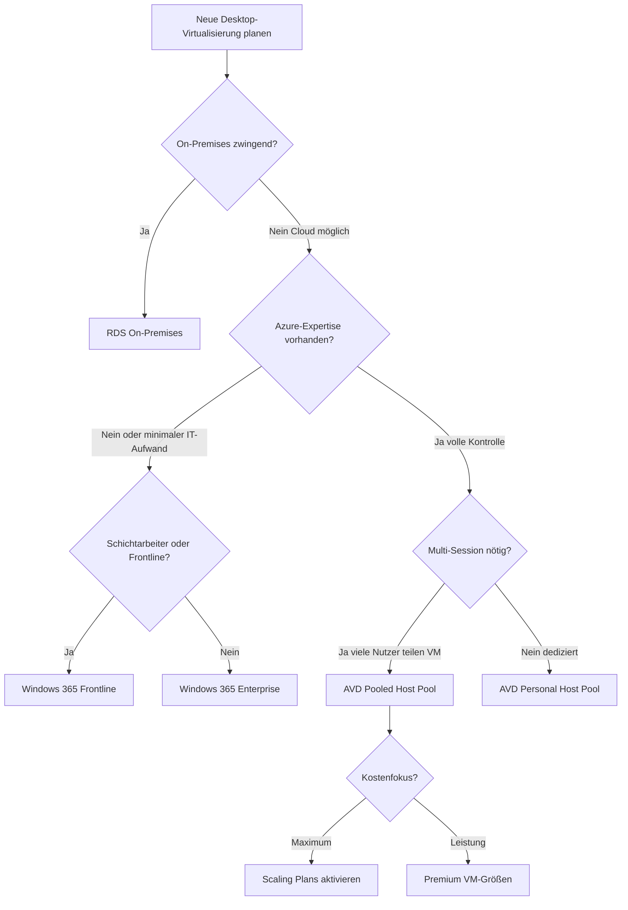
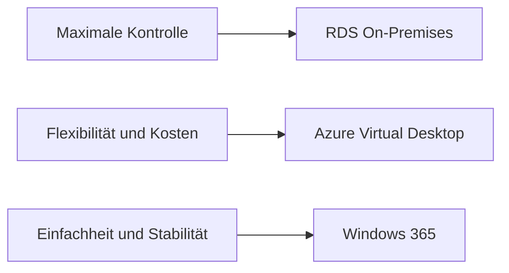

---
tags:
  - microsoft365
  - avd
  - windows365
  - rds
  - vergleich
  - entscheidung
  - desktop-virtualisierung
aliases:
  - Desktop-Virtualisierung Vergleich
  - RDS AVD W365
  - VDI Entscheidung
---

# RDS vs AVD vs W365 Vergleich

> [!ABSTRACT] TL;DR
> Remote Desktop Services (RDS) bietet maximale On-Premises-Kontrolle, Azure Virtual Desktop (AVD) kombiniert Cloud-Flexibilität mit vollständiger Anpassbarkeit, und Windows 365 ist das einfachste DaaS-Modell mit festem Monatspreis. Die richtige Wahl hängt von Komplexitätsbereitschaft, Budget-Modell und Infrastrukturstrategie ab.

---

## Remote Desktop Services (RDS) On-Premises

### Überblick und Architektur

Remote Desktop Services ist die klassische, auf Windows Server basierende Lösung für Desktop- und Anwendungsvirtualisierung. Alle Komponenten werden selbst betrieben — entweder auf eigener Hardware oder als IaaS-VMs in einer Cloud.



**RDS-Komponenten:**

| Komponente | Kürzel | Funktion |
|-----------|--------|----------|
| Remote Desktop Session Host | RDSH | Führt Benutzersitzungen aus |
| Remote Desktop Connection Broker | RDCB | Lastverteilung und Sitzungswiederherstellung |
| Remote Desktop Gateway | RDGW | Sicherer externer Zugriff via HTTPS/RDP |
| Remote Desktop Licensing Server | RDLS | Verwaltet und validiert RDS CALs |
| Remote Desktop Web Access | RDWA | Web-Portal für RemoteApp und Desktop |

**Stärken von RDS:**
- Vollständige Kontrolle über alle Komponenten
- On-Premises oder Private Cloud — Datensouveränität
- Beste Legacy-App-Kompatibilität (Windows Server OS)
- CapEx-Modell — nach der Investition geringe laufende Kosten

**Schwächen von RDS:**
- Hoher Verwaltungsaufwand (5 Rollen, Patching, HA-Konfiguration)
- Manuelle Skalierung (neue Server bestellen, installieren)
- Veraltetes Lizenzmodell (RDS CALs per User oder per Device)
- Kein Windows 10/11 Multi-Session für Pooled-Szenarien
- Microsoft investiert weniger in neue RDS-Features

---

## Azure Virtual Desktop als Cloud-RDS

### Architekturunterschiede zu RDS

AVD übernimmt RDCB, RDGW, RDWA und RDLS vollständig — Microsoft betreibt diese Dienste als PaaS. Was in der eigenen Azure-Subscription verbleibt: nur die **Session Hosts (Azure VMs)** und der Storage.



Der fundamentale Unterschied: AVD nutzt **Windows 10/11 Enterprise Multi-Session** — eine nur in Azure verfügbare OS-Version, die mehrere gleichzeitige Benutzer auf derselben VM ermöglicht. Dies macht den Hauptkostenunterschied zu klassischem RDS (das nur Windows Server für Multi-Session verwendet).

---

## Windows 365 als Desktop-as-a-Service

Windows 365 ist die am wenigsten komplexe Option: Microsoft verwaltet **alles** — Infrastruktur, Netzwerk, Betriebssystem-Updates und Hochverfügbarkeit. Jeder Benutzer erhält einen dedizierten, persistenten Cloud PC mit festem Monatspreis.

Die Philosophie: "Setz eine Lizenz ein, und der Cloud PC ist in Minuten verfügbar." Kein Azure-Wissen erforderlich, keine Infrastruktur-Entscheidungen.

---

## Detaillierter Vergleich

| Kriterium | RDS On-Premises | Azure Virtual Desktop | Windows 365 |
|-----------|-----------------|----------------------|-------------|
| **Betriebsmodell** | On-Prem oder IaaS | PaaS (eigene VMs) | SaaS / DaaS |
| **Infrastruktur-Eigentum** | Eigene Server / VMs | Eigene Azure-VMs + MS Control Plane | Vollständig Microsoft |
| **Azure-Subscription nötig** | Nein | Ja | Nein |
| **Skalierbarkeit** | Manuell (neue Server) | Automatisch (Scaling Plans) | Automatisch |
| **Persistenz** | Frei wählbar | Personal=Ja / Pooled=Nein | Immer persistierend |
| **Multi-Session** | Ja (Windows Server) | Ja (Win 10/11 Multi-Session) | Nein (1:1) |
| **Kosten-Modell** | CapEx + RDS CALs | Pay-as-you-go | Fixer Monatspreis |
| **VM-Verwaltung** | Selbst (alles) | Selbst (Session Hosts) | Microsoft |
| **Management-Tool** | Server Manager / AD | Azure Portal + Intune | Intune Admin Center |
| **Offline-Fähigkeit** | Ja (lokal) | Nein | Preview (begrenzt) |
| **GPU-Support** | Ja (eigene HW) | Ja (NV-Series VMs) | Ja (GPU-Pläne) |
| **FSLogix** | Empfohlen | Empfohlen (Pooled: Pflicht) | Nicht nötig |
| **Lizenz** | RDS User/Device CALs | In M365 E3/E5 enthalten | W365-Lizenz |
| **RemoteApp** | Ja | Ja | Nein |
| **Custom Images** | Ja | Ja | Enterprise: Ja |
| **Hybrid-Zugriff** | Nativ | Via VNet/ANC | Via ANC |
| **Komplexität** | Hoch | Mittel-Hoch | Gering |
| **Control-Plane-Patching** | Selbst | Microsoft | Microsoft |
| **Session-Host-Patching** | Selbst | Selbst | Microsoft |

---

## Entscheidungsbaum



---

## Kostenvergleich: CapEx vs. OpEx

| Kostenaspekt | RDS On-Premises | Azure Virtual Desktop | Windows 365 |
|-------------|-----------------|----------------------|-------------|
| **Initiale Investition** | Hoch (Server, Lizenzen) | Gering (nur Azure-Ressourcen) | Keine |
| **Monatliche Grundkosten** | Mittel (Strom, Wartung) | Variabel (nach tatsächlicher Nutzung) | Fix pro Nutzer |
| **Skalierungskosten** | Sehr hoch (neue Hardware) | Niedrig (VMs on-demand) | Lizenzpreis |
| **Unerwartete Kosten** | Hardwareausfall, Notfall-IT | VM-Überlastung, Netzwerkkosten | Keine |
| **Kostenoptimierung** | Kaum möglich | Scaling Plans, Reserved Instances (bis 40%) | Nicht möglich |
| **Transparenz** | Schwierig zu berechnen | Azure Cost Management | Vollständig transparent |

> [!TIP] AVD-Kostenoptimierung mit Reserved Instances
> Für dauerhaft laufende Personal Host Pool VMs lohnen sich Azure Reserved Instances (1 oder 3 Jahre) — Einsparungen von bis zu 40% gegenüber Pay-as-you-go. Für Pooled Host Pools sind Scaling Plans wichtiger als Reserved Instances.

---

## Migrationspfad von RDS zu AVD

Eine typische RDS-zu-AVD-Migration läuft in klar definierten Phasen:

### Phase 1: Bewertung und Planung

```powershell
# RDS-Umgebung inventarisieren
# Aktive Sessions auf RDSH-Servern ermitteln
$RDSHServer = "rdsh01.contoso.local"
$Sessions = Invoke-Command -ComputerName $RDSHServer -ScriptBlock {
    Get-RDUserSession -ConnectionBroker localhost
}
$Sessions | Group-Object HostServer | Select-Object Name, Count
```

- Inventory: Welche Anwendungen, wie viele Nutzer, welche Sessions-Peaks?
- Anwendungskompatibilität prüfen (Windows Server vs. Windows 10/11)
- FSLogix-Strategie definieren

### Phase 2: Azure-Infrastruktur aufbauen

```powershell
# Host Pool in Azure erstellen
New-AzWvdHostPool `
    -ResourceGroupName "rg-avd-migration" `
    -Name "hp-migration-pooled" `
    -Location "westeurope" `
    -HostPoolType Pooled `
    -LoadBalancerType BreadthFirst `
    -MaxSessionLimit 8 `
    -PreferredAppGroupType Desktop
```

### Phase 3: Image erstellen und validieren

Bestehendes RDSH-Image als Basis für AVD Custom Image nutzen:
1. Referenz-RDSH-Server als Azure VM klonen oder neu bauen
2. Anwendungen installieren, testen
3. Sysprep und in Azure Compute Gallery hochladen

### Phase 4: FSLogix einrichten

Profil-Migration von RDS-Profil-Disks zu FSLogix:

```powershell
# Profil-Migration mit FSLogix frx.exe (Beispiel)
# Auf dem alten RDSH-Server:
$FrxPath = "C:\Program Files\FSLogix\Apps\frx.exe"
& $FrxPath copy-profile -filename "\\stavdfslogix.file.core.windows.net\profiles\SID_Username\Profile_SID.vhdx" -username "DOMAIN\username"
```

### Phase 5: Pilotmigration

- 5–10% der Nutzer auf AVD migrieren (pilotgruppe)
- 2-4 Wochen Beobachtung: Performance, Probleme, Feedback
- Issues beheben, dann Scale-out

### Phase 6: Vollständige Migration und Dekommissionierung

- Nutzer-Gruppen stufenweise zu AVD wechseln
- RDS-Server in den Maintenance-Modus (keine neuen Verbindungen)
- Nach letztem Nutzer-Transfer: RDS-Server dekommissionieren

---

## Hybride Szenarien

### RDS + AVD (Parallel-Betrieb)
- Spezielle Legacy-Apps auf RDS (z.B. 32-Bit-Applikationen oder Hardware-Dongle-Abhängigkeiten)
- Standard-Arbeitsplätze auf AVD
- Nutzer greifen auf beide Umgebungen via Remote Desktop Client zu

### Windows 365 + AVD
Viele Organisationen setzen beide Lösungen parallel ein:
- **Windows 365**: Einfache Nutzer, Management, HR, Buchhaltung — voller persistenter Desktop
- **AVD Pooled**: Call Center, viele gleichzeitige Nutzer, kostenoptimiert
- **AVD Personal**: Entwickler, Power-User, spezielle Software

---

## Typische Anwendungsfälle je Plattform

| Anwendungsfall | Empfehlung | Begründung |
|---------------|------------|------------|
| Regulierte Branche, Daten dürfen Cloud nicht verlassen | RDS On-Premises | Datensouveränität, Compliance |
| 200+ Standard-Büroarbeitsplätze, Kostenoptimierung | AVD Pooled | Multi-Session spart 60-70% VM-Kosten |
| 50 Entwickler mit individuellen Setups | AVD Personal oder W365 Enterprise | Persistenz, volle Anpassbarkeit |
| Call Center, 3 Schichten à 100 Mitarbeiter | W365 Frontline | 100 statt 300 Lizenzen nötig |
| KMU < 50 Nutzer, kein dediziertes IT-Team | Windows 365 Business | Einfachste Verwaltung |
| CAD/3D-Modellierung für Designteam | AVD mit GPU-VMs | Flexible GPU-Kapazität on-demand |
| Kurzfristiges Onboarding von 100 Contractors | Windows 365 | In Minuten provisioniert |
| SAP oder ERP mit speziellen Server-Abhängigkeiten | RDS oder AVD Personal | Windows Server Kompatibilität |
| Kiosk-Terminals im Einzelhandel | W365 Frontline Shared | Non-persistent, automatischer Reset |

---

## Entscheidungsfaktoren auf einen Blick



**Wähle RDS**, wenn:
- Regulatorische Anforderungen Cloud ausschließen
- Bestehende, große Investition in On-Premises-Infrastruktur
- Legacy-Anwendungen nur auf Windows Server laufen
- Maximale Anpassung aller Komponenten nötig

**Wähle AVD**, wenn:
- Cloud ist akzeptabel / gewünscht
- Multi-Session wichtig für Kostenoptimierung
- Azure-Expertise vorhanden oder aufbaubar
- RemoteApp für einzelne Legacy-Apps nötig
- Granulare Kontrolle über Image, Netzwerk, Skalierung gewünscht

**Wähle Windows 365**, wenn:
- Minimaler IT-Verwaltungsaufwand wichtig
- Vorhersagbare Kosten (Budget-Fixierung)
- Schnelles Onboarding ohne tiefe Azure-Kenntnisse
- Persistenter, persönlicher Desktop für jeden Nutzer
- Schichtarbeiter oder Frontline Workers (Frontline-Edition)

---

## Verwandte Notizen

- [[Windows 365 Cloud PC]]
- [[Windows 365 Boot und Frontline]]
- [[Azure Virtual Desktop AVD]]
- [[AVD Netzwerk und Identität]]
- [[FSLogix]]
