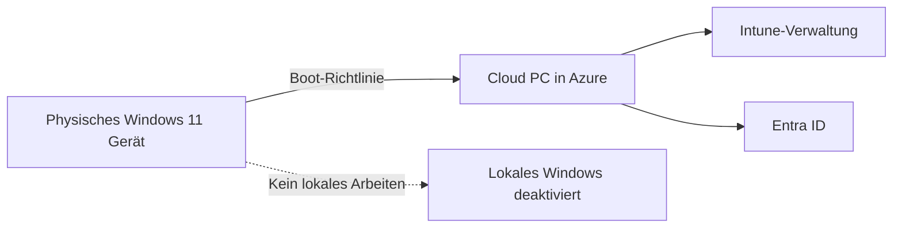
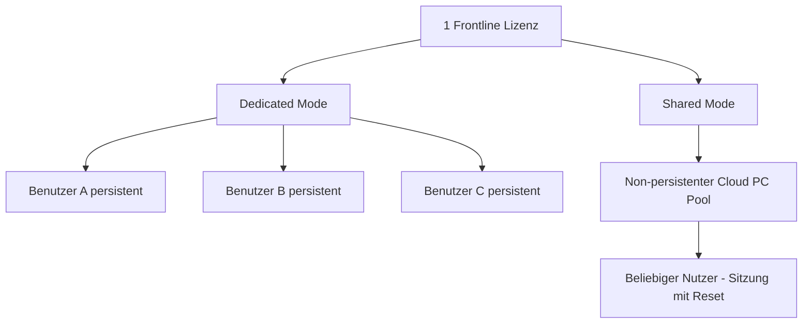

---
tags:
  - microsoft365
  - windows365
  - frontline
  - cloud-pc
  - boot
  - schichtarbeiter
aliases:
  - W365 Boot
  - W365 Frontline
  - Windows 365 Shared
---

# Windows 365 Boot und Frontline

> [!ABSTRACT] TL;DR
> Windows 365 Boot verwandelt ein physisches Gerät in einen reinen Cloud-PC-Client. Windows 365 Frontline ermöglicht geteilte Cloud-PCs für Schichtarbeiter — eine Lizenz deckt drei Nutzer ab, die nie gleichzeitig aktiv sind.

---

## Windows 365 Boot

### Konzept

**Windows 365 Boot** ist ein Feature, das ein physisches Windows 11-Gerät direkt in den persönlichen Cloud PC des Nutzers starten lässt — anstatt das lokale Windows zu laden. Das physische Gerät fungiert als reiner **Thin Client**: Es stellt die Verbindung her, aber alle Rechenleistung und alle Daten befinden sich im Cloud PC in der Azure-Cloud.

Für den Nutzer sieht es so aus, als würde er einen normalen Windows-PC starten — tatsächlich greift er aber auf seinen persönlichen Cloud PC zu. Das lokale Windows ist nur noch eine Plattform für die Verbindung, nicht mehr der eigentliche Arbeitsplatz.



### Anforderungen für Windows 365 Boot

| Anforderung | Details |
|-------------|---------|
| Betriebssystem | Windows 11 (aktuellste Version empfohlen) |
| Intune-Enrollment | Pflicht — Gerät muss Intune-verwaltet sein |
| Windows 365 Lizenz | Enterprise (Boot + Frontline nicht für Business) |
| Windows 365 Boot Policy | Muss in Intune konfiguriert sein |
| Netzwerkverbindung | Stabile Internetverbindung beim Bootvorgang |

### Konfiguration in Intune

1. **Intune Admin Center** → `Devices` → `Windows 365` → `Boot Settings`
2. **Windows 365 Boot Policy erstellen**
3. **Zielgruppe** (Entra ID Security Group) zuweisen
4. Nach Policy-Anwendung: Beim nächsten Neustart startet das Gerät direkt in den Cloud PC

> [!NOTE] Sicherheitsvorteil
> Mit Windows 365 Boot werden keine Unternehmensdaten mehr lokal auf dem Gerät gespeichert. Bei Geräteverlust oder -diebstahl sind alle Daten sicher im Cloud PC — nicht auf dem physischen Gerät.

### Anwendungsfälle für Windows 365 Boot
- **Hochsicherheitsumgebungen**: Finanzinstitutionen, Behörden — keine lokale Datenspeicherung
- **Kiosk- und Shared-Devices**: Ein Gerät, das immer in den Cloud PC des angemeldeten Nutzers bootet
- **Einfaches Geräte-Management**: Physische Hardware ist komplett austauschbar, da alles im Cloud PC lebt

---

## Windows 365 Switch

### Konzept

**Windows 365 Switch** ermöglicht den nahtlosen Wechsel zwischen dem lokalen Windows 11-Desktop und dem Cloud PC — ähnlich wie virtuelle Desktops in Windows 11. Der Wechsel erfolgt über die **Task-Ansicht** (Task View) oder einen Tastaturkurzbefehl.


### Anforderungen
- Windows 11 23H2 oder neuer
- Windows 365 Enterprise Lizenz
- Windows 365 Switch Policy in Intune konfiguriert
- Remote Desktop WebSocket aktiv

> [!TIP] Ideal für Hybrid-Worker
> Windows 365 Switch eignet sich für Nutzer, die sowohl lokale Tools (z.B. spezielle Hardware-Treiber) als auch den verwalteten Cloud PC benötigen. Ein schneller Wechsel ohne vollständige Remote-Desktop-Sitzung steigert die Produktivität.

---

## Windows 365 Offline

Windows 365 Offline ist ein Preview-Feature (Stand 2024), das temporäre Offline-Nutzung des Cloud PCs ermöglicht. Der Inhalt des Cloud PCs wird auf das lokale Gerät synchronisiert, sodass bei fehlender Internetverbindung weitergearbeitet werden kann. Bei Wiederherstellung der Verbindung werden Änderungen zurück in den Cloud PC synchronisiert.

> [!WARNING] Preview-Feature
> Windows 365 Offline befindet sich noch in der Preview-Phase. Es ist nicht für produktive Umgebungen empfohlen. Funktionen und Anforderungen können sich ändern.

---

## Windows 365 Frontline — Konzept

### Zielgruppe

Windows 365 Frontline wurde für **Frontline Worker** entwickelt — Mitarbeiter, die:
- In Schichten arbeiten (nicht gleichzeitig aktiv sind)
- Keinen eigenen, dauerhaften Arbeitsplatz-PC haben
- Typischerweise in Call Centern, im Gesundheitswesen, in der Produktion oder im Einzelhandel tätig sind

Das Kernversprechen: **Günstigere Lizenzierung** durch ein Concurrent-Modell, das der Realität von Schichtbetrieben entspricht.

---

## Windows 365 Frontline — Lizenzmodell

### Concurrent-Lizenzierung

Windows 365 Frontline basiert auf einem **Concurrent-Nutzungsmodell**: Eine Lizenz erlaubt genau eine aktive Sitzung zu einem Zeitpunkt, kann aber mehreren Nutzern zugewiesen werden — solange diese nicht gleichzeitig aktiv sind.

**Dedicated Mode**: 1 Lizenz = 3 Benutzer (aber max. 1 gleichzeitig aktiv)

Beispiel: Bei einem Call Center mit 3 Schichten à 100 Mitarbeiter werden statt 300 Lizenzen nur 100 Frontline-Lizenzen benötigt — Kosteneinsparung von 66%.

### Frontline Modi im Vergleich

| Modus | Persistenz | Nutzer pro Lizenz | Gleichzeitig aktiv | Datenzurücksetzung |
|-------|-----------|-------------------|--------------------|-------------------|
| **Dedicated** | Ja (persistent) | 3 | 1 | Nein — Daten bleiben |
| **Shared** | Nein (non-persistent) | Unbegrenzt (Pool) | 1 | Ja — nach jeder Sitzung |

#### Dedicated Mode
Jeder der drei zugewiesenen Benutzer hat seinen eigenen, persistenten Cloud PC. Dateien, Einstellungen und Anwendungen bleiben zwischen Sitzungen erhalten — aber der Cloud PC ist nur für einen Nutzer gleichzeitig zugänglich. Ideal für Schichtarbeiter mit personalisierten Arbeitsumgebungen.

#### Shared Mode (neu in 2024)
Der Shared Mode ist ein **non-persistenter** Cloud PC, der nach jeder Sitzung vollständig zurückgesetzt wird. Alle Nutzerdaten werden bei der Abmeldung gelöscht. Dieser Modus eignet sich für:
- **Kiosk-Szenarien**: Kurze Sitzungen ohne personalisierte Daten
- **Hot-Desking**: Beliebige Mitarbeiter nutzen denselben Cloud PC
- **Datenschutz-Anforderungen**: Keine Restdaten zwischen Sitzungen

> [!IMPORTANT] Shared Mode und Datenspeicherung
> Im Shared Mode werden bei der Abmeldung alle lokalen Nutzerdaten gelöscht. Wichtige Daten müssen in OneDrive, SharePoint oder anderen Cloud-Diensten gespeichert werden — nicht lokal auf dem Cloud PC.



---

## Windows 365 Frontline — Anwendungsfälle

### Call Center (3 Schichten)
Ein Call Center mit 300 Agenten in drei Schichten (je 100 gleichzeitig aktiv) benötigt nur 100 Frontline-Lizenzen statt 300 regulären Cloud PC-Lizenzen. Die Mitarbeiter jeder Schicht nutzen dieselben Lizenzen — aber zu unterschiedlichen Zeiten.

### Gesundheitswesen
Krankenpfleger und medizinisches Personal teilen Terminals auf Stationen. Mit dem Shared Mode melden sich verschiedene Mitarbeiter an demselben Cloud PC an — ohne dass Patientendaten zwischen Sitzungen sichtbar bleiben.

### Produktion und Fertigung
Maschinenbediener benötigen Zugriff auf Produktionssoftware nur während ihrer Schicht. Mit Frontline Dedicated haben sie einen personalisierten Cloud PC, der zwischen den Schichten inaktiv bleibt.

### Einzelhandel
Kassierer und Lagermitarbeiter nutzen gemeinsam genutzte Terminals. Der Shared Mode gewährleistet, dass nach jeder Sitzung alle Transaktionsdaten gelöscht werden.

---

## Windows 365 Frontline — Konfiguration

### Voraussetzungen
- Windows 365 Frontline-Lizenz (in M365 Admin Center zuweisen)
- Microsoft Intune (für die Verwaltung)
- Entra ID Security Groups für die Zuweisung
- Provisioning Policy (Frontline-Typ)

### Schritte im Intune Admin Center

1. **Frontline-Lizenz zuweisen**: M365 Admin Center → Nutzer → Lizenzen → Windows 365 Frontline
2. **Provisioning Policy erstellen**: `Devices` → `Windows 365` → `Provisioning Policies` → `Frontline`
3. **Typ wählen**: Dedicated oder Shared Mode
4. **Session Timeout konfigurieren** (besonders wichtig für Shared Mode)
5. **Nutzergruppe zuweisen**: Entra ID Security Group

```powershell
# Frontline Cloud PCs über Microsoft Graph API abrufen
$Headers = @{ Authorization = "Bearer $AccessToken" }

# Alle Cloud PCs des Tenants
$CloudPCs = Invoke-RestMethod `
    -Uri "https://graph.microsoft.com/v1.0/deviceManagement/virtualEndpoint/cloudPCs" `
    -Headers $Headers

# Frontline Cloud PCs filtern
$FrontlineCloudPCs = $CloudPCs.value | Where-Object { $_.servicePlanName -like "*Frontline*" }
$FrontlineCloudPCs | Select-Object displayName, status, userPrincipalName, servicePlanName
```

### Session Timeout für Shared Mode

```powershell
# Session Timeout via Intune Graph API konfigurieren
$Body = @{
    displayName = "Frontline-Shared-Timeout"
    sessionTimeoutInMinutes = 60
    disconnectTimeoutInMinutes = 15
} | ConvertTo-Json

Invoke-RestMethod `
    -Uri "https://graph.microsoft.com/beta/deviceManagement/virtualEndpoint/userSettings" `
    -Method POST `
    -Headers $Headers `
    -Body $Body `
    -ContentType "application/json"
```

---

## Windows 365 GPU-fähige Pläne

Windows 365 bietet auch GPU-beschleunigte Cloud PCs für grafikintensive Workloads:

| Plan | GPU | vCPU | RAM | Storage | Anwendungsfall |
|------|-----|------|-----|---------|----------------|
| GPU Standard | NVIDIA T4 (4 GB) | 4 | 16 GB | 128 GB | CAD, 3D-Modellierung leicht |
| GPU Super | NVIDIA T4 (16 GB) | 8 | 56 GB | 512 GB | KI-Workloads, Rendering |
| GPU Super | NVIDIA T4 (16 GB) | 16 | 56 GB | 1 TB | Professionelles 3D/KI |

> [!NOTE] GPU-Pläne und Lizenzierung
> GPU-fähige Cloud PCs sind im Premium-Segment angesiedelt und werden separat lizenziert. Sie eignen sich für Branchen wie Architektur, Film/VFX, Maschinenbau oder KI-Entwicklung.

---

## Vergleich Windows 365 Frontline vs. AVD Pooled

Beide Lösungen adressieren das Szenario "mehrere Nutzer teilen sich Ressourcen" — aber mit sehr unterschiedlichen Ansätzen:

| Kriterium | W365 Frontline | AVD Pooled Host Pool |
|-----------|---------------|----------------------|
| Infrastruktur | Microsoft-vollständig verwaltet | Eigene Azure VMs |
| Skalierung | Automatisch | Scaling Plans (manuell konfiguriert) |
| Kosten-Modell | Fixer Preis pro Frontline-Lizenz | Pay-as-you-go Azure VM-Kosten |
| Persistenz | Dedicated (optional) oder Non-persistent | Non-persistent (empfohlen) |
| FSLogix | Nicht erforderlich (Dedicated persistent) | Dringend empfohlen |
| Komplexität | Sehr gering | Mittel bis hoch |
| Anpassbarkeit | Gering | Sehr hoch |
| Custom Images | Enterprise: Ja | Ja |
| RemoteApp | Nein | Ja |
| Netzwerk-Integration | Via ANC | Eigenes Azure VNet |
| Management | Intune Admin Center | Azure Portal + Intune |

> [!TIP] Entscheidungshilfe
> **Windows 365 Frontline** ist die richtige Wahl, wenn minimaler Verwaltungsaufwand im Vordergrund steht und die Anforderungen einfach sind. **AVD Pooled** bietet mehr Flexibilität, erfordert aber Azure-Expertise und höheren Konfigurationsaufwand — liefert dafür mehr Kontrolle über Kosten und Konfiguration.

---

## Verwaltung und Monitoring via Intune

Alle Windows 365 Frontline Cloud PCs sind Intune-enrolled und vollständig verwaltbar:

- **Monitoring**: Intune Admin Center → `Devices` → `Windows 365` → Frontline-Bereich
- **Concurrent Session Reports**: Zeigt aktive gleichzeitige Sessions an (für Lizenz-Compliance)
- **Policies**: Compliance-Policies, Configuration-Profiles, App-Deployments — identisch zu regulären Cloud PCs
- **Alerts**: Wenn mehr gleichzeitige Sessions als Lizenzen vorliegen

```powershell
# Concurrent Session Übersicht abrufen
$FrontlineReport = Invoke-RestMethod `
    -Uri "https://graph.microsoft.com/beta/deviceManagement/virtualEndpoint/reports/getFrontlineConcurrentSessionReport" `
    -Headers $Headers
$FrontlineReport | ConvertTo-Json -Depth 5
```

---

## Troubleshooting

### Häufige Probleme

| Problem | Ursache | Lösung |
|---------|---------|--------|
| "Keine Kapazität verfügbar" | Alle Concurrent-Lizenzen belegt | Report prüfen, Lizenzen erhöhen oder Session beenden |
| Shared Mode setzt Daten nicht zurück | Policy falsch konfiguriert | Provisioning Policy und Reset-Einstellungen prüfen |
| Dedicated: Cloud PC nicht verfügbar | Falscher Login-Zeitpunkt (anderer Nutzer aktiv) | Session des aktiven Nutzers beenden |
| Boot-Policy greift nicht | Intune-Policy noch nicht synchronisiert | Sync erzwingen: `Start-Process "ms-device-enrollment:..."` |
| Langsame Performance | Zu kleiner Plan | Resize auf größeren Frontline-Plan |

> [!WARNING] Lizenz-Compliance
> Wenn dauerhaft mehr simultane Sessions als Lizenzen auftreten, entsteht ein Lizenzverstoß. Das Monitoring im Intune Admin Center sollte regelmäßig geprüft werden, insbesondere nach organisatorischen Veränderungen (neue Schichten, mehr Mitarbeiter).

---

## Verwandte Notizen

- [[Windows 365 Cloud PC]]
- [[Azure Virtual Desktop AVD]]
- [[AVD Netzwerk und Identität]]
- [[RDS vs AVD vs W365 Vergleich]]
