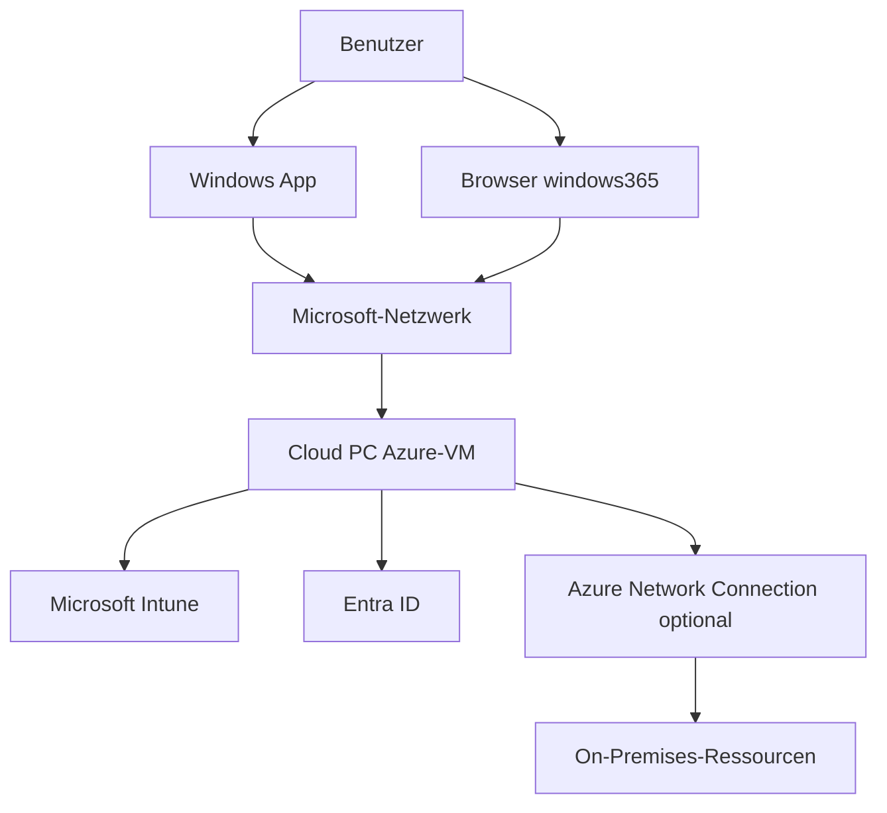
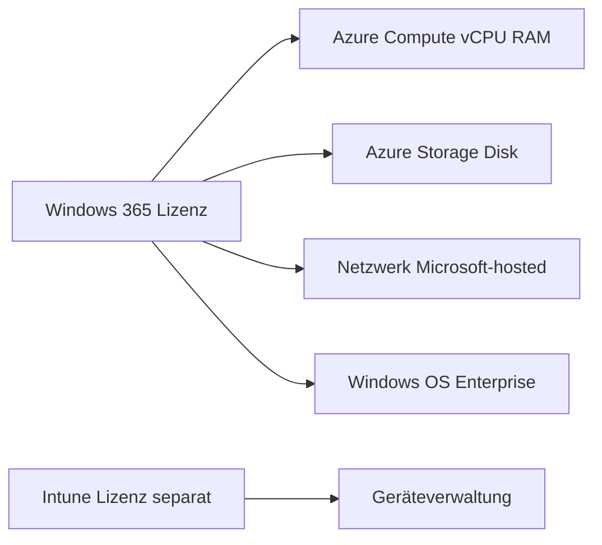

---
tags:
  - microsoft365
  - windows365
  - cloud-pc
  - intune
  - entra-id
aliases:
  - Cloud PC
  - W365
  - Windows 365 Enterprise
---

# Windows 365 Cloud PC

> [!ABSTRACT] TL;DR
> Windows 365 ist Microsofts SaaS-Lösung für persistente, persönliche Cloud-PCs (Cloud PC). Die gesamte Infrastruktur wird von Microsoft in Azure betrieben — kein eigenes Azure-Abo nötig. Verwaltung erfolgt vollständig über Microsoft Intune.

---

## Was ist Windows 365?

Windows 365 ist ein Cloud-Dienst, der einen vollständigen Windows-PC in der Azure-Cloud bereitstellt — den sogenannten **Cloud PC**. Im Gegensatz zu klassischer VDI ist Windows 365 ein reines SaaS-Angebot: Microsoft betreibt die gesamte Infrastruktur (Compute, Storage, Netzwerk), der Administrator muss keine eigene Azure-Subscription verwalten.

Das Konzept des Cloud PCs folgt dem **Desktop-as-a-Service (DaaS)**-Modell:

- **Persistent**: Jeder Nutzer hat seinen eigenen, dauerhaften Cloud PC — Dateien, Einstellungen und Anwendungen bleiben zwischen Sitzungen erhalten.
- **Persönlich**: 1:1-Zuweisung — ein Cloud PC gehört genau einem Benutzer.
- **Vollständiges Windows**: Der Cloud PC läuft auf Windows 10 oder Windows 11 Enterprise mit vollem Desktop-Erlebnis.

Benutzer können von überall auf ihren Cloud PC zugreifen — über die **Windows App**, den **Browser** unter `windows365.microsoft.com`, die klassische **Remote Desktop App** oder über **Windows 365 Boot** (direkter Start in den Cloud PC).

---

## Architektur

Windows 365 basiert auf Microsoft Azure, aber die Komplexität der Infrastruktur ist vollständig verborgen. Microsoft stellt sicher, dass jeder Cloud PC hochverfügbar und sicher betrieben wird.



### Microsoft-hosted Network
Beim **Microsoft-hosted Network** stellt Microsoft das gesamte Netzwerk bereit. Der Cloud PC erhält eine ausgehende Internetverbindung und Zugang zu Microsoft-Diensten (M365, Entra ID, Intune). Keine eigene Azure-Infrastruktur erforderlich — ideal für reine Cloud-Organisationen.

### Azure Network Connection (ANC)
Die **Azure Network Connection** verbindet den Cloud PC mit einem eigenen Azure VNet. Dies ermöglicht:
- Zugriff auf On-Premises-Ressourcen (File Server, interne Anwendungen)
- Eigene DNS-Auflösung
- Hybrid Entra Join (AD DS-Domänenmitgliedschaft)

Für ANC wird eine eigene Azure-Subscription mit einem vorhandenen VNet und Subnet benötigt.

---

## Windows 365 Business vs. Enterprise

Windows 365 wird in zwei Editionen angeboten, die sich vor allem in der Verwaltungstiefe und den Organisationsgrößen unterscheiden.

| Kriterium | Business | Enterprise |
|-----------|----------|------------|
| Max. Nutzer | 300 | Unbegrenzt |
| Intune-Verwaltung | Optional (vereinfacht) | Vollständig Intune |
| Azure Network Connection | Nein | Ja |
| Custom Images | Nein | Ja |
| Hybrid Entra Join | Nein | Ja |
| Zielgruppe | KMU ohne dediziertes IT-Team | Mittelstand / Konzern |
| Provisioning Policy | Vereinfacht | Vollständig konfigurierbar |
| Conditional Access | Eingeschränkt | Vollständig |

> [!TIP] Welche Edition wählen?
> **Business** ist ideal für kleine Organisationen, die schnell starten wollen, ohne tiefe Azure-Kenntnisse. **Enterprise** ist die richtige Wahl, wenn Intune bereits eingesetzt wird, On-Premises-Ressourcen erreichbar sein müssen oder individuelle Images und Netzwerkkonfigurationen benötigt werden.

---

## Pläne und Spezifikationen

Windows 365 bietet eine breite Palette an Konfigurationen, die nach vCPUs, RAM und Storage gestaffelt sind. Die Preise (Stand 2024, USD) sind Listenpreise pro Nutzer/Monat.

| Plan | vCPU | RAM | Storage | Preis/Monat (ca.) |
|------|------|-----|---------|-------------------|
| Basic | 2 | 4 GB | 128 GB | ~31 USD |
| Standard | 2 | 8 GB | 128 GB | ~41 USD |
| Standard | 4 | 16 GB | 128 GB | ~66 USD |
| Premium | 8 | 32 GB | 128 GB | ~131 USD |
| Premium | 8 | 32 GB | 512 GB | ~162 USD |
| GPU Standard | 4 + NVIDIA T4 | 16 GB | 128 GB | auf Anfrage |
| GPU Super | 8 + NVIDIA T4 | 56 GB | 512 GB | auf Anfrage |

> [!NOTE] Windows Hybrid Benefit
> Wenn eine Windows E3/E5- oder M365 E3/E5-Lizenz vorhanden ist, wird kein Windows-OS-Aufschlag berechnet. Der **Windows Hybrid Benefit** spart je nach Plan mehrere USD pro Nutzer/Monat.

> [!IMPORTANT] Resize ist möglich
> Cloud PCs können nachträglich auf höhere Pläne upgraded werden (Resize-Funktion). Ein Downgrade ist nicht möglich ohne Reprovisioning.

---

## Via Microsoft Intune Admin Center (UI)

### Cloud PC Provisioning Policy erstellen

1. Öffne das **Microsoft Intune Admin Center** unter [intune.microsoft.com](https://intune.microsoft.com)
2. Navigiere zu **Geräte → Windows 365 → Bereitstellungsrichtlinien**
3. Klicke auf **+ Erstellen**
4. Gib einen **Namen** ein (z.B. `PP-W365-Standard`) und wähle den **Lizenztyp** (*Enterprise* oder *Frontline*)
5. Wähle unter **Netzwerk** entweder **Microsoft-hosted Network** oder eine vorhandene **Azure Network Connection (ANC)**
6. Wähle ein **Image** aus der Galerie (z.B. *Windows 11 Enterprise + Microsoft 365 Apps 23H2*) oder ein Custom Image
7. Konfiguriere **Sprache & Region** (z.B. `Deutsch (Deutschland)`)
8. Wähle den **AD-Beitrittstyp**: **Microsoft Entra ID Join** (cloud-only) oder **Hybrid Microsoft Entra Join**
9. Klicke auf **Weiter → Zuweisungen** → gewünschte **Entra ID-Sicherheitsgruppe** hinzufügen
10. Klicke auf **Erstellen**

> [!NOTE] Automatisches Provisioning
> Nach der Zuweisung werden Cloud PCs automatisch für alle Mitglieder der Sicherheitsgruppe erstellt. Der Status ist unter **Geräte → Windows 365 → Alle Cloud-PCs** einsehbar.

### Cloud PC verwalten (Resize, Reprovision, Troubleshoot)

1. Navigiere zu **Geräte → Windows 365 → Alle Cloud-PCs**
2. Wähle einen Cloud PC aus der Liste
3. Im Detailbereich sind folgende **Aktionen** verfügbar:
   - **Größe ändern (Resize)**: Plan auf höhere CPU/RAM upgraden — ohne Datenverlust
   - **Erneut bereitstellen (Reprovision)**: Cloud PC auf Provisionierungszustand zurücksetzen (**Datenverlust!**)
   - **Probleme beheben (Troubleshoot)**: Konnektivitätsprüfung starten (DNS, Entra ID, Intune, ANC)
   - **Neustart**: Cloud PC neu starten
   - **Wiederherstellen (Restore)**: Snapshot aus den letzten 7 Tagen wiederherstellen

> [!TIP] Bereitstellungsstatus überwachen
> Unter **Windows 365 → Organisationseinstellungen** lässt sich der Status aller Provisioning Policies einsehen. Fehler werden mit Fehlercode und empfohlenem Lösungsschritt angezeigt.

---

## Provisioning Policy

Eine **Provisioning Policy** definiert, wie Cloud PCs für eine Nutzergruppe erstellt werden. Sie ist das zentrale Konfigurationsobjekt in Windows 365 Enterprise.

### Bestandteile einer Provisioning Policy

| Einstellung | Optionen | Beschreibung |
|-------------|----------|--------------|
| Netzwerk | Microsoft-hosted / ANC | Netzwerkanbindung des Cloud PCs |
| Image | Gallery-Image / Custom Image | Betriebssystem und Vorinstallationen |
| Sprache & Region | z.B. de-DE | Windows-Systemsprache |
| AD Join-Typ | Entra ID Join / Hybrid Entra Join | Identitätszugehörigkeit |
| Lizenz | Aus Provisioning Policy abgeleitet | Automatische Zuweisung |

### Schritte im Intune Admin Center

1. **Intune Admin Center** → `Devices` → `Windows 365` → `Provisioning Policies`
2. **Neue Policy erstellen**: Name, Netzwerk (Microsoft-hosted oder ANC auswählen)
3. **Image auswählen**: Marketplace-Image (Windows 11 Enterprise + M365 Apps) oder Custom Image
4. **Sprache konfigurieren**: Windows-Sprache und Zeitzone
5. **Assignments**: Entra ID Security Group zuweisen — alle Mitglieder erhalten einen Cloud PC

```powershell
# Provisioning Policies via Microsoft Graph API abrufen
$Headers = @{ Authorization = "Bearer $AccessToken" }
$Response = Invoke-RestMethod `
    -Uri "https://graph.microsoft.com/v1.0/deviceManagement/virtualEndpoint/provisioningPolicies" `
    -Headers $Headers
$Response.value | Select-Object displayName, imageDisplayName, onPremisesConnectionId
```

---

## Entra ID Integration und Intune-Verwaltung

Jeder Cloud PC wird automatisch bei Microsoft Intune enrolled und mit Entra ID verbunden. Es gibt zwei Join-Modi:

- **Microsoft Entra ID Join (cloud-only)**: Der Cloud PC ist ausschließlich mit Entra ID verbunden. Ideal für reine Cloud-Organisationen ohne On-Premises AD.
- **Hybrid Entra Join**: Erfordert eine Azure Network Connection und eine laufende AD DS-Domänenverbindung. Ermöglicht vollständigen Zugriff auf On-Premises-Ressourcen mit Kerberos-Authentifizierung.

Nach dem Enrollment stehen alle Intune-Funktionen zur Verfügung:
- **Compliance Policies**: Gerätezustand prüfen (Encryption, OS-Version, Antivirus)
- **Configuration Profiles**: Einstellungen per Policy pushen (VPN, WLAN, Firewall)
- **App Deployment**: Win32 Apps, MSI, MSIX, Microsoft Store
- **Conditional Access**: Zugriff an Bedingungen knüpfen (MFA, Device Compliance)

---

## Cloud PC Aktionen

Administratoren können im Intune Admin Center verschiedene Aktionen auf Cloud PCs ausführen:

| Aktion | Beschreibung | Datenverlust? |
|--------|-------------|---------------|
| **Resize** | vCPU/RAM/Storage upgraden (kein Neustart nötig bei Storage) | Nein |
| **Reprovision** | Cloud PC vollständig zurücksetzen auf Provisionierungszustand | Ja — alle Nutzerdaten |
| **Restore** | Automatisches Backup wiederherstellen (7 Tage Snapshots) | Nein (Stand Backup) |
| **Rename** | Gerätename in Intune und Entra ID anpassen | Nein |
| **Restart** | Cloud PC neu starten | Nein |
| **Troubleshoot** | Connectivity Check und Diagnose starten | Nein |

> [!WARNING] Reprovision setzt alle Daten zurück
> Das Reprovisioning löscht alle Nutzerdaten und stellt den Cloud PC auf den Ausgangszustand der Provisioning Policy zurück. Vor einem Reprovisioning sicherstellen, dass wichtige Daten in OneDrive oder SharePoint gespeichert sind.

---

## Custom Images

Windows 365 Enterprise unterstützt **Custom Images**, die in der Azure Compute Gallery (früher: Shared Image Gallery) gespeichert werden.

### Anforderungen an Custom Images
- Generalisiertes Windows 10/11 Enterprise Image (Sysprep)
- Keine lokalen Benutzerkonten (außer Built-in Administrator)
- Azure VM Agent installiert
- Alle wichtigen Anwendungen vorinstalliert

### Image vorbereiten

```powershell
# VM für Custom Image vorbereiten (Sysprep)
# Auf der Quell-VM ausführen

# Optional: Windows Update abschließen
Install-WindowsUpdate -AcceptAll -AutoReboot

# Sysprep ausführen
& "$env:SystemRoot\System32\Sysprep\sysprep.exe" /oobe /generalize /shutdown /mode:vm
```

Nach dem Sysprep-Shutdown wird aus der VM ein generalisiertes Image in der Azure Compute Gallery erstellt. Im Intune Admin Center unter `Windows 365` → `Device Images` kann das Image importiert werden.

---

## Zugriff auf den Cloud PC

### Windows App (empfohlen)
Die **Windows App** (früher: Remote Desktop App) ist der primäre Client für Cloud PCs. Sie ist für Windows, macOS, iOS und Android verfügbar und bietet:
- Automatische Verbindungsoptimierung
- Multi-Monitor-Unterstützung
- Clipboard- und Druckerweiterleitung
- Teams Optimization (WebRTC Redirect)

### Browser-Zugriff
Unter `windows365.microsoft.com` können Nutzer direkt im Browser auf ihren Cloud PC zugreifen — ohne Client-Installation. Ideal für:
- Zugriff von verwalteten Geräten ohne installierten Client
- Temporärer Zugriff von fremden Rechnern
- HTML5-basiert, keine Plugin-Installation nötig

---

## Troubleshooting

### Gray Screen Problem
Ein grauer Bildschirm beim Verbindungsaufbau ist eines der häufigsten Probleme. Ursachen:

| Ursache | Lösung |
|---------|--------|
| Netzwerkverbindung unterbrochen | ANC-Status prüfen, Azure VNet konfigurieren |
| Entra ID Join fehlgeschlagen | Entra ID-Gerätestatus prüfen, Reprovision |
| Zertifikatsfehler | Zertifikat auf Cloud PC erneuern |
| Provisioning noch nicht abgeschlossen | Status in Intune prüfen |

### Connectivity Check

> [!NOTE] Connectivity Check ausführen
> Im Intune Admin Center: `Devices` → `Windows 365` → Cloud PC auswählen → `Troubleshoot` → `Run connectivity check`. Dieser prüft DNS, Entra ID, Intune, ANC-Verbindung und meldet gezielt Fehler.

### Log-Dateien auf dem Cloud PC

```powershell
# Windows 365 Logs auslesen
Get-EventLog -LogName "Application" -Source "CloudPC*" -Newest 50

# Netzwerk-Konnektivität prüfen
Test-NetConnection -ComputerName "rdgateway.wvd.microsoft.com" -Port 443
Test-NetConnection -ComputerName "login.microsoftonline.com" -Port 443
```

---

## Lizenzierung

Windows 365 wird **pro Nutzer, pro Monat** lizenziert. In der Lizenz enthalten sind:

- **Windows OS-Lizenz** (Windows 10/11 Enterprise)
- **Azure Compute** (vCPU, RAM)
- **Azure Storage** (Systemdisk)
- **Netzwerk** (ausgehender Traffic bei Microsoft-hosted Network)
- **Intune-Verwaltungsrecht** (erfordert separate Intune-Lizenz oder M365-Bundle)

> [!IMPORTANT] Intune-Lizenz erforderlich
> Windows 365 Enterprise erfordert zusätzlich eine Microsoft Intune-Lizenz (oder M365 Business Premium, E3, E5). Die Intune-Lizenz ist nicht im Windows 365-Preis enthalten.

### Kosteneinsparung durch Windows Hybrid Benefit
Wenn eine Windows E3/E5- oder M365 E3/E5-Lizenz vorhanden ist:
- Kein separater Windows-OS-Aufschlag im Cloud PC-Preis
- Preisersparnis je nach Plan



---

## Verwandte Notizen

- [[Windows 365 Boot und Frontline]]
- [[Azure Virtual Desktop AVD]]
- [[AVD Netzwerk und Identität]]
- [[FSLogix]]
- [[RDS vs AVD vs W365 Vergleich]]
