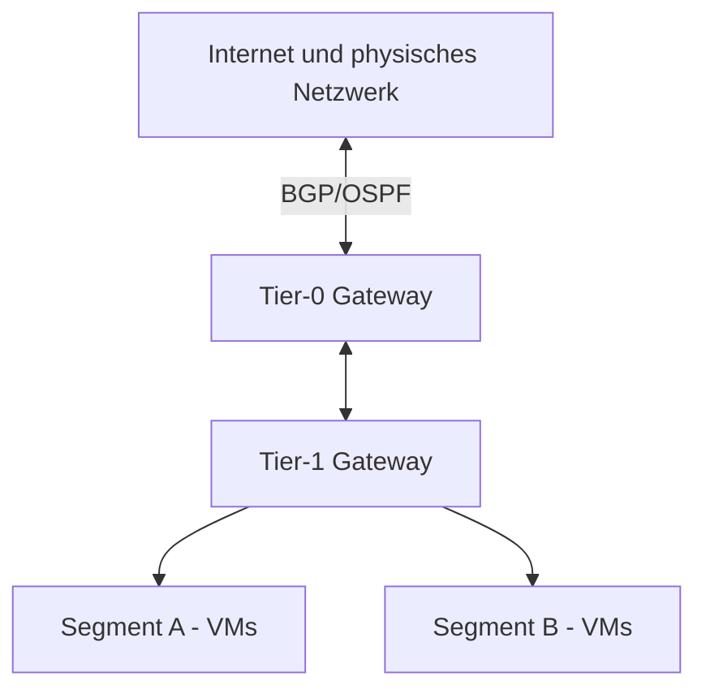

# VMware NSX

> [!ABSTRACT]
> VMware NSX ist die Software-Defined Networking (SDN)-Plattform von VMware. Netzwerke, Firewalls, Load Balancer und VPNs werden vollständig als Software realisiert — unabhängig von physischer Netzwerk-Hardware. Ab Version 4.0 (2022) heißt NSX-T schlicht „NSX".

---

## Was ist NSX?

NSX ist VMwares Implementierung von Software-Defined Networking (SDN). Statt Netzwerkfunktionen in dedizierten Hardware-Appliances zu betreiben (physische Switches, Hardware-Firewalls), realisiert NSX diese vollständig als Software auf dem Hypervisor.

**Kernidee:** Das Netzwerk wird eine abstrakte Ressource — ähnlich wie vSphere das Compute virtualisiert, virtualisiert NSX das Netzwerk. Jede VM bekommt logische Netzwerke, Firewalls und Services — unabhängig davon, auf welchem Host sie läuft.

### Geschichte und Versionen

| Version | Name | Status | Besonderheit |
|---|---|---|---|
| NSX for vSphere | NSX-V | End of Support 2025 | Nur ESXi, vSphere-exklusiv, veraltet |
| NSX-T 2.x–3.x | NSX-T Data Center | Abgelöst | Multi-Hypervisor (ESXi + KVM), Container-Support |
| NSX 4.x+ | NSX | Aktuell | Vereinfachter Name, vereinheitlichte Plattform |

> [!IMPORTANT]
> NSX-V (NSX for vSphere) hat End of General Support erreicht. Alle neuen Deployments sollten NSX (ehemals NSX-T) verwenden. Migration von NSX-V zu NSX ist aufwändig und erfordert Planung.

### NSX im Vergleich zu klassischem Netzwerk

| Merkmal | Klassisches Netzwerk | NSX (SDN) |
|---|---|---|
| Firewall | Dedizierte Hardware-Appliance | Distributed Firewall auf jedem Hypervisor-Kernel |
| Netzwerksegmentierung | VLANs auf physischen Switches | Overlay-Netzwerke (Geneve-Tunnel) |
| Load Balancer | Hardware-Appliance (F5, Citrix) | Software Load Balancer in NSX |
| Netzwerk-Provisionierung | Manuell (Ticket an Netzwerk-Team) | Self-Service via API/vCenter |
| Multi-Site | komplexe BGP/OSPF-Konfiguration | NSX Federation |

---

## Kernkomponenten

### NSX Manager

Die zentrale Management-Plane — als Appliance (3 Manager für HA oder 1 für Lab):

| Instanz-Typ | Beschreibung |
|---|---|
| NSX Manager (Single) | Lab/Dev, kein HA |
| NSX Manager Cluster (3x) | Produktion, HA-fähig |
| Global NSX Manager | Multi-Site-Federation |

### Data Plane Komponenten

| Komponente | Funktion |
|---|---|
| NSX Edge Node | Gateway-VM: Nord-Süd-Traffic, NAT, VPN, Load Balancer, BGP/OSPF |
| Distributed Router (DR) | Im Hypervisor-Kernel: Ost-West-Routing ohne Trampoline-Effekt |
| Distributed Firewall (DFW) | Im Hypervisor-Kernel: Firewall-Regeln direkt am vNIC jeder VM |
| Transport Node | ESXi-Host oder KVM-Host mit NSX-Kernel-Modulen |
| Geneve-Tunnel | Overlay-Protokoll für logische Netzwerke (Port 6081 UDP) |

---

## Netzwerk-Konzepte

### Overlay vs. Underlay

```
Overlay (logisch)          Underlay (physisch)
─────────────────          ──────────────────
Segment A (10.0.1.0/24)    VLAN 100 (physisch)
Segment B (10.0.2.0/24) →  Geneve-Tunnel über physische NICs
Segment C (10.0.3.0/24)    VLAN 100 (physisch)
```

Mehrere logische Segmente teilen sich ein physisches VLAN — keine separate VLAN-Konfiguration pro logischem Netzwerk nötig.

### Tier-0 und Tier-1 Gateway

| Gateway | Funktion |
|---|---|
| Tier-0 (T0) | Nord-Süd-Gateway: BGP/OSPF zum physischen Netzwerk, External Connectivity |
| Tier-1 (T1) | Ost-West-Gateway: Verbindet logische Segmente, routes nach T0 weiter |



### Mikrosegmentierung

Die wichtigste Security-Funktion von NSX: Die Distributed Firewall (DFW) läuft direkt im VMkernel — jeder VM-Netzwerkverkehr wird am vNIC gefiltert, bevor er den Host verlässt.

**Vorteil:** Auch Ost-West-Traffic (VM zu VM auf gleichem Host) wird gefiltert — klassische Netzwerk-Firewalls sehen diesen Traffic nicht.

```
VM-A ←→ [DFW@vNIC] ←→ Hypervisor-Netzwerk ←→ [DFW@vNIC] ←→ VM-B
```

---

## Installation und Konfiguration

### Voraussetzungen

| Anforderung | Details |
|---|---|
| vCenter | Version 7.0+ |
| ESXi | Version 7.0+ (auf Transport Nodes) |
| NSX Manager RAM | 16 GB (Small), 32 GB (Medium) |
| NSX Manager CPU | 6 vCPUs (Small), 12 vCPUs (Medium) |
| NSX Edge RAM | 8 GB (Small), 32 GB (Large) |
| Lizenz | VCF oder separate NSX-Lizenz |

### Deployment-Übersicht

1. **NSX Manager OVA deployen** — via vCenter OVF-Deployment
2. **NSX Manager mit vCenter verbinden** — System → Compute Managers
3. **Transport Zone erstellen** — Overlay und VLAN Transport Zones
4. **Uplink Profile erstellen** — Teaming-Policy, MTU (9000 empfohlen)
5. **Transport Nodes konfigurieren** — ESXi-Hosts als Transport Nodes hinzufügen
6. **Tier-0 Gateway erstellen** — mit Edge Node verknüpfen, BGP konfigurieren
7. **Tier-1 Gateway erstellen** — mit Tier-0 verbinden
8. **Segmente erstellen** — logische Netzwerke, mit Tier-1 verbinden
9. **VMs in Segmente migrieren** — vNIC von VLAN-PortGroup auf NSX-Segment umstellen

### Transport Zone erstellen

**GUI-Pfad:** `NSX Manager → Networking → Network Topology → Transport Zones`

| Transport Zone Typ | Verwendung |
|---|---|
| Overlay Transport Zone | Für logische NSX-Segmente (Geneve-Tunnel) |
| VLAN Transport Zone | Für VLAN-backed Uplinks auf Edge Nodes |

---

## Distributed Firewall (DFW)

### Regel-Struktur

**GUI-Pfad:** `NSX Manager → Security → Distributed Firewall`

Regeln werden in **Kategorien** (Policies) organisiert:

| Kategorie | Priorität | Verwendung |
|---|---|---|
| Ethernet | Höchste | Layer-2-Regeln (MAC-basiert) |
| Emergency | 2 | Notfall-Blockierregeln |
| Infrastructure | 3 | DNS, AD, Management-Traffic |
| Environment | 4 | Zone-zu-Zone-Regeln |
| Application | 5 | Applikations-spezifische Regeln |

### Beispiel-Regelkonfiguration

```
Policy: Web-App-Trennung
├── Regel 1: Web-Tier → App-Tier : Port 8080 : ALLOW
├── Regel 2: App-Tier → DB-Tier : Port 1433 : ALLOW
├── Regel 3: Web-Tier → DB-Tier : ANY : DROP
└── Regel 4: Default : ANY → ANY : DROP (Log)
```

### Sicherheitsgruppen (Security Groups)

Statt IP-Adressen werden **Security Groups** als Quelle/Ziel verwendet:

```
Security Group "Web-VMs":
  - Membership: Tag = "Tier:Web" ODER
  - VM-Name enthält "web"

→ Regeln verwenden "Web-VMs" statt "192.168.1.0/24"
→ Wenn eine neue Web-VM startet und das Tag bekommt, greift die Regel automatisch
```

---

## Gateway Firewall und Services

### Gateway Firewall

Firewall auf dem Tier-0/Tier-1 Gateway — für Nord-Süd-Traffic:

**GUI-Pfad:** `Security → Gateway Firewall → Gateway Policies`

### Load Balancer

**GUI-Pfad:** `Networking → Load Balancing`

| Load Balancer Typ | Einsatz |
|---|---|
| Tier-1 (empfohlen) | Applikations-Load-Balancing hinter dem Gateway |
| Active-Standby | Standard-Konfiguration (kein Scale-out) |

```
Externer Traffic → T0 Gateway → T1 Gateway → NSX Load Balancer → VMs (Server Pool)
```

### NAT

**GUI-Pfad:** `Networking → NAT`

```powershell
# NAT-Regel via API (Beispiel)
# SNAT: Interner Traffic → externe IP
# DNAT: Externe IP → interne VM (Port Forwarding)
```

### VPN

| VPN-Typ | Protokoll |
|---|---|
| IPsec VPN | Site-to-Site, Policy- oder Route-based |
| L2 VPN | Layer-2-Erweiterung zwischen Sites |
| SSL VPN | Remote Access (via NSX Edge) |

---

## Troubleshooting

### Diagnose-Tools in NSX Manager

| Tool | Pfad | Verwendung |
|---|---|---|
| Packet Capture | Plan & Troubleshoot → Port Mirroring | Traffic mitschneiden |
| Traceflow | Plan & Troubleshoot → Traceflow | Paket-Pfad nachverfolgen |
| Port Connection | Networking → Logical Ports | VM-Verbindungsstatus |
| Connectivity Check | System → Fabric → Nodes | Transport-Node-Konnektivität |

### Traceflow — Ost-West-Diagnose

```
NSX Manager → Plan & Troubleshoot → Traceflow
→ Quelle: VM-A vNIC
→ Ziel: VM-B IP
→ Protokoll: ICMP / TCP:80
→ Trace starten → zeigt jeden Hop mit DFW-Regelentscheidung
```

### Häufige Probleme

| Problem | Ursache | Lösung |
|---|---|---|
| Transport Node nicht verbunden | NSX-Kernel-Modul nicht geladen | `esxcli software vib list | grep nsx` auf Host |
| Geneve-Tunnel down | MTU zu klein (Geneve braucht +50 Bytes) | MTU auf physischen Switches auf 9000 setzen |
| DFW blockiert Traffic unerwartet | Default-Deny-Regel greift | Traceflow zur Diagnose, Regel-Logging aktivieren |
| Edge Node BGP nicht up | BGP-Konfiguration oder physisches Routing | `show bgp neighbors` auf Edge Node via NSX Console |
| VMs können Segment nicht erreichen | Segment nicht mit T1 verbunden | Segment-Konfiguration in NSX Manager prüfen |

### Log-Pfade

| Komponente | Log-Pfad |
|---|---|
| NSX Manager | `/var/log/vmware/nsx-*/` |
| DFW auf ESXi | `/var/log/dfwpktlogs.log` |
| Edge Node | `/var/log/syslog` (via SSH auf Edge VM) |
| Transport Node | `esxcli network ip connection list` |

---

## Verwandte Notizen

- [[ESXi Grundlagen]]
- [[vCenter]]
- [[ESXi Netzwerk und Storage]]
- [[Tanzu]]
- [[vSphere Replication]]
