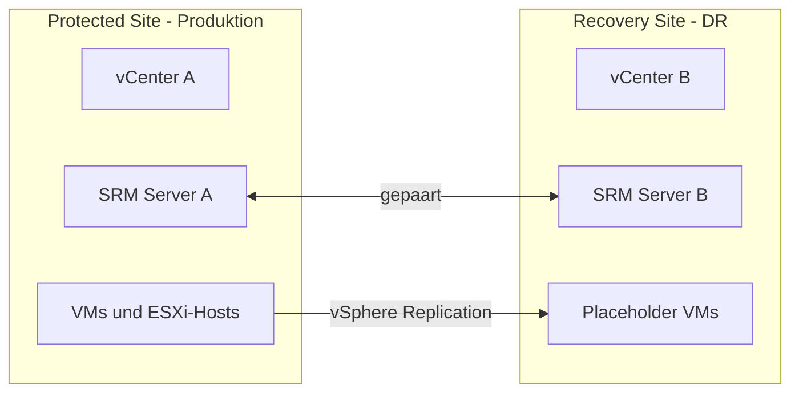

# Site Recovery Manager

> [!ABSTRACT]
> VMware Site Recovery Manager (SRM) ist die DR-Orchestrierungsplattform von VMware. SRM automatisiert Failover, Test-Failover und Failback ganzer Umgebungen — inklusive Reihenfolge, Netzwerk-Rekonfiguration und Recovery-Skripten. Es arbeitet mit vSphere Replication oder Array-Based Replication.

---

## Was ist Site Recovery Manager?

Site Recovery Manager (SRM) wurde mit vSphere 4.0 eingeführt und ist die Enterprise-DR-Lösung im VMware-Portfolio. Während [[vSphere Replication]] die Daten repliziert, orchestriert SRM den gesamten Failover-Prozess.

**Kernidee:** DR nicht als manuellen Prozess aus Handbüchern, sondern als automatisierten, testbaren Plan definieren — mit definierten RTO- und RPO-Zielen.

### SRM vs. vSphere Replication allein

| Merkmal | vSphere Replication (allein) | SRM + vSphere Replication |
|---|---|---|
| Replikation | Ja | Ja (via VR oder Array-Replication) |
| Failover | Manuell, VM für VM | Automatisiert, Recovery Plan |
| Reihenfolge | Keine | Definierte Start-Reihenfolge (Priorität) |
| Netzwerk-Mapping | Manuell anpassen | Automatische IP-Umkonfiguration |
| Pre/Post-Skripte | Keine | Benutzerdefinierte Skripte im Plan |
| Test-Failover | Eingeschränkt | Non-disruptive Tests ohne Auswirkung auf Produktion |
| RTO-Planung | Keine | Definierter Recovery Time Objective |
| Lizenz | Im VVF/VCF enthalten | Separate SRM-Lizenz oder VCF |

### Lizenzierung

| Edition | Inhalt |
|---|---|
| VCF (VMware Cloud Foundation) | SRM enthalten |
| Standalone SRM | Separate Lizenz, pro VM oder Site |

---

## Architektur

SRM benötigt auf beiden Sites einen SRM Server und setzt gepaarte vCenter-Instanzen voraus.



| Komponente | Beschreibung |
|---|---|
| SRM Server | Windows-Dienst oder Appliance (ab SRM 9.0: nur Appliance) |
| Protected Site | Produktionsstandort — Quell-VMs laufen hier |
| Recovery Site | DR-Standort — VMs werden hierher failovered |
| Paired Sites | Beide SRM-Server sind miteinander verbunden |
| Placeholder VMs | Inaktive VM-Shells auf Recovery Site (kein Speicherplatz) |

---

## Kernkonzepte

| Konzept | Erklärung |
|---|---|
| Protection Group | Gruppe von VMs die gemeinsam geschützt werden (gleiche Replikation) |
| Recovery Plan | Definiert Failover-Ablauf: Reihenfolge, IP-Mapping, Skripte |
| Recovery Steps | Einzelne Schritte im Plan (VM starten, Skript ausführen, warten) |
| Network Mapping | Zuordnung Protected Site Netzwerk → Recovery Site Netzwerk |
| Datastore Mapping | Zuordnung Protected Site Datastore → Recovery Site Datastore |
| Folder Mapping | VM-Ordnerstruktur zwischen Sites |
| IP Customization | IP-Adresse/Gateway der VM wird bei Failover automatisch geändert |
| RTO | Recovery Time Objective — maximale tolerable Ausfallzeit |
| RPO | Recovery Point Objective — maximaler tolerierbarer Datenverlust |

---

## Konfiguration

### Sites pairen

**GUI-Pfad:** `vCenter → Site Recovery → Öffnen → Sites → Site-Paar erstellen`

1. Remote vCenter URL eingeben
2. Credentials der Remote-Site eingeben
3. Verbindung herstellen und bestätigen

### Mappings konfigurieren

**GUI-Pfad:** `Site Recovery → Site-Paar → Konfigurieren`

```
Netzwerk-Mapping:
  Protected: "VM-Network-Prod" → Recovery: "VM-Network-DR"
  Protected: "VLAN100"         → Recovery: "VLAN200"

Datastore-Mapping:
  Protected: "vSAN-Prod"       → Recovery: "vSAN-DR"

Folder-Mapping:
  Protected: "Produktion"      → Recovery: "DR-Recovered"
```

### Protection Group erstellen

**GUI-Pfad:** `Site Recovery → Protection Groups → Erstellen`

| Einstellung | Bedeutung |
|---|---|
| Name | Sprechender Name z. B. "Web-Tier" |
| Site-Paar | Welches Site-Paar verwendet wird |
| Replikationstyp | vSphere Replication oder Array-Based |
| VMs hinzufügen | Welche VMs zur Gruppe gehören |

### Recovery Plan erstellen

**GUI-Pfad:** `Site Recovery → Recovery Plans → Erstellen`

1. **Name und Beschreibung**
2. **Protection Groups hinzufügen** — eine oder mehrere
3. **Test-Netzwerk auswählen** — isoliertes Netzwerk für Tests
4. **Schritte anpassen:**

```
Recovery Plan "Web-Infrastruktur-Failover":
  Priorität 1: DB-Server starten
  Priorität 2: App-Server starten (wartet 120 Sek auf DB)
  Priorität 3: Web-Server starten
  Post-Recovery-Skript: DNS-Update-Script ausführen
```

### Prioritäten und Wartezeiten

```
Priorität 1 → alle VMs dieser Priorität starten
→ Warten: 120 Sekunden (oder bis VMware Tools reagiert)
→ Skript ausführen (optional)
Priorität 2 → alle VMs dieser Priorität starten
...
```

---

## Test-Failover

Test-Failover ist **non-disruptive** — Produktion läuft weiter, Replikation wird nicht unterbrochen.

**GUI-Pfad:** `Recovery Plans → Plan auswählen → Test`

**Was passiert beim Test:**
1. VMs werden im **isolierten Test-Netzwerk** auf Recovery Site gestartet
2. Placeholder VMs werden durch echte VMs ersetzt (im Test-Netzwerk)
3. Recovery Plan Steps werden ausgeführt
4. Admin testet die Umgebung manuell
5. **Test bereinigen** — VMs werden heruntergefahren, Placeholder wiederhergestellt

> [!TIP]
> Regelmäßige Tests (quartalsweise) sind Best Practice für DR-Zertifizierungen (ISO 22301, BSI IT-Grundschutz). SRM dokumentiert jeden Test mit Zeitstempeln und Status.

```
Test-Ergebnis-Bericht:
  Test gestartet: 2025-03-01 14:00
  Schritt 1 (DB-Server): OK — gestartet in 45 Sek
  Schritt 2 (App-Server): OK — gestartet in 78 Sek
  Schritt 3 (Web-Server): OK — gestartet in 32 Sek
  Skript: OK — DNS-Test erfolgreich
  Gesamtzeit: 4 Minuten 23 Sekunden
  Bereinigung: OK
```

---

## Echter Failover (Recovery)

Bei einem echten Disaster:

**GUI-Pfad:** `Recovery Plans → Plan auswählen → Ausführen → Recovery`

> [!WARNING]
> Echter Failover ist **destruktiv** für die Protected Site — VMs dort werden als ausgefallen markiert. Nur ausführen wenn die Protected Site wirklich nicht verfügbar ist oder bewusst abgeschaltet wird.

**Ablauf:**
1. Letzte Replikation synchronisieren (wenn Protected Site noch erreichbar)
2. VMs auf Protected Site herunterfahren (wenn erreichbar)
3. VMs auf Recovery Site starten (in definierter Reihenfolge)
4. Netzwerk-Mappings anwenden (IP-Adressen umkonfigurieren)
5. Skripte ausführen (DNS-Updates, Monitoring, etc.)

---

## Failback

Rückkehr zur Protected Site nach dem Failover:

**GUI-Pfad:** `Recovery Plans → Reprotect` (nach erfolgreichem Failover)

1. **Reprotect** — Recovery Site wird zur neuen Protected Site
2. Replikation läuft jetzt von Recovery Site → Protected Site
3. **Failback-Plan ausführen** — VMs migrieren zurück
4. **Reprotect erneut** — ursprüngliche Richtung wiederherstellen

> [!NOTE]
> Nach dem Failback ist der ursprüngliche Zustand wiederhergestellt. Empfohlen: Nach Failback sofort testen ob Replikation korrekt läuft.

---

## Troubleshooting

| Problem | Ursache | Lösung |
|---|---|---|
| Site-Paar nicht verbunden | SRM-Zertifikat abgelaufen oder Firewall | Port 8095 zwischen SRM-Servern prüfen |
| Protection Group hat Fehler | VM-Replikation unterbrochen | VR-Status prüfen, Replikation neu konfigurieren |
| Test-Failover schlägt fehl | Test-Netzwerk nicht korrekt konfiguriert | Netzwerk-Mapping prüfen |
| Recovery Plan Schritt schlägt fehl | VM startet nicht auf Recovery Site | VM-Kompatibilität mit Recovery-Host prüfen |
| IP-Customization funktioniert nicht | VMware Tools nicht aktuell | VMware Tools aktualisieren |
| Reprotect schlägt fehl | Protected Site noch nicht bereit | Host-Verbindung und Storage prüfen |

### Log-Pfade

| Komponente | Log-Pfad |
|---|---|
| SRM Server (Windows) | `%PROGRAMDATA%\VMware\VMware vCenter Site Recovery Manager\Logs` |
| SRM Appliance | `/var/log/vmware/srm/` |
| Recovery Plan Ausführung | Site Recovery UI → Recovery Plans → History |

---

## Verwandte Notizen

- [[vSphere Replication]]
- [[ESXi Grundlagen]]
- [[vCenter]]
