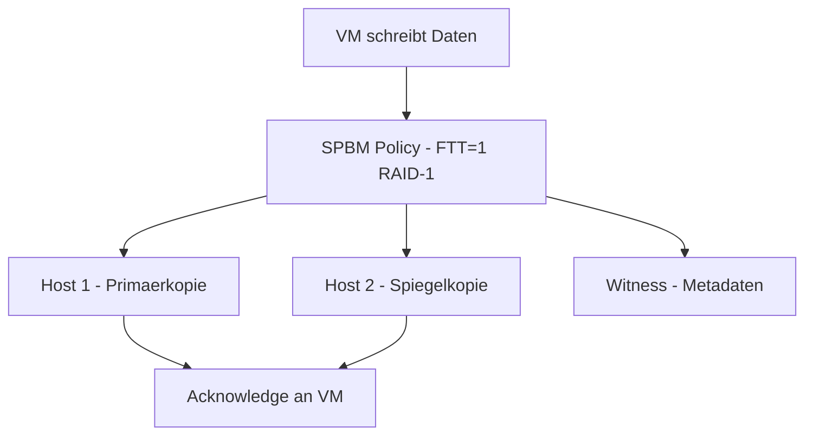

# vSAN

> [!ABSTRACT]
> VMware vSAN ist eine hyperkonvergente Speicherlösung (HCI), die lokale SSDs und HDDs der ESXi-Hosts zu einem gemeinsamen, verteilten Datastore zusammenfasst. Storage wird nicht mehr in dedizierten SAN/NAS-Systemen betrieben, sondern direkt auf den Compute-Hosts.

---

## Was ist vSAN?

vSAN (früher VSAN, Virtual SAN) wurde mit vSphere 5.5 (2014) eingeführt und ist VMwares Implementierung von Hyperconverged Infrastructure (HCI). Anstatt dedizierten Storage-Arrays kombiniert vSAN die lokalen Festplatten aller ESXi-Hosts im Cluster zu einem einzigen, verteilten Datastore.

**Kernidee:** Jeder ESXi-Host bringt Compute (CPU/RAM) und Storage (SSDs/HDDs) mit — vSAN fasst den Storage aller Hosts zu einem gemeinsamen Pool zusammen.

### vSAN vs. traditioneller Storage

| Merkmal | Traditionelles SAN/NAS | vSAN (HCI) |
|---|---|---|
| Storage-Hardware | Dedizierte SAN/NAS-Arrays | Lokale Disks in ESXi-Hosts |
| Netzwerk | FC-SAN oder iSCSI/NFS | 10/25 GbE (Standard-Netzwerk) |
| Skalierung | Vertikal (größeres Array) | Horizontal (mehr Hosts) |
| Komplexität | Hoch (separate Storage-Admin) | Niedrig (einheitliche vCenter-Verwaltung) |
| Lizenz | Hardware-abhängig | VMware VCF oder vSAN Add-on |
| Abhängigkeit | Single Point of Failure möglich | Verteilt, selbstheilend |

### vSAN-Versionen und Editionen

| Edition | Enthält | Verfügbarkeit |
|---|---|---|
| vSAN (Standard) | Basis-HCI, Encryption, Deduplication | VCF oder Add-on |
| vSAN ESA (Express Storage Architecture) | vSAN 8.0+, vollständige Neuentwicklung der I/O-Architektur | VCF |
| vSAN Max | Dedizierter Storage-Cluster (nur Storage, kein Compute) | VCF |

> [!IMPORTANT]
> vSAN ist **nicht** im Basis-ESXi oder VVF (vSphere Foundation) enthalten — es erfordert VCF (VMware Cloud Foundation) oder eine separate vSAN-Lizenz.

---

## Architektur

### Cluster-Disk-Gruppen

Jeder vSAN-Host hat eine oder mehrere **Disk Groups**. Eine Disk Group besteht aus:

| Komponente | Funktion | Empfehlung |
|---|---|---|
| Cache Tier (1 Disk) | Read/Write Cache | NVMe oder SAS SSD |
| Capacity Tier (1–7 Disks) | Persistente Datenspeicherung | SSD oder HDD |

> [!NOTE]
> Im vSAN ESA (ab vSAN 8.0) gibt es keine Cache/Capacity-Trennung mehr — alle SSDs werden einheitlich genutzt (All-Flash, NVMe optimiert).

### Datenpfad



### vSAN Witness

Bei 2-Knoten-vSAN oder Stretched Cluster wird ein **Witness** benötigt:
- Leichtgewichtige Appliance (oder dritter Host)
- Hält keine VM-Daten — nur Metadaten (Witness-Komponenten)
- Verhindert Split-Brain bei Netzwerktrennung

---

## Storage Policy Based Management (SPBM)

vSAN verwendet **Policies** um Datenschutz und Performance pro VM zu definieren — keine manuelle LUN-Konfiguration.

**GUI-Pfad:** `vCenter → Policies and Profiles → VM Storage Policies`

### Wichtige Policy-Parameter

| Parameter | Wert | Bedeutung |
|---|---|---|
| Failures to Tolerate (FTT) | 1 | VM überlebt Ausfall von 1 Host/Disk |
| Failures to Tolerate (FTT) | 2 | VM überlebt Ausfall von 2 Hosts |
| RAID-Level | RAID-1 (Mirroring) | Vollständige Spiegelung (FTT=1 → 2 Kopien) |
| RAID-Level | RAID-5 (Erasure Coding) | Effizienter (braucht weniger Platz, mehr Hosts nötig) |
| RAID-Level | RAID-6 | FTT=2 mit Erasure Coding (6 Hosts minimum) |
| Number of disk stripes | 1–12 | Performance-Streifen über mehrere Disks |
| Object space reservation | 0–100% | Vorallokierter Speicher |

### RAID-1 vs. RAID-5 Vergleich

| Methode | Min. Hosts | Overhead | Performance |
|---|---|---|---|
| RAID-1 (FTT=1) | 3 | 100% (2 Kopien) | Sehr hoch |
| RAID-5 (FTT=1) | 4 | 33% | Hoch |
| RAID-6 (FTT=2) | 6 | 50% | Mittel |

---

## Voraussetzungen und Mindestanforderungen

| Anforderung | Minimum | Empfehlung |
|---|---|---|
| Hosts pro Cluster | 3 (Standard) / 2 (2-Node) | 4+ |
| Netzwerk | 10 GbE | 25 GbE |
| vSAN VMkernel Adapter | 1 pro Host | 2 (Redundanz) |
| Cache Disk | 1 SSD pro Disk Group | NVMe |
| Capacity Disks | 1–7 pro Disk Group | SSD (All-Flash) |
| vCenter | Zwingend | — |
| HCL | Alle Komponenten auf VMware HCL | Kritisch! |

> [!WARNING]
> vSAN erfordert zertifizierte Hardware (VMware HCL — Hardware Compatibility List). Nicht-zertifizierte Disks können zu Datenverlust führen. VMware bietet ReadyNodes (vorzertifizierte Server von Dell, HPE, Lenovo etc.) an.

---

## Installation und Konfiguration

### vSAN aktivieren

**GUI-Pfad:** `vCenter → Cluster → Konfigurieren → vSAN → Dienste`

1. **Cluster-Typ auswählen:**
   - Single Site Cluster
   - 2-Node Cluster (mit Witness)
   - Stretched Cluster (2 Sites + Witness)

2. **Deduplication und Compression** (optional, nur All-Flash)

3. **Disk Groups konfigurieren:**
   - Automatisch (Disks werden automatisch zugewiesen)
   - Manuell (Cache- und Capacity-Disks explizit auswählen)

4. **Witness Host** (nur bei 2-Node/Stretched Cluster)

### Disk Group manuell erstellen

**GUI-Pfad:** `Host → Konfigurieren → vSAN → Disk Management → Disk Group erstellen`

```
Disk Group:
  Cache: NVMe_500GB (SSD, markiert als Cache)
  Capacity: SSD_2TB_1, SSD_2TB_2, SSD_2TB_3
```

### VMkernel-Adapter für vSAN

```powershell
# Per PowerCLI vSAN VMkernel konfigurieren
$vmhost = Get-VMHost "esxi01.domain.local"
$vss = Get-VirtualSwitch -VMHost $vmhost -Name "vSwitch0"

New-VMHostNetworkAdapter -VMHost $vmhost `
    -PortGroup "vSAN" `
    -VirtualSwitch $vss `
    -IP 10.10.10.1 `
    -SubnetMask 255.255.255.0 `
    -VsanTrafficEnabled $true
```

---

## VM Storage Policy zuweisen

```powershell
# Storage Policy erstellen (per PowerCLI)
$policy = New-SpbmStoragePolicy -Name "vSAN-FTT1-RAID5" `
    -Description "FTT=1 mit RAID-5 Erasure Coding" `
    -AnyOfRuleSets @(
        New-SpbmRuleSet -AllOfRules @(
            New-SpbmRule -Capability (Get-SpbmCapability "VSAN.hostFailuresToTolerate") -Value 1,
            New-SpbmRule -Capability (Get-SpbmCapability "VSAN.replicaPreference") -Value "RAID-5/6 (Erasure Coding)"
        )
    )

# Policy auf VM anwenden
$vm = Get-VM "WebServer01"
$disk = Get-HardDisk -VM $vm
Set-HardDisk -HardDisk $disk -StoragePolicy $policy
```

---

## Monitoring und Health

**GUI-Pfad:** `Cluster → Monitor → vSAN → Skyline Health`

| Health-Check-Bereich | Prüft |
|---|---|
| Netzwerk | vSAN-Netzwerkkonnektivität, MTU, Latenz |
| Physical Disk | Disk-Fehler, Kapazität, Endurance |
| Data | Resync-Status, Compliance mit Policies |
| Cluster | Hosts-Status, Disk-Gruppen |
| Performance Service | Performance-Daten aktiviert? |

```powershell
# vSAN Health per PowerCLI prüfen
$cluster = Get-Cluster "vSAN-Cluster"
$healthSvc = Get-VsanView -Id "VsanVcClusterHealthSystem-vsan-cluster-health-system"
$healthResult = $healthSvc.VsanQueryVcClusterHealthSummary($cluster.Id, $null, $null, $true, $null, $null, "defaultView")
$healthResult.OverallHealth
```

---

## vSAN Performance Service

**GUI-Pfad:** `Cluster → Konfigurieren → vSAN → Dienste → Performance Service`

Aktiviert detailliertes Performance-Monitoring (IOPS, Throughput, Latenz) für:
- Cluster-weite Metriken
- Einzelne VMs
- Disk Groups pro Host

---

## Troubleshooting

| Problem | Ursache | Lösung |
|---|---|---|
| VM „Noncompliant" | Policy nicht erfüllbar (zu wenig Hosts) | Hosts hinzufügen oder Policy ändern |
| Resync läuft lange | Netzwerkbandbreite zu gering | 25 GbE empfohlen für Produktion |
| Disk Group offline | Disk-Fehler | Skyline Health → Physical Disk prüfen |
| vSAN-Netzwerk down | MTU-Mismatch (Jumbo Frames) | MTU auf allen Switches auf 9000 setzen |
| Kapazität fast voll | Overhead durch RAID unterschätzt | Policy zu RAID-5 ändern oder Hosts/Disks hinzufügen |
| Split-Brain (2-Node) | Witness nicht erreichbar | Witness-Verbindung und Routing prüfen |

### Wichtige Befehle (ESXi-Shell)

```bash
# vSAN-Cluster-Status
esxcli vsan cluster get

# vSAN-Disk-Status
esxcli vsan storage list

# vSAN-Netzwerk prüfen
esxcli vsan network list

# vSAN Health aus CLI
esxcli vsan health cluster list
```

---

## Verwandte Notizen

- [[ESXi Grundlagen]]
- [[vCenter]]
- [[ESXi Netzwerk und Storage]]
- [[PowerCLI]]
- [[Tanzu]]
