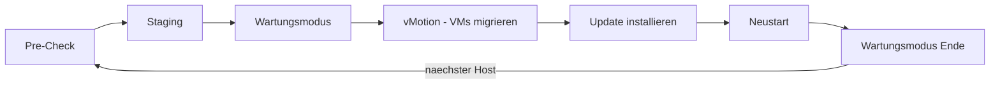

# vSphere Lifecycle Manager

> [!ABSTRACT]
> vSphere Lifecycle Manager (vLCM) ist die zentrale Lösung für Patch- und Update-Management von ESXi-Hosts, VM Hardware und VMware Tools in vSphere-Umgebungen. Ab vSphere 7.0 ersetzt vLCM den früheren vSphere Update Manager (VUM).

---

## Was ist vSphere Lifecycle Manager?

vSphere Lifecycle Manager (vLCM) wurde mit vSphere 7.0 als direkter Nachfolger von vSphere Update Manager (VUM) eingeführt. Er ist vollständig in vCenter integriert — kein separater Server mehr nötig.

**Kernaufgaben:**
- ESXi-Hosts patchen und auf neue Versionen heben
- Firmware-Updates für Server-Hardware koordinieren
- VMware Tools und VM Hardware Version aktualisieren
- Drift-Erkennung: Abweichungen vom definierten Soll-Zustand erkennen

### Baselines vs. Desired State Images

| Merkmal | Baselines (klassisch) | Desired State Image (modern) |
|---|---|---|
| Funktionsweise | Einzelne Patches/Updates als Baseline definieren | Vollständiges ESXi-Image inkl. Add-ons als gewünschter Zustand |
| Flexibilität | Einzelne Patches gezielt anwenden | Cluster-weiter einheitlicher Zustand |
| Firmware | Nur über separate Tools | Integriert via Vendor Add-on |
| Empfehlung | Legacy-Umgebungen, vSphere 6.x | Neue Deployments ab vSphere 7.0+ |
| Cluster-Mischung | Hosts können unterschiedliche Patch-Stände haben | Alle Hosts identisch |

> [!NOTE]
> Ein Cluster kann entweder Baselines **oder** Desired State Images verwenden — nicht beides gleichzeitig. Der Wechsel von Baselines zu Images ist in eine Richtung (kein automatischer Rückweg).

---

## Desired State Image (Cluster Image)

Das Cluster Image definiert exakt, was auf allen Hosts im Cluster installiert sein soll:

| Komponente | Inhalt |
|---|---|
| ESXi-Version | Z. B. ESXi 8.0 Update 3 |
| Vendor Add-on | Hersteller-spezifisches Bundle (Dell OMIVV, HPE SPP) |
| Komponenten | Einzelne VIBs/Treiber zusätzlich zum Basis-Image |
| Firmware | (Optional) via Vendor Add-on |

**GUI-Pfad:** `vCenter → Hosts und Cluster → Cluster auswählen → Updates → Image`

### Image definieren

1. **Basis-Image wählen** — ESXi-Version aus Depot oder Upload
2. **Vendor Add-on hinzufügen** (optional) — Herstellerpaket für Firmware
3. **Komponenten hinzufügen** (optional) — zusätzliche Treiber/Erweiterungen
4. **Image speichern**
5. **Compliance-Check starten** — Hosts werden mit dem Image verglichen
6. **Drift-Bericht ansehen** — welche Hosts weichen ab?

---

## Remediation (Update durchführen)

Remediation ist der Prozess, bei dem Hosts auf den definierten Soll-Zustand gebracht werden.

### Ablauf einer Remediation



| Phase | Beschreibung |
|---|---|
| Pre-Check | Kompatibilitätsprüfung: Hardware, Treiber, VMs geprüft |
| Staging | Update-Pakete werden auf Host heruntergeladen (noch nicht installiert) |
| Wartungsmodus | VMs werden per vMotion auf andere Hosts migriert |
| Update | Patches/Image werden installiert |
| Neustart | Host wird neu gestartet |
| Abschluss | Host verlässt Wartungsmodus, nächster Host beginnt |

> [!WARNING]
> Bei einem Cluster ohne ausreichend Hosts für vMotion kann Remediation blockieren. DRS muss aktiviert sein oder VMs müssen manuell migriert werden.

### Remediation starten (GUI)

**Pfad:** `Cluster → Updates → Hosts → Alle remediieren` oder einzelne Hosts auswählen

**Optionen:**
- **Parallel Remediation** — mehrere Hosts gleichzeitig (schneller, aber weniger Ressourcen für VMs)
- **Sequential Remediation** — ein Host nach dem anderen (sicherer)
- **Quick Boot** — schnellerer Neustart ohne vollständiges BIOS-POST (wenn unterstützt)

### Remediation per PowerCLI

```powershell
# Alle Hosts eines Clusters remediieren
$cluster = Get-Cluster "Prod-Cluster"
$baseline = Get-Baseline "ESXi 8.0 U3"

# Compliance-Check
Test-Compliance -Entity $cluster -Baseline $baseline

# Staging
Stage-Patch -Entity $cluster -Baseline $baseline

# Remediation
Remediate-Inventory -Entity $cluster -Baseline $baseline -ClusterDisableHighAvailability $false
```

---

## Firmware-Updates

vLCM kann Firmware-Updates für Server-Hardware koordinieren, wenn ein Vendor Add-on vorhanden ist.

| Hersteller | Integration |
|---|---|
| Dell EMC | OpenManage Integration for VMware vCenter (OMIVV) |
| HPE | HPE OneView for VMware vCenter |
| Lenovo | Lenovo XClarity Integrator |
| Cisco UCS | Cisco Intersight / UCS Manager |

**Voraussetzung:** Vendor Add-on muss im vLCM-Depot verfügbar sein.

> [!TIP]
> Firmware-Updates über vLCM synchronisieren Hardware- und ESXi-Updates — das verhindert Treiber-/Firmware-Inkompatibilitäten die bei getrennten Update-Prozessen entstehen können.

---

## VMware Tools und VM Hardware

vLCM verwaltet auch VM-seitige Updates:

| Update-Typ | GUI-Pfad |
|---|---|
| VMware Tools (einzelne VM) | VM → Zusammenfassung → VMware Tools aktualisieren |
| VMware Tools (alle VMs) | Cluster → Updates → VMs → VMware Tools |
| VM Hardware Version | VM → Kompatibilität → VM-Kompatibilität aktualisieren |
| Bulk VM Hardware | Cluster → Updates → VMs → VM-Hardware |

> [!WARNING]
> VM Hardware-Version-Updates erfordern einen VM-Neustart. Höhere Hardware-Version = höhere Mindest-ESXi-Version. Downgrade nicht möglich.

---

## Depot-Verwaltung

vLCM bezieht Updates aus Depots:

| Depot-Typ | Quelle |
|---|---|
| Online-Depot (VMware) | my.vmware.com / broadcom.com (Internetzugang nötig) |
| UMDS (Update Manager Download Service) | Lokaler Proxy für Offline-Umgebungen |
| Importiertes ISO | Manuell hochgeladenes ESXi-Image |
| Vendor Add-on Depot | Hersteller-URL oder manueller Upload |

**UMDS einrichten (für Air-Gapped-Umgebungen):**
```powershell
# UMDS ist ein separates Windows-Tool
# Download von Broadcom, auf separatem Windows-Server installieren
# Konfiguration: vmware-umds -S --patch-store "D:\UMDS-Depot"
# Synchronisierung: vmware-umds -S
# Export: vmware-umds -E --export-store "\\fileserver\vsphere-depot"
```

---

## Troubleshooting

| Problem | Mögliche Ursache | Lösung |
|---|---|---|
| Pre-Check schlägt fehl | VMs auf Host nicht migrierbar | VM-Kompatibilität oder DRS prüfen |
| Staging schlägt fehl | Kein Zugriff auf Depot | Netzwerk/Proxy-Konfiguration prüfen |
| Host verlässt Wartungsmodus nicht | VMs starten nicht nach Migration | VM-Events in vCenter prüfen |
| Compliance-Status „Inkompatibel" | Hardware unterstützt Image nicht | Vendor HCL prüfen |
| Firmware-Update nicht verfügbar | Vendor Add-on nicht installiert | Hersteller-Plugin installieren |
| Quick Boot nicht möglich | Hardware unterstützt Quick Boot nicht | Quick Boot deaktivieren in Optionen |

### Log-Pfade

| Log | Pfad |
|---|---|
| vLCM-Log (vCenter) | `/var/log/vmware/vmware-updatemgr/updatemgr.log` |
| Remediation-Log | vCenter → Monitor → Tasks und Ereignisse |
| Host-Update-Log | `/var/log/esxupdate.log` (auf ESXi-Host) |

---

## Verwandte Notizen

- [[ESXi Grundlagen]]
- [[ESXi Installation]]
- [[vCenter]]
- [[PowerCLI]]
