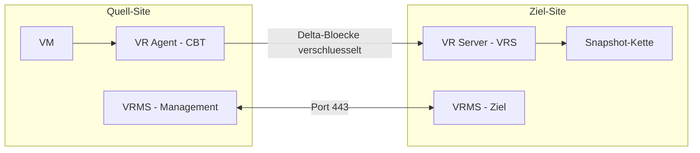

# vSphere Replication

> [!ABSTRACT]
> vSphere Replication ist VMwares agentenlose, asynchrone VM-Replikationslösung. VMs werden kontinuierlich von einer Quelle zu einem Ziel repliziert — mit einem konfigurierbaren RPO (Recovery Point Objective) von 5 Minuten bis 24 Stunden. Die Lösung ist storage-unabhängig.

---

## Was ist vSphere Replication?

vSphere Replication (VR) ist eine in vCenter integrierte Replikationslösung für virtuelle Maschinen. Sie wurde mit vSphere 5.1 eingeführt und repliziert VM-Daten asynchron von einer Quell-Site zu einer Ziel-Site — unabhängig vom verwendeten Storage-Typ.

**Kernmerkmale:**
- Agentenlos — keine Software in der VM nötig
- Storage-unabhängig — kein Array-Replication nötig (kein SAN-zu-SAN)
- RPO: 5 Minuten bis 24 Stunden (konfigurierbar pro VM)
- Replikation innerhalb desselben vCenters oder zu einem zweiten vCenter
- Integriert in [[Site Recovery Manager]] für orchestrierten Failover

### Vergleich mit anderen DR-Methoden

| Methode | RPO | Granularität | Storage-Abhängigkeit | Kosten |
|---|---|---|---|---|
| vSphere Replication | 5 Min – 24 h | Pro VM | Keine | Niedrig (im Lizenzpaket) |
| Array-Based Replication | Sekunden – Minuten | LUN/Volume | Gleiches Storage-Array | Hoch |
| vSAN Stretched Cluster | ~0 (synchron) | Cluster-weit | vSAN auf beiden Sites | Sehr hoch |
| Site Recovery Manager + VR | 5 Min – 24 h | Orchestriert | Keine (mit VR) | Mittel |

> [!NOTE]
> vSphere Replication ist im vSphere Foundation (VVF) und VMware Cloud Foundation (VCF) enthalten. Für ältere Deployments ist es auch als separates Add-on verfügbar.

---

## Architektur und Komponenten

| Komponente | Funktion |
|---|---|
| vSphere Replication Appliance (VRMS) | Management-Plane: UI-Integration in vCenter, Koordination |
| vSphere Replication Server (VRS) | Daten-Plane: Empfängt und schreibt replizierte VM-Daten auf Ziel-Site |
| vSphere Replication Agent | Im VMkernel des Quell-Hosts: Verfolgt Änderungen und sendet Delta-Blöcke |

**Wie die Replikation funktioniert:**
1. VR-Agent auf Quell-Host verfolgt geänderte Disk-Blöcke (Block-Tracking wie CBT)
2. Geänderte Blöcke werden komprimiert und verschlüsselt über das Netzwerk gesendet
3. VRS auf Ziel-Site empfängt und schreibt Blöcke in Snapshot-Kette
4. Bei Failover wird die letzte konsistente Kopie aktiviert



---

## Voraussetzungen

| Anforderung | Details |
|---|---|
| vCenter | Version 7.0+ auf beiden Sites |
| vSphere Replication Appliance | OVA von Broadcom/VMware deployen |
| Netzwerkbandbreite | Abhängig von Change Rate der VMs |
| Port 31031 | Replikations-Traffic zwischen Quell- und Ziel-VRMS |
| Port 443 | VRMS ↔ vCenter Kommunikation |
| Lizenz | VVF / VCF oder standalone |

---

## Installation

### vSphere Replication Appliance deployen

**GUI-Pfad:** `vCenter → Hosts und Cluster → Host auswählen → Aktionen → OVF-Vorlage deployen`

1. **OVA herunterladen** von Broadcom Support Portal
2. **OVA deployen** auf Management-Cluster (beide Sites)
3. **Appliance konfigurieren** — IP, Gateway, DNS, NTP
4. **Mit vCenter registrieren:**

```
vCenter → Menü → Site Recovery → Öffnen
→ vSphere Replication → Konfigurieren
→ vSphere Replication Appliance: IP der VRMS eintragen
→ Verbindung herstellen
```

5. **Sites pairen** (für Cross-vCenter-Replikation):
```
Site Recovery UI → Sites → Site-Paar erstellen
→ Remote vCenter URL + Credentials
```

---

## Replikation konfigurieren

**GUI-Pfad:** `vCenter → VM auswählen → Rechtsklick → Alle Site Recovery Aktionen → Replikation konfigurieren`

### Schritt-für-Schritt

1. **Ziel-Site auswählen** — gleiches vCenter oder Remote-Site
2. **Replikations-Server auswählen** — automatisch oder manuell
3. **Gastdatenträgerkonsistenz** — VMware Tools quiesce aktivieren (für DB/App-Konsistenz)
4. **Ziel-Datenspeicher auswählen** — wo die replizierte VM gespeichert wird
5. **RPO konfigurieren** — 5 Minuten bis 24 Stunden
6. **Aufbewahrungspunkte** — Anzahl der Point-in-Time-Snapshots (0–24)
7. **Seed-Disk verwenden** (optional) — für initiale Synchronisation bei schmaler Leitung

> [!TIP]
> Bei großen VMs oder schmaler WAN-Leitung: Seed-Disk nutzen. Die initiale Kopie der VM wird manuell (z. B. per USB) zur Ziel-Site transportiert und als Ausgangspunkt für die Replikation genutzt.

---

## Replikationsstatus überwachen

**GUI-Pfad:** `Site Recovery → Replikationen`

| Status | Bedeutung |
|---|---|
| OK | Replikation läuft, RPO eingehalten |
| Warning | RPO leicht überschritten (< 2× RPO) |
| Error | Replikation gestoppt oder RPO stark überschritten |
| Syncing | Initiale oder manuelle Synchronisation läuft |
| Paused | Replikation manuell pausiert |

```
Replikation → VM auswählen → Details
→ Letzter Sync: 14:32 Uhr
→ RPO: 15 Minuten
→ Lag: 3 Minuten
→ Aufbewahrungspunkte: 3 verfügbar
```

---

## Failover

### Geplanter Failover (Planned Migration)

Wird genutzt wenn die Quell-Site noch verfügbar ist (z. B. geplante Wartung):

1. VM auf Quell-Site herunterfahren (graceful shutdown)
2. Letzte Daten werden repliziert (synchronisiert)
3. VM auf Ziel-Site gestartet
4. **Ergebnis:** Datenverlust = 0

**GUI-Pfad:** `Site Recovery → Replikationen → VM auswählen → Recover`
→ Recovery-Typ: **Migrate** (geplant)

### Ungeplanter Failover (Recovery)

Wenn die Quell-Site ausgefallen ist:

1. Letzten verfügbaren Replikationspunkt auswählen
2. VM auf Ziel-Site starten
3. **Ergebnis:** Datenverlust = Zeit seit letztem Sync (max. RPO)

**GUI-Pfad:** `Site Recovery → Replikationen → VM auswählen → Recover`
→ Recovery-Typ: **Recovery** (ungeplant)

> [!WARNING]
> Nach einem ungeplanten Failover ist die Quell-VM möglicherweise noch aktiv (Split-Brain). Sicherstellen, dass die Quell-VM wirklich offline ist, bevor die Ziel-VM gestartet wird.

---

## Failback

Nach dem Failover: Rückkehr zur ursprünglichen Quell-Site.

1. **Reverse Replication konfigurieren** — Ziel wird neue Quelle
2. Daten werden zurückrepliziiert
3. **Re-Protect** — Replikation in ursprüngliche Richtung wiederherstellen

**GUI-Pfad:** `Site Recovery → Replikationen → Recover durchgeführte VM → Reverse`

---

## Troubleshooting

| Problem | Ursache | Lösung |
|---|---|---|
| RPO-Warnung | Netzwerkbandbreite zu gering | Throttling prüfen, Change Rate der VM analysieren |
| Initiale Synchronisation schlägt fehl | Firewall blockiert Port 31031 | Netzwerkports prüfen |
| Replikation pausiert | Ziel-Datenspeicher voll | Datastore-Kapazität erhöhen oder VM verschieben |
| VRMS zeigt Fehler | Zertifikat abgelaufen | VRMS-Zertifikat erneuern |
| Failover schlägt fehl | VM-Netzwerk auf Ziel-Site nicht vorhanden | Netzwerk-Mapping in Site Recovery prüfen |

### Log-Pfade

| Komponente | Log-Pfad |
|---|---|
| VRMS Appliance | `/opt/vmware/hms/logs/hms.log` |
| VRS (Replication Server) | `/opt/vmware/hms/logs/` |
| vCenter Ereignisse | vCenter → Überwachung → Ereignisse → "Replication" filtern |

---

## Verwandte Notizen

- [[ESXi Grundlagen]]
- [[vCenter]]
- [[Site Recovery Manager]]
