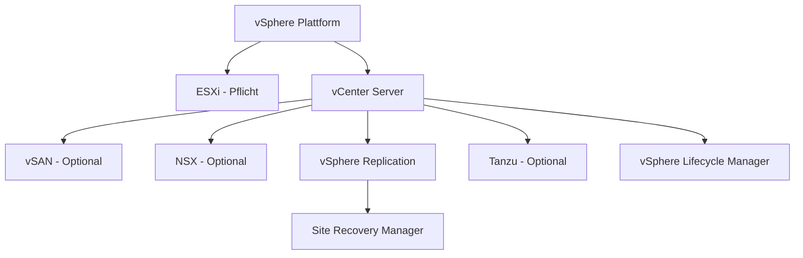

# ESXi / VMware vSphere Grundlagen

> [!ABSTRACT]
> VMware ESXi ist ein Typ-1-Hypervisor (Bare-Metal) von VMware/Broadcom — Marktführer in der Enterprise-Virtualisierung. vSphere ist die übergeordnete Plattform bestehend aus ESXi, vCenter Server und optionalen Diensten wie vSAN und NSX. Nach der Broadcom-Übernahme (2023) hat sich das Lizenzmodell grundlegend geändert.

---

## Was ist ESXi?

ESXi (Elastic Sky X Integrated) ist **VMwares** Typ-1-Hypervisor (Bare-Metal). Er läuft **direkt auf der Server-Hardware** ohne ein darunterliegendes Betriebssystem — ähnlich wie Hyper-V. Der Begriff **vSphere** bezeichnet die gesamte Virtualisierungsplattform: ESXi ist der Hypervisor, vCenter Server die zentrale Verwaltungskomponente.

VMware wurde **1998** gegründet und veröffentlichte **ESX 1.0** im Jahr **2001** — den ersten kommerziellen Typ-1-Hypervisor für x86-Hardware. Mit ESXi 3.5 (2007) wurde der Service Console (Linux-Basis) entfernt und durch den schlanken VMkernel ersetzt. Im **November 2023** schloss Broadcom die Übernahme von VMware ab, was zu erheblichen Änderungen im Lizenz- und Produktportfolio führte.

### ESXi-Versionsgeschichte

| Version | Jahr | Wesentliche Neuerungen |
|---------|------|------------------------|
| **ESX 1.0** | 2001 | Erstveröffentlichung, Service Console (Linux-basiert) |
| **ESX 3.0** | 2006 | vMotion, DRS, vCenter Server |
| **ESX 3.5 / ESXi 3.5** | 2007 | Storage vMotion, HA — ESXi ohne Service Console eingeführt |
| **ESXi 4.x** | 2009 | vSphere-Suite, Distributed vSwitch, Ende von ESX Classic |
| **ESXi 5.x** | 2011 | VAAI (Storage Offload), Storage DRS, vSphere Replication |
| **ESXi 6.x** | 2015 | Virtual Volumes (vVols), NVMe-Unterstützung |
| **ESXi 7.0** | 2020 | Native Kubernetes (Tanzu), ARM-Unterstützung |
| **ESXi 8.0** | 2022 | DPU-Offload, AI/ML-Beschleunigung, Lifecycle-Verbesserungen |
| **ESX 9.0** | 2025 | Rückbenennung zu "ESX", erweiterte Cloud-Integration |

### ESXi-Architektur

| Schicht | Komponente | Beschreibung |
|--------|-----------|-------------|
| **Hardware** | Physischer Server | CPU mit VT-x/AMD-V, RAM, Storage, Netzwerk |
| **VMkernel** | Hypervisor-Kern | Direkte Hardware-Steuerung, kein darunterliegendes OS |
| **VMs** | Guest-Betriebssysteme | Laufen als isolierte Prozesse im VMkernel |
| **Management** | vCenter / ESXi Host Client | Web-UI und API für Verwaltung |

---

## Die vSphere-Produktfamilie

vSphere ist eine **Plattform**, kein einzelnes Produkt. Sie besteht aus mehreren Komponenten die unabhängig oder kombiniert eingesetzt werden:

| Komponente | Funktion | Erforderlich |
|-----------|---------|-------------|
| **ESXi** | Typ-1-Hypervisor — führt VMs aus | Ja (Basis) |
| **vCenter Server** | Zentrale Verwaltung mehrerer ESXi-Hosts, Cluster, HA, DRS | Für Cluster-Features |
| **vSAN** | Hyperkonvergente Speicherlösung aus lokalen SSDs/HDDs der Hosts | Optional |
| **NSX** | Software-defined Networking — Mikrosegmentierung, SDN, Firewall | Optional |
| **vSphere Replication** | Asynchrone VM-Replikation für Disaster Recovery | Optional |
| **Tanzu** | Native Kubernetes-Integration für Container-Workloads | Optional |
| **vSphere Lifecycle Manager** | Zentralisiertes Patch- und Update-Management für Hosts | Empfohlen |
| **Site Recovery Manager (SRM)** | Orchestrierung von DR-Failover und Failback | Optional |

---

## Lizenzierung (Stand: 2025, post-Broadcom)

> [!WARNING] Grundlegende Lizenzänderungen durch Broadcom
> Broadcom hat nach der VMware-Übernahme (2023) das gesamte Lizenzmodell umgestellt. Perpetual-Lizenzen wurden abgeschafft, das SKU-Portfolio drastisch reduziert.

### Aktuelle Editionen

| Edition | Inhalt | Lizenzmodell |
|---------|--------|-------------|
| **VMware vSphere Foundation (VVF)** | ESXi + vCenter + vSphere Lifecycle Manager + Aria Suite Lite | Subscription, pro CPU-Core |
| **VMware Cloud Foundation (VCF)** | VVF + vSAN + NSX + Tanzu — vollständiger Stack | Subscription, pro CPU-Core |
| **ESXi (Free, limitiert)** | Nur ESXi 8.x, kein vCenter, kein HA/DRS/vMotion | Kostenlos nach Registrierung bei Broadcom |

### Wichtige Lizenz-Änderungen

| Änderung | Details |
|---------|---------|
| **Kein Perpetual mehr** | Alle neuen Lizenzen nur als Subscription — bestehende Perpetual laufen aus ohne Verlängerungsmöglichkeit |
| **Per-Core-Lizenzierung** | Pro physischem CPU-Core, Minimum 16 Cores pro CPU (auch wenn weniger vorhanden) |
| **Essentials/Plus-Kits eingestellt** | Keine Einstiegspakete für KMU mehr verfügbar |
| **Standard/Enterprise Plus eingestellt** | Für vSphere 9+ nur noch VVF und VCF — keine Einzelprodukte |
| **Free ESXi 8 wiederbelebt** (April 2025) | ESXi 8 wieder kostenlos verfügbar, nur für Non-Production/Lab, Registrierung erforderlich |
| **vSphere 7.x End of Support** | Oktober 2025 — Migration auf 8.x oder 9.x erforderlich |

> [!IMPORTANT] KMU-Situation
> Für kleine Umgebungen ist VMware nach den Broadcom-Änderungen deutlich teurer geworden. Alternativen wie **Proxmox VE** (Open Source), **XCP-ng** oder **Hyper-V** werden deshalb zunehmend evaluiert.

---

## Kernkonzepte

### vMotion (Live Migration)

vMotion ermöglicht die **unterbrechungsfreie Live-Migration** laufender VMs zwischen ESXi-Hosts. Voraussetzungen: gemeinsamer Datastore (oder Shared Nothing vMotion), kompatible CPU-Familien (oder EVC), vCenter.

| Migrationsart | Downtime | Voraussetzung |
|--------------|---------|--------------|
| **vMotion** | ~0 s | Shared Storage, vCenter, kompatible CPUs |
| **Storage vMotion** | ~0 s | Nur Storage-Migration, kein Shared Storage nötig |
| **Shared Nothing vMotion** | ~0 s | CPU + Storage gleichzeitig, kein Shared Storage |
| **Cross-vCenter vMotion** | ~0 s | Migration zwischen verschiedenen vCenter-Instanzen |

### High Availability (HA)

HA überwacht alle Hosts im Cluster per **Heartbeat**. Fällt ein Host aus, werden seine VMs auf verbleibenden Hosts neu gestartet (kein Live-Migration — Neustart erforderlich).

| Parameter | Beschreibung |
|-----------|-------------|
| **Host Monitoring** | Heartbeat alle 1 s, Ausfall nach 15 s ohne Antwort erkannt |
| **VM Monitoring** | Überwacht Gastbetriebssystem per VMtools-Heartbeat |
| **Admission Control** | Reserviert Kapazität für den Ausfall von N Hosts |
| **Restart Priority** | Definiert Reihenfolge des VM-Neustarts nach Ausfall |

### Distributed Resource Scheduler (DRS)

DRS **balanciert CPU- und RAM-Auslastung** automatisch über alle Hosts im Cluster mittels vMotion.

| DRS-Modus | Verhalten |
|-----------|----------|
| **Manual** | Empfehlungen werden angezeigt, Admin entscheidet |
| **Partially Automated** | Initiale Platzierung automatisch, Migrationen manuell |
| **Fully Automated** | Alle Migrationen automatisch (empfohlen) |

### VM-Dateiformate

| Datei | Endung | Inhalt |
|-------|--------|--------|
| **Konfiguration** | `.vmx` | VM-Einstellungen (CPU, RAM, Hardware-Konfiguration) |
| **Festplatte** | `.vmdk` | Virtuelle Festplatte (Daten) |
| **Snapshot Delta** | `-delta.vmdk` | Änderungen seit dem letzten Snapshot |
| **Snapshot Metadaten** | `.vmsd` | Snapshot-Struktur und -Namen |
| **Swap** | `.vswp` | VM-Swap-Datei (RAM-Auslagerung) |
| **NVRAM** | `.nvram` | BIOS/UEFI-Einstellungen der VM |
| **Log** | `.log` | VM-Ereignisprotokoll |

---

## Netzwerk-Grundlagen

### vSwitch-Typen

| Typ | Kürzel | Verwaltung | Verfügbar |
|-----|--------|-----------|---------|
| **Standard vSwitch** | VSS | Pro Host konfiguriert | Immer (ohne vCenter) |
| **Distributed vSwitch** | VDS | Zentral über vCenter für alle Hosts | Benötigt vCenter + Lizenz |

### Netzwerk-Objekte

| Objekt | Funktion |
|--------|---------|
| **Uplink** | Physische NIC des Hosts — verbindet vSwitch mit dem physischen Netzwerk |
| **Port Group** | Logische Gruppe von Ports mit einheitlichen Einstellungen (VLAN, Security, Traffic Shaping) |
| **VMkernel Port (vmk)** | Netzwerkinterface des Hosts selbst — für Management, vMotion, iSCSI, vSAN |
| **VM Network** | Port Group, der VMs zugewiesen wird |

---

## Vergleich mit anderen Hypervisoren

| Merkmal | VMware ESXi | Microsoft Hyper-V | Proxmox VE | XCP-ng |
|---------|------------|------------------|------------|--------|
| **Typ** | Typ-1 | Typ-1 | Typ-1 (KVM/LXC) | Typ-1 (Xen) |
| **Lizenz** | Subscription (VVF/VCF) | In Windows Server enthalten | Open Source (kostenlos) | Open Source (kostenlos) |
| **Management-UI** | vSphere Client (Web) | Hyper-V Manager / WAC | Proxmox Web UI | XO (Xen Orchestra) |
| **Live Migration** | vMotion | Live Migration | Live Migration | Live Migration |
| **HA** | vSphere HA | Windows Server Failover Cluster | HA-Ressourcen | XO HA |
| **Enterprise-Verbreitung** | Sehr hoch | Hoch | Steigend | Gering |
| **Zielgruppe** | Enterprise | Windows-Umgebungen | KMU / Homelab | KMU / Alternative VMware |

---

## Verwandte Notizen

- [[vCenter]]
- [[ESXi Installation]]
- [[ESXi Netzwerk und Storage]]
- [[ESXi Troubleshooting]]
- [[vSAN]]
- [[NSX]]
- [[vSphere Replication]]
- [[Site Recovery Manager]]
- [[Tanzu]]
- [[vSphere Lifecycle Manager]]
- [[PowerCLI]]
- [[Installation Hyper-V (Windows Server 2022)|Hyper-V]]
