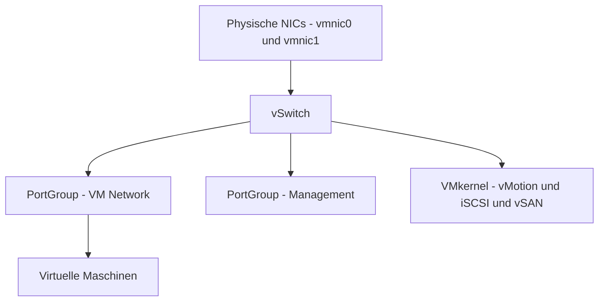

# ESXi Netzwerk und Storage

> [!ABSTRACT]
> Netzwerk und Storage sind die zwei kritischsten Konfigurationsbereiche in ESXi. Netzwerk wird über virtuelle Switches (VSS oder VDS) organisiert, Storage über Datastores — lokal, iSCSI, NFS oder vSAN. Diese Dokumentation behandelt beide Bereiche von der Grundkonfiguration bis zu fortgeschrittenen Setups.

---

## Netzwerk

### Überblick: Standard vSwitch (VSS) vs. Distributed vSwitch (VDS)

| Merkmal | Standard vSwitch (VSS) | Distributed vSwitch (VDS) |
|--------|----------------------|--------------------------|
| **Verwaltung** | Pro Host einzeln | Zentral über vCenter |
| **vCenter erforderlich** | Nein | Ja |
| **Lizenz** | Keine Zusatzlizenz | VVF / Enterprise Plus |
| **Port-Mirroring** | Nein | Ja |
| **LACP** | Nein | Ja |
| **Einsatz** | Einzelne Hosts, Labs | Produktions-Cluster |



### Standard vSwitch konfigurieren

#### GUI (vSphere Host Client)

```
Host Client → Netzwerk → Virtuelle Switches → vSwitch hinzufügen

Name:        vSwitch1
Uplinks:     vmnic1 (physische NIC auswählen)
MTU:         1500 (oder 9000 für Jumbo Frames)
→ Hinzufügen

Port Group hinzufügen:
→ vSwitch1 → Port-Gruppe hinzufügen
→ Name:   VM Network Marketing
→ VLAN:   20 (0 = kein VLAN, 4095 = VLAN Trunk)
→ vSwitch: vSwitch1
→ Hinzufügen
```

#### PowerShell (PowerCLI)

```powershell
# Mit ESXi verbinden
Connect-VIServer -Server esxi01.firma.local -User root -Password 'Passwort'

# vSwitch erstellen
New-VirtualSwitch -VMHost esxi01.firma.local -Name vSwitch1 -NumPorts 120

# Uplink hinzufügen
$vmhost = Get-VMHost esxi01.firma.local
$vswitch = Get-VirtualSwitch -VMHost $vmhost -Name vSwitch1
Add-VirtualSwitchPhysicalNetworkAdapter -VirtualSwitch $vswitch `
    -PhysicalNic (Get-VMHostNetworkAdapter -VMHost $vmhost -Physical -Name vmnic1)

# Port Group erstellen
New-VirtualPortGroup -VirtualSwitch $vswitch -Name "VM Network Marketing" -VLanId 20
```

### VMkernel-Port erstellen (für vMotion, iSCSI, vSAN)

#### GUI

```
Host Client → Netzwerk → VMkernel-NICs → VMkernel-NIC hinzufügen

vSwitch:       vSwitch1 (oder vorhanden)
Port-Gruppe:   vMotion Network (neu oder bestehend)
VLAN:          30 (vMotion VLAN)
IPv4-Konfiguration:
  ⦿ Statisch: 192.168.30.10 / 255.255.255.0
Dienste:
  ☑ vMotion     (für vMotion-Traffic)
  ☐ Management  (nur für Management-Interface)
  ☑ iSCSI       (für iSCSI-Traffic, eigene vmk)
  ☑ vSAN        (für vSAN-Traffic, eigene vmk)
→ Erstellen
```

> [!TIP] Netzwerktrennung
> Best Practice: Separate VMkernel-Ports (vmk) für jeden Zweck:
> - vmk0 → Management (Standard)
> - vmk1 → vMotion
> - vmk2 → iSCSI-A
> - vmk3 → iSCSI-B (für MPIO)
> - vmk4 → vSAN (wenn verwendet)

### Distributed vSwitch (VDS) erstellen

#### GUI (vSphere Client — benötigt vCenter)

```
vSphere Client → Datacenter → Netzwerk → Rechtsklick → Distributed Switch → Neu

Name:           dvSwitch-Prod
vSphere-Version: 8.0.0 (passend zur ESXi-Version)
Uplinks:        2 (Anzahl physischer NICs)
Port Groups:    ✓ Standard-Port-Gruppe erstellen
→ Weiter → Fertig stellen

Host zum dvSwitch hinzufügen:
→ dvSwitch → Rechtsklick → Host hinzufügen
→ Hosts auswählen
→ Physische NICs zuweisen:
   vmnic0 → Uplink 1
   vmnic1 → Uplink 2
→ VMkernel-Adapter migrieren (optional)
→ Fertig stellen
```

---

## Storage

### Datastore-Typen

| Typ | Protokoll | Dateisystem | Einsatz |
|-----|----------|------------|--------|
| **Lokaler Datastore** | Direkt/SATA/SAS | VMFS 6 | Einzelne Hosts, Labs |
| **iSCSI** | TCP/IP | VMFS 6 | Shared Storage für Cluster |
| **NFS** | TCP/IP | NFS v3/v4.1 | Shared Storage, einfach zu konfigurieren |
| **Fibre Channel** | FC | VMFS 6 | Hochperformant, Enterprise |
| **vSAN** | Intern | vSAN FS | Hyperkonvergent, kein externes Storage |
| **vVols** | FC/iSCSI/NFS | Array-spezifisch | Storage-Array-Integration |

### iSCSI Datastore anbinden

#### GUI

```
Host Client → Storage → Adapter → Software-iSCSI-Adapter

1. Adapter aktivieren:
   → "Konfigurieren" → iSCSI aktivieren → Speichern

2. Netzwerkbindung:
   → Netzwerkport-Bindung → Hinzufügen
   → vmk2 (iSCSI-A VMkernel) → OK

3. Dynamische Erkennung:
   → Dynamische Erkennungsadressen → Hinzufügen
   → iSCSI-Server: 192.168.40.10
   → Port: 3260
   → OK → Erneut scannen

4. Datastore erstellen:
   → Storage → Datastores → Neuer Datastore
   → VMFS
   → Gerät auswählen (erkannte iSCSI-LUN)
   → VMFS 6
   → Datastore-Name: iSCSI-Prod-01
   → Partition-Größe: Maximal
   → Fertig stellen
```

#### PowerShell (PowerCLI)

```powershell
# iSCSI-Adapter aktivieren
$vmhost = Get-VMHost esxi01.firma.local
$hba = Get-VMHostHba -VMHost $vmhost -Type iSCSI
Set-VMHostHba -VMHostHba $hba -IScsiName "iqn.2025-01.local.firma:esxi01"

# iSCSI-Ziel hinzufügen
New-IScsiHbaTarget -IScsiHba $hba -Address 192.168.40.10 -Port 3260

# Erneut scannen
Get-VMHostStorage -VMHost $vmhost -RescanAllHba
```

### NFS Datastore anbinden

#### GUI

```
Host Client → Storage → Datastores → Neuer Datastore
→ NFS
→ NFS-Version: NFS 4.1 (empfohlen, Kerberos-Unterstützung)
→ NFS-Server:  192.168.1.50
→ NFS-Freigabe: /mnt/esxi-storage
→ Datastore-Name: NFS-Backup
→ Fertig stellen
```

#### PowerShell (PowerCLI)

```powershell
New-Datastore -VMHost esxi01.firma.local `
    -Name "NFS-Backup" `
    -Nfs `
    -NfsHost 192.168.1.50 `
    -Path /mnt/esxi-storage `
    -NfsVersion 4
```

### VMFS-Datastore erweitern

```
Host Client → Storage → Datastores → Datastore auswählen
→ Aktionen → Kapazität erhöhen
→ Vorhandenen VMFS-Datastore erweitern
→ Partition-Größe: Maximal
→ Fertig stellen
```

---

## vSAN (VMware vSAN)

vSAN ist Microsofts hyperkonvergente Speicherlösung — lokale Disks der ESXi-Hosts werden zu einem gemeinsamen Cluster-Datastore zusammengefasst.

> [!NOTE] vSAN Lizenz
> vSAN ist **nicht** in der Basis-ESXi-Lizenz enthalten. Für vSAN ist VCF (VMware Cloud Foundation) oder ein separates vSAN-Lizenz-Add-on erforderlich.

### vSAN Voraussetzungen

| Anforderung | Minimum |
|-------------|---------|
| **Hosts** | 3 (für RAID-1 Redundanz) |
| **Disk-Typen** | 1x SSD (Cache-Tier) + 1x HDD/SSD (Capacity-Tier) pro Host |
| **Netzwerk** | Dedizierter 10 GbE VMkernel-Port für vSAN-Traffic |
| **vCenter** | Erforderlich |

### vSAN aktivieren

```
vSphere Client → Cluster → Konfigurieren → vSAN → Dienste → Konfigurieren

vSAN-Cluster-Typ:
  ⦿ Einzel-Site-Cluster

vSAN-ESA oder vSAN-OSA:
  ⦿ vSAN-OSA (Original Storage Architecture — einfacher)

Festplattenkonfiguration:
→ Festplattenerkennung: Automatisch
  (oder manuell: Cache-Tier und Capacity-Tier zuweisen)

→ Fertig stellen
```

---

## Snapshot-Verwaltung

Snapshots erfassen den Zustand einer VM zu einem bestimmten Zeitpunkt. **Achtung:** Snapshots sind kein Backup — sie verbleiben auf demselben Datastore.

### GUI

```
VM auswählen → Aktionen → Snapshots → Snapshot erstellen
→ Name:        Vor Update KB5001330
→ Beschreibung: Windows Update Rollback-Punkt
→ ☑ Arbeitsspeicher des virtuellen Computers aufzeichnen
→ ☑ Gastbetriebssystem stilllegen (VMtools erforderlich)
→ OK

Snapshot-Manager:
→ VM → Aktionen → Snapshots → Snapshots verwalten
→ Snapshot auswählen → Zurücksetzen / Löschen

Alle Snapshots löschen:
→ VM → Aktionen → Snapshots → Alle Snapshots löschen
```

> [!WARNING] Snapshots und Performance
> Snapshots schreiben alle Änderungen in Delta-Dateien. Bei langen Laufzeiten (>24–48h) wachsen diese stark und verschlechtern die Performance erheblich. Snapshots immer zeitnah löschen. Nie als Langzeit-Backup verwenden.

---

## Verwandte Notizen

- [[ESXi Grundlagen]]
- [[ESXi Installation]]
- [[vCenter]]
- [[ESXi Troubleshooting]]
