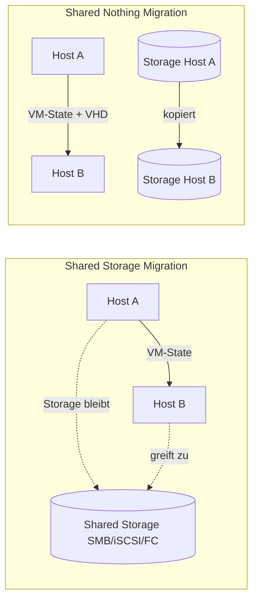
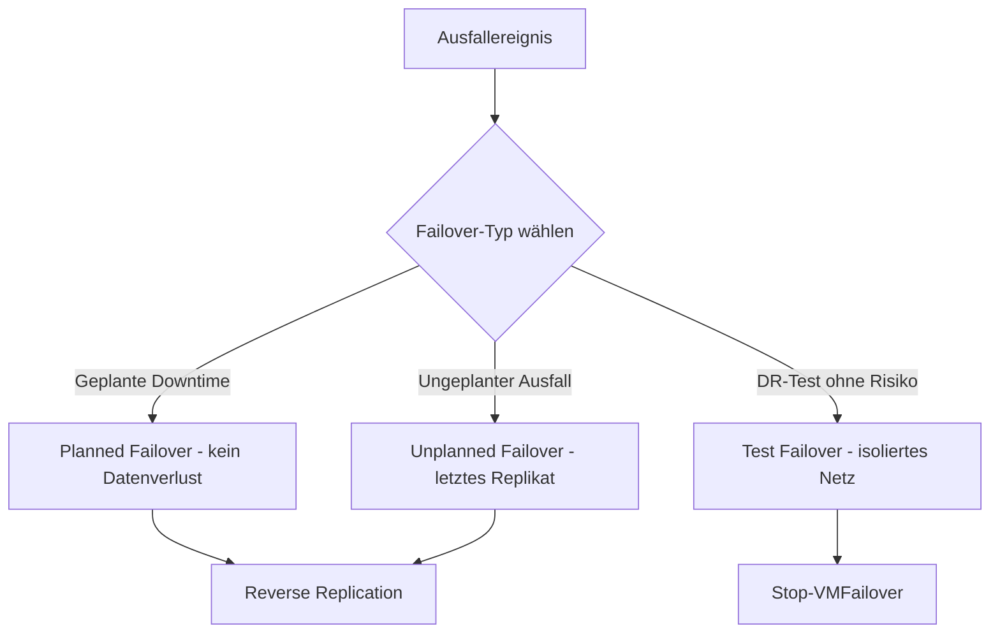
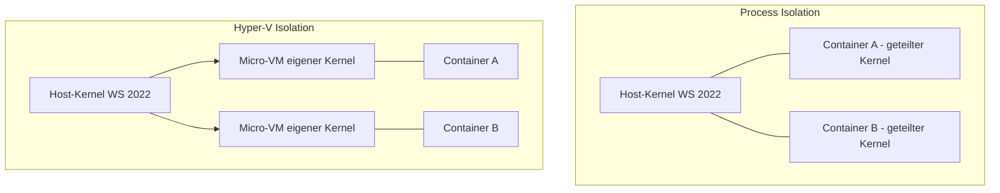

---
tags:
  - virtualization
  - hyper-v
  - live-migration
  - replica
  - failover-clustering
  - ha
  - dr
---

# Hyper-V Replica und Live Migration

> [!ABSTRACT] TL;DR
> Live Migration verschiebt laufende VMs unterbrechungsfrei zwischen Hosts. Hyper-V Replica repliziert VMs asynchron auf einen DR-Standort. Failover Clustering kombiniert beide Technologien für echte Hochverfügbarkeit — ohne SAN-Zwang durch Shared Nothing Migration und Replica.

---

## Live Migration

### Was ist Live Migration?

Live Migration ermöglicht das **unterbrechungsfreie Verschieben** einer laufenden VM von einem Hyper-V-Host auf einen anderen. Während der Migration bleibt die VM aktiv — Netzwerkverbindungen bleiben erhalten, laufende Prozesse werden nicht unterbrochen. Der Übertragungsvorgang ist für Benutzer und Anwendungen transparent.

> [!INFO] Abgrenzung: Quick Migration vs. Live Migration
> | Merkmal | Quick Migration | Live Migration |
> |---------|----------------|----------------|
> | VM-Zustand während Migration | **Pausiert** (kurzes Einfrieren) | **Läuft durch** (unterbrechungsfrei) |
> | Downtime | Sekunden bis Minuten | Millisekunden (kaum merklich) |
> | Netzwerkverbindungen | Werden kurz unterbrochen | Bleiben erhalten |
> | Anforderungen | Geringer | Höher (CPU-Kompatibilität, Netzwerkbandbreite) |
> | Einsatz | Cluster-Wartung, ältere Umgebungen | Standard in modernen Cluster-Umgebungen |

### Voraussetzungen

| Kategorie | Anforderung |
|-----------|-------------|
| **CPU** | Kompatible Prozessoren auf Quell- und Zielhost **oder** Processor Compatibility Mode aktiviert |
| **Netzwerk** | Dedicated Migration Network empfohlen (min. 1 GbE, besser 10 GbE) |
| **Storage** | Shared Storage (SMB 3.0, iSCSI, FC) **oder** Shared Nothing (ohne gemeinsamen Storage) |
| **Authentifizierung** | CredSSP oder Kerberos Constrained Delegation (KCD) |
| **OS** | Gleiche oder kompatible Windows Server Versionen |

> [!TIP] Processor Compatibility Mode — Hyper-Vs EVC-Äquivalent
> Der **Processor Compatibility Mode** ist Hyper-Vs Antwort auf VMwares Enhanced vMotion Compatibility (EVC). Er maskiert prozessorspezifische Flags und ermöglicht Live Migration zwischen Hosts mit **unterschiedlichen CPU-Generationen** (z.B. Ivy Bridge → Haswell). Aktivierung per PowerShell:
> ```powershell
> Set-VMProcessor -VMName "MeineVM" -CompatibilityForMigrationEnabled $true
> ```
> Nachteil: Die VM nutzt nur den kleinsten gemeinsamen CPU-Funktionsumfang — neuere Instruktionssätze wie AVX2 stehen im Gastbetriebssystem nicht zur Verfügung.

### Shared Storage vs. Shared Nothing Live Migration



| Merkmal | Shared Storage Migration | Shared Nothing Migration |
|---------|--------------------------|--------------------------|
| **Storage-Anforderung** | Gemeinsamer Storage (SMB, iSCSI, FC) | Keiner — lokale Disks reichen |
| **Migrationsdauer** | Sehr kurz (nur RAM-Zustand) | Länger (RAM + VHD-Daten) |
| **Netzwerklast** | Gering | Hoch (komplette VHD wird übertragen) |
| **Einsatz** | Cluster-Umgebungen mit SAN/NAS | Kleinere Umgebungen, Ad-hoc-Migration |
| **Verfügbar seit** | Windows Server 2008 R2 | Windows Server 2012 |

### Authentifizierung konfigurieren

**Option 1 — CredSSP** (einfacher, aber weniger sicher):
Credentials werden an den Zielhost delegiert. Erfordert, dass der Administrator lokal oder per direkter RDP-Session auf dem Quellhost angemeldet ist.

```powershell
# CredSSP auf Quellhost aktivieren
Enable-WSManCredSSP -Role Client -DelegateComputer "ZielHost.domain.local"

# CredSSP auf Zielhost aktivieren
Enable-WSManCredSSP -Role Server
```

**Option 2 — Kerberos Constrained Delegation (KCD)** (empfohlen für Produktionsumgebungen):
Ermöglicht Live Migration ohne direkte Anmeldung am Host — ideal für automatisierte und geskriptete Szenarien.

```powershell
# KCD im Active Directory konfigurieren (auf einem DC ausführen)
# Quellhost darf den Zielhost für cifs und Microsoft Virtual System Migration Service delegieren
Set-ADComputer -Identity "QuellHost" `
               -PrincipalsAllowedToDelegateToAccount (Get-ADComputer "ZielHost")
```

> [!WARNING] CredSSP in Produktionsumgebungen
> CredSSP ist anfällig für Pass-the-Hash-Angriffe, da Credentials im Klartext an den Zielhost weitergegeben werden. Für Produktionsumgebungen immer **Kerberos Constrained Delegation** bevorzugen.

### Performance: Gleichzeitige Live Migrations

```powershell
# Maximale gleichzeitige Live Migrations anzeigen
Get-VMHost | Select-Object MaximumVirtualMachineMigrations, MaximumStorageMigrations

# Limits anpassen (Standard: 2 gleichzeitige Migrationen)
Set-VMHost -MaximumVirtualMachineMigrations 4
Set-VMHost -MaximumStorageMigrations 4

# Dediziertes Migrationsnetzwerk konfigurieren
Set-VMHost -UseAnyNetworkForMigration $false
Add-VMMigrationNetwork -Cidr "10.10.20.0/24" -Priority 1
```

### PowerShell: Move-VM und Move-VMStorage

```powershell
# Einfache Live Migration (Shared Storage — nur VM-Zustand wandert)
Move-VM -Name "ProdVM01" -DestinationHost "HyperV-Node02"

# Shared Nothing Live Migration (VM + Storage komplett verschieben)
Move-VM -Name "ProdVM01" `
        -DestinationHost "HyperV-Node02" `
        -DestinationStoragePath "D:\Hyper-V\VMs\ProdVM01"

# Nur den Storage einer VM verschieben (VM bleibt am gleichen Host)
Move-VMStorage -VMName "ProdVM01" `
               -DestinationStoragePath "E:\Hyper-V\VMs\ProdVM01"

# Migration-Status live verfolgen
Get-VMJob | Where-Object { $_.VMName -eq "ProdVM01" } |
    Select-Object Name, JobType, PercentComplete
```

---

## Hyper-V Replica

### Was ist Hyper-V Replica?

Hyper-V Replica ist eine **asynchrone VM-Replikation** auf Host-Ebene — ohne SAN, ohne spezielle Storage-Hardware. VMs werden kontinuierlich auf einen sekundären Hyper-V-Host (Replica-Host) repliziert und stehen dort für ein Failover bereit. Der primäre Einsatz ist **Disaster Recovery (DR)** für kleinere bis mittlere Umgebungen.

> [!INFO] Replikations-Intervalle
> | Intervall | Einsatz | Recovery Point Objective (RPO) |
> |-----------|---------|-------------------------------|
> | **30 Sekunden** | Kritische Systeme, maximale Aktualität | ~30 Sekunden Datenverlust |
> | **5 Minuten** | Standard-Produktionssysteme | ~5 Minuten Datenverlust |
> | **15 Minuten** | Unkritische Systeme, geringere Netzwerklast | ~15 Minuten Datenverlust |

### Authentifizierung: Kerberos vs. Zertifikat

| Methode | Protokoll | Port | Verschlüsselung | Einsatz |
|---------|-----------|------|-----------------|---------|
| **Kerberos** | HTTP | 80 | Keine (Klartext!) | Nur im internen, vertrauenswürdigen LAN |
| **Zertifikat** | HTTPS | 443 | TLS | Empfohlen — immer, besonders WAN/Site-to-Site |

> [!DANGER] Niemals Kerberos/HTTP über WAN
> Replikationsdaten über HTTP werden **unverschlüsselt** übertragen — das schließt VM-Arbeitsspeicher-Inhalte ein. Über WAN oder nicht vollständig vertrauenswürdige Netzwerke ausschließlich **HTTPS mit Zertifikat** verwenden.

### Replica Broker für Cluster

In einem Failover Cluster übernimmt der **Hyper-V Replica Broker** die Verwaltung von Replikationen für alle Cluster-Nodes. Er stellt einen einheitlichen Endpunkt bereit — externe Hosts replizieren zum Broker-Namen, nicht zu einzelnen Nodes.

```powershell
# Replica Broker im Failover Cluster hinzufügen (auf einem Cluster-Node ausführen)
Add-ClusterResource -Name "Hyper-V Replica Broker" `
                    -ResourceType "Hyper-V Replica Broker" `
                    -Group "Cluster Group"

# Broker starten
Start-ClusterResource -Name "Hyper-V Replica Broker"
```

### Replikation einrichten

```powershell
# 1. Replica-Server konfigurieren (auf dem Zielhost ausführen)
Set-VMReplicationServer -ReplicationEnabled $true `
                        -AllowedAuthenticationType Certificate `
                        -CertificateThumbprint "ABCDEF1234567890" `
                        -ReplicationAllowedFromAnyServer $false `
                        -DefaultStorageLocation "D:\Hyper-V\Replica"

# 2. Replikation für eine VM aktivieren (auf dem Quellhost ausführen)
Enable-VMReplication -VMName "ProdVM01" `
                     -ReplicaServerName "replica-host.domain.local" `
                     -ReplicaServerPort 443 `
                     -AuthenticationType Certificate `
                     -CertificateThumbprint "ABCDEF1234567890" `
                     -ReplicationFrequencySec 300

# 3. Initiale Replikation starten
Start-VMInitialReplication -VMName "ProdVM01"

# Replikationsstatus prüfen
Get-VMReplication -VMName "ProdVM01" |
    Select-Object VMName, State, Health, LastReplicationTime
```

### Failover-Typen



```powershell
# Planned Failover (VM auf Primär-Host ZUERST stoppen!)
Start-VMFailover -VMName "ProdVM01" -AsJob

# Unplanned Failover (Primär-Host nicht erreichbar)
Start-VMFailover -VMName "ProdVM01" -Confirm:$false

# Failover abschließen — VM startet auf Replica-Host
Complete-VMFailover -VMName "ProdVM01"

# Test Failover — VM startet isoliert, Primär-VM läuft weiter
Start-VMFailover -VMName "ProdVM01" -AsTest

# Test Failover beenden (Testinstanz wird verworfen)
Stop-VMFailover -VMName "ProdVM01"

# Reverse Replication nach Failback — Replica wird neue Quelle
Set-VMReplication -VMName "ProdVM01" -Reverse
Start-VMInitialReplication -VMName "ProdVM01"
```

### Replica Health überwachen

```powershell
# Health-Status aller replizierten VMs
Get-VMReplication |
    Select-Object VMName, State, Health, LastReplicationTime, AverageReplicationSize |
    Format-Table -AutoSize

# Nur fehlerhafte Replikationen anzeigen
Get-VMReplication | Where-Object { $_.Health -ne "Normal" }

# Replikationsstatistiken zurücksetzen (nach Behebung eines Fehlers)
Reset-VMReplicationStatistics -VMName "ProdVM01"
```

> [!TIP] Replica Health regelmäßig prüfen
> Hyper-V Replica schreibt Fehler ins Windows Ereignisprotokoll unter `Microsoft-Windows-Hyper-V-VMMS-Admin`. Einen Scheduled Task oder ein Monitoring-Skript einrichten, das täglich `Get-VMReplication | Where-Object { $_.Health -ne "Normal" }` ausführt und bei Treffern alarmiert.

---

## Failover Clustering mit Hyper-V

### Windows Server Failover Cluster (WSFC)

Der **Windows Server Failover Cluster (WSFC)** ist die Basis für hochverfügbare Hyper-V-Umgebungen. Mehrere Hyper-V-Hosts bilden einen Cluster — fällt ein Node aus, starten die VMs automatisch auf einem anderen Node neu (High Availability). In Kombination mit Live Migration wird der Neustart sogar unterbrechungsfrei durchgeführt.

```powershell
# Failover Clustering Feature installieren (auf jedem Node ausführen)
Install-WindowsFeature -Name Failover-Clustering -IncludeManagementTools

# Cluster-Voraussetzungen validieren (vor der Erstellung!)
Test-Cluster -Node "HV-Node01", "HV-Node02", "HV-Node03"

# Cluster erstellen
New-Cluster -Name "HV-Cluster01" `
            -Node "HV-Node01", "HV-Node02", "HV-Node03" `
            -StaticAddress "10.10.10.50"
```

### Cluster Shared Volumes (CSV)

**Cluster Shared Volumes (CSV)** sind Shared Disks, auf die **alle Cluster-Nodes gleichzeitig** lesend und schreibend zugreifen können — im Gegensatz zu klassischen Cluster-Disks, die immer nur einem Node exklusiv zugewiesen sind.

| Merkmal | Normale Cluster-Disk | Cluster Shared Volume (CSV) |
|---------|---------------------|-----------------------------|
| **Gleichzeitiger Zugriff** | Nur ein Node (Owner) | Alle Nodes gleichzeitig |
| **VMs pro Volume** | Eine (oder wenige) | Viele — kein Engpass |
| **Live Migration** | Erfordert Storage-Failover | Nahtlos, kein Storage-Move nötig |
| **Verwaltungsaufwand** | Hoch (viele LUNs nötig) | Gering (wenige große CSVs) |
| **Dateisystem** | NTFS | NTFS (gemountet unter `C:\ClusterStorage`) |

```powershell
# Disk als CSV hinzufügen
Add-ClusterSharedVolume -Name "Cluster Disk 1"

# Alle CSVs anzeigen
Get-ClusterSharedVolume

# CSV-Zustand und Owner-Node prüfen
Get-ClusterSharedVolume | Select-Object Name, State, OwnerNode
```

### VM als hochverfügbare Ressource

```powershell
# VM als hochverfügbare Ressource im Cluster registrieren
Add-ClusterVirtualMachineRole -VMName "ProdVM01" -Cluster "HV-Cluster01"

# Bevorzugte Owner-Nodes festlegen (Priorisierung)
Set-ClusterOwnerNode -Resource "ProdVM01" -Owners "HV-Node01", "HV-Node02"

# Alle Cluster-VMs anzeigen
Get-ClusterGroup | Where-Object { $_.GroupType -eq "VirtualMachine" }
```

### Quorum-Konfiguration

Das **Quorum** bestimmt, welche Cluster-Nodes als autoritativ gelten — es verhindert Split-Brain-Szenarien, bei denen zwei getrennte Cluster-Hälften gleichzeitig VMs starten würden.

| Quorum-Typ | Beschreibung | Einsatz |
|------------|-------------|---------|
| **Node Majority** | Mehrheit der Nodes muss erreichbar sein | Ungerade Anzahl Nodes (3, 5, 7) |
| **Disk Witness** | Shared Disk als Tiebreaker | Gerade Anzahl Nodes mit Shared Storage |
| **File Share Witness** | SMB-Freigabe als Tiebreaker | Wenn kein Shared Storage verfügbar |
| **Cloud Witness (Azure)** | Azure Blob Storage als Witness | Moderne Empfehlung — kein lokaler Witness nötig |

```powershell
# Cloud Witness (Azure) konfigurieren — empfohlen ab Windows Server 2016
Set-ClusterQuorum -Cluster "HV-Cluster01" `
                  -CloudWitness `
                  -AccountName "mystorageaccount" `
                  -AccessKey "Base64EncodedKey=="

# File Share Witness konfigurieren (Fallback-Option)
Set-ClusterQuorum -Cluster "HV-Cluster01" `
                  -FileShareWitness "\\fileserver\HV-Cluster01-Witness"

# Aktuellen Quorum-Typ anzeigen
Get-ClusterQuorum -Cluster "HV-Cluster01"
```

> [!TIP] Cloud Witness — die moderne Empfehlung
> Ab Windows Server 2016 ist **Cloud Witness** der bevorzugte Witness-Typ. Er erfordert keinen dedizierten Server, ist durch Azure Redundanz hochverfügbar und kostet durch minimalen Blob-Storage-Verbrauch praktisch nichts (< 1 USD/Monat). Ideal auch für 2-Node-Cluster.

> [!INFO] Stretch Cluster (Site-to-Site)
> Ein **Stretch Cluster** erstreckt sich über zwei physische Standorte — VMs können bei Ausfall eines kompletten Datacenters auf den zweiten Standort failovern. Erfordert synchrone Storage-Replikation (z.B. **Storage Replica**, ab Windows Server 2016) und sorgfältiges Netzwerkdesign mit Site-Awareness. Das Quorum muss so konfiguriert sein, dass kein einzelner Standort allein Quorum erreichen kann.

---

## Nested Virtualization

### Konzept und Voraussetzungen

**Nested Virtualization** ermöglicht das Ausführen von Hyper-V **innerhalb einer Hyper-V-VM** — der Hypervisor läuft also in einer virtuellen Maschine, die selbst vom Hypervisor verwaltet wird. Auf dem physischen Host werden dafür Virtualisierungserweiterungen (VT-x/AMD-V) an die VM durchgereicht.

| Anforderung | Details |
|-------------|---------|
| **Host-CPU** | Intel mit VT-x/EPT (vollständige Unterstützung) — AMD eingeschränkt (ab bestimmten EPYC-Generationen) |
| **VM-Konfigurationsversion** | Mindestens Version 8.0 (Windows Server 2016 / Windows 10) |
| **VM-RAM** | Mindestens 4 GB empfohlen (Hypervisor + Gast-VMs) |
| **Dynamischer RAM** | Muss für die äußere VM **deaktiviert** sein |
| **Host OS** | Windows Server 2016+ oder Windows 10+ als Hyper-V-Host |

```powershell
# Nested Virtualization aktivieren (VM muss gestoppt sein)
Set-VMProcessor -VMName "LabVM01" -ExposeVirtualizationExtensions $true

# Aktivierung prüfen
Get-VMProcessor -VMName "LabVM01" | Select-Object VMName, ExposeVirtualizationExtensions

# MAC-Spoofing aktivieren — erforderlich für Netzwerk in verschachtelten VMs
Set-VMNetworkAdapter -VMName "LabVM01" -MacAddressSpoofing On

# Dynamischen RAM deaktivieren (Pflicht für Nested Virtualization)
Set-VMMemory -VMName "LabVM01" -DynamicMemoryEnabled $false
```

> [!WARNING] Nested Virtualization nicht für Produktion
> Nested Virtualization erzeugt spürbare Performance-Einbußen (bis zu 30–50 % Overhead auf CPU-Ebene). Ausschließlich für **Labs, Schulungen und Entwicklungsumgebungen** verwenden — nie für produktive Workloads.

### Einsatzszenarien

- **Hyper-V Labs:** Vollständige Cluster-Testumgebungen auf einem einzigen physischen Host aufbauen
- **Windows Container mit Hyper-V-Isolation:** Docker/containerd auf einer Hyper-V-VM betreiben, die selbst im Cluster läuft
- **CI/CD-Pipelines:** Automatisierte Tests von VM-Images in kurzlebigen, isolierten Umgebungen
- **Schulungen:** Teilnehmer erhalten individuelle, vollständige Hyper-V-Hosts als VMs

---

## Hyper-V + Windows Container

### Hyper-V Isolation für Windows Container

Windows Container unterstützen zwei Isolationsmodi. Der **Hyper-V Isolation Mode** startet jeden Container in einer eigenen schlanken **Micro-VM** — vollständig isoliert vom Host-Kernel, ohne geteilten Kernel-Namespace.



### Process Isolation vs. Hyper-V Isolation

| Merkmal | Process Isolation | Hyper-V Isolation |
|---------|-----------------|-------------------|
| **Kernel** | Geteilt mit Host | Eigener isolierter Kernel pro Container |
| **Performance** | Höher (kein VM-Overhead) | Etwas geringer (Micro-VM-Overhead) |
| **Sicherheit** | Kernel-Escape möglich | Starke Isolation — kein Host-Kernel-Zugriff |
| **OS-Versionskompatibilität** | Host und Container-Image müssen exakt übereinstimmen | Flexibler — verschiedene Versionen auf einem Host |
| **Ressourcenverbrauch** | Gering | Höher (RAM-Overhead pro Micro-VM) |
| **Einsatz** | Vertrauenswürdige Workloads, CI/CD | Mandantentrennung, Untrusted Code, gemischte OS-Versionen |

### Container-Host einrichten

```powershell
# Container-Feature installieren
Install-WindowsFeature -Name Containers -Restart

# Hyper-V für Hyper-V Isolation installieren (falls nicht bereits vorhanden)
Install-WindowsFeature -Name Hyper-V -IncludeManagementTools -Restart

# Container mit Process Isolation starten (Standard auf passendem OS)
docker run --isolation=process mcr.microsoft.com/windows/servercore:ltsc2022

# Container mit Hyper-V Isolation starten (explizit erzwingen)
docker run --isolation=hyperv mcr.microsoft.com/windows/servercore:ltsc2019
```

> [!NOTE] Nested Virtualization für Container-Hosts als VM
> Wenn der **Container-Host selbst eine Hyper-V-VM** ist (häufig in Cloud-Umgebungen oder Hyper-V-Labs), muss **Nested Virtualization** aktiviert sein, damit Hyper-V Isolation innerhalb der VM funktioniert. Ohne Nested Virtualization können nur Process Isolation Container gestartet werden.

> [!TIP] Hyper-V Isolation in Kubernetes
> In **Azure Kubernetes Service (AKS)** und on-premises Kubernetes-Setups lassen sich Windows-Pods mit Hyper-V Isolation über eine dedizierte `RuntimeClass` betreiben — ideal für Mandanten-Szenarien, bei denen verschiedene Tenants Workloads auf demselben Node ausführen.

---

## Verwandte Notizen

- [[Installation Hyper-V (Windows Server 2022)]]
- [[Hyper-V Storage]]
- [[Hyper-V Netzwerk]]
- [[Hyper-V Best Practices]]
- [[Hyper-V Troubleshooting]]