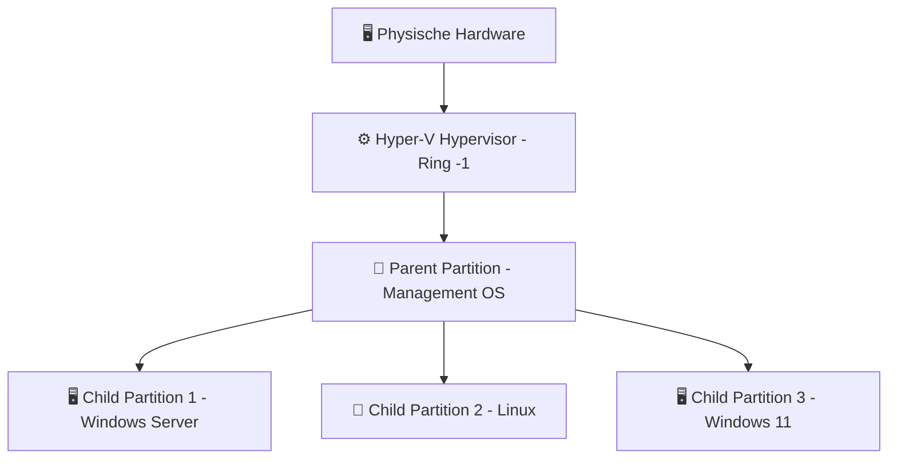

---
tags:
  - virtualization
  - hyper-v
  - grundlagen
  - windows-server
  - microsoft
aliases:
  - Was ist Hyper-V
  - Hyper-V Grundlagen
  - Hyper-V Einführung
---

# Was ist Hyper-V

> [!ABSTRACT] TL;DR
> Hyper-V ist Microsofts nativer **Typ-1-Hypervisor**, der seit Windows Server 2008 in Windows integriert ist. Er läuft direkt auf der Hardware — nicht auf einem Host-Betriebssystem — und bietet Virtualisierung für Server-, Desktop- und Cloud-Workloads (Azure basiert intern auf Hyper-V). Für Windows-Umgebungen ist er die kosteneffizienteste und am besten integrierte Wahl.

---

## Was ist Hyper-V?

Hyper-V ist ein von Microsoft entwickelter **Typ-1-Hypervisor** (auch *Bare-Metal-Hypervisor* genannt). Im Gegensatz zu Typ-2-Hypervisoren wie VirtualBox oder VMware Workstation läuft Hyper-V **direkt auf der Hardware** und stellt allen darüber laufenden Betriebssystemen — einschließlich Windows selbst — virtualisierte Ressourcen bereit.

Hyper-V ist seit **Windows Server 2008** fester Bestandteil des Microsoft-Ökosystems und seit **Windows 8** auch als *Client Hyper-V* auf Desktop-Betriebssystemen verfügbar. Microsoft Azure, die größte Public-Cloud-Plattform der Welt, betreibt seinen Kern auf einer modifizierten Hyper-V-Architektur.

> [!NOTE] Hyper-V und Azure
> Azure nutzt intern eine gehärtete, angepasste Version von Hyper-V. Wer Hyper-V lokal beherrscht, versteht daher wesentliche Grundlagen der Azure-Virtualisierungsschicht.

---

## Architektur — Wie Hyper-V funktioniert

### Typ-1-Hypervisor & Ring -1

Klassische Betriebssysteme laufen im **Ring 0** (Kernel Mode). Hyper-V nutzt eine CPU-Erweiterung (Intel VT-x / AMD-V), den sogenannten **VMX Root Mode** — unterhalb von Ring 0, daher oft als **Ring -1** bezeichnet. Alle anderen Betriebssysteme laufen in **Partitionen** mit einem virtualisierten Ring 0.



### Parent Partition (Management OS)

Die **Parent Partition** ist privilegiert und hat als einzige direkten Zugriff auf physische Hardware. Sie hostet:

- Den **Hyper-V Manager** und PowerShell-Verwaltung
- **Virtualization Service Providers (VSPs)** — Treiber, die Geräte an Child Partitions weiterleiten
- Den **VMBus** — hochperformanter Kommunikationskanal zwischen Parent und Child Partitions

> [!WARNING] Parent Partition ist kein Workload-Server
> Obwohl die Parent Partition wie normales Windows aussieht, läuft sie selbst als virtualisierte Partition unter dem Hypervisor. Sie sollte **nicht** für produktive Workloads genutzt werden — nur für die Verwaltung.

### Child Partitions (VMs)

Jede VM läuft als isolierte **Child Partition** — kein direkter Hardwarezugriff, alle Geräte über den VMBus als **synthetische Geräte** (`storvsc`, `netvsc`) oder als emulierte Legacy-Geräte (langsamer, für ältere Gäste).

---

## Hyper-V Editionen

| Edition | Betriebssystem | Lizenz | Besonderheiten |
|---|---|---|---|
| **Hyper-V-Rolle** | Windows Server 2012–2025 | Im Server-Lizenzmodell enthalten | Voller Funktionsumfang, Enterprise-Features |
| **Client Hyper-V** | Windows 10/11 Pro, Enterprise, Education | Kostenlos (im OS enthalten) | Kein Live Migration, kein Replica, limitiert |
| **Hyper-V Server 2019** | Eigenständiges Produkt | **Kostenlos** (letztes Release) | Nur Core-CLI, kein GUI, reiner Hypervisor |
| **Azure Hyper-V** | Microsoft Azure | Pay-as-you-go | Modifizierte Version, Cloud-only |

> [!IMPORTANT] Hyper-V Server 2019 — letztes kostenloses Release
> Microsoft hat keinen Hyper-V Server 2022 veröffentlicht. Wer einen kostenlosen Bare-Metal-Hypervisor sucht, muss auf Alternativen wie Proxmox oder XCP-ng wechseln.

---

## Vergleich mit anderen Hypervisoren

| Merkmal | **Hyper-V** | **VMware ESXi** | **Proxmox VE** | **KVM (Linux)** |
|---|---|---|---|---|
| **Typ** | Typ-1 | Typ-1 | Typ-1 (KVM) | Typ-1 (Kernel) |
| **Lizenz** | Proprietär / enthalten | Proprietär (kostenpflichtig) | Open Source (AGPL) | Open Source (GPL) |
| **GUI** | Hyper-V Manager / WAC | vSphere Client | Proxmox Web UI | Virt-Manager / Cockpit |
| **Live Migration** | ✅ (Windows Server) | ✅ vMotion | ✅ | ✅ |
| **HA / Clustering** | ✅ Failover Cluster | ✅ vSphere HA | ✅ | ⚠️ manuell |
| **Windows-Integration** | ⭐⭐⭐⭐⭐ | ⭐⭐⭐ | ⭐⭐⭐ | ⭐⭐ |
| **Linux-Support** | ⭐⭐⭐ | ⭐⭐⭐⭐ | ⭐⭐⭐⭐⭐ | ⭐⭐⭐⭐⭐ |
| **Zielgruppe** | Microsoft/AD-Umgebungen | Enterprise | Homelab, KMU | Server-Admins, Cloud |
| **Stärken** | AD-Integration, Azure-Hybrid | Stabilität, vSphere-Ökosystem | Preis-Leistung, Ceph, LXC | Flexibilität, Kernel-nah |
| **Schwächen** | Schwächer bei Linux, GUI veraltet | Hohe Lizenzkosten (Broadcom) | Weniger Enterprise-Support | Kein natives GUI, komplex |

> [!TIP] Wann Hyper-V die richtige Wahl ist
> Hyper-V ist ideal wenn bereits eine **Windows Server- oder Microsoft 365-Infrastruktur** existiert. Die nahtlose Integration mit Active Directory, Azure Arc und Windows Admin Center macht es zur logischen Wahl für Microsoft-zentrierte Umgebungen.

---

## Kernkonzepte im Überblick

### Virtual Switch (vSwitch)

| Typ | Beschreibung |
|---|---|
| **Extern** | Verbindet VMs mit dem physischen Netzwerk (über Host-NIC) |
| **Intern** | Kommunikation zwischen VMs und Host, kein externes Netzwerk |
| **Privat** | Nur VM-zu-VM-Kommunikation, Host völlig isoliert |

Details → [[Hyper-V Netzwerk]]

### VHDX (Virtual Hard Disk)

| Merkmal | VHD (alt) | **VHDX (aktuell)** |
|---|---|---|
| Maximale Größe | 2 TB | **64 TB** |
| Seektorgröße | 512 Byte | 4096 Byte (4K-native) |
| Korruptionsschutz | Keiner | Journaling bei Absturz |
| Performance | Basis | Optimiert für SSDs |

Details → [[Hyper-V Storage]]

### VM-Generationen (Gen 1 vs. Gen 2)

- **Generation 1** — Emuliertes BIOS, IDE-Controller, breite Kompatibilität
- **Generation 2** — UEFI/Secure Boot, SCSI-only, bessere Performance, nur 64-Bit

Vollständige Übersicht inkl. Konfigurationsversionen 8–12 → [[VM Generationen und Konfigurationsversionen]]

### Integration Services

Integration Services sind **Treiber und Dienste** im Gast für optimale Kommunikation über den VMBus:

| Service | Funktion |
|---|---|
| **Heartbeat** | Überwachung ob VM noch reagiert |
| **Time Synchronization** | Uhrsynchronisation mit dem Host |
| **Data Exchange** | Schlüssel-Wert-Austausch Host ↔ Gast |
| **Guest Shutdown** | Sauberes Herunterfahren vom Host |
| **VSS** | Quiesce-Snapshots / Production Checkpoints |
| **Live Migration** | Speicher-Ballooning und Dirty-Page-Tracking |

> [!NOTE] Linux Integration Services
> Seit Kernel 4.x sind Linux IS-Treiber (`hv_vmbus`, `hv_storvsc`, `hv_netvsc`) direkt im Linux-Kernel enthalten — keine manuelle Installation nötig.

### Checkpoints

| Typ | Beschreibung | Empfehlung |
|---|---|---|
| **Standard Checkpoint** | Sichert auch RAM-Inhalt | Nur für Test-VMs |
| **Production Checkpoint** | Nutzt VSS im Gast, kein RAM-Dump | Für Produktions-VMs |

> [!WARNING] Checkpoints sind kein Backup-Ersatz
> Checkpoints sind an die VHDX-Kette gebunden. Bei Verlust der Basisdisk sind alle Checkpoints wertlos.

### Nested Virtualization

```powershell
# Nested Virtualization für eine VM aktivieren (Host-PowerShell)
Set-VMProcessor -VMName "MeineTestVM" -ExposeVirtualizationExtensions $true
```

> [!WARNING] Einschränkungen
> Kein Dynamic Memory in der äußeren VM bei aktivierter Nested Virtualization. Nur für Lab-Umgebungen geeignet — spürbare Performance-Einbußen.

---

## Versionsgeschichte

| Version | Windows Server | Jahr | Wichtige Neuerungen |
|---|---|---|---|
| **1.0** | WS 2008 | 2008 | Erster Release, Gen-1-VMs, Live Migration (nur SAN) |
| **2.0** | WS 2008 R2 | 2009 | Live Migration ohne SAN, Dynamic Memory, RemoteFX |
| **3.0** | WS 2012 | 2012 | VHDX, 4 TB RAM/Host, SR-IOV, Hyper-V Replica, vSwitch-Erweiterungen |
| **3.1** | WS 2012 R2 | 2013 | Gen-2-VMs, Online-VHDX-Resize, Shared VHDX, Erweiterte Session |
| **2016** | WS 2016 | 2016 | Nested Virtualization, Shielded VMs, Production Checkpoints |
| **2019** | WS 2019 | 2018 | Encrypted Networks, Storage Migration, Storage Spaces Direct |
| **2022** | WS 2022 | 2021 | Azure Arc-Integration, SMB über QUIC, Konfigurationsversion 10.0 |
| **2025** | WS 2025 | 2024 | GPU Partitioning (GPU-P), VM Hibernation, Konfigurationsversion 12.0 |

---

## Systemanforderungen

| Komponente | Mindestanforderung | Empfehlung |
|---|---|---|
| **CPU** | 64-Bit mit SLAT (Second Level Address Translation) | Intel VT-x / AMD-V im BIOS aktiviert |
| **RAM** | 4 GB (Host) | 32 GB+ für mehrere VMs |
| **Storage** | Kein Minimum | NVMe SSD für VHDXs; separates Volume vom OS |
| **Netzwerk** | 1 GbE | 10 GbE für Live Migration und Replica |
| **OS** | Windows Server 2012+ / Windows 10 Pro+ | Windows Server 2022 / 2025 |

> [!IMPORTANT] SLAT ist Pflicht
> Second Level Address Translation (Intel EPT / AMD RVI) ist seit Hyper-V 3.0 **zwingend erforderlich**. Alle CPUs seit ca. 2010 unterstützen SLAT. Im BIOS muss Virtualisierung explizit aktiviert sein.

---

## Verwandte Notizen

- [[VM Generationen und Konfigurationsversionen]]
- [[Hyper-V Netzwerk]]
- [[Hyper-V Storage]]
- [[Installation Hyper-V (Windows Server 2022)]]
- [[ESXi Grundlagen]]
